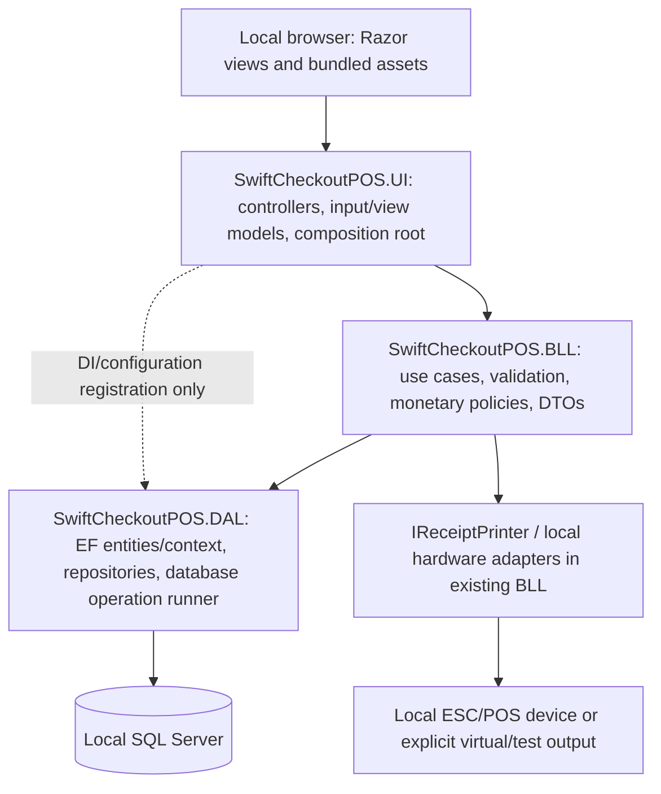

# SwiftCheckoutPOS Architecture

Status: technical direction for future implementation · 2026-10-31. **Documentation only; not a claim that these controls are implemented or tested.** The latest user authorization permits documentation changes throughout docs/ and supersedes the earlier audit-only output restriction. The existing [PROJECT_AUDIT.md](C:/source/repos/SwiftCheckoutPOS/docs/PROJECT_AUDIT.md) remains the evidence/issue register.

## 1. Verified baseline and decision boundary

Subsequent implementation: the owner authorized reconstruction of the lost checkout service. [CHECKOUT_RESTORATION.md](C:/source/repos/SwiftCheckoutPOS/docs/CHECKOUT_RESTORATION.md) records the incremental implementation and test limits. The verified baseline table and documentation-step command log below remain historical; they are not a claim that CheckoutService is still missing. The full durable-draft/operation-registry/deployment target is not yet implemented.

| Observed fact | Evidence |
| --- | --- |
| **VERIFIED** · Existing MVC solution is SwiftCheckoutPOS.slnx, not a .sln | [SwiftCheckoutPOS.slnx:1–5](C:/source/repos/SwiftCheckoutPOS/SwiftCheckoutPOS.slnx:1): three project entries. Do not create a parallel solution or rename it. |
| **VERIFIED** · All three projects target net10.0 | [SwiftCheckoutPOS.UI/SwiftCheckoutPOS.UI.csproj:1–7](C:/source/repos/SwiftCheckoutPOS/SwiftCheckoutPOS.UI/SwiftCheckoutPOS.UI.csproj:1); BLL/DAL csproj line 4. Selected SDK rechecked: **10.0.403**; no global.json in workspace/checked ancestors. |
| **VERIFIED** · EF SQL Server provider/tooling is 10.0.9; System.IO.Ports is 10.0.9 | [DAL csproj:10–17](C:/source/repos/SwiftCheckoutPOS/SwiftCheckoutPOS.DAL/SwiftCheckoutPOS.DAL.csproj:10), [BLL csproj:9–15](C:/source/repos/SwiftCheckoutPOS/SwiftCheckoutPOS.BLL/SwiftCheckoutPOS.BLL.csproj:9). No package changed. |
| **VERIFIED** · References are UI → BLL/DAL and BLL → DAL | [SwiftCheckoutPOS.UI/SwiftCheckoutPOS.UI.csproj:23–25](C:/source/repos/SwiftCheckoutPOS/SwiftCheckoutPOS.UI/SwiftCheckoutPOS.UI.csproj:23); BLL csproj:14–15. DAL has no project reference. |
| **VERIFIED** · DbConn is required; base ConnectionStrings is empty | [SwiftCheckoutPOS.UI/Program.cs:11–14](C:/source/repos/SwiftCheckoutPOS/SwiftCheckoutPOS.UI/Program.cs:11), [SwiftCheckoutPOS.UI/appsettings.json:8–9](C:/source/repos/SwiftCheckoutPOS/SwiftCheckoutPOS.UI/appsettings.json:8). Development JSON has a named SQL instance, integrated Windows authentication and TrustServerCertificate=True. Host/instance/catalog **[REDACTED]**, location [SwiftCheckoutPOS.UI/appsettings.Development.json:8–10](C:/source/repos/SwiftCheckoutPOS/SwiftCheckoutPOS.UI/appsettings.Development.json:8). |
| Actual installed SQL edition/version/locality/grants/schema/data/size remain unverified | No SQL connection was made. A named-instance string is not proof of Express, local hosting or production licensing. Step 5/operator inventory must verify these before deployment/reuse/restore. |
| **CONFIRMED** · Retry enabled, but transaction boundaries are broken | [SwiftCheckoutPOS.UI/Program.cs:53–54](C:/source/repos/SwiftCheckoutPOS/SwiftCheckoutPOS.UI/Program.cs:53) EnableRetryOnFailure; SalesRepository BeginTransaction at 46/67/98/163, no strategy wrapper. PB-02/PB-03 in audit. |
| **VERIFIED** · Entities currently cross into UI | [CheckoutViewModel.cs:17–18](C:/source/repos/SwiftCheckoutPOS/SwiftCheckoutPOS.UI/Models/CheckoutViewModel.cs:17): `List<Sale>`; [TillCountSummary.cshtml:3](C:/source/repos/SwiftCheckoutPOS/SwiftCheckoutPOS.UI/Views/Report/TillCountSummary.cshtml:3): entity model. This is an explicit target correction. |
| **CONFIRMED** · Physical receipt integration is incomplete | [SwiftCheckoutPOS.UI/Program.cs:79–83](C:/source/repos/SwiftCheckoutPOS/SwiftCheckoutPOS.UI/Program.cs:79) selects VirtualPrinterService; audit AUD-22. |
| **VERIFIED (prior audit build)** · Release is blocked | Audit build: 22 warnings/2 missing-CheckoutService errors; missing session cache and migration drift. No new build/app/test/database execution here. |

**Decision:** retain ASP.NET Core MVC, C#, .NET 10, EF Core, SQL Server and three projects. Use one Windows Service, one loopback web origin and one local SQL instance. No cloud, sync, network terminals, brokers, microservices, generic framework rewrite, SQLite migration or additional Domain/Contracts project.

Baseline labels identify file/command evidence or carry forward the cited audit finding; they do not claim new runtime validation. Full issue format, paths/lines/methods/excerpts and traced execution evidence remain with the linked audit IDs. The technical decisions below are normative targets. Owner business decisions live only in [PRODUCT_REQUIREMENTS.md](C:/source/repos/SwiftCheckoutPOS/docs/PRODUCT_REQUIREMENTS.md) OPEN QUESTIONS. Do not “fix” calculations by inventing tax, refund, discount, rounding, stock or finance rules.

## 2. Responsibilities and dependency direction



| Project | Owns | Must not own |
| --- | --- | --- |
| UI | HTTP model binding/ModelState, authentication/role/antiforgery filters, controllers, UI ViewModels, Razor, local JS/CSS, safe error presentation; Program is composition root | SQL/DbContext queries in actions, entity-bound forms/views, financial policy, direct serial writes or transaction orchestration |
| BLL | Application/use-case services, business validation and authorized transitions, owner-approved calculations, immutable command/result DTOs, IReceiptPrinter contract, receipt projection/format intent; existing hardware adapter location retained | HTTP/session dependencies, repository-internal commits, browser-authoritative totals, raw SQL or user-facing exception text |
| DAL | Entities/mappings/migrations, narrow query/write repositories, SQL projections, atomic operation/retry executor, operation-result persistence, native backup SQL | UI/ViewModel/BLL DTO references, discount/tax/refund policy, committing half of a use case, hardware calls |

Retain **BLL → DAL**. A small app already shares DAL entities internally with services; moving everything to a new abstraction project would add churn without repairing money/data defects. Introduce **narrow DAL-owned interfaces** only for genuine test seams and transaction coordination (for example repository operations used by InventoryService and an IDatabaseOperationRunner). Concrete repositories implement them in DAL; BLL can fake those contracts in unit tests. This improves isolated validation tests and removes scattered SaveChanges, but **does not claim complete dependency inversion**: BLL still references DAL contracts/entities. DAL must never reference BLL to implement a BLL interface, which would create a cycle. Keep unrelated concrete services/repositories until a concrete need appears.

Repositories retrieve/mutate data within an explicitly supplied context; **write repository methods do not call SaveChanges or BeginTransaction**. The operation runner alone owns persistence. Read repositories use bounded projections, predicates and SQL aggregation where appropriate; do not expose IQueryable to controllers or materialize lifetime graphs for KPI cards. No generic repository, mediator, event bus or distributed unit of work.

## 3. DTO, entity and validation boundaries

- DAL entities stay in DAL/BLL internals. Every BLL method consumed by UI returns a BLL DTO/result; Razor uses UI ViewModels composed of primitives/BLL DTOs, never DAL entities or navigations.
- Replace held-order List<Sale> with HeldOrderDTO and entity-bound till summary with ReconciliationDTO/ViewModel. Do not merely wrap an entity inside a DTO.
- Input models contain only editable fields, required operation/draft identity and original row version. Actor identity comes from validated claims/current account, not a posted field. Do not bind an entity or trust posted current stock/cost/total.
- UI rejects binding/ModelState errors before invoking BLL, including primitive decimal/date conversion errors. BLL always enforces required fields, supported enum/type values, normalized reserved categories, lengths/scale/range and owner-approved rules. Normalize **before** comparing allowlists; never convert an unknown money direction to Outflow.
- Authoritative stock/status/price/customer validation happens again **inside** the transaction against fresh rows. An early UI check is advisory.
- One BLL decimal-based calculation implementation defines approved line/discount/tax/totals and reporting semantics. Browser calculations and formats are previews. Existing SQL scale is not an approved rounding policy; preserve fractions until the owner resolves precision rules.
- DAL/SQL enforce structural keys, FKs, uniqueness, scale and justified checks. Do not add a no-negative-stock constraint until the stock policy is approved. Validate values against the **stored** precision after the approved rounding step.
- Use original RowVersion for stale forms/drafts and meaningful conflict results. Product metadata changes must not silently replace stock; permitted stock corrections are explicit attributable adjustment commands with owner-approved financial effects.
- All cart selection/state changes, including loyalty association, use token-protected POSTs. Server roles protect every route independently of menus. Recheck active account/security version for stale-cookie revocation; preserve local PBKDF2/cookie authentication.

## 4. DI and lifetime conventions

| Dependency | Target lifetime / rule |
| --- | --- |
| BLL services, repositories/read context, database operation runner, hardware adapter facade | Scoped. Constructors only assign dependencies/validate immutable arguments; no SQL, directory creation, port open or other I/O. |
| ApplicationDbContext | Scoped for ordinary reads; **fresh per retry attempt** for writes. Never shared across requests/threads or captured by a singleton. |
| Context factory | Scoped factory with the same centrally registered SQL options (including EnableRetryOnFailure). This avoids a singleton factory consuming scoped options; confirm registrations in DI tests. |
| AutoBackupWorker | Hosted singleton using IServiceScopeFactory/CreateAsyncScope for each iteration/attempt; resolves scoped backup/settings services inside scope and disposes them. |
| TimeProvider / immutable validated machine options / local backup coordinator | Singleton where thread-safe; no scoped repositories/context captured. One local host and one serialized backup attempt. |
| IReceiptPrinter | Scoped adapter; local shared device-access gate may be singleton without scoped dependencies. Actual hardware mode explicit, not silently changed to virtual. |
| ILogger<T> | Framework-injected; application code never depends on a particular logging sink. |

Use constructor injection and explicit composition-root registration. Async SQL/file/device APIs where useful; await operations, pass cancellation safely, and do not use Task.Run/fire-and-forget to hide financial writes. After an uncertain commit, cancellation is not proof of rollback.

## 5. Transaction, retry, idempotency and concurrency contract

**Retain EnableRetryOnFailure.** BLL defines the complete business operation; DAL executes it with EF’s execution strategy. This corrects the existing four manual-transaction sites and separate stock/ledger saves without changing architecture.

The database operation runner's required algorithm (design, not executable implementation):

1. Receive an immutable normalized command, stable server-issued OperationId, actor ID, draft/original version and non-sensitive request fingerprint. Preserve that identity across HTTP retries, double-clicks and reconnection.
2. Obtain Database.CreateExecutionStrategy from a factory-created configured context. Call its ExecuteAsync/Execute around the **entire** database unit.
3. For **every attempt**, create a fresh context and repositories/data-session bound to it. Start the explicit transaction **inside the delegate**; load/revalidate all rows and account permissions there. Do not reuse a mutated graph from the request/previous attempt.
4. Look up the durable operation result. Same ID/type/actor/fingerprint already committed: return its stored outcome. Same ID with different input: conflict, save nothing. A unique OperationId row is committed with the business rows.
5. Calculate approved values server-side and stage all sale/items/tender facts, stock movements, required ledger/customer/refund/audit facts and draft transition in the same context. Repositories only stage changes.
6. Runner saves once where feasible; additional flushes for generated IDs remain inside the **same transaction**. Commit only after every required effect is staged/saved. Read the post-save identifiers before producing the result.
7. On transient failure, strategy may replay the entire unit with fresh state. On lost commit acknowledgement, verify durable operation outcome with a fresh connection/context; operation uniqueness and reconciliation of an operation-key collision prevent double effects. An unrelated unique/FK failure is not “already succeeded.”
8. If outcome cannot be determined, return **OutcomeUnknown/Pending** with OperationId and a local outcome-lookup/recovery path. Do not tell staff to create a new sale or silently retry with a new ID.
9. After committed outcome is established, printing/drawer, optional diagnostics and other filesystem side effects occur **outside** the transaction/retry delegate. Their failure cannot undo or repeat a saved sale.

A durable operation row/result is needed for sale/refund/restock/return/adjustment/held transitions where replay changes money/stock. A unique completion link per durable draft prevents two distinct OperationIds from completing the same draft; the original draft version/status is checked in the transaction. A receipt unique index remains required but is not request idempotency. The operation registry is a small local SQL table, not a queue/outbox/event-sourcing system. Store only necessary IDs/fingerprint/outcome, not raw requests or secrets.

Default isolation: SQL Server READ COMMITTED plus row versions and unique constraints; handle optimistic conflicts as explicit review/reload, not automatic overwrite. Use a narrow serializable guard for concurrent last-active-admin changes (small Users table) so two requests cannot remove the last Admin. Never globally serialize every read.

The database unit includes human actor/audit facts; those are business records. A failing **diagnostic log sink** or printer after commit is different and must not cause a financial retry. [EF execution strategies/commit uncertainty](https://learn.microsoft.com/en-us/ef/core/miscellaneous/connection-resiliency), [EF transaction behavior](https://learn.microsoft.com/en-us/ef/core/saving/transactions).

## 6. Durable checkout and immutable business records

SQL is the durable source of truth. Session becomes a local projection/navigation aid, using an in-process IDistributedCache implementation for the one host; it is never the sole copy of a held/resumed order or completed financial record.

Add a small durable **CheckoutOrder/CheckoutOrderLine** aggregate for active/held work, with identity/version/actor linkage and a link to the completed sale. Save cart mutations and lifecycle transitions there. Resuming changes durable state and reconstructs session; it does not delete the only SQL copy. Completion links the order and immutable sale facts in the same unit. The owner still decides reservation/cancellation/transfer/expiry rules—durability does not decide when stock moves.

Existing held Sales rows must be inventoried and migrated with preserved original IDs/receipt references and explicit links; do not delete them or silently assign new historical receipt semantics. The legacy-to-target mapping is reviewed after the receipt/held-policy answers, before a migration is approved.

Completed sale/items/tender facts, sale-time cost, stock-movement history, ledger and refund occurrences are attributable and preserved. Corrections/reversals use linked authorized records rather than overwriting original date/amount/actor. No cash/card processing API is implied by a PaymentMethod label. Financial policy and representation of reversal entries remain owner decisions.

## 7. Local SQL Server direction

**Recommendation for a new shop PC: serviced SQL Server 2022 Express as a normal Windows service.** It meets the stated 10 GB baseline, is production-usable without paid engine licensing, matches this conventional relational workload and runs independently of interactive Windows login. Capacity/OS/support/licensing checks are installation gates, not assumptions about the currently configured named instance. Do not replace a compatible, licensed, already local instance merely for uniformity.

| Option | Evaluation / decision |
| --- | --- |
| SQL Server 2022 Express | Recommended new-install baseline; free production edition, 10 GB per relational database, no SQL Server Agent. AutoBackupWorker stays in the app host. Monitor growth/disk headroom; never purge business history to fit the cap. |
| SQL Server 2025 Express | Also free for production, but **50 GB**, not 10 GB. No Agent. A compatible existing 2025 Express can remain; a new-baseline change requires recorded qualification of Windows/provider/restore compatibility, not an automatic upgrade. |
| Express LocalDB | User-mode, demand-started, developer-oriented instance. Use matching local test/development engine; not the default shop host because service identity/boot operation and backup permissions are clearer with the normal SQL service. This is an operational choice, not a claim LocalDB is forbidden for production. |
| Existing local instance | Reuse if supported, properly licensed, local-only, sufficient capacity, correct schema/backup/permissions and qualified with the app. Confirm actual edition, version, compatibility level and location first; credentials stay outside repo. |
| Developer / Evaluation | **Developer is not licensed for production.** Evaluation is time-limited and not the production baseline. Do not run shop sales on a development license. |

The brief's “10 GB Express” description applies to 2022; it is not a version-independent limit. [Microsoft 2022 edition limits/Agent](https://learn.microsoft.com/en-us/sql/sql-server/editions-and-components-of-sql-server-2022/), [2025 limits/Agent](https://learn.microsoft.com/sql/sql-server/editions-and-components-of-sql-server-latest), [Express production use](https://www.microsoft.com/en-us/sql-server/sql-server-downloads), [licensing editions](https://www.microsoft.com/licensing/guidance/SQL), [LocalDB](https://learn.microsoft.com/en-us/sql/database-engine/configure-windows/sql-server-express-localdb).

Deployment requirements: supported Windows x64/platform combination and current servicing; offline installation media; SQL service automatic startup; dedicated least-privilege app Windows identity with integrated SQL authentication; local-only SQL connectivity (shared memory where qualified, otherwise strictly local binding); no remote database/browser-discovery dependency; approved data/log paths outside replaceable app files; free space for data, logs and recovery media. Actual Windows/SQL compatibility must pass [SQL 2022 requirements](https://learn.microsoft.com/en-us/sql/sql-server/install/hardware-and-software-requirements-for-installing-sql-server-2022). EF's provider supports SQL Server 2019 onward; check both engine and database compatibility level, not .NET version alone. [Provider compatibility](https://learn.microsoft.com/en-us/ef/core/providers/sql-server/).

For new installations propose SIMPLE recovery with verified full backups **only if** the owner accepts recovery to the last such backup. A stricter RPO requires a reviewed FULL/log-backup chain before production. Existing recovery model/chains must be preserved until assessed; full backups alone do not manage a FULL-mode log chain. No model is changed here. Canonical operations are exclusively in [DATA_RECOVERY_PLAN.md](C:/source/repos/SwiftCheckoutPOS/docs/DATA_RECOVERY_PLAN.md).

## 8. Initialization, schema integrity, migrations and upgrades

New PC provisioning and existing upgrades are **operator-controlled maintenance**, never ordinary startup. Generate explicit from/to EF migration SQL from the reviewed migrations, inspect it for drop/rebuild/cascade/precision/data conversion, qualify it on a synthetic prior-version test database, then apply only to the independently verified target. Do not run EnsureCreated, automatic Migrate or a migration bundle implicitly when opening the POS.

For any existing database, take/verify the pre-change recovery set **first**; follow [DATA_RECOVERY_PLAN.md](C:/source/repos/SwiftCheckoutPOS/docs/DATA_RECOVERY_PLAN.md) for the sole procedure. Fresh empty catalogs have no prior business state but still require guarded target selection, reviewed baseline SQL and controlled first-Admin provisioning. Do not solve audit AUD-03 by guessing migration history, stamping rows “applied,” recreating the database or inferring historical CostAtSale from current prices. [Reviewed production migration scripts](https://learn.microsoft.com/en-us/ef/core/managing-schemas/migrations/applying).

Required structure:

- Stable PKs; enforced FKs for sale/items/products/actors/refund links/movements/operations; unique barcode, receipt and OperationId as appropriate.
- Restrict deletes/cascades on financial records and referenced master data; use deactivation and linked corrections. Reconcile initial Vendor cascade versus current Restrict explicitly.
- Preserve existing decimal(18,2) amounts and decimal(5,2) tax **as current schema evidence**, not a new rounding rule. Any owner-required scale change needs reviewed conversion and proof no silent truncation.
- Capture immutable completion cost and event timestamps/actor IDs. Use UTC for new technical audit timestamps; owner business-day zone/filter definitions remain pending. Never reinterpret existing local timestamps without a mapping.
- Product/Sale/Draft/settings or other mutable-record RowVersion where it prevents stale edits; original tokens cross request boundaries. Existing missing RowVersion/CostAtSale/ledger/settings migrations are release blockers.
- Checks/status/type allowlists consistent with approved rules; do not encode unknown oversell/refund policy as a guessed SQL CHECK.
- Keep modeled barcode/receipt indexes; qualify sale date/status, ledger date and other indexes against actual deployment/plans. Bounded SQL summaries/paging preserve all history.
- Durable commit defaults: delayed durability off; no AUTO_SHRINK or destructive startup repair, no automatic database replacement. Storage must honor write flushes; backup media/UPS planning addresses hardware/power failures beyond SQL's guarantees.

## 9. Shop configuration, hosting and keys

Production is one ASP.NET Core MVC **Windows Service** (SwiftCheckoutPOS), automatic delayed start with local service recovery, under a dedicated non-interactive least-privilege local Windows account. SQL service also starts automatically; app readiness performs bounded read-only connectivity/schema-version checks and reports maintenance/unavailable state, never seeds/recreates/upgrades a database. The browser shortcut opens **https://localhost:7089**; no remote access. [Microsoft Windows Service hosting](https://learn.microsoft.com/en-us/aspnet/core/host-and-deploy/windows-service?view=aspnetcore-10.0).

Package the existing UI as a **self-contained Windows x64 folder publish**, initially without trimming or single-file publishing. Ship the qualified runtime/native dependencies and bundled frontend assets; the shop needs no SDK or internet restore. Supply offline SQL/driver prerequisites and service/certificate provisioning through the installer. Runtime security servicing requires a tested republish; preserve ProgramData/SQL across release replacement. Actual hardware/OS qualification remains a release gate.

Production Kestrel listens on IPv4/IPv6 loopback only, HTTPS only. Validate effective endpoints and reject wildcard/LAN configuration/overrides; AllowedHosts is not a binding control. Provision a trusted machine-local localhost certificate offline, grant private-key read only to the service identity, and provide offline renewal/replacement. Do not use a developer certificate/profile as the shop installation contract.

Proposed paths (not created; actual drive/ACLs validated by installer):

| Location | Contents / writer |
| --- | --- |
| Protected install/release folder under Program Files | Application binaries/assets, read-only to service/staff; installer writes |
| C:/ProgramData/SwiftCheckoutPOS/Config/machine.json | Required DbConn, data roots, certificate reference, hardware mode/port/baud and log policy; local administrator writes, service reads; **no committed real connection string** |
| Local SQL SystemSettings | Authorized non-secret runtime preferences (backup enabled/time/validated target, held retention and approved shop settings), versioned/audited; not credentials or unrestricted host endpoints |
| C:/ProgramData/SwiftCheckoutPOS/Data/Images | Safe generated local media IDs and validated images; service writes with staged replacement |
| C:/ProgramData/SwiftCheckoutPOS/Data/Keys | Stable Data Protection ring, service/admin ACL only; DPAPI machine protection plus strict ACL; stable application name SwiftCheckoutPOS.Local |
| C:/ProgramData/SwiftCheckoutPOS/Logs | Rotated redacted diagnostics; service writes, authorized maintenance reads |
| C:/ProgramData/SwiftCheckoutPOS/Backups | Default local backup/recovery metadata; SQL engine/service and app receive only required rights. Separate local/removable verified copy per owner recovery requirement |

External machine.json is **not loaded by current code**. Target precedence is base defaults → required protected machine file → explicitly authorized deployment overrides; arbitrary environment/CLI overrides of DB/paths/endpoints are rejected in Production. Development may use User Secrets/environment values, never production credentials; test configuration is isolated as below. Missing/invalid machine configuration fails clearly; no fallback to a developer/shop/test catalog or silent disabled backup defaults. Validate/canonicalize local roots and approved removable targets; no UNC/cloud/shared database destinations.

Keep backup attempt/checkpoint manifests in protected local files outside the database being restored; SQL stores schedule preferences, not the sole evidence of recovery sets. Pair native SQL and non-SQL recovery files during a bounded maintenance pause so their references agree; scheduling/catch-up/verification/retention are defined only in the canonical recovery plan.

Move executable-relative backup_config.json settings into the canonical versioned SystemSettings through a reviewed preservation step; keep its old contents privately for recovery until validated. Hardware/deployment policy stays administrator-controlled. Sensitive configuration is not displayed in logs/HTML.

Auth/session use secure HttpOnly/SameSite cookies with explicit owner-approved expiry/shift rules; stale accounts are revalidated. Persisting keys and application identity permits still-valid login tickets across reboots/in-place upgrades. DPAPI LocalMachine protection requires restricted ACL because other machine users with the file can decrypt; fresh Windows recovery may require new keys/certificate and re-login, not restoration of old browser tickets. SQL business records/password hashes do not depend on cookie keys. [Data Protection storage/isolation](https://learn.microsoft.com/en-us/aspnet/core/security/data-protection/configuration/overview?view=aspnetcore-10.0), [DPAPI scope/at-rest protection](https://learn.microsoft.com/en-us/aspnet/core/security/data-protection/implementation/key-encryption-at-rest?view=aspnetcore-10.0).

## 10. Exceptions, local logs and audit

BLL returns explicit validation/conflict/not-authorized/already-committed/outcome-unknown results. Unexpected failures carry a correlation/operation ID into a central UI exception handler and safe local diagnostics. UI shows a useful bounded message and recovery action; no ex.Message/stack/SQL/connection string disclosure. Use 400/422 for binding/validation, 409 for stale/replay conflict, 401/403 for access and a safe unavailable response for infrastructure faults; a committed sale response retains saved SaleId/outcome even if printing fails. Production never exposes a developer exception page.

Keep ILogger<T>. **Select one local rolling file implementation: Serilog.Extensions.Hosting plus Serilog.Sinks.File**, with compatible reviewed/pinned releases selected in the implementation task. They are not installed now; do not create a custom logging framework or remote collector. Target daily rolling plus 10 MiB size rolling, 30 retained files (files, not “30 days”), rollOnFileSizeLimit enabled, bounded event size, no unbounded async queue. This limits diagnostic growth to approximately 300 MiB plus current/event overhead; test full-disk/denied-write behavior. Windows Event Log is local startup/fatal fallback, provisioned by installer. These are engineering defaults, not business-record retention. [Host integration](https://github.com/serilog/serilog-extensions-hosting), [file rolling/retention](https://github.com/serilog/serilog-sinks-file).

Log structured operation/correlation/resource IDs, event type, outcome, duration, sanitized error type/code and component. Do not log passwords, hash/salt, cookies/tokens, SQL/parameters, connection strings, full request/cart bodies, receipt contents, customer/employee personal details or unredacted exception text. Prefer path aliases to sensitive paths. Redact before writing; limit diagnostics access. Diagnostic failure must not roll back/repeat an established financial outcome.

Required actor/reason/stock/refund/financial change history is durable SQL business audit committed atomically with its operation, independent of file-log rotation. No automatic deletion of business/audit records is authorized by diagnostic retention.

## 11. Hardware and fully offline operation

Keep IReceiptPrinter, extend its contract to consume a receipt DTO projected from a **committed sale** and return explicit Printed/Failed/Unknown outcome; “port opened” is not delivery confirmation. Complete one compatible local physical adapter first (existing serial/USB virtual-COM ESC/POS driver when the actual device matches); a Windows-driver adapter only if the selected hardware requires it. Do not silently claim virtual mode is real hardware.

Port/baud/protocol/code page/timeouts are validated machine settings; no constructor I/O. Health and reconnect are bounded and explicit. Serial barcode readers need an adapter only if actually required; keyboard-wedge/manual input stays supported. Print/reprint and drawer actuation require authorized token-protected commands linked to saved sale and owner tender policy; ambiguous hardware delivery is operator-reviewed, not blindly replayed.

| Offline component | Required local behavior |
| --- | --- |
| Hosting/startup | Windows Service + loopback Kestrel; browser uses local shortcut; no internet boot/identity dependency |
| Frontend | Bundled local JS/CSS/fonts/icons/images; no CDN/fetch fallback; fix local jQuery dependency order |
| Database | Local SQL Windows service, integrated local identity, no network DB/sync |
| Configuration | Protected machine file + SQL settings; validation and version preservation, no remote config/license check |
| Hardware | Local USB/serial/Windows driver; no cloud print or mandatory online device service |
| Authentication | Local users/PBKDF2/cookies and local key ring; controlled offline first-Admin/recovery, no shared default password |
| Logging | Protected local rolling files/Event Log, no telemetry requirement |
| Backups | Local native SQL backup/verification and approved removable copy; AutoBackupWorker, no Agent/cloud |
| Crash/power loss | SQL recovery + durable draft/operation outcome lookup; never rebuild/reseed/re-finalize automatically; canonical [DATA_RECOVERY_PLAN.md](C:/source/repos/SwiftCheckoutPOS/docs/DATA_RECOVERY_PLAN.md) |

## 12. Test strategy and isolation contract

Future project locations: **Tests/SwiftCheckoutPOS.Tests.Unit** and **Tests/SwiftCheckoutPOS.Tests.Integration**, both net10.0, both added to **existing SwiftCheckoutPOS.slnx**. “Added to the .sln” means this actual solution; no duplicate .sln. No test project/solution edit is performed in this documentation task.

Unit tests cover pure approved calculations, DTO/state/validation/hash/policy logic with narrow DAL fakes; they never open SQL/dev configuration. Integration tests use actual EF SQL Server provider on dedicated **SwiftCheckoutPOS_Test**, preferably SQL Server 2022 LocalDB for the new baseline; production-identity acceptance uses an equally isolated Express test installation. No EF InMemory/SQLite substitute for SQL transaction/rowversion/backup behavior.

Test lifecycle:

1. Explicit test-only connection input (SWIFTCHECKOUTPOS_TEST_CONNECTION), Testing environment before host construction. Remove shop/developer configuration providers; no fallback to UI DbConn, User Secrets or inherited production settings.
2. Parse/allowlist exact local server/instance and exact catalog **SwiftCheckoutPOS_Test** before opening any connection. Using a name suffix or Testing environment alone is insufficient.
3. Guard the maintenance connection to master on that approved test instance. Create the test catalog only if absent; create fixture-owned marker/manifest and fixed test data/log roots. If an existing catalog is unmarked or identity/path differs, **stop without modifying it**.
4. Apply the reviewed baseline/migration SQL through the harness only, then synthetic fixtures and generated test credentials. No business DB clones/real customer data/secrets. Test app login has only test-catalog rights; provisioning identity is separate.
5. Reset by stopping the test host, disposing contexts/connections/pools, rechecking exact target/marker/file roots, then dropping/recreating **only that marked test catalog** and applying reviewed SQL/fixtures. Never call EnsureDeleted on an unchecked context. Destructive fixture groups run sequentially; races use multiple contexts inside one controlled test.
6. Backups/restores/files/device fakes use fixture-only roots and the same target guards; no shop media, keys, certificates, backups or real printer/drawer during automated tests. Physical-device acceptance requires the isolated test setup/operator.
7. Refuse invalid/empty/production/mismatched configuration before any database write; keep test keys/application identity isolated from shop cookies. Test cleanup cannot delete arbitrary paths/reparse targets.

Minimum suite follows audit T-01–T-21: money precision, historical cost, sales/stock/ledger atomicity and retries/unknown commit, duplicate requests/two tabs, stale edits, hold/resume/crash, full refund/repeat/concurrency, finance/date/till identity, authentication/revocation/roles/tokens, upload/path/error handling, backup/restore, scheduler/reboot, offline/device failures and upgrades. Business expected values wait for owner answers. [OFFLINE_ACCEPTANCE_TESTS.md](C:/source/repos/SwiftCheckoutPOS/docs/OFFLINE_ACCEPTANCE_TESTS.md) contains cases only; execution/evidence happens in **Step 5**, not here.

## 13. Documentation ownership and release gates

[PRODUCT_REQUIREMENTS.md](C:/source/repos/SwiftCheckoutPOS/docs/PRODUCT_REQUIREMENTS.md) owns features/current behavior/open policy questions. [DEVELOPMENT_ROADMAP.md](C:/source/repos/SwiftCheckoutPOS/docs/DEVELOPMENT_ROADMAP.md) owns task IDs and audit/test traceability. [OFFLINE_ACCEPTANCE_TESTS.md](C:/source/repos/SwiftCheckoutPOS/docs/OFFLINE_ACCEPTANCE_TESTS.md) owns Step 5 cases. **[DATA_RECOVERY_PLAN.md](C:/source/repos/SwiftCheckoutPOS/docs/DATA_RECOVERY_PLAN.md) is the sole recovery runbook**; other documents reference it rather than maintaining alternative restore procedures. The audit remains historical evidence, not a second normative recovery plan.

No release until build/session/schema blockers, atomic financial writes/retry/idempotency, precision/history/security/audit defects and physical/recovery/offline gates are resolved; required owner policy examples are approved and tests pass. This document does not authorize source/package/schema/configuration changes or claim any gate passed.


## 14. Documentation-step verification log and limits

Exact shell commands run while preparing these documents follow. These are reads/SDK metadata only; no new build, package installation/upgrade, application launch, SQL connection, migration, restore or test execution occurred. Prior audit build/package outputs remain attributed to that audit. File authoring is restricted to the five requested docs/ Markdown files.

### D-CMD-01

```powershell
$auditInstructionPaths=@('C:/source/repos/AGENTS.md','C:/source/repos/SwiftCheckoutPOS/AGENTS.md'); foreach($auditInstructionPath in $auditInstructionPaths){ if(Test-Path -LiteralPath $auditInstructionPath -PathType Leaf){ Write-Output "FILE: $auditInstructionPath"; Get-Content -LiteralPath $auditInstructionPath -Raw } }; Get-ChildItem -LiteralPath docs -Force | Select-Object Name,Length | ConvertTo-Json
```

Exit 0. Parent C:/source/repos/AGENTS.md read; repository AGENTS.md absent. docs inventory contained PROJECT_AUDIT.md. Instruction text decoded by PowerShell; latest user documentation scope controls this task.

### D-CMD-02

```powershell
Get-Content -LiteralPath docs/PROJECT_AUDIT.md -Raw
```

Exit 0. Read the complete existing audit (526,085 normalized characters); retained historical findings/labels, not re-executed.

### D-CMD-03

```powershell
$auditFiles=@('SwiftCheckoutPOS.slnx','SwiftCheckoutPOS.UI/SwiftCheckoutPOS.UI.csproj','SwiftCheckoutPOS.BLL/SwiftCheckoutPOS.BLL.csproj','SwiftCheckoutPOS.DAL/SwiftCheckoutPOS.DAL.csproj','SwiftCheckoutPOS.UI/Program.cs'); foreach($auditFile in $auditFiles){ Write-Output "FILE: $auditFile"; $auditAt=0; Get-Content -LiteralPath $auditFile | ForEach-Object { $auditAt++; $auditText=$_; if($auditText -match '(?i)(UserSecretsId|password|secret|token)' -and $auditFile -like '*.csproj'){$auditText='[REDACTED] (metadata location only)'}; '{0,4}: {1}' -f $auditAt,$auditText } }; $auditJson=Get-Content -LiteralPath SwiftCheckoutPOS.UI/appsettings.Development.json -Raw | ConvertFrom-Json; $auditConn=[System.Data.Common.DbConnectionStringBuilder]::new(); $auditConn.set_ConnectionString([string]$auditJson.ConnectionStrings.DbConn); $auditShape=foreach($auditKey in $auditConn.get_Keys()){ $auditValue=[string]$auditConn[$auditKey]; $auditShown='[REDACTED]'; if($auditKey -match '^(Server|Data Source)$'){ $auditShown=if($auditValue -match '^\(localdb\)\\'){'LocalDB: [REDACTED]'}elseif($auditValue -match '\\SQLEXPRESS(?:,\d+)?$'){'Named instance with Express naming convention: [REDACTED]; edition unverified'}elseif($auditValue -match '\\'){'Named SQL Server instance: [REDACTED]; locality/edition unverified'}else{'SQL Server host/default instance: [REDACTED]; locality/edition unverified'} } elseif($auditKey -match '^(Integrated Security|Trusted_Connection|Encrypt|TrustServerCertificate|MultipleActiveResultSets)$'){ $auditShown=$auditValue }; [pscustomobject]@{Key=$auditKey;Shape=$auditShown} }; $auditShape | ConvertTo-Json; $auditBase=Get-Content -LiteralPath SwiftCheckoutPOS.UI/appsettings.json -Raw | ConvertFrom-Json; [pscustomobject]@{BaseConnectionKeyCount=@($auditBase.ConnectionStrings.PSObject.Properties).Count;ProductionJsonPresent=(Test-Path -LiteralPath SwiftCheckoutPOS.UI/appsettings.Production.json);GlobalJsonPresent=(Test-Path -LiteralPath global.json)} | ConvertTo-Json
```

Exit 0. Read actual .slnx/projects/Program with line numbers. Required DbConn; empty base ConnectionStrings; named development SQL instance/integrated auth/TrustServerCertificate shape only. Values redacted; no database connection.

### D-CMD-04

```powershell
$auditFiles=@('SwiftCheckoutPOS.UI/Models/CheckoutViewModel.cs','SwiftCheckoutPOS.UI/Views/Report/TillCountSummary.cshtml','SwiftCheckoutPOS.BLL/Interfaces/IReceiptPrinter.cs','SwiftCheckoutPOS.DAL/Entities/LedgerEntry.cs','SwiftCheckoutPOS.DAL/Entities/SystemSetting.cs'); foreach($auditFile in $auditFiles){ Write-Output "FILE: $auditFile"; $auditAt=0; Get-Content -LiteralPath $auditFile | ForEach-Object { $auditAt++; '{0,4}: {1}' -f $auditAt,$_ } }; rg -n 'BeginTransaction|CreateExecutionStrategy|SaveChanges|CostAtSale|IsRowVersion|HasIndex|HasColumnType|DeleteBehavior|Migrate\(|EnsureCreated' SwiftCheckoutPOS.DAL/Context/ApplicationDbContext.cs SwiftCheckoutPOS.DAL/Repositories/SalesRepository.cs SwiftCheckoutPOS.DAL/Repositories/InventoryRepository.cs SwiftCheckoutPOS.DAL/Repositories/FinanceRepository.cs SwiftCheckoutPOS.UI/Program.cs
```

Exit 0. Read entity/view/interface boundaries and context/repository transaction/mapping sites. Four SalesRepository BeginTransaction calls; no CreateExecutionStrategy match in those inspected paths; separate SaveChanges sites observed. No mutations.

### D-CMD-05

```powershell
dotnet --version; $auditGlobals=@('C:/global.json','C:/source/global.json','C:/source/repos/global.json','C:/source/repos/SwiftCheckoutPOS/global.json'); foreach($auditGlobal in $auditGlobals){ [pscustomobject]@{Path=$auditGlobal;Present=(Test-Path -LiteralPath $auditGlobal -PathType Leaf)} } | ConvertTo-Json; rg --files --hidden --no-ignore -g AGENTS.md -g '*.sln' -g '*.slnx' -g '*.csproj' -g '!**/bin/**' -g '!**/obj/**' -g '!**/.vs/**'
```

Exit 1 before command execution: PowerShell parser rejected a pipe directly after foreach (empty pipe element). No dotnet/file inventory action from this malformed command; corrected next.

### D-CMD-06

```powershell
dotnet --version; $auditGlobals=@('C:/global.json','C:/source/global.json','C:/source/repos/global.json','C:/source/repos/SwiftCheckoutPOS/global.json'); $auditGlobalRows=foreach($auditGlobal in $auditGlobals){ [pscustomobject]@{Path=$auditGlobal;Present=(Test-Path -LiteralPath $auditGlobal -PathType Leaf)} }; $auditGlobalRows | ConvertTo-Json; rg --files --hidden --no-ignore -g AGENTS.md -g '*.sln' -g '*.slnx' -g '*.csproj' -g '!**/bin/**' -g '!**/obj/**' -g '!**/.vs/**'
```

Exit 0. dotnet --version returned 10.0.403. No global.json in checked ancestor/workspace paths. File inventory found three csproj and SwiftCheckoutPOS.slnx; no existing test projects/.sln or repository AGENTS.md.

Primary technical sources are linked beside the decisions they support. Microsoft/Serilog documentation was consulted for version-dependent edition limits/licensing, provider compatibility, SQL recovery/backup/restore restrictions, EF retries/migrations, Windows Service hosting, Data Protection and local file logging. Web lookups are research, not connectivity evidence for the shop PC. No unretrieved package advisory/patch version is invented.

Areas not newly inspected: actual installed SQL/Windows/service/license/permissions/database schema or business rows; hardware devices; production certificate/key ring/configuration; file ACLs/disk capacity; publish/installer output; NuGet advisory refresh/build/runtime tests. The earlier audit owns its full inspected/not-inspected inventory. All current readiness/capacity/RPO/RTO claims require later evidence.

### D-CMD-07 — Pre-authoring scope inventory

```powershell
$directionDocs=@('docs/PRODUCT_REQUIREMENTS.md','docs/ARCHITECTURE.md','docs/DEVELOPMENT_ROADMAP.md','docs/OFFLINE_ACCEPTANCE_TESTS.md','docs/DATA_RECOVERY_PLAN.md'); $directionDocRows=foreach($directionDoc in $directionDocs){ [pscustomobject]@{Path=$directionDoc;Exists=(Test-Path -LiteralPath $directionDoc -PathType Leaf)} }; $directionDocRows | ConvertTo-Json; $directionFiles=rg --files --hidden -g '!docs/**' -g '!.git/**' -g '!**/bin/**' -g '!**/obj/**' -g '!**/.vs/**'; $directionHashes=foreach($directionFile in $directionFiles){ $directionHash=Get-FileHash -LiteralPath $directionFile -Algorithm SHA256; '{0}|{1}' -f $directionFile,$directionHash.Hash }; $directionHashBytes=[Text.Encoding]::UTF8.GetBytes(($directionHashes -join "`n")); $directionDigest=[Security.Cryptography.SHA256]::Create(); [pscustomobject]@{NonDocFileCount=@($directionFiles).Count;NonDocDigest=([BitConverter]::ToString($directionDigest.ComputeHash($directionHashBytes))).Replace('-','');AuditSHA256=(Get-FileHash -LiteralPath docs/PROJECT_AUDIT.md -Algorithm SHA256).Hash} | ConvertTo-Json
```

Exit 0. Five requested document paths did not exist. 193 non-doc files fingerprinted, excluding git/build/editor output; existing audit fingerprint retained. No secret values were output. This is a documentation-scope check, not an application test.

### D-CMD-08 — Stable-order comparison baseline

```powershell
$directionDocs=@('docs/PRODUCT_REQUIREMENTS.md','docs/ARCHITECTURE.md','docs/DEVELOPMENT_ROADMAP.md','docs/OFFLINE_ACCEPTANCE_TESTS.md','docs/DATA_RECOVERY_PLAN.md'); $directionDocRows=foreach($directionDoc in $directionDocs){ [pscustomobject]@{Path=$directionDoc;Exists=(Test-Path -LiteralPath $directionDoc -PathType Leaf)} }; $directionDocRows | ConvertTo-Json; $directionFiles=rg --files --hidden -g '!docs/**' -g '!.git/**' -g '!**/bin/**' -g '!**/obj/**' -g '!**/.vs/**'; $directionHashes=foreach($directionFile in $directionFiles){ $directionHash=Get-FileHash -LiteralPath $directionFile -Algorithm SHA256; '{0}|{1}' -f $directionFile,$directionHash.Hash }; $directionHashBytes=[Text.Encoding]::UTF8.GetBytes((($directionHashes | Sort-Object) -join "`n")); $directionDigest=[Security.Cryptography.SHA256]::Create(); [pscustomobject]@{NonDocFileCount=@($directionFiles).Count;NonDocDigest=([BitConverter]::ToString($directionDigest.ComputeHash($directionHashBytes))).Replace('-','');AuditSHA256=(Get-FileHash -LiteralPath docs/PROJECT_AUDIT.md -Algorithm SHA256).Hash} | ConvertTo-Json
```

Exit 0. Same 193-file inventory/audit captured with sorted hash records for deterministic final comparison. No file was changed.

### D-CMD-09 — Final document-only validation

```powershell
$directionDocPaths=@('docs/PRODUCT_REQUIREMENTS.md','docs/ARCHITECTURE.md','docs/DEVELOPMENT_ROADMAP.md','docs/OFFLINE_ACCEPTANCE_TESTS.md','docs/DATA_RECOVERY_PLAN.md'); $directionDocText=($directionDocPaths | ForEach-Object { Get-Content -LiteralPath $_ -Raw }) -join "\n"; $directionBadLinks=@(); foreach($directionMatch in [regex]::Matches($directionDocText,'\]\((C:/[^)\r\n]+)\)')){ $directionTarget=$directionMatch.Groups[1].Value; $directionLine=0; if($directionTarget -match ':(\d+)$'){ $directionLine=[int]$Matches[1]; $directionTarget=$directionTarget -replace ':\d+$','' }; if(-not (Test-Path -LiteralPath $directionTarget -PathType Leaf)){ $directionBadLinks+=$directionTarget } elseif($directionLine -gt 0 -and @(Get-Content -LiteralPath $directionTarget).Count -lt $directionLine){ $directionBadLinks+=($directionTarget + ':line-out-of-range') } }; $directionProduct=Get-Content -LiteralPath docs/PRODUCT_REQUIREMENTS.md -Raw; $directionQuestions=[regex]::Matches($directionProduct,'(?m)^\| (PR-Q\d+) \|'); $directionRoadmap=Get-Content -LiteralPath docs/DEVELOPMENT_ROADMAP.md -Raw; $directionTasks=[regex]::Matches($directionRoadmap,'(?m)^\| ((?:IMM|BP|FUT)-\d+) \|'); $directionCases=[regex]::Matches((Get-Content -LiteralPath docs/OFFLINE_ACCEPTANCE_TESTS.md -Raw),'(?m)^## (OAT-\d+)'); $directionFiles=rg --files --hidden -g '!docs/**' -g '!.git/**' -g '!**/bin/**' -g '!**/obj/**' -g '!**/.vs/**'; $directionHashes=foreach($directionFile in $directionFiles){ $directionHash=Get-FileHash -LiteralPath $directionFile -Algorithm SHA256; '{0}|{1}' -f $directionFile,$directionHash.Hash }; $directionHashBytes=[Text.Encoding]::UTF8.GetBytes((($directionHashes | Sort-Object) -join "`n")); $directionDigest=[Security.Cryptography.SHA256]::Create(); $directionHashResult=([BitConverter]::ToString($directionDigest.ComputeHash($directionHashBytes))).Replace('-',''); $directionConnection=[string](Get-Content -LiteralPath SwiftCheckoutPOS.UI/appsettings.Development.json -Raw | ConvertFrom-Json).ConnectionStrings.DbConn; [pscustomobject]@{DocumentCount=$directionDocPaths.Count;BrokenLocalLinks=@($directionBadLinks | Select-Object -Unique);QuestionCount=$directionQuestions.Count;TaskCount=$directionTasks.Count;CaseCount=$directionCases.Count;NonDocFileCount=@($directionFiles).Count;NonDocUnchanged=($directionHashResult -eq 'A44340F404C06A0A345E4A3E9758EAC13C891EF7A43886BF5DECEDC8EBCD7FF8');AuditUnchanged=((Get-FileHash -LiteralPath docs/PROJECT_AUDIT.md -Algorithm SHA256).Hash -eq '3355E082EC810A968E2509A5BD1C468710455162ACA91C06F829B11F9E0497DF');DevelopmentConnectionValueCopied=($directionConnection.Length -gt 0 -and $directionDocText.Contains($directionConnection))} | ConvertTo-Json -Depth 4
```

Exit 0 (run before and after recording this result). Five documents, 84 question rows, 32 roadmap tasks and 33 cases; no broken local file/line links. All 193 fingerprinted non-doc files and the existing audit remained unchanged. The actual development connection value was not copied. In-memory checks also found contiguous unique question IDs, one question mark per question, valid task/case/audit ID references and balanced Markdown fences. This is document/scope validation only; acceptance tests remain unexecuted. One authoring orchestration cell had a JavaScript parse error before any action; it was corrected before the five-file write.
