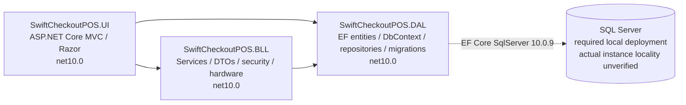

# SwiftCheckoutPOS — Principal Engineer Project Audit

**Pass A + Pass B + Pass C · 2026-10-31 · Asia/Dhaka**  
Workspace: **C:/source/repos/SwiftCheckoutPOS**  
Final source-audit structure: sections 1–20. Prior pass evidence, issue IDs and exact commands are retained; section 20 is the final coverage/command boundary. No implementation was performed.

## 1 Executive Summary

**Do not release this source snapshot for production use.** The verified Pass A non-incremental build failed with **22 warnings and 2 errors** because CheckoutService is missing. DAL/BLL compiled; UI did not. Pass B/C were read-only source/history/configuration reviews, not successful app/database/device/reboot tests.

The architecture is appropriate in principle for a standalone offline Windows POS: three net10.0 MVC/BLL/DAL projects, EF Core SQL Server 10.0.9, local cookie authentication/session and local hardware/backup paths. The actual solution is **C:/source/repos/SwiftCheckoutPOS/SwiftCheckoutPOS.slnx**, selected SDK **10.0.403** with no global.json. Retain MVC and SQL Server; the project-reference graph does not justify a rewrite, SQLite migration or distributed infrastructure.

The main confirmed blockers are:

- **Build/startup/schema:** missing CheckoutService, missing session backing-cache registration, and migrations that do not match the current model (AUD-01–03). Production connection/boot/certificate/key/data-directory provisioning is not demonstrated.
- **Money and records:** fractional product values lost through edit/list/create mapping, unwrapped retry-enabled transactions on the fully traced refund path, independent stock/ledger commits, stale edit forms replacing newer stock, and historical profit based on current product cost (PB-01–05). Finance type/category/binding errors and incomplete attributable refund records add integrity gaps (PB-06–09).
- **Staff security/audit:** disabled/demoted/reset accounts retain issued-cookie privileges until expiry (PC-01); till closures record user ID 1 instead of the operator (PC-08). Barcode-controlled media cleanup can destroy existing product images before product validation (PC-03). Backup raw SQL/path boundaries and unsafe client/token wiring remain confirmed defects (PB-11/PB-12/AUD-23).
- **Recovery/hardware:** backup creation exists without verified local restore/failure recovery; scheduler misses downtime and forgets successes (PB-13–15). Physical receipts are incomplete and the registered printer is virtual (AUD-22). Printing/stock finalization guarantees cannot be completed without the missing checkout BLL.

Pass B added **15 CONFIRMED findings and 9 SUSPECTED risks**; Pass C adds **9 CONFIRMED findings and 5 SUSPECTED risks**, with prior Pass A IDs retained and overlaps explicitly cross-referenced. CONFIRMED means the applicable code path was traced; it does not mean an exploit or financial write was performed. Repository omissions do not prove missing BLL validation: checkout oversell, duplicate-sale behavior, held-order handoff and hardware/commit outcomes remain qualified.

All 16 controller role gates were reviewed. A current Cashier-only cookie cannot reach explicit Admin/Manager routes just by typing URLs; PC-01 concerns stale formerly privileged cookies. Passwords use versioned salted PBKDF2-SHA256, not plaintext. Full available Git history—four reachable commits, 196 diff paths, 96,082 patch lines including messages/deletions/root/merge handling—was scanned with values suppressed; **no verified real credential or default seeded Admin was found**. This is not a guarantee about encoded/binary/unavailable history. Fresh first-Admin provisioning is also absent (PC-09).

No required CDN, online font, cloud identity, external core API, telemetry or online licensing dependency was found in the searched runtime source/assets. Database-driven image paths and actual deployed SQL locality remain unverified. Development DbConn comes from committed environment JSON **[REDACTED]**; the checked User Secrets store had no DbConn key and checked canonical environment entries were absent. A separately installed production process may have external configuration; none was started or certified.

NuGet inventory remains **79 package/version rows / 178 project mappings**. The owner vulnerability/outdated text reports are absent; Pass A live scans failed DNS, while selected primary advisories/deprecation/version metadata were retrieved. Section 12 records the known Pkcs advisory and dependency deprecations without claiming a clean graph or upgrading packages.

The report supplies an ordered local correction roadmap and minimum unit/SQL integration/acceptance tests in sections 17–18. Any integration work must use **SwiftCheckoutPOS_Test** on dedicated local SQL Server/LocalDB, never the business database. Tax, rounding, inventory ownership, refunds, cash and financial indicator policy remain owner decisions in section 19.

**Constraints observed:** only docs/PROJECT_AUDIT.md was authored. No app start, database connection/record read/write, migration, backup/restore, hardware I/O, package install/restore/upgrade, new test project, test execution or source/configuration/history change occurred in this continuation. Pass A builds refreshed generated artifacts under the user's explicit build allowance. All commands, limits and remaining files are recorded in section 20.

**Labels:** VERIFIED = command/build/test evidence for the stated fact; CONFIRMED = full applicable source path, ordinarily UI → BLL → DAL (ending at actual filesystem/bootstrap/browser boundary where appropriate); SUSPECTED = plausible consequence needing missing source, isolated runtime or deployment evidence. No feature is called Works solely because a method exists.

## 2 Technology Stack

### 2.1 Solution, SDK and framework

| Item | Observed value | Evidence |
| --- | --- | --- |
| Exact solution | C:/source/repos/SwiftCheckoutPOS/SwiftCheckoutPOS.slnx (XML solution format); no .sln found | [SwiftCheckoutPOS.slnx](../SwiftCheckoutPOS.slnx) (lines 1–5): `<Project Path="SwiftCheckoutPOS.UI/SwiftCheckoutPOS.UI.csproj" ... />` |
| UI | Microsoft.NET.Sdk.Web; net10.0; nullable and implicit usings enabled | [SwiftCheckoutPOS.UI/SwiftCheckoutPOS.UI.csproj](../SwiftCheckoutPOS.UI/SwiftCheckoutPOS.UI.csproj) (lines 1–7) |
| BLL / DAL | Microsoft.NET.Sdk; net10.0; nullable and implicit usings enabled | [SwiftCheckoutPOS.BLL/SwiftCheckoutPOS.BLL.csproj](../SwiftCheckoutPOS.BLL/SwiftCheckoutPOS.BLL.csproj) (lines 1–6), [SwiftCheckoutPOS.DAL/SwiftCheckoutPOS.DAL.csproj](../SwiftCheckoutPOS.DAL/SwiftCheckoutPOS.DAL.csproj) (lines 1–6) |
| Required SDK generation | .NET 10 SDK; no exact patch pinned by the repository | net10.0 project declarations and [Microsoft EF10 requirements](https://learn.microsoft.com/en-us/ef/core/what-is-new/ef-core-10.0/whatsnew) |
| SDK used | 10.0.403, x64 | VERIFIED `dotnet --version` and `dotnet --list-sdks` |
| Installed runtime relevant here | Microsoft.NETCore.App / Microsoft.AspNetCore.App 10.0.14; WindowsDesktop.App 10.0.14 also installed | VERIFIED `dotnet --list-runtimes`; this web project does not thereby require WindowsDesktop |
| global.json | None at C:/global.json, C:/source/global.json, C:/source/repos/global.json or repository root; recursive source search found none | VERIFIED path checks and source inventory. SDK 10.0.403 is selected, not an asserted exact required patch. |
| Language | C# with SDK-selected default language version; no explicit LangVersion property found in the supplied projects | Project declarations; no Directory.Build/Packages configuration found by inventory |
| Web application | ASP.NET Core MVC/Razor, local cookie authentication, HTTP session, local static assets | [SwiftCheckoutPOS.UI/Program.cs](../SwiftCheckoutPOS.UI/Program.cs) (lines 16–49), [SwiftCheckoutPOS.UI/Views/_ViewImports.cshtml](../SwiftCheckoutPOS.UI/Views/_ViewImports.cshtml) (lines 1–3) |
| Data access | EF Core 10.0.9 SQL Server provider, Microsoft.Data.SqlClient 6.1.1 resolved transitively, concrete repositories | [SwiftCheckoutPOS.DAL/SwiftCheckoutPOS.DAL.csproj](../SwiftCheckoutPOS.DAL/SwiftCheckoutPOS.DAL.csproj) (lines 10–18), package JSON command |
| Local hardware | System.IO.Ports 10.0.9; IReceiptPrinter; virtual implementation registered | [SwiftCheckoutPOS.BLL/SwiftCheckoutPOS.BLL.csproj](../SwiftCheckoutPOS.BLL/SwiftCheckoutPOS.BLL.csproj) (lines 9–11), [SwiftCheckoutPOS.UI/Program.cs](../SwiftCheckoutPOS.UI/Program.cs) (lines 79–83) |

No cloud hosting/database, external identity provider, broker or distributed component is required by the inspected core application code. Azure/identity libraries in the resolved SQL-client graph are transitive capabilities; their presence is not evidence that local cookie login requires internet.

### 2.2 Every direct NuGet reference

Current means requested/resolved **in the existing local assets**, not a fresh restore. All framework targets below are net10.0. The complete direct/transitive per-project inventory and per-package assessment are in **section 12.4**, using explicit UI/BLL/DAL and D/T mapping.

| Project | Package | Requested | Resolved | Kind / source |
| --- | --- | --- | --- | --- |
| UI | Microsoft.EntityFrameworkCore.Design | 10.0.9 | 10.0.9 | Direct; PrivateAssets=all; [SwiftCheckoutPOS.UI/SwiftCheckoutPOS.UI.csproj](../SwiftCheckoutPOS.UI/SwiftCheckoutPOS.UI.csproj) (lines 16–19) |
| UI | Newtonsoft.Json | 13.0.4 | 13.0.4 | Direct; [SwiftCheckoutPOS.UI/SwiftCheckoutPOS.UI.csproj](../SwiftCheckoutPOS.UI/SwiftCheckoutPOS.UI.csproj) (lines 20) |
| BLL | Microsoft.Extensions.Hosting.Abstractions | 10.0.9 | 10.0.9 | Direct; [SwiftCheckoutPOS.BLL/SwiftCheckoutPOS.BLL.csproj](../SwiftCheckoutPOS.BLL/SwiftCheckoutPOS.BLL.csproj) (lines 10) |
| BLL | System.IO.Ports | 10.0.9 | 10.0.9 | Direct; [SwiftCheckoutPOS.BLL/SwiftCheckoutPOS.BLL.csproj](../SwiftCheckoutPOS.BLL/SwiftCheckoutPOS.BLL.csproj) (lines 11) |
| DAL | Microsoft.EntityFrameworkCore.Design | 10.0.9 | 10.0.9 | Direct; PrivateAssets=all; [SwiftCheckoutPOS.DAL/SwiftCheckoutPOS.DAL.csproj](../SwiftCheckoutPOS.DAL/SwiftCheckoutPOS.DAL.csproj) (lines 10–13) |
| DAL | Microsoft.EntityFrameworkCore.SqlServer | 10.0.9 | 10.0.9 | Direct; [SwiftCheckoutPOS.DAL/SwiftCheckoutPOS.DAL.csproj](../SwiftCheckoutPOS.DAL/SwiftCheckoutPOS.DAL.csproj) (lines 14) |
| DAL | Microsoft.EntityFrameworkCore.Tools | 10.0.9 | 10.0.9 | Direct; PrivateAssets=all; [SwiftCheckoutPOS.DAL/SwiftCheckoutPOS.DAL.csproj](../SwiftCheckoutPOS.DAL/SwiftCheckoutPOS.DAL.csproj) (lines 15–18) |

Design/Tools are developer/migration tooling dependencies. PrivateAssets governs propagation; it is not proof that every tooling-related assembly is absent from published artifacts. Publishing was not inspected. ASP.NET Core shared-framework references are not extra direct NuGet PackageReference entries.

### 2.3 Configuration and connection-string shape

| File / location | Observed configuration |
| --- | --- |
| [SwiftCheckoutPOS.UI/appsettings.json](../SwiftCheckoutPOS.UI/appsettings.json) (lines 1–11) | Logging: Default=Information, Microsoft.AspNetCore=Warning; AllowedHosts=*; no nonempty ConnectionStrings:DbConn |
| [SwiftCheckoutPOS.UI/appsettings.Development.json](../SwiftCheckoutPOS.UI/appsettings.Development.json) (lines 1–11) | Same logging levels; nonempty ConnectionStrings:DbConn at line 9, value **[REDACTED]** |
| [SwiftCheckoutPOS.UI/Program.cs](../SwiftCheckoutPOS.UI/Program.cs) (lines 11–14) | Program uses `GetConnectionString("DbConn")`; throws if no value is supplied. Environment-specific configuration/user secrets may supply it; those stores were not read. |
| [SwiftCheckoutPOS.UI/SwiftCheckoutPOS.UI.csproj](../SwiftCheckoutPOS.UI/SwiftCheckoutPOS.UI.csproj) (lines 7) | UserSecretsId is declared. Pass C checked the related store’s presence/DbConn-key existence only; values [REDACTED]. See 11.7. |
| [SwiftCheckoutPOS.DAL/Context/ApplicationDbContext.cs](../SwiftCheckoutPOS.DAL/Context/ApplicationDbContext.cs) (lines 32–39) | Parameterless-context fallback calls `UseSqlServer("Name=DbConn")` only if options were not configured. No design-time factory was found despite a comment referring to one. |

Parsed shape, with all host/instance/database identity values withheld:

```text
Server=[REDACTED]\[REDACTED];
Initial Catalog=[REDACTED];
TrustServerCertificate=True;
Integrated Security=True;
```

This is an **other named-instance shape**. It did not match a (localdb) prefix or SQLEXPRESS suffix. Neither an instance name nor a naming convention proves SQL Server edition, version or that it is on the POS PC. There is no SQL username/password key in this parsed development string; Windows identity supplies authentication. Encrypt is not explicitly configured here; effective behavior depends on the resolved driver and any deployment overrides. TrustServerCertificate=True bypasses server-certificate validation when TLS is used. AllowedHosts=* is host-header policy, not a Kestrel listen-address declaration; it is not proof of network exposure.

The first generic PowerShell connection-builder assignment was not a valid key parse (it created a ConnectionString key through PowerShell adaptation). It was replaced with the explicit set_ConnectionString accessor; the shape above uses the corrected result. No connection was opened in either operation.

### 2.4 Database creation and upgrade mechanism

**CONFIRMED source mechanism:** migrations exist; **neither Migrate/MigrateAsync nor EnsureCreated is invoked anywhere in the supplied runtime source**. Therefore automatic database creation at startup is not implemented. How an existing database was actually provisioned is **Unknown**.

- [SwiftCheckoutPOS.DAL/Migrations/20260702170944_InitialEnterpriseSchema.cs](../SwiftCheckoutPOS.DAL/Migrations/20260702170944_InitialEnterpriseSchema.cs) (lines 12–208) — **InitialEnterpriseSchema.Up**, excerpt: `migrationBuilder.CreateTable(name: "Categories", ...)`; creates Categories, Customers, Users, Vendors, Sales, Products and SaleItems plus indexes.
- [SwiftCheckoutPOS.DAL/Migrations/20260703065136_AddTillReconciliationTable.cs](../SwiftCheckoutPOS.DAL/Migrations/20260703065136_AddTillReconciliationTable.cs) (lines 12–31) — **AddTillReconciliationTable.Up**, excerpt: `migrationBuilder.CreateTable(name: "TillReconciliations", ...)`.
- [SwiftCheckoutPOS.DAL/Context/ApplicationDbContext.cs](../SwiftCheckoutPOS.DAL/Context/ApplicationDbContext.cs) (lines 21–30) — **ApplicationDbContext**, excerpt: `DbSet<LedgerEntry> LedgerEntries` and `DbSet<SystemSetting> SystemSettings`.
- The current model also maps Customer.Address, Product/Sale.RowVersion, Sale.CashierName and SaleItem.CostAtSale, absent from supplied migration additions. **AUD-03** documents the confirmed deployment-schema gap without assuming the installed database state.

No migration, EnsureCreated call, EF database update, connection test or SQL query was executed. Future upgrades must preserve existing records and stay on local SQL Server; no database replacement is recommended.

### 2.5 Program.cs, DI and lifetimes

Program.cs was read in full. All application repositories and services are concrete scoped registrations; the exception is the printer interface binding. There are no explicit AddTransient or application AddSingleton registrations. Framework internals have their own lifetimes.

| Registration | Lifetime | Evidence / assessment |
| --- | --- | --- |
| ApplicationDbContext via AddDbContext | Scoped by the framework default | [SwiftCheckoutPOS.UI/Program.cs](../SwiftCheckoutPOS.UI/Program.cs) (lines 53–54): `UseSqlServer(connectionString, sqlOptions => sqlOptions.EnableRetryOnFailure())`. Retry policy conflicts with explicit sales transactions (AUD-04). |
| UserRepository, InventoryRepository, SalesRepository, CustomerRepository, BackupRepository, TillReconciliationRepository, FinanceRepository, SettingsRepository | Scoped | [SwiftCheckoutPOS.UI/Program.cs](../SwiftCheckoutPOS.UI/Program.cs) (lines 56–63). They share the request’s DbContext through DI. This does not itself make separate SaveChanges calls one transaction. |
| AuthService, UserAdminService, InventoryService, ReportService, CheckoutService, CustomerService, DashboardService, ReconciliationService, BackupService, TillReconciliationService, RefundService, FinanceService, SettingsService | Scoped | [SwiftCheckoutPOS.UI/Program.cs](../SwiftCheckoutPOS.UI/Program.cs) (lines 65–77). CheckoutService has no supplied implementation, causing compilation failure. |
| IReceiptPrinter → VirtualPrinterService | Scoped | [SwiftCheckoutPOS.UI/Program.cs](../SwiftCheckoutPOS.UI/Program.cs) (lines 79–81). Physical driver is not selected. |
| AutoBackupWorker via AddHostedService | Hosted singleton | [SwiftCheckoutPOS.UI/Program.cs](../SwiftCheckoutPOS.UI/Program.cs) (lines 83). [SwiftCheckoutPOS.BLL/Services/AutoBackupWorker.cs](../SwiftCheckoutPOS.BLL/Services/AutoBackupWorker.cs) (lines 30–33) creates a scope per iteration then resolves BackupService. This avoids directly capturing a scoped DbContext in the hosted worker. |
| MVC, antiforgery, authentication, authorization and session | Framework-managed | [SwiftCheckoutPOS.UI/Program.cs](../SwiftCheckoutPOS.UI/Program.cs) (lines 16–50). Session backing IDistributedCache registration is missing (AUD-02). |

**Middleware/endpoint order**, [SwiftCheckoutPOS.UI/Program.cs](../SwiftCheckoutPOS.UI/Program.cs) (lines 85–108):

1. Build host.
2. Outside Development: exception handler at /Home/Error and HSTS.
3. HTTPS redirection.
4. Routing.
5. Session middleware.
6. Authentication.
7. Authorization.
8. MapStaticAssets.
9. Conventional MVC route `{controller=Account}/{action=Login}/{id?}`, with static assets.
10. Run host (read in source only; not executed by this audit).

Authentication precedes authorization; routing precedes both. Session preceding authentication is not, on its own, a middleware-order defect. Missing cache registration is the specific startup problem. No startup Migrate/EnsureCreated, Windows-service/task setup, explicit data-protection key path or production listen-address setup is supplied. Default framework behavior may still provide some of these operational properties; reboot/deployment behavior is not established by source absence alone. Anonymous login/static-asset delivery and local HTTPS certificate behavior require isolated runtime verification after compilation is fixed.

**Authentication/session settings**, [SwiftCheckoutPOS.UI/Program.cs](../SwiftCheckoutPOS.UI/Program.cs) (lines 23–49) and [SwiftCheckoutPOS.UI/Controllers/AccountController.cs](../SwiftCheckoutPOS.UI/Controllers/AccountController.cs) (lines 35–72):

- Session idle timeout: 8 hours; HttpOnly, essential cookie, SameSite=Strict, SecurePolicy=SameAsRequest. ActiveCart is JSON in HTTP session, not established durable business storage.
- Authentication scheme POSAuthCookie; cookie SwiftCheckout.Auth; HttpOnly, SameSite=Strict, SecurePolicy=SameAsRequest; 8-hour absolute ticket life, sliding expiration disabled; login/denied paths configured.
- Login uses AuthService → UserRepository → PBKDF2 verification, then stores user ID/name/role claims with IsPersistent=true. Logout signs out and clears session.
- Fallback authorization requires authentication; controller roles constrain administrative routes. Home and Account are AllowAnonymous. Pass C's complete role/revocation review is in section 11; stale-cookie privileges are PC-01.
- Global AutoValidateAntiforgeryToken filter; request header name RequestVerificationToken. Ordinary Razor forms use FormTagHelper via _ViewImports; AJAX must supply its request token explicitly (AUD-23).

### 2.6 launchSettings.json and offline operation

[SwiftCheckoutPOS.UI/Properties/launchSettings.json](../SwiftCheckoutPOS.UI/Properties/launchSettings.json) (lines 3–46) defines only development launch profiles:

| Profile | Shape |
| --- | --- |
| http | Project; Development; browser launch; http://localhost:5104 |
| https | Project; Development; https://localhost:7089 and http://localhost:5104 |
| IIS Express | Development; anonymous authentication enabled, Windows authentication disabled; localhost HTTP port 59270 / SSL port 44322 |
| WSL | WSL2 development profile, same 7089/5104 URLs; distribution name empty |

These are developer profiles, not an installation or post-reboot launch mechanism. Windows SQL integrated authentication is separate from IIS’s Windows authentication setting. Referenced Bootstrap/jQuery/validation assets are bundled under local wwwroot/lib; no required external CDN/core API was found in inspected views. A disconnected installation, local SQL identity, restart and upgrade procedure remain unverified.

## 3 Architecture & Dependency Diagram

### 3.1 Actual project reference graph

Arrows show compile-time project references. The SQL arrow shows the external local persistence technology, not another project.



**VERIFIED graph declarations:** [SwiftCheckoutPOS.UI/SwiftCheckoutPOS.UI.csproj](../SwiftCheckoutPOS.UI/SwiftCheckoutPOS.UI.csproj) (lines 23–25), excerpt `ProjectReference Include="..\SwiftCheckoutPOS.DAL\SwiftCheckoutPOS.DAL.csproj"`; [SwiftCheckoutPOS.BLL/SwiftCheckoutPOS.BLL.csproj](../SwiftCheckoutPOS.BLL/SwiftCheckoutPOS.BLL.csproj) (lines 14–15), excerpt `ProjectReference Include="..\SwiftCheckoutPOS.DAL\SwiftCheckoutPOS.DAL.csproj"`; [SwiftCheckoutPOS.DAL/SwiftCheckoutPOS.DAL.csproj](../SwiftCheckoutPOS.DAL/SwiftCheckoutPOS.DAL.csproj) (lines 1–21) has no ProjectReference. No cycle is declared.

### 3.2 Coupling and dependency inversion assessment

The persistence boundary does **not enforce strict dependency inversion**: business services consume concrete repository/entity types defined in DAL, and ReconciliationService directly consumes ApplicationDbContext. Dependency injection constructs those concrete objects; DI alone does not invert their source dependencies. Evidence: [SwiftCheckoutPOS.BLL/Services/InventoryService.cs](../SwiftCheckoutPOS.BLL/Services/InventoryService.cs) (lines 14–21) — **InventoryService constructor**, `InventoryService(InventoryRepository inventoryRepo, FinanceService financeService)`; [SwiftCheckoutPOS.BLL/Services/ReconciliationService.cs](../SwiftCheckoutPOS.BLL/Services/ReconciliationService.cs) (lines 10–12) — **ReconciliationService constructor**, `ReconciliationService(ApplicationDbContext context)`.

The UI’s DAL reference has two distinct uses:

- **Composition root:** Program registers DbContext/repositories. A direct reference here is a reasonable small-application choice; removing it merely to hide the arrow would not improve business correctness.
- **Presentation coupling beyond composition:** [SwiftCheckoutPOS.UI/Models/CheckoutViewModel.cs](../SwiftCheckoutPOS.UI/Models/CheckoutViewModel.cs) (lines 17–18) exposes `List<Sale> HeldOrders`, and [SwiftCheckoutPOS.UI/Views/Report/TillCountSummary.cshtml](../SwiftCheckoutPOS.UI/Views/Report/TillCountSummary.cshtml) (lines 3) uses `@model SwiftCheckoutPOS.DAL.Entities.TillReconciliation`. This binds views to DAL entity structure/navigation and makes UI-only testing less isolated.

**Assessment:** the graph itself is not a demonstrated harmful bug, and no new domain/infrastructure projects or blanket repository-interface rewrite is justified for this one-PC POS. The demonstrated harm is duplicated reconciliation behavior (AUD-07) and concrete missing/incompatible orchestration, not the visual shape of the diagram. Keep the three projects. Add a focused DTO/contract or transaction coordinator only when it removes a specific coupling defect or enables a meaningful check. IReceiptPrinter already provides a useful hardware seam.

## 4 Feature Inventory

Status definitions: **Works** requires positive runtime/test evidence; none is claimed here. **Incomplete** means supplied source has a missing integration/implementation. **Broken** identifies a traced defect or build failure. **Unknown** means a plausible implementation exists but was not executed. The global UI compilation/session/schema blockers affect the whole app; rows below also describe each feature’s own source completeness.

| Feature | Status | Evidence label | Location and observed coverage |
| --- | --- | --- | --- |
| [Authentication](#feature-1) | **Incomplete** | CONFIRMED source path; runtime Unknown | AccountController; AuthService/PasswordHasher; UserRepository; Account/Login and AccessDenied views. Local PBKDF2/cookie implementation exists; no login was executed. Global build/session blockers apply. Pass C confirms stale-cookie revocation gap PC-01; current role gates are in 11.3. |
| [User administration](#feature-2) | **Incomplete** | CONFIRMED source path; runtime Unknown | UserAdminController; UserAdminService; UserRepository; UserAdmin/Create, Edit, Index. Admin-only create/edit/deactivate, allowed-role/password checks and last-active-admin protection exist. Create/edit role/validation paths were reviewed in Pass C (PC-05/PC-06); Index/visual/runtime behavior remains unverified. |
| [Inventory and products](#feature-3) | **Broken** | CONFIRMED source path; runtime Unknown | InventoryAdminController; InventoryService/FinanceService; InventoryRepository/FinanceRepository; InventoryAdmin/Create, Edit, Index. Create/edit/search/sort, stock/reorder fields, weighted-average restock, vendor return and image upload are implemented. Pass B confirms precision/save/concurrency defects PB-01/PB-03/PB-04/PB-08; Pass C confirms media defect PC-03. Required schema differs from supplied migrations (AUD-03). |
| [Categories and vendors](#feature-4) | **Broken** | CONFIRMED | InventoryAdminController.QuickAddCategory/QuickAddVendor; InventoryService; InventoryRepository; inventory create/edit quickAdd scripts. Lookup/add paths exist; quick-add fetches omit the globally required antiforgery request token (AUD-23). No separate full category/vendor maintenance feature was found. |
| [Sales and checkout](#feature-5) | **Broken** | VERIFIED | CheckoutController; missing CheckoutService; SalesRepository; Checkout/Index; SalesAdmin placeholder. Build proves the service type is missing (AUD-01). Cart, barcode, quantity, discount, loyalty and tender UI exist, but final validation/commit semantics cannot be inferred from repository code alone. |
| [Held orders](#feature-6) | **Incomplete** | CONFIRMED missing integration; effects SUSPECTED | CheckoutController.HoldOrder/ResumeOrder; missing CheckoutService; SalesRepository park/resume/list; checkout held-order modal. DAL reserves stock at park and releases/deletes the held sale at resume; actual BLL orchestration is absent. No confirmed owner policy for expiry/cancellation or durable active-cart recovery. |
| [Customers](#feature-7) | **Unknown** | CONFIRMED source path; runtime Unknown | CustomerController; CustomerService; CustomerRepository/SalesRepository; Customer/Index and Details; checkout loyalty lookup. Enrollment/edit/profile/search/sort, history and loyalty lookup are implemented. UI and database behavior were not run; Address schema is missing from supplied migration additions. |
| [Refunds](#feature-8) | **Broken** | CONFIRMED | RefundController; RefundService; SalesRepository; Refund/Index. Whole-sale lookup/status change/restock exists; BLL rejects Held/already Refunded. Retry-enabled DbContext conflicts with its explicit transaction (AUD-04). No refund was executed. |
| [Financial ledger](#feature-9) | **Broken** | CONFIRMED source path; runtime Unknown | FinanceAdminController; FinanceService; FinanceRepository; FinanceAdmin/Index; inventory service postings. Manual entries, capital/expense/inventory categories, inventory-generated postings and KPI calculations exist. LedgerEntries table is absent from supplied migrations; PB-03/PB-06/PB-07 and section 8 establish save/validation/formula issues. No runtime accounting outcome is certified. |
| [COGS](#feature-10) | **Incomplete** | CONFIRMED source availability; invocation Unknown | FinanceService.RecordSystemCOGS; FinanceRepository; SaleItem.CostAtSale; missing checkout integration; no dedicated COGS controller/view. Writer method and sale-time cost field exist. Search found no supplied caller of RecordSystemCOGS; missing CheckoutService prevents establishing whether completion captures costs/posts COGS. |
| [Dashboard and reporting](#feature-11) | **Incomplete** | CONFIRMED source path; runtime Unknown | AdminDashboardController/ReportAdminController/ReportController; DashboardService/ReportService; SalesRepository; dashboard/report views; ManagerDashboard and SalesAdmin placeholders. Admin metrics, date-range reports, customer history and Z-report preview/print exist; manager dashboard and sales-admin page are literal placeholders. Pass B confirms current-cost historical profit defect PB-05; formulas and untested policy questions are in section 8. |
| [Till reconciliation](#feature-12) | **Broken** | CONFIRMED | ReconciliationController/TillReconciliationService/TillReconciliationRepository; ReportController/ReconciliationService direct DbContext; reconciliation/till-count views. Input name mismatch persists zero (AUD-05). Second path totals lifetime completed cash and invents an eight-hour open time (AUD-07). Both write the same close table and hardcode actor ID 1 (PC-08). |
| [System settings](#feature-13) | **Unknown** | CONFIRMED source path; consumer integration Unknown | SettingsAdminController; SettingsService; SettingsRepository; SettingsAdmin/Index; missing checkout consumer. One setting is implemented: held-order retention hours (default 72; setter 0–87600). SystemSettings migration is absent; effect on checkout cannot be traced without its service. |
| [Database backup](#feature-14) | **Incomplete** | CONFIRMED source path; actual backup Unknown | BackupAdminController; BackupService/BackupConfigDTO; BackupRepository; BackupAdmin/Index. Native SQL .bak creation/history/download and config exist. No supplied local restore/verification workflow or runbook (AUD-20); no backup/restore was performed. |
| [Automatic backup](#feature-15) | **Incomplete** | CONFIRMED | Program hosted-service registration; AutoBackupWorker; BackupService/BackupRepository; BackupAdmin configuration controls. 30-second polling; one in-memory success date. Missed-minute catch-up and persistent success state are absent (AUD-21); not an OS-level scheduler and not tested across restart. |
| [Receipt printing](#feature-16) | **Incomplete** | CONFIRMED source path; actual printing Unknown | CheckoutController/ReportAdminController; IReceiptPrinter and VirtualPrinterService; checkout/report preview; executable-relative VirtualReceipts files. Active path writes text files and reports virtual online. Checkout fetch is missing the request token (AUD-23); physical driver support is incomplete (AUD-22). |
| [Hardware integration](#feature-17) | **Incomplete** | CONFIRMED | SerialPrinterDriver/EscPosFormatter; ComPortPrinterService; IReceiptPrinter; checkout HID-keyboard scanner JavaScript. Serial drawer/Z-report code exists; receipt method is empty, alternate COM service throws, and neither physical driver is registered. Browser HID scanning is implemented heuristically; device behavior remains untested. |

### 4.1 Feature evidence and layer traces

<a id="feature-1"></a>

#### Authentication — Unknown

Local PBKDF2/cookie implementation exists; no login was executed. Global build/session blockers apply. Pass C confirms stale-cookie revocation gap PC-01; current role gates are in 11.3.

- [SwiftCheckoutPOS.UI/Controllers/AccountController.cs](../SwiftCheckoutPOS.UI/Controllers/AccountController.cs) (lines 35–58) — **AccountController.Login**: `_authService.ValidateCredentials(...)`
- [SwiftCheckoutPOS.BLL/Services/AuthService.cs](../SwiftCheckoutPOS.BLL/Services/AuthService.cs) (lines 24–44) — **AuthService.ValidateCredentials**: `if (user == null || !user.IsActive) return false;`
- [SwiftCheckoutPOS.DAL/Repositories/UserRepository.cs](../SwiftCheckoutPOS.DAL/Repositories/UserRepository.cs) (lines 30–33) — **UserRepository.GetUserByUsername**: `_context.Users.FirstOrDefault(...)`
- [SwiftCheckoutPOS.UI/Views/Account/Login.cshtml](../SwiftCheckoutPOS.UI/Views/Account/Login.cshtml) (lines 16–32) — **Account.Login Razor form**: `<form asp-action="Login" method="post">`

<a id="feature-2"></a>

#### User administration — Unknown

Admin-only create/edit/deactivate, allowed-role/password checks and last-active-admin protection exist. Create/edit role/validation paths were reviewed in Pass C (PC-05/PC-06); Index/visual/runtime behavior remains unverified.

- [SwiftCheckoutPOS.UI/Controllers/UserAdminController.cs](../SwiftCheckoutPOS.UI/Controllers/UserAdminController.cs) (lines 35–52) — **UserAdminController.Create**: `_userService.CreateUser(new UserActionDTO { ... });`
- [SwiftCheckoutPOS.BLL/Services/UserAdminService.cs](../SwiftCheckoutPOS.BLL/Services/UserAdminService.cs) (lines 50–69) — **UserAdminService.CreateUser**: `NormalizeAndValidate(dto, requirePassword: true);`
- [SwiftCheckoutPOS.DAL/Repositories/UserRepository.cs](../SwiftCheckoutPOS.DAL/Repositories/UserRepository.cs) (lines 35–44) — **UserRepository.AddUser / UpdateUser**: `_context.SaveChanges();`
- [SwiftCheckoutPOS.UI/Views/UserAdmin/Create.cshtml](../SwiftCheckoutPOS.UI/Views/UserAdmin/Create.cshtml) (lines 18–19) — **UserAdmin.Create Razor form**: `<form asp-action="Create" method="post">`

<a id="feature-3"></a>

#### Inventory and products — Unknown

Create/edit/search/sort, stock/reorder fields, weighted-average restock, vendor return and image upload are implemented. Pass B confirms precision/save/concurrency defects PB-01/PB-03/PB-04/PB-08; Pass C confirms media defect PC-03. Required schema differs from supplied migrations (AUD-03).

- [SwiftCheckoutPOS.UI/Controllers/InventoryAdminController.cs](../SwiftCheckoutPOS.UI/Controllers/InventoryAdminController.cs) (lines 192–216) — **InventoryAdminController.ProcessRestock / ProcessReturnToVendor**: `_inventoryService.RestockProduct(...);`
- [SwiftCheckoutPOS.BLL/Services/InventoryService.cs](../SwiftCheckoutPOS.BLL/Services/InventoryService.cs) (lines 159–186) — **InventoryService.RestockProduct**: `product.CostPrice = Math.Round(weightedAverageCost, 2);`
- [SwiftCheckoutPOS.DAL/Repositories/InventoryRepository.cs](../SwiftCheckoutPOS.DAL/Repositories/InventoryRepository.cs) (lines 44–53) — **InventoryRepository.AddProduct / UpdateProduct**: `_context.Products.Update(product);`
- [SwiftCheckoutPOS.UI/Views/InventoryAdmin/Index.cshtml](../SwiftCheckoutPOS.UI/Views/InventoryAdmin/Index.cshtml) (lines 227–245) — **InventoryAdmin.Index restock form**: `<form asp-action="ProcessRestock" method="post">`

<a id="feature-4"></a>

#### Categories and vendors — Broken

Lookup/add paths exist; quick-add fetches omit the globally required antiforgery request token (AUD-23). No separate full category/vendor maintenance feature was found.

- [SwiftCheckoutPOS.UI/Controllers/InventoryAdminController.cs](../SwiftCheckoutPOS.UI/Controllers/InventoryAdminController.cs) (lines 225–236) — **InventoryAdminController.QuickAddCategory / QuickAddVendor**: `_inventoryService.AddCategory(categoryName);`
- [SwiftCheckoutPOS.BLL/Services/InventoryService.cs](../SwiftCheckoutPOS.BLL/Services/InventoryService.cs) (lines 207–224) — **InventoryService.GetAllVendors / AddCategory / AddVendor**: `_inventoryRepo.AddVendor(new Vendor { VendorName = vendorName });`
- [SwiftCheckoutPOS.DAL/Repositories/InventoryRepository.cs](../SwiftCheckoutPOS.DAL/Repositories/InventoryRepository.cs) (lines 57–87) — **InventoryRepository category/vendor methods**: `_context.Categories.OrderBy(c => c.CategoryName).ToList();`
- [SwiftCheckoutPOS.UI/Views/InventoryAdmin/Create.cshtml](../SwiftCheckoutPOS.UI/Views/InventoryAdmin/Create.cshtml) (lines 139–153) — **InventoryAdmin.Create quickAdd**: `fetch(`/InventoryAdmin/QuickAdd${type}`, { method: 'POST', body: formData });`

<a id="feature-5"></a>

#### Sales and checkout — Broken

Build proves the service type is missing (AUD-01). Cart, barcode, quantity, discount, loyalty and tender UI exist, but final validation/commit semantics cannot be inferred from repository code alone.

- [SwiftCheckoutPOS.UI/Controllers/CheckoutController.cs](../SwiftCheckoutPOS.UI/Controllers/CheckoutController.cs) (lines 19–29) — **CheckoutController constructor**: `private readonly CheckoutService _checkoutService;`
- [SwiftCheckoutPOS.UI/Controllers/CheckoutController.cs](../SwiftCheckoutPOS.UI/Controllers/CheckoutController.cs) (lines 269–290) — **CheckoutController.Finalize**: `_checkoutService.FinalizeTransaction(cart, paymentMethod, cashierName);`
- [SwiftCheckoutPOS.DAL/Repositories/SalesRepository.cs](../SwiftCheckoutPOS.DAL/Repositories/SalesRepository.cs) (lines 44–62) — **SalesRepository.FinalizeSale**: `_context.Sales.Add(sale);`
- [SwiftCheckoutPOS.UI/Views/Checkout/Index.cshtml](../SwiftCheckoutPOS.UI/Views/Checkout/Index.cshtml) (lines 640–665) — **Checkout.Index tender form/buttons**: `<form asp-action="Finalize" method="post" id="finalizeForm" ...>`

<a id="feature-6"></a>

#### Held orders — Incomplete

DAL reserves stock at park and releases/deletes the held sale at resume; actual BLL orchestration is absent. No confirmed owner policy for expiry/cancellation or durable active-cart recovery.

- [SwiftCheckoutPOS.UI/Controllers/CheckoutController.cs](../SwiftCheckoutPOS.UI/Controllers/CheckoutController.cs) (lines 168–209) — **CheckoutController.HoldOrder / ResumeOrder**: `var resumedCart = _checkoutService.ResumeOrder(saleId);`
- [SwiftCheckoutPOS.DAL/Repositories/SalesRepository.cs](../SwiftCheckoutPOS.DAL/Repositories/SalesRepository.cs) (lines 65–119) — **SalesRepository.ParkHeldOrder / ResumeHeldOrder**: `_context.Sales.Remove(sale);`
- [SwiftCheckoutPOS.UI/Views/Checkout/Index.cshtml](../SwiftCheckoutPOS.UI/Views/Checkout/Index.cshtml) (lines 715–742) — **Checkout.Index held-order modal**: `<form asp-action="ResumeOrder" method="post" ...>`

<a id="feature-7"></a>

#### Customers — Unknown

Enrollment/edit/profile/search/sort, history and loyalty lookup are implemented. UI and database behavior were not run; Address schema is missing from supplied migration additions.

- [SwiftCheckoutPOS.UI/Controllers/CustomerController.cs](../SwiftCheckoutPOS.UI/Controllers/CustomerController.cs) (lines 29–35) — **CustomerController.Add**: `_customerService.AddNewCustomer(fullName, phoneNumber, address);`
- [SwiftCheckoutPOS.BLL/Services/CustomerService.cs](../SwiftCheckoutPOS.BLL/Services/CustomerService.cs) (lines 96–111) — **CustomerService.AddNewCustomer**: `_customerRepo.AddCustomer(customer);`
- [SwiftCheckoutPOS.DAL/Repositories/CustomerRepository.cs](../SwiftCheckoutPOS.DAL/Repositories/CustomerRepository.cs) (lines 39–48) — **CustomerRepository.AddCustomer**: `customer.RegisteredAt = DateTime.Now;`
- [SwiftCheckoutPOS.UI/Views/Customer/Index.cshtml](../SwiftCheckoutPOS.UI/Views/Customer/Index.cshtml) (lines 168–169) — **Customer.Index add form**: `<form asp-action="Add" method="post" ...>`

<a id="feature-8"></a>

#### Refunds — Broken

Whole-sale lookup/status change/restock exists; BLL rejects Held/already Refunded. Retry-enabled DbContext conflicts with its explicit transaction (AUD-04). No refund was executed.

- [SwiftCheckoutPOS.UI/Controllers/RefundController.cs](../SwiftCheckoutPOS.UI/Controllers/RefundController.cs) (lines 44–58) — **RefundController.ConfirmRefund**: `_refundService.ExecuteRefund(receiptNumber);`
- [SwiftCheckoutPOS.BLL/Services/RefundService.cs](../SwiftCheckoutPOS.BLL/Services/RefundService.cs) (lines 48–62) — **RefundService.ExecuteRefund**: `if (sale.OrderStatus == "Held") ...;`
- [SwiftCheckoutPOS.DAL/Repositories/SalesRepository.cs](../SwiftCheckoutPOS.DAL/Repositories/SalesRepository.cs) (lines 161–180) — **SalesRepository.ProcessRefundTransaction**: `using var transaction = _context.Database.BeginTransaction();`
- [SwiftCheckoutPOS.UI/Views/Refund/Index.cshtml](../SwiftCheckoutPOS.UI/Views/Refund/Index.cshtml) (lines 175–180) — **Refund.Index confirmation form**: `<form asp-action="ConfirmRefund" method="post" ...>`

<a id="feature-9"></a>

#### Financial ledger — Unknown

Manual entries, capital/expense/inventory categories, inventory-generated postings and KPI calculations exist. LedgerEntries table is absent from supplied migrations; PB-03/PB-06/PB-07 and section 8 establish save/validation/formula issues. No runtime accounting outcome is certified.

- [SwiftCheckoutPOS.UI/Controllers/FinanceAdminController.cs](../SwiftCheckoutPOS.UI/Controllers/FinanceAdminController.cs) (lines 40–46) — **FinanceAdminController.AddEntry**: `_financeService.RecordManualEntry(...);`
- [SwiftCheckoutPOS.BLL/Services/FinanceService.cs](../SwiftCheckoutPOS.BLL/Services/FinanceService.cs) (lines 114–135) — **FinanceService.RecordManualEntry**: `_financeRepo.AddEntry(entry);`
- [SwiftCheckoutPOS.DAL/Repositories/FinanceRepository.cs](../SwiftCheckoutPOS.DAL/Repositories/FinanceRepository.cs) (lines 21–33) — **FinanceRepository.GetLedgerByDateRange / AddEntry**: `_context.LedgerEntries.Add(entry);`
- [SwiftCheckoutPOS.UI/Views/FinanceAdmin/Index.cshtml](../SwiftCheckoutPOS.UI/Views/FinanceAdmin/Index.cshtml) (lines 298–316) — **FinanceAdmin.Index entry form**: `<form asp-action="AddEntry" method="post" ...>`

<a id="feature-10"></a>

#### COGS — Incomplete

Writer method and sale-time cost field exist. Search found no supplied caller of RecordSystemCOGS; missing CheckoutService prevents establishing whether completion captures costs/posts COGS.

- [SwiftCheckoutPOS.BLL/Services/FinanceService.cs](../SwiftCheckoutPOS.BLL/Services/FinanceService.cs) (lines 166–179) — **FinanceService.RecordSystemCOGS**: `Category = "COGS", TransactionType = "Outflow"`
- [SwiftCheckoutPOS.DAL/Repositories/FinanceRepository.cs](../SwiftCheckoutPOS.DAL/Repositories/FinanceRepository.cs) (lines 30–33) — **FinanceRepository.AddEntry**: `_context.SaveChanges();`
- [SwiftCheckoutPOS.DAL/Entities/SaleItem.cs](../SwiftCheckoutPOS.DAL/Entities/SaleItem.cs) (lines 20–21) — **SaleItem**: `public decimal CostAtSale { get; set; }`

<a id="feature-11"></a>

#### Dashboard and reporting — Incomplete

Admin metrics, date-range reports, customer history and Z-report preview/print exist; manager dashboard and sales-admin page are literal placeholders. Pass B confirms current-cost historical profit defect PB-05; formulas and untested policy questions are in section 8.

- [SwiftCheckoutPOS.UI/Controllers/AdminDashboardController.cs](../SwiftCheckoutPOS.UI/Controllers/AdminDashboardController.cs) (lines 19–27) — **AdminDashboardController.Index**: `_dashboardService.GetMetrics(filter);`
- [SwiftCheckoutPOS.UI/Controllers/ReportAdminController.cs](../SwiftCheckoutPOS.UI/Controllers/ReportAdminController.cs) (lines 23–28) — **ReportAdminController.Index**: `_reportService.GetAdvancedReport(startDate, endDate, searchQuery);`
- [SwiftCheckoutPOS.BLL/Services/ReportService.cs](../SwiftCheckoutPOS.BLL/Services/ReportService.cs) (lines 20–48) — **ReportService.GetAdvancedReport**: `_salesRepo.GetSalesByDateRange(queryStart, queryEnd).ToList();`
- [SwiftCheckoutPOS.DAL/Repositories/SalesRepository.cs](../SwiftCheckoutPOS.DAL/Repositories/SalesRepository.cs) (lines 33–41) — **SalesRepository.GetSalesByDateRange**: `.Include(s => s.SaleItems).ThenInclude(si => si.Product)`
- [SwiftCheckoutPOS.UI/Views/ManagerDashboard/Index.cshtml](../SwiftCheckoutPOS.UI/Views/ManagerDashboard/Index.cshtml) (lines 1) — **ManagerDashboard.Index Razor view**: `<h1>Manager</h1>`
- [SwiftCheckoutPOS.UI/Views/SalesAdmin/Index.cshtml](../SwiftCheckoutPOS.UI/Views/SalesAdmin/Index.cshtml) (lines 1) — **SalesAdmin.Index Razor view**: `<h2>Sales Audit</h2>`

<a id="feature-12"></a>

#### Till reconciliation — Broken

Input name mismatch persists zero (AUD-05). Second path totals lifetime completed cash and invents an eight-hour open time (AUD-07). Both write the same close table and hardcode actor ID 1 (PC-08).

- [SwiftCheckoutPOS.UI/Views/Reconciliation/Index.cshtml](../SwiftCheckoutPOS.UI/Views/Reconciliation/Index.cshtml) (lines 30–34) — **Reconciliation.Index cash input**: `name="actualCashCount"`
- [SwiftCheckoutPOS.UI/Controllers/ReconciliationController.cs](../SwiftCheckoutPOS.UI/Controllers/ReconciliationController.cs) (lines 30–38) — **ReconciliationController.CloseTill**: `CloseTill(decimal countedCash, string notes)`
- [SwiftCheckoutPOS.BLL/Services/TillReconciliationService.cs](../SwiftCheckoutPOS.BLL/Services/TillReconciliationService.cs) (lines 49–67) — **TillReconciliationService.CommitReconciliation**: `CountedCash = actualCashCount`
- [SwiftCheckoutPOS.DAL/Repositories/TillReconciliationRepository.cs](../SwiftCheckoutPOS.DAL/Repositories/TillReconciliationRepository.cs) (lines 20–23) — **TillReconciliationRepository.AddReconciliation**: `_context.TillReconciliations.Add(reconciliation);`

<a id="feature-13"></a>

#### System settings — Unknown

One setting is implemented: held-order retention hours (default 72; setter 0–87600). SystemSettings migration is absent; effect on checkout cannot be traced without its service.

- [SwiftCheckoutPOS.UI/Controllers/SettingsAdminController.cs](../SwiftCheckoutPOS.UI/Controllers/SettingsAdminController.cs) (lines 28–37) — **SettingsAdminController.UpdateRetention**: `_settingsService.SetHeldOrderRetentionHours(retentionHours);`
- [SwiftCheckoutPOS.BLL/Services/SettingsService.cs](../SwiftCheckoutPOS.BLL/Services/SettingsService.cs) (lines 17–36) — **SettingsService.GetHeldOrderRetentionHours / SetHeldOrderRetentionHours**: `GetSettingValue("HeldOrderRetentionHours", "72")`
- [SwiftCheckoutPOS.DAL/Repositories/SettingsRepository.cs](../SwiftCheckoutPOS.DAL/Repositories/SettingsRepository.cs) (lines 26–44) — **SettingsRepository.UpdateSetting**: `_context.SystemSettings.Add(new SystemSetting { ... });`
- [SwiftCheckoutPOS.UI/Views/SettingsAdmin/Index.cshtml](../SwiftCheckoutPOS.UI/Views/SettingsAdmin/Index.cshtml) (lines 61–73) — **SettingsAdmin.Index retention form**: `name="retentionHours" ... min="0" max="87600"`

<a id="feature-14"></a>

#### Database backup — Incomplete

Native SQL .bak creation/history/download and config exist. No supplied local restore/verification workflow or runbook (AUD-20); no backup/restore was performed.

- [SwiftCheckoutPOS.UI/Controllers/BackupAdminController.cs](../SwiftCheckoutPOS.UI/Controllers/BackupAdminController.cs) (lines 46–59) — **BackupAdminController.TriggerManualBackup**: `_backupService.ExecuteManualBackup();`
- [SwiftCheckoutPOS.BLL/Services/BackupService.cs](../SwiftCheckoutPOS.BLL/Services/BackupService.cs) (lines 52–55) — **BackupService.ExecuteManualBackup**: `CreateDatabaseBackup(config.TargetDirectory)`
- [SwiftCheckoutPOS.DAL/Repositories/BackupRepository.cs](../SwiftCheckoutPOS.DAL/Repositories/BackupRepository.cs) (lines 24–51) — **BackupRepository.CreateDatabaseBackup**: `BACKUP DATABASE ... TO DISK = ...`
- [SwiftCheckoutPOS.UI/Views/BackupAdmin/Index.cshtml](EVIDENCE_REFERENCES.md#backupadmin-view-snapshot) (lines 11–18) — **BackupAdmin.Index manual backup form**: `<form asp-action="TriggerManualBackup" method="post" ...>`

<a id="feature-15"></a>

#### Automatic backup — Incomplete

30-second polling; one in-memory success date. Missed-minute catch-up and persistent success state are absent (AUD-21); not an OS-level scheduler and not tested across restart.

- [SwiftCheckoutPOS.UI/Program.cs](../SwiftCheckoutPOS.UI/Program.cs) (lines 83) — **Program registration**: `builder.Services.AddHostedService<AutoBackupWorker>();`
- [SwiftCheckoutPOS.BLL/Services/AutoBackupWorker.cs](../SwiftCheckoutPOS.BLL/Services/AutoBackupWorker.cs) (lines 30–59) — **AutoBackupWorker.ExecuteAsync**: `now.Hour == config.AutoBackupTime.Hours && now.Minute == config.AutoBackupTime.Minutes`
- [SwiftCheckoutPOS.BLL/DTOs/BackupConfigDTO.cs](../SwiftCheckoutPOS.BLL/DTOs/BackupConfigDTO.cs) (lines 11–13) — **BackupConfigDTO**: `public bool IsAutoBackupEnabled { get; set; } = false;`
- [SwiftCheckoutPOS.UI/Views/BackupAdmin/Index.cshtml](EVIDENCE_REFERENCES.md#backupadmin-view-snapshot) (lines 45–64) — **BackupAdmin.Index scheduling controls**: `name="AutoBackupTime"`

<a id="feature-16"></a>

#### Receipt printing — Incomplete

Active path writes text files and reports virtual online. Checkout fetch is missing the request token (AUD-23); physical driver support is incomplete (AUD-22).

- [SwiftCheckoutPOS.UI/Program.cs](../SwiftCheckoutPOS.UI/Program.cs) (lines 79–81) — **Program printer binding**: `AddScoped<IReceiptPrinter, VirtualPrinterService>()`
- [SwiftCheckoutPOS.UI/Controllers/CheckoutController.cs](../SwiftCheckoutPOS.UI/Controllers/CheckoutController.cs) (lines 237–261) — **CheckoutController.TriggerHardwarePrint**: `_hardwarePrinter.PrintReceipt(session);`
- [SwiftCheckoutPOS.BLL/Services/VirtualPrinterService.cs](../SwiftCheckoutPOS.BLL/Services/VirtualPrinterService.cs) (lines 24–38) — **VirtualPrinterService.PrintReceipt**: `File.WriteAllText(Path.Combine(_outputDirectory, fileName), receiptText);`
- [SwiftCheckoutPOS.UI/Views/Checkout/Index.cshtml](../SwiftCheckoutPOS.UI/Views/Checkout/Index.cshtml) (lines 924–930) — **Checkout.Index triggerHardwarePrint**: `fetch('/Checkout/TriggerHardwarePrint', { method: 'POST', ... })`

<a id="feature-17"></a>

#### Hardware integration — Incomplete

Serial drawer/Z-report code exists; receipt method is empty, alternate COM service throws, and neither physical driver is registered. Browser HID scanning is implemented heuristically; device behavior remains untested.

- [SwiftCheckoutPOS.BLL/Hardware/SerialPrinterDriver.cs](../SwiftCheckoutPOS.BLL/Hardware/SerialPrinterDriver.cs) (lines 22–47) — **SerialPrinterDriver.IsPrinterOnline / PrintReceipt**: `// Receipt implementation omitted for focus on Z-Report scope.`
- [SwiftCheckoutPOS.BLL/Hardware/SerialPrinterDriver.cs](../SwiftCheckoutPOS.BLL/Hardware/SerialPrinterDriver.cs) (lines 95–119) — **SerialPrinterDriver.SendToPrinter**: `using var port = new SerialPort(_comPort, _baudRate);`
- [SwiftCheckoutPOS.BLL/Services/ComPortPrinterService.cs](../SwiftCheckoutPOS.BLL/Services/ComPortPrinterService.cs) (lines 14–26) — **ComPortPrinterService**: `throw new NotImplementedException("Hardware not yet connected.");`
- [SwiftCheckoutPOS.UI/Views/Checkout/Index.cshtml](../SwiftCheckoutPOS.UI/Views/Checkout/Index.cshtml) (lines 933–1008) — **Checkout.Index scanner JavaScript**: `const SCANNER_THRESHOLD_MS = 30;`

## 5 Project-by-Project Assessment

### 5.1 SwiftCheckoutPOS.UI

MVC composition root, 16 controllers, Razor forms/terminal UI, request models, local static assets, cookie/session/antiforgery setup. It references BLL and DAL. Missing CheckoutService prevents compilation; session composition is incomplete. Administrative and cashier entry points exist, but manager/sales-admin pages are placeholders. The composition root should remain local and simple; no frontend/framework replacement is proposed.

Priority: AUD-01, AUD-02, AUD-05 and AUD-23; then verify actual login, local assets, HTTPS and role navigation on an isolated installation. No UI workflow is certified Works.

### 5.2 SwiftCheckoutPOS.BLL

16 supplied service files plus DTOs, PasswordHasher, IReceiptPrinter and hardware helpers. It depends on DAL concrete repositories/entities. Local authentication logic and substantial inventory/customer/report/backup behavior exist. Missing CheckoutService leaves a major orchestration gap, including COGS and held-order semantics. Two reconciliation services implement different calculations. Virtual printing is selected; physical receipt implementation is incomplete.

Priority: recover the missing intended service before changing financial policy, unify the demonstrated reconciliation boundary, retain existing validation/last-admin protection, and complete only the actual local hardware requirements. Physical serial work needs controlled device verification, not a DI switch alone.

### 5.3 SwiftCheckoutPOS.DAL

ApplicationDbContext, 10 entity classes, eight concrete repositories, two handwritten migration Up/Down files, two migration designer files and a model snapshot. Money mappings use decimal columns; receipt/barcode/username unique indexes and product/sale RowVersion are intended in the model. The supplied migration chain does not create the whole current model, and intended model constraints are not proof that an installed database has them. Sales methods explicitly transact; their compatibility with retry configuration is the issue.

Priority: reconcile the additive schema baseline and transaction policy without touching live data. Backup create/list/download exists; restore/verification and full local recovery data are not supplied. No SQLite migration or database replacement is recommended.

### 5.4 Build results: exact warnings and errors

**Latest non-incremental build — VERIFIED:** exit **1**, **22 warnings**, **2 errors**, elapsed **8.99 seconds**. DAL and BLL compiled; UI failed. The earlier incremental Pass A build emitted **6 warnings, 2 errors** (elapsed 4.62 seconds). The warning count difference reflects different emitted diagnostic sets; neither build passed. Fixing the first compile blocker may expose additional UI diagnostics.

Latest command:

```powershell
dotnet build SwiftCheckoutPOS.slnx --no-restore --no-incremental --nologo --disable-build-servers -m:1 -v:minimal
```

Latest unique diagnostic lines are below, preserving exact file/line/column information. These are VERIFIED compiler/package diagnostics, not assertions that every nullable warning is a reproduced runtime bug. The build summary repeats lines; repetitions are not counted twice.

```text
C:\source\repos\SwiftCheckoutPOS\SwiftCheckoutPOS.BLL\SwiftCheckoutPOS.BLL.csproj : warning NU1902: Package 'System.Security.Cryptography.Pkcs' 9.0.4 has a known moderate severity vulnerability, https://github.com/advisories/GHSA-2fmv-rv2c-59x7
C:\source\repos\SwiftCheckoutPOS\SwiftCheckoutPOS.BLL\SwiftCheckoutPOS.BLL.csproj : warning NU1903: Package 'System.Security.Cryptography.Pkcs' 9.0.4 has a known high severity vulnerability, https://github.com/advisories/GHSA-846f-f764-76mx
C:\source\repos\SwiftCheckoutPOS\SwiftCheckoutPOS.DAL\Repositories\InventoryRepository.cs(32,20): warning CS8603: Possible null reference return. [C:\source\repos\SwiftCheckoutPOS\SwiftCheckoutPOS.DAL\SwiftCheckoutPOS.DAL.csproj]
C:\source\repos\SwiftCheckoutPOS\SwiftCheckoutPOS.DAL\Repositories\InventoryRepository.cs(40,20): warning CS8603: Possible null reference return. [C:\source\repos\SwiftCheckoutPOS\SwiftCheckoutPOS.DAL\SwiftCheckoutPOS.DAL.csproj]
C:\source\repos\SwiftCheckoutPOS\SwiftCheckoutPOS.DAL\Repositories\SalesRepository.cs(119,20): warning CS8603: Possible null reference return. [C:\source\repos\SwiftCheckoutPOS\SwiftCheckoutPOS.DAL\SwiftCheckoutPOS.DAL.csproj]
C:\source\repos\SwiftCheckoutPOS\SwiftCheckoutPOS.DAL\Repositories\SalesRepository.cs(155,20): warning CS8603: Possible null reference return. [C:\source\repos\SwiftCheckoutPOS\SwiftCheckoutPOS.DAL\SwiftCheckoutPOS.DAL.csproj]
C:\source\repos\SwiftCheckoutPOS\SwiftCheckoutPOS.BLL\Services\CustomerService.cs(38,85): warning CS8625: Cannot convert null literal to non-nullable reference type. [C:\source\repos\SwiftCheckoutPOS\SwiftCheckoutPOS.BLL\SwiftCheckoutPOS.BLL.csproj]
C:\source\repos\SwiftCheckoutPOS\SwiftCheckoutPOS.BLL\Services\CustomerService.cs(38,110): warning CS8625: Cannot convert null literal to non-nullable reference type. [C:\source\repos\SwiftCheckoutPOS\SwiftCheckoutPOS.BLL\SwiftCheckoutPOS.BLL.csproj]
C:\source\repos\SwiftCheckoutPOS\SwiftCheckoutPOS.BLL\Services\InventoryService.cs(24,82): warning CS8625: Cannot convert null literal to non-nullable reference type. [C:\source\repos\SwiftCheckoutPOS\SwiftCheckoutPOS.BLL\SwiftCheckoutPOS.BLL.csproj]
C:\source\repos\SwiftCheckoutPOS\SwiftCheckoutPOS.BLL\Services\InventoryService.cs(24,107): warning CS8625: Cannot convert null literal to non-nullable reference type. [C:\source\repos\SwiftCheckoutPOS\SwiftCheckoutPOS.BLL\SwiftCheckoutPOS.BLL.csproj]
C:\source\repos\SwiftCheckoutPOS\SwiftCheckoutPOS.BLL\DTOs\BackupConfigDTO.cs(18,23): warning CS8618: Non-nullable property 'FileName' must contain a non-null value when exiting constructor. Consider adding the 'required' modifier or declaring the property as nullable. [C:\source\repos\SwiftCheckoutPOS\SwiftCheckoutPOS.BLL\SwiftCheckoutPOS.BLL.csproj]
C:\source\repos\SwiftCheckoutPOS\SwiftCheckoutPOS.BLL\DTOs\BackupConfigDTO.cs(19,23): warning CS8618: Non-nullable property 'FilePath' must contain a non-null value when exiting constructor. Consider adding the 'required' modifier or declaring the property as nullable. [C:\source\repos\SwiftCheckoutPOS\SwiftCheckoutPOS.BLL\SwiftCheckoutPOS.BLL.csproj]
C:\source\repos\SwiftCheckoutPOS\SwiftCheckoutPOS.BLL\DTOs\CategoryDTO.cs(8,23): warning CS8618: Non-nullable property 'CategoryName' must contain a non-null value when exiting constructor. Consider adding the 'required' modifier or declaring the property as nullable. [C:\source\repos\SwiftCheckoutPOS\SwiftCheckoutPOS.BLL\SwiftCheckoutPOS.BLL.csproj]
C:\source\repos\SwiftCheckoutPOS\SwiftCheckoutPOS.BLL\DTOs\UserDTO.cs(12,23): warning CS8618: Non-nullable property 'Username' must contain a non-null value when exiting constructor. Consider adding the 'required' modifier or declaring the property as nullable. [C:\source\repos\SwiftCheckoutPOS\SwiftCheckoutPOS.BLL\SwiftCheckoutPOS.BLL.csproj]
C:\source\repos\SwiftCheckoutPOS\SwiftCheckoutPOS.BLL\DTOs\UserDTO.cs(13,23): warning CS8618: Non-nullable property 'RoleName' must contain a non-null value when exiting constructor. Consider adding the 'required' modifier or declaring the property as nullable. [C:\source\repos\SwiftCheckoutPOS\SwiftCheckoutPOS.BLL\SwiftCheckoutPOS.BLL.csproj]
C:\source\repos\SwiftCheckoutPOS\SwiftCheckoutPOS.BLL\DTOs\CustomerDTO.cs(8,23): warning CS8618: Non-nullable property 'PhoneNumber' must contain a non-null value when exiting constructor. Consider adding the 'required' modifier or declaring the property as nullable. [C:\source\repos\SwiftCheckoutPOS\SwiftCheckoutPOS.BLL\SwiftCheckoutPOS.BLL.csproj]
C:\source\repos\SwiftCheckoutPOS\SwiftCheckoutPOS.BLL\DTOs\CustomerDTO.cs(9,23): warning CS8618: Non-nullable property 'FullName' must contain a non-null value when exiting constructor. Consider adding the 'required' modifier or declaring the property as nullable. [C:\source\repos\SwiftCheckoutPOS\SwiftCheckoutPOS.BLL\SwiftCheckoutPOS.BLL.csproj]
C:\source\repos\SwiftCheckoutPOS\SwiftCheckoutPOS.BLL\Services\CustomerService.cs(26,42): warning CS8603: Possible null reference return. [C:\source\repos\SwiftCheckoutPOS\SwiftCheckoutPOS.BLL\SwiftCheckoutPOS.BLL.csproj]
C:\source\repos\SwiftCheckoutPOS\SwiftCheckoutPOS.BLL\Services\InventoryService.cs(55,21): warning CS8602: Dereference of a possibly null reference. [C:\source\repos\SwiftCheckoutPOS\SwiftCheckoutPOS.BLL\SwiftCheckoutPOS.BLL.csproj]
C:\source\repos\SwiftCheckoutPOS\SwiftCheckoutPOS.BLL\Services\ComPortPrinterService.cs(12,33): warning CS0414: The field 'ComPortPrinterService._comPort' is assigned but its value is never used [C:\source\repos\SwiftCheckoutPOS\SwiftCheckoutPOS.BLL\SwiftCheckoutPOS.BLL.csproj]
C:\source\repos\SwiftCheckoutPOS\SwiftCheckoutPOS.UI\SwiftCheckoutPOS.UI.csproj : warning NU1902: Package 'System.Security.Cryptography.Pkcs' 9.0.4 has a known moderate severity vulnerability, https://github.com/advisories/GHSA-2fmv-rv2c-59x7
C:\source\repos\SwiftCheckoutPOS\SwiftCheckoutPOS.UI\SwiftCheckoutPOS.UI.csproj : warning NU1903: Package 'System.Security.Cryptography.Pkcs' 9.0.4 has a known high severity vulnerability, https://github.com/advisories/GHSA-846f-f764-76mx
C:\source\repos\SwiftCheckoutPOS\SwiftCheckoutPOS.UI\Controllers\CheckoutController.cs(19,26): error CS0246: The type or namespace name 'CheckoutService' could not be found (are you missing a using directive or an assembly reference?) [C:\source\repos\SwiftCheckoutPOS\SwiftCheckoutPOS.UI\SwiftCheckoutPOS.UI.csproj]
C:\source\repos\SwiftCheckoutPOS\SwiftCheckoutPOS.UI\Controllers\CheckoutController.cs(27,13): error CS0246: The type or namespace name 'CheckoutService' could not be found (are you missing a using directive or an assembly reference?) [C:\source\repos\SwiftCheckoutPOS\SwiftCheckoutPOS.UI\SwiftCheckoutPOS.UI.csproj]
```

The first incremental build also emitted NU1902 and NU1903 on DAL itself. Both runs and the resolved JSON inventory establish Pkcs 9.0.4 in all three projects. No test project/suite was found or run. There was no application launch and no restore/install.

### 5.5 Provisional Pass A issue register

This is the retained Pass A startup/schema/build and feature-completeness issue register. IDs are not renumbered. Pass B/C extend the findings in sections 6/7 and complete the source assessments in later sections; runtime operational certification was never performed.

<a id="aud-01"></a>

#### AUD-01 · Critical · VERIFIED · The supplied solution cannot compile because CheckoutService is missing

**File(s), lines, class/method and evidence**

- [SwiftCheckoutPOS.UI/Controllers/CheckoutController.cs](../SwiftCheckoutPOS.UI/Controllers/CheckoutController.cs) (lines 19–29) — **CheckoutController field and constructor**: `private readonly CheckoutService _checkoutService;`
- [SwiftCheckoutPOS.UI/Program.cs](../SwiftCheckoutPOS.UI/Program.cs) (lines 65–75) — **Program (top-level service registration)**: `builder.Services.AddScoped<CheckoutService>();`
- [SwiftCheckoutPOS.BLL/SwiftCheckoutPOS.BLL.csproj](../SwiftCheckoutPOS.BLL/SwiftCheckoutPOS.BLL.csproj) (lines 1–18) — **MSBuild project compilation (no custom source inclusion)**: `<TargetFramework>net10.0</TargetFramework>`

**Execution path:** Checkout view actions → CheckoutController → unresolved CheckoutService. The business layer cannot be traced onward to SalesRepository because the implementation is absent from the supplied files.

**Root cause:** The UI and composition root reference a class that is not present in the BLL source or supplied project references.

**Impact:** No deployable UI build can be produced from this source snapshot. Pass A’s non-incremental build exited 1 with CS0246 at CheckoutController.cs:19 and :27, 22 warnings and 2 errors. DAL and BLL compiled; UI did not. This does not validate runtime behavior.

**Recommended correction:** Recover the intended CheckoutService implementation from the authoritative source/history and reconcile its existing contracts. Review it before making checkout changes; do not reconstruct business policy from controller assumptions.

**Migration required?** No for source recovery; reassess after the missing implementation is available.

**Regression risk:** High: checkout validation, persistence, stock, discounts, loyalty and idempotency depend on the missing code.

<a id="aud-02"></a>

#### AUD-02 · Critical · CONFIRMED · Session has no registered backing cache

**File(s), lines, class/method and evidence**

- [SwiftCheckoutPOS.UI/Program.cs](../SwiftCheckoutPOS.UI/Program.cs) (lines 16–30) — **Program (service registration)**: `builder.Services.AddSession(options => { ... });`
- [SwiftCheckoutPOS.UI/Program.cs](../SwiftCheckoutPOS.UI/Program.cs) (lines 85–99) — **Program (middleware composition)**: `app.UseSession();`
- [SwiftCheckoutPOS.UI/Controllers/CheckoutController.cs](../SwiftCheckoutPOS.UI/Controllers/CheckoutController.cs) (lines 295–305) — **CheckoutController.GetActiveSession / SaveActiveSession**: `HttpContext.Session.SetString(ActiveCartKey, JsonConvert.SerializeObject(session));`

**Execution path:** Program registers the default session store and uses its middleware → CheckoutController reads/writes ActiveCart. No IDistributedCache registration exists anywhere in the supplied startup code. This is a framework composition failure before BLL/DAL execution.

**Root cause:** AddSession does not supply the IDistributedCache implementation required by the default session store.

**Impact:** Once compilation is repaired, service validation/middleware activation cannot resolve session storage. Application startup/requests are blocked; no application launch was attempted.

**Recommended correction:** Register a suitable local session cache. An in-process cache is sufficient for disposable HTTP session state on this one computer, but business carts that must survive restarts need durable local database state independently of the cache (see AUD-25).

**Migration required?** No for cache registration; durable cart changes may require one.

**Regression risk:** Medium: verify login, logout, all cart mutations and expiry. Framework prerequisite verified against Microsoft’s ASP.NET Core 10 session documentation.

<a id="aud-03"></a>

#### AUD-03 · Critical · CONFIRMED · The supplied migrations do not create the schema required by the current model

**File(s), lines, class/method and evidence**

- [SwiftCheckoutPOS.DAL/Context/ApplicationDbContext.cs](../SwiftCheckoutPOS.DAL/Context/ApplicationDbContext.cs) (lines 21–30) — **ApplicationDbContext DbSets**: `public virtual DbSet<LedgerEntry> LedgerEntries { get; set; } ... public virtual DbSet<SystemSetting> SystemSettings { get; set; }`
- [SwiftCheckoutPOS.DAL/Context/ApplicationDbContext.cs](../SwiftCheckoutPOS.DAL/Context/ApplicationDbContext.cs) (lines 54–99) — **ApplicationDbContext.OnModelCreating**: `entity.Property(e => e.RowVersion).IsRowVersion(); ... entity.Property(e => e.CostAtSale).HasColumnType("decimal(18, 2)");`
- [SwiftCheckoutPOS.DAL/Migrations/20260702170944_InitialEnterpriseSchema.cs](../SwiftCheckoutPOS.DAL/Migrations/20260702170944_InitialEnterpriseSchema.cs) (lines 78–149) — **InitialEnterpriseSchema.Up**: `OrderStatus = table.Column<string>(type: "nvarchar(max)", nullable: false); ... LineTotal = table.Column<decimal>(...)`
- [SwiftCheckoutPOS.DAL/Migrations/20260703065136_AddTillReconciliationTable.cs](../SwiftCheckoutPOS.DAL/Migrations/20260703065136_AddTillReconciliationTable.cs) (lines 12–31) — **AddTillReconciliationTable.Up**: `migrationBuilder.CreateTable(name: "TillReconciliations", ...);`
- [SwiftCheckoutPOS.DAL/Migrations/ApplicationDbContextModelSnapshot.cs](../SwiftCheckoutPOS.DAL/Migrations/ApplicationDbContextModelSnapshot.cs) (lines 48–225) — **ApplicationDbContextModelSnapshot.BuildModel**: `b.ToTable("Customers"); ... b.ToTable("Products"); ... b.ToTable("Sales"); ... b.ToTable("SaleItems");`

**Execution path:** FinanceAdminController.Index → FinanceService.GetFinanceDashboard → FinanceRepository.GetLedgerByDateRange → LedgerEntries; SettingsAdminController → SettingsService → SettingsRepository → SystemSettings. Inventory/customer/sales queries also map columns absent from the migration chain.

**Root cause:** Only the initial schema and till table migrations are supplied. They contain no LedgerEntries/SystemSettings tables, Customer.Address, Product.RowVersion, Sale.RowVersion/CashierName or SaleItem.CostAtSale additions. Current length/index/delete mappings also diverge from the snapshot.

**Impact:** A database created only from these migrations cannot support the current queries and saves. The installed database was not inspected: this is a confirmed source/deployment schema gap, not a claim that an existing live database lacks these objects.

**Recommended correction:** Create reviewed additive SQL Server migrations against the actual supported baseline, with a verified local backup, safe defaults/backfills and upgrade rollback/recovery instructions. Do not recreate or drop a shop database. Historical cost backfills require evidence, not current supplier prices.

**Migration required?** Yes. No migrations were generated or applied during this audit.

**Regression risk:** High: schema changes affect every business record; validate fresh creation and upgrade of a disposable copy before release.

<a id="aud-04"></a>

#### AUD-04 · Critical · CONFIRMED · SQL retry configuration conflicts with explicit sales transactions

**File(s), lines, class/method and evidence**

- [SwiftCheckoutPOS.UI/Program.cs](../SwiftCheckoutPOS.UI/Program.cs) (lines 52–54) — **Program (ApplicationDbContext registration)**: `options.UseSqlServer(connectionString, sqlOptions => sqlOptions.EnableRetryOnFailure())`
- [SwiftCheckoutPOS.UI/Controllers/RefundController.cs](../SwiftCheckoutPOS.UI/Controllers/RefundController.cs) (lines 44–58) — **RefundController.ConfirmRefund**: `_refundService.ExecuteRefund(receiptNumber);`
- [SwiftCheckoutPOS.BLL/Services/RefundService.cs](../SwiftCheckoutPOS.BLL/Services/RefundService.cs) (lines 48–62) — **RefundService.ExecuteRefund**: `if (sale.OrderStatus == "Refunded") ...; if (sale.OrderStatus == "Held") ...; _salesRepo.ProcessRefundTransaction(sale);`
- [SwiftCheckoutPOS.DAL/Repositories/SalesRepository.cs](../SwiftCheckoutPOS.DAL/Repositories/SalesRepository.cs) (lines 161–185) — **SalesRepository.ProcessRefundTransaction**: `using var transaction = _context.Database.BeginTransaction(); ... _context.SaveChanges();`
- [SwiftCheckoutPOS.DAL/Repositories/SalesRepository.cs](../SwiftCheckoutPOS.DAL/Repositories/SalesRepository.cs) (lines 44–109) — **SalesRepository.FinalizeSale / ParkHeldOrder / ResumeHeldOrder**: `using var transaction = _context.Database.BeginTransaction();`

**Execution path:** Refund form → RefundController.ConfirmRefund → RefundService.ExecuteRefund → SalesRepository.ProcessRefundTransaction using the retry-enabled DbContext. No execution-strategy wrapper exists. Checkout callers are unavailable, so their BLL validation is not inferred.

**Root cause:** User-initiated transactions are not executed as a unit through Database.CreateExecutionStrategy. EF Core’s retry strategy rejects this combination when the operation executes.

**Impact:** The traced refund persistence path fails once earlier startup/schema blockers are removed. The same incompatible transaction pattern appears in the checkout repository methods. This conclusion is based on code and Microsoft’s documented EF behavior, not a real-database reproduction.

**Recommended correction:** Retain EnableRetryOnFailure. Execute each complete logical transaction, its reads/validation and all writes through Database.CreateExecutionStrategy().Execute/ExecuteAsync with clean attempt state. Use durable operation identity and committed-outcome verification where required; exclude hardware side effects from the retry delegate. Pass B PB-02 and section 10 expand the exact four sites. Do not remove retry handling to suppress the exception.

**Migration required?** No for the execution policy; an additional durable idempotency key may require an additive migration.

**Regression risk:** High: retries must never duplicate sales, refunds, stock or ledger postings.

<a id="aud-05"></a>

#### AUD-05 · Critical · CONFIRMED · Till closure discards the entered cash count and persists zero

**File(s), lines, class/method and evidence**

- [SwiftCheckoutPOS.UI/Views/Reconciliation/Index.cshtml](../SwiftCheckoutPOS.UI/Views/Reconciliation/Index.cshtml) (lines 30–35) — **Reconciliation.Index Razor form**: `<input type="number" name="actualCashCount" ... required ... />`
- [SwiftCheckoutPOS.UI/Controllers/ReconciliationController.cs](../SwiftCheckoutPOS.UI/Controllers/ReconciliationController.cs) (lines 28–40) — **ReconciliationController.CloseTill**: `CloseTill(decimal countedCash, string notes) ... CommitReconciliation(userId, countedCash, notes);`
- [SwiftCheckoutPOS.BLL/Services/TillReconciliationService.cs](../SwiftCheckoutPOS.BLL/Services/TillReconciliationService.cs) (lines 49–67) — **TillReconciliationService.CommitReconciliation**: `CountedCash = actualCashCount, ... _tillRepo.AddReconciliation(reconciliation);`
- [SwiftCheckoutPOS.DAL/Repositories/TillReconciliationRepository.cs](../SwiftCheckoutPOS.DAL/Repositories/TillReconciliationRepository.cs) (lines 20–23) — **TillReconciliationRepository.AddReconciliation**: `_context.TillReconciliations.Add(reconciliation); _context.SaveChanges();`

**Execution path:** Rendered form posts actualCashCount → action expects countedCash → missing decimal input defaults to zero → BLL copies it → DAL saves it. Neither the action nor BLL validates binding/presence.

**Root cause:** Form and action parameter names differ; a non-nullable decimal plus unchecked ModelState hides the missing value.

**Impact:** A normal till close records CountedCash=0 regardless of the operator’s entered amount and advances the last-close boundary. No live reconciliation was submitted.

**Recommended correction:** Bind a dedicated validated request model with the same field name, reject missing/invalid values and preserve the submitted count. Provide a controlled correction/audit procedure for affected historical rows; do not silently rewrite them.

**Migration required?** No for the binding fix. An audited correction history may require one.

**Regression risk:** Medium: verify missing, zero, fractional, invalid and normal counts, and that rejected requests do not create a close.

<a id="aud-07"></a>

#### AUD-07 · Critical · CONFIRMED · The second till-close path sums lifetime sales and invents an eight-hour shift

**File(s), lines, class/method and evidence**

- [SwiftCheckoutPOS.UI/Views/Report/TillCount.cshtml](../SwiftCheckoutPOS.UI/Views/Report/TillCount.cshtml) (lines 7–16) — **Report.TillCount Razor form**: `<form asp-action="SubmitTillCount" method="post">`
- [SwiftCheckoutPOS.UI/Controllers/ReportController.cs](../SwiftCheckoutPOS.UI/Controllers/ReportController.cs) (lines 38–48) — **ReportController.SubmitTillCount**: `_reconciliationService.PerformBlindReconciliation(currentUserId, countedAmount, notes ?? string.Empty);`
- [SwiftCheckoutPOS.BLL/Services/ReconciliationService.cs](../SwiftCheckoutPOS.BLL/Services/ReconciliationService.cs) (lines 14–32) — **ReconciliationService.PerformBlindReconciliation**: `.Where(s => s.PaymentMethod == "Cash" && s.OrderStatus == "Completed").Sum(s => s.TotalAmount); ... OpenTime = DateTime.Now.AddHours(-8);`
- [SwiftCheckoutPOS.DAL/Repositories/TillReconciliationRepository.cs](../SwiftCheckoutPOS.DAL/Repositories/TillReconciliationRepository.cs) (lines 26–31) — **TillReconciliationRepository.GetLatestReconciliation**: `.OrderByDescending(t => t.CloseTime).FirstOrDefault();`

**Execution path:** Blind count form → ReportController → ReconciliationService → ApplicationDbContext directly → TillReconciliations.SaveChanges. These rows are consumed as the latest shift boundary by the other reconciliation path.

**Root cause:** The query never filters since the last close despite its comment. It writes a fabricated OpenTime and shares the same close table with a different financial calculation.

**Impact:** Past shifts’ completed cash sales are counted again even when the current shift has no sales. Submitting through this route also changes the next shift boundary used by AUD-06.

**Recommended correction:** Route both existing entry points through one bounded, owner-approved reconciliation calculation and persisted shift definition. Validate counts and make shift closure atomic with the selected cutoff; keep both UI entry points if needed.

**Migration required?** Likely yes for explicit shift state/float/cash events; no need to replace MVC or add another service.

**Regression risk:** High: both routes must produce the same result and reject duplicate closure of the same shift.

<a id="aud-20"></a>

#### AUD-20 · High · CONFIRMED · Backup creation exists, but no local restore or restore-verification workflow is supplied

**File(s), lines, class/method and evidence**

- [SwiftCheckoutPOS.UI/Views/BackupAdmin/Index.cshtml](EVIDENCE_REFERENCES.md#backupadmin-view-snapshot) (lines 11–18) — **BackupAdmin.Index Razor page**: `Database Backup & Recovery ... <form asp-action="TriggerManualBackup" method="post">`
- [SwiftCheckoutPOS.UI/Controllers/BackupAdminController.cs](../SwiftCheckoutPOS.UI/Controllers/BackupAdminController.cs) (lines 22–75) — **BackupAdminController.Index / SaveConfiguration / TriggerManualBackup / DownloadBackup**: `_backupService.ExecuteManualBackup(); ... return File(fileBytes, "application/octet-stream", fileName);`
- [SwiftCheckoutPOS.BLL/Services/BackupService.cs](../SwiftCheckoutPOS.BLL/Services/BackupService.cs) (lines 52–72) — **BackupService.ExecuteManualBackup / GetBackupHistory**: `CreateDatabaseBackup(config.TargetDirectory); ... directoryInfo.GetFiles("*.bak")`
- [SwiftCheckoutPOS.DAL/Repositories/BackupRepository.cs](../SwiftCheckoutPOS.DAL/Repositories/BackupRepository.cs) (lines 24–58) — **BackupRepository.CreateDatabaseBackup**: `BACKUP DATABASE ... WITH FORMAT`

**Execution path:** Backup page → controller → BackupService → BackupRepository creates a .bak. History/download are implemented. All backup layer bodies were read and source searches found no RESTORE DATABASE/VERIFYONLY or restore scripts/runbook.

**Root cause:** Recovery is advertised in the page title but only backup creation/list/download is implemented in the supplied project.

**Impact:** The mandatory local restore capability and proof that a backup can recover the shop are absent from the deliverable. A .bak covers database contents, not uploaded product images or file-based configuration. No actual backup was created or restored.

**Recommended correction:** Supply a local restore procedure or controlled maintenance workflow covering compatible SQL Server version, database identity, connections, pre-restore safety copy, permissions and post-restore record checks. Package required non-database local data separately. A documented operator procedure is acceptable if it satisfies the owner’s recovery requirement; it need not be a destructive in-app button.

**Migration required?** No inherent schema migration.

**Regression risk:** High: restore replaces database state. Prove recovery only on an isolated disposable database and never use a production shop database for tests.

<a id="aud-21"></a>

#### AUD-21 · Medium · CONFIRMED · Scheduled backups are skipped after missing the exact minute and their success state is volatile

**File(s), lines, class/method and evidence**

- [SwiftCheckoutPOS.UI/Controllers/BackupAdminController.cs](../SwiftCheckoutPOS.UI/Controllers/BackupAdminController.cs) (lines 30–43) — **BackupAdminController.SaveConfiguration**: `_backupService.SaveConfiguration(config);`
- [SwiftCheckoutPOS.BLL/Services/AutoBackupWorker.cs](../SwiftCheckoutPOS.BLL/Services/AutoBackupWorker.cs) (lines 16) — **AutoBackupWorker field initialization**: `private DateTime _lastBackupDate = DateTime.MinValue;`
- [SwiftCheckoutPOS.BLL/Services/AutoBackupWorker.cs](../SwiftCheckoutPOS.BLL/Services/AutoBackupWorker.cs) (lines 35–59) — **AutoBackupWorker.ExecuteAsync**: `now.Hour == config.AutoBackupTime.Hours && now.Minute == config.AutoBackupTime.Minutes ... await Task.Delay(TimeSpan.FromSeconds(30), stoppingToken);`
- [SwiftCheckoutPOS.BLL/Services/BackupService.cs](../SwiftCheckoutPOS.BLL/Services/BackupService.cs) (lines 26–38) — **BackupService.GetConfiguration**: `catch { return new BackupConfigDTO(); }`
- [SwiftCheckoutPOS.BLL/DTOs/BackupConfigDTO.cs](../SwiftCheckoutPOS.BLL/DTOs/BackupConfigDTO.cs) (lines 10–13) — **BackupConfigDTO defaults**: `public bool IsAutoBackupEnabled { get; set; } = false;`

**Execution path:** Saved configuration → hosted worker reads it → exact clock-minute equality → BackupService → BackupRepository. Successful date is held only in the worker instance; unreadable config silently restores disabled defaults.

**Root cause:** There is no persisted last-success checkpoint, overdue/catch-up rule or visible health state.

**Impact:** If Windows/app is stopped or suspended across the selected minute, that day’s automatic backup is not attempted later. Restarting in the matching minute can make another backup because last success is forgotten. A bad configuration file can silently disable scheduling.

**Recommended correction:** Persist last successful backup and outcome, define a simple owner-approved overdue/catch-up policy, surface failures/last success locally, and preserve the configuration across upgrades. Check backup integrity and disk capacity; agree retention rather than automatically deleting history.

**Migration required?** Not necessarily; protected local configuration/state can suffice, or use an additive local SQL settings/history table.

**Regression risk:** Medium: verify restart/sleep/missed-minute/failure behavior without changing the system clock or touching a real database.

<a id="aud-22"></a>

#### AUD-22 · High · CONFIRMED · Physical receipt printing is incomplete and the active driver is virtual

**File(s), lines, class/method and evidence**

- [SwiftCheckoutPOS.UI/Program.cs](../SwiftCheckoutPOS.UI/Program.cs) (lines 79–83) — **Program (printer registration)**: `builder.Services.AddScoped<IReceiptPrinter, VirtualPrinterService>();`
- [SwiftCheckoutPOS.UI/Controllers/CheckoutController.cs](../SwiftCheckoutPOS.UI/Controllers/CheckoutController.cs) (lines 237–261) — **CheckoutController.TriggerHardwarePrint**: `_hardwarePrinter.OpenCashDrawer(); _hardwarePrinter.PrintReceipt(session);`
- [SwiftCheckoutPOS.BLL/Services/VirtualPrinterService.cs](../SwiftCheckoutPOS.BLL/Services/VirtualPrinterService.cs) (lines 17–38) — **VirtualPrinterService.IsPrinterOnline / OpenCashDrawer / PrintReceipt**: `public bool IsPrinterOnline() => true; ... File.WriteAllText(..., receiptText);`
- [SwiftCheckoutPOS.BLL/Hardware/SerialPrinterDriver.cs](../SwiftCheckoutPOS.BLL/Hardware/SerialPrinterDriver.cs) (lines 43–51) — **SerialPrinterDriver.PrintReceipt / GenerateReceiptPreview**: `// Receipt implementation omitted for focus on Z-Report scope.`
- [SwiftCheckoutPOS.BLL/Services/ComPortPrinterService.cs](../SwiftCheckoutPOS.BLL/Services/ComPortPrinterService.cs) (lines 14–26) — **ComPortPrinterService.IsPrinterOnline / OpenCashDrawer / PrintReceipt**: `throw new NotImplementedException("Hardware not yet connected.");`

**Execution path:** Checkout/Report actions → IReceiptPrinter → registered VirtualPrinterService → local text/log files. SerialPrinterDriver can send drawer/Z-report bytes but has an empty receipt method; ComPortPrinterService throws. This I/O workflow has no DAL step.

**Root cause:** Virtual operation is deliberately the safe default, but neither physical implementation supplies a complete receipt workflow.

**Impact:** The required local hardware behavior is not delivered by the supplied registration. A virtual success message does not establish a printed receipt or opened physical drawer. Switching DI alone to SerialPrinterDriver would still not print a receipt.

**Recommended correction:** Complete and validate the existing serial driver against the actual local printer/drawer, add explicit local configuration and distinguish virtual mode from physical success. Retain virtual mode for development; do not enable an untested physical device.

**Migration required?** No database migration required for completing the driver.

**Regression risk:** High: hardware commands need controlled device testing, port configuration, timeouts, paper/offline handling and safe print retry.

<a id="aud-23"></a>

#### AUD-23 · High · CONFIRMED · Checkout printing and inventory quick-add AJAX omit the required antiforgery token

**File(s), lines, class/method and evidence**

- [SwiftCheckoutPOS.UI/Program.cs](../SwiftCheckoutPOS.UI/Program.cs) (lines 16–21) — **Program (MVC/antiforgery registration)**: `options.Filters.Add(new AutoValidateAntiforgeryTokenAttribute()); ... options.HeaderName = "RequestVerificationToken";`
- [SwiftCheckoutPOS.UI/Views/Checkout/Index.cshtml](../SwiftCheckoutPOS.UI/Views/Checkout/Index.cshtml) (lines 924–930) — **Checkout.Index JavaScript triggerHardwarePrint**: `fetch('/Checkout/TriggerHardwarePrint', { method: 'POST', headers: { 'Content-Type': 'application/x-www-form-urlencoded' }, body: new URLSearchParams(receiptData) })`
- [SwiftCheckoutPOS.UI/Views/InventoryAdmin/Create.cshtml](../SwiftCheckoutPOS.UI/Views/InventoryAdmin/Create.cshtml) (lines 139–153) — **InventoryAdmin.Create JavaScript quickAdd**: `formData.append(..., input.trim()); ... fetch(`/InventoryAdmin/QuickAdd${type}`, { method: 'POST', body: formData });`
- [SwiftCheckoutPOS.UI/Views/InventoryAdmin/Edit.cshtml](../SwiftCheckoutPOS.UI/Views/InventoryAdmin/Edit.cshtml) (lines 166–180) — **InventoryAdmin.Edit JavaScript quickAdd**: `fetch(`/InventoryAdmin/QuickAdd${type}`, { method: 'POST', body: formData });`
- [SwiftCheckoutPOS.UI/Controllers/InventoryAdminController.cs](../SwiftCheckoutPOS.UI/Controllers/InventoryAdminController.cs) (lines 225–236) — **InventoryAdminController.QuickAddCategory / QuickAddVendor**: `[HttpPost] ... _inventoryService.AddCategory(categoryName);`
- [SwiftCheckoutPOS.UI/Views/ReportAdmin/Index.cshtml](../SwiftCheckoutPOS.UI/Views/ReportAdmin/Index.cshtml) (lines 378–389) — **ReportAdmin.Index JavaScript dispatchHardwarePrint**: `headers: { 'RequestVerificationToken': token }`

**Execution path:** JavaScript POST → global MVC antiforgery authorization filter rejects the missing request token before controller/BLL/DAL execution. Ordinary Razor POST forms do generate tokens through the imported FormTagHelper; these fetch bodies do not include those tokens.

**Root cause:** AJAX paths were not updated to send the configured header or form token. Sending the antiforgery cookie alone is insufficient.

**Impact:** Checkout print calls and fast category/vendor creation are rejected with the framework’s invalid-antiforgery response. Checkout’s fetch also ignores HTTP success/error status and response JSON. Report printing demonstrates the correct token-header pattern already present.

**Recommended correction:** Read the generated token and send it on each unsafe AJAX request, then handle HTTP failures and response JSON visibly. Keep the global antiforgery protection.

**Migration required?** No.

**Regression risk:** Low to medium: verify every AJAX POST succeeds with a valid token and is rejected without one; do not introduce antiforgery bypasses.


Framework semantics were checked against [Microsoft session setup](https://learn.microsoft.com/en-us/aspnet/core/fundamentals/app-state?view=aspnetcore-10.0#configure-session-state) and [EF Core execution strategies/transactions](https://learn.microsoft.com/en-us/ef/core/miscellaneous/connection-resiliency#execution-strategies-and-transactions). These references support the framework behavior; the application path evidence is local source. No unsafe runtime reproduction was attempted.

### 5.6 OPEN QUESTIONS FOR THE OWNER

1. What authoritative CheckoutService source/history should define payment/stock validation, repricing, idempotency, COGS and loyalty? Its missing behavior must not be invented.
2. Which currency, fractional-price/tax and rounding rules are intended? Product mapping/forms often use integer rounding while restock and checkout DTO arithmetic retain two decimals.
3. Which discount, tax allocation, full/partial refund, refund tender and stock-return rules are intended? Current UI and repository behavior are not an owner-approved policy.
4. Should held orders reserve stock, and how should resume/cancel/retention/expiry preserve them across restarts? What should zero retention hours mean?
5. Is 5000 BDT the actual opening float? What is a shift boundary, and what should each reconciliation route include?
6. Which SQL instance/edition/Windows identity is the production local deployment, how was its schema provisioned, and what is the supported upgrade baseline?
7. What are required backup frequency, recovery time/data age, local/removable target and non-SQL file recovery requirements?
8. The two owner-provided NuGet text reports are absent. Their findings cannot be reconciled with this snapshot until their contents become available; this pass records the limitation without guessing.

### 5.7 Areas and files not inspected or not runtime verified

Pass A rechecked project/startup/config/registration/metadata and method/source inventories. It also uses source paths already read in this same chat’s initial review. No application source change was performed between those reads. Git access was unavailable in Pass A; Pass C resolved that access and scanned the locally available history (11.6). Original missing CheckoutService behavior was not recovered.

- Missing CheckoutService; missing owner NuGet text reports; no source/revision history recovered.
- Full migration designer bodies; snapshot lines 226–411 were only searched selectively. The handwritten migration files and model fields used for AUD-03 were read.
- Full rendering, accessibility and behavior of Razor views. Relevant checkout/payment/quick-add/refund/till/backup/report source excerpts were read; large CSS/ornamental sections and user-admin/customer/dashboard layouts were not exhaustively inspected.
- Entire third-party wwwroot/lib code, custom CSS/JavaScript visual behavior, binary product images/favicon and .vs/user project settings. Bundled asset presence was checked, not a full JavaScript supply-chain audit.
- Complete publish/bin/obj artifacts; selected assets metadata and build outputs were inspected. Tooling/private assets were not assumed absent from deployment.
- User secrets, environment credential stores, Windows services/tasks/ACLs/certificates/key storage, actual SQL edition/topology/schema/migration history/records/backups and printer/scanner/drawer devices.
- All executable feature outcomes, database integrity, offline end-to-end operation, reboot/upgrade recovery and exploit reachability. A build failure is not treated as permission to start against a real database.

### 5.8 Exact commands run for Pass A

All commands ran in PowerShell from **C:\source\repos\SwiftCheckoutPOS**. JSON output formatting and --no-restore preserve the user’s requested checks while avoiding implicit package restoration. In .NET 10, package listing can otherwise restore automatically; [Microsoft documents --no-restore for skipping it](https://learn.microsoft.com/en-us/dotnet/core/tools/dotnet-package-list).

#### Pass A command 01

```powershell
Get-Location; Get-ChildItem -Force | Select-Object Mode,Name; rg --files --hidden --no-ignore -g AGENTS.md -g global.json -g '*.sln' -g '*.slnx' -g '*.csproj' -g 'Directory.*' -g 'NuGet.Config' -g '!**/bin/**' -g '!**/obj/**' -g '!**/.vs/**'
```

Result: Exit 0: expected workspace/three projects; only .slnx, no .sln/global.json/local AGENTS.md/Directory.* in inventory.

#### Pass A command 02

```powershell
Get-ChildItem -LiteralPath docs -Force | Select-Object Name,Length,LastWriteTime; Get-Content -LiteralPath docs/nuget-vulnerable.txt -ErrorAction Continue; Get-Content -LiteralPath docs/nuget-outdated.txt -ErrorAction Continue
```

Result: Exit 1: both owner NuGet text files absent; docs contained the audit only.

#### Pass A command 03

```powershell
$auditFiles=@('SwiftCheckoutPOS.slnx','SwiftCheckoutPOS.UI/SwiftCheckoutPOS.UI.csproj','SwiftCheckoutPOS.BLL/SwiftCheckoutPOS.BLL.csproj','SwiftCheckoutPOS.DAL/SwiftCheckoutPOS.DAL.csproj','SwiftCheckoutPOS.UI/Program.cs'); foreach($auditFile in $auditFiles){ Write-Output "FILE: $auditFile"; $auditLine=0; Get-Content -LiteralPath $auditFile | ForEach-Object { $auditLine++; '{0,4}: {1}' -f $auditLine,$_ } }
```

Result: Exit 0: read solution, project definitions and all Program.cs lines.

#### Pass A command 04

```powershell
dotnet --version; dotnet --list-sdks; dotnet --list-runtimes
```

Result: Exit 0: SDK 10.0.403; relevant .NET/ASP.NET Core runtime 10.0.14; additional 8/9 runtimes are not this project’s target.

#### Pass A command 05

```powershell
dotnet build SwiftCheckoutPOS.slnx --no-restore --nologo --disable-build-servers -m:1 -v:minimal
```

Result: Exit 1: incremental build 6 warnings, 2 missing-CheckoutService errors, 4.62 seconds; DAL/BLL compiled, UI failed.

#### Pass A command 06

```powershell
dotnet list SwiftCheckoutPOS.slnx package --include-transitive --no-restore --format json
```

Result: Exit 0: BLL 2 direct + 55 transitive; DAL 3 + 54; UI 2 + 62. All 178 entries represented in 79 matrix rows.

#### Pass A command 07

```powershell
dotnet list SwiftCheckoutPOS.slnx package --vulnerable --include-transitive --no-restore --format json
```

Result: Exit 1: vulnerable scan DNS failure to api.nuget.org; no complete current-feed result.

#### Pass A command 08

```powershell
dotnet list SwiftCheckoutPOS.slnx package --outdated --no-restore --format json
```

Result: Exit 1 after asynchronous completion: outdated scan DNS failure; output collected from session 17566.

#### Pass A command 09

```powershell
dotnet list SwiftCheckoutPOS.slnx package --deprecated --no-restore --format json
```

Result: Exit 1 after asynchronous completion: deprecated scan DNS failure; output collected from session 89755.

#### Pass A command 10

```powershell
$auditFiles=@('SwiftCheckoutPOS.UI/appsettings.json','SwiftCheckoutPOS.UI/appsettings.Development.json','SwiftCheckoutPOS.UI/Properties/launchSettings.json'); foreach($auditFile in $auditFiles){ Write-Output "FILE: $auditFile"; $auditLine=0; Get-Content -LiteralPath $auditFile | ForEach-Object { $auditLine++; $auditText=$_; if($auditText -match '(?i)(DbConn|password|secret|token|ConnectionString.*:)'){$auditText='[REDACTED] (configuration location only)'}; '{0,4}: {1}' -f $auditLine,$auditText } }; $auditJson=Get-Content SwiftCheckoutPOS.UI/appsettings.Development.json -Raw | ConvertFrom-Json; $auditConn=[System.Data.Common.DbConnectionStringBuilder]::new(); $auditConn.ConnectionString=$auditJson.ConnectionStrings.DbConn; foreach($auditKey in $auditConn.Keys){ $auditValue=[string]$auditConn[$auditKey]; $auditShape='[REDACTED]'; if($auditKey -match '^(Server|Data Source|Address|Addr|Network Address)$'){ if($auditValue -match '^\(localdb\)\\'){ $auditShape='LocalDB: (localdb)\[REDACTED]' } elseif($auditValue -match '\\SQLEXPRESS(?:,\d+)?$'){ $auditShape='Named SQL Server instance: [REDACTED]\SQLEXPRESS (Express naming convention; edition not verified)' } elseif($auditValue -match '\\'){ $auditShape='Named SQL Server instance: [REDACTED]\[REDACTED]' } else {$auditShape='SQL Server host/default instance: [REDACTED]'} } elseif($auditKey -match '^(Integrated Security|Trusted_Connection|Encrypt|TrustServerCertificate|MultipleActiveResultSets|Persist Security Info)$'){ $auditShape=$auditValue }; [pscustomobject]@{Key=$auditKey;Shape=$auditShape} }; $auditGlobals=@('C:/global.json','C:/source/global.json','C:/source/repos/global.json','C:/source/repos/SwiftCheckoutPOS/global.json'); foreach($auditGlobal in $auditGlobals){ [pscustomobject]@{GlobalJson=$auditGlobal;Exists=(Test-Path -LiteralPath $auditGlobal -PathType Leaf)} }
```

Result: Exit 0: redacted configuration/launch profiles read. Initial generic builder assignment did not parse the string; command 13 supersedes that shape output and mixed-format ancestor display.

#### Pass A command 11

```powershell
rg --files --hidden --no-ignore -g '*nuget*vulnerab*' -g '*nuget*outdat*' -g '*[Tt]est*' -g '*.cs' -g '*.cshtml' -g '!**/bin/**' -g '!**/obj/**' -g '!**/.vs/**' -g '!**/wwwroot/lib/**'; rg -n 'EnsureCreated|Migrate\(|MigrateAsync|IDesignTimeDbContextFactory|CreateExecutionStrategy|AddDistributedMemoryCache|IDistributedCache|AddSingleton|AddTransient|AddScoped|AddHostedService|DbContext|UseSqlServer' SwiftCheckoutPOS.UI/Program.cs SwiftCheckoutPOS.BLL SwiftCheckoutPOS.DAL -g '*.cs' -g '!**/obj/**' -g '!**/bin/**'
```

Result: Exit 0: source inventory and DI/schema/cache/strategy searches; no owner reports/test suite/startup database creation/cache registration found.

#### Pass A command 12

```powershell
rg -n 'SwiftCheckoutPOS.DAL|ApplicationDbContext|DbContext|new Sale|List<Sale>|IReceiptPrinter|_checkoutService|CostAtSale|RecordSystemCOGS' SwiftCheckoutPOS.UI SwiftCheckoutPOS.BLL -g '*.cs' -g '*.cshtml' -g '!**/bin/**' -g '!**/obj/**'
```

Result: Exit 0: traced UI/BLL→DAL coupling, entity-bound views/models, printer interface, missing checkout methods and sole supplied COGS writer declaration.

#### Pass A command 13

```powershell
$auditJson=Get-Content SwiftCheckoutPOS.UI/appsettings.Development.json -Raw | ConvertFrom-Json; $auditConn=[System.Data.Common.DbConnectionStringBuilder]::new(); try { $auditConn.set_ConnectionString([string]$auditJson.ConnectionStrings.DbConn); $auditRows=foreach($auditKey in $auditConn.get_Keys()){ $auditValue=[string]$auditConn[$auditKey]; $auditShape='[REDACTED]'; if($auditKey -match '^(Server|Data Source|Address|Addr|Network Address)$'){ if($auditValue -match '^\(localdb\)\\'){ $auditShape='LocalDB: (localdb)\[REDACTED]' } elseif($auditValue -match '\\SQLEXPRESS(?:,\d+)?$'){ $auditShape='Named SQL Server: [REDACTED]\SQLEXPRESS (Express naming convention only; edition not verified)' } elseif($auditValue -match '\\'){ $auditShape='Named SQL Server: [REDACTED]\[REDACTED]' } else { $auditShape='SQL Server host/default instance: [REDACTED]' } } elseif($auditKey -match '^(Integrated Security|Trusted_Connection|Encrypt|TrustServerCertificate|MultipleActiveResultSets|Persist Security Info)$'){ $auditShape=$auditValue }; [pscustomobject]@{Key=$auditKey;Shape=$auditShape} }; $auditRows | ConvertTo-Json -Depth 4 } catch { [pscustomobject]@{ConnectionParse='Failed';ExceptionType=$_.Exception.GetType().FullName;Value='[REDACTED]'} | ConvertTo-Json }; @('C:/global.json','C:/source/global.json','C:/source/repos/global.json','C:/source/repos/SwiftCheckoutPOS/global.json') | ForEach-Object { [pscustomobject]@{GlobalJson=$_;Exists=(Test-Path -LiteralPath $_ -PathType Leaf)} } | ConvertTo-Json
```

Result: Exit 0: corrected explicit accessor parsed another named SQL instance; catalog redacted; integrated authentication/certificate trust true. All four global.json paths absent. No connection opened.

#### Pass A command 14

```powershell
dotnet build SwiftCheckoutPOS.slnx --no-restore --no-incremental --nologo --disable-build-servers -m:1 -v:minimal
```

Result: Exit 1: non-incremental build 22 warnings, 2 errors, 8.99 seconds; diagnostics in 5.4.

#### Pass A command 15

```powershell
rg -n '^\s*(\[Authorize|\[AllowAnonymous|public .*\(|private .*\(|protected .*\()|_scopeFactory.CreateScope|GetRequiredService|CostAtSale|Math.Round\(p\.|actualCashCount|countedCash' SwiftCheckoutPOS.UI/Controllers SwiftCheckoutPOS.BLL/Services SwiftCheckoutPOS.DAL/Repositories SwiftCheckoutPOS.BLL/Hardware SwiftCheckoutPOS.UI/Models/CheckoutViewModel.cs SwiftCheckoutPOS.UI/Views/Reconciliation/Index.cshtml -g '*.cs' -g '*.cshtml'
```

Result: Exit 0: feature methods/roles/constructors indexed. Large displayed output was truncated; cited complete bodies were read earlier or in bounded reads.

#### Pass A command 16

```powershell
$auditFiles=@('SwiftCheckoutPOS.BLL/Services/AutoBackupWorker.cs','SwiftCheckoutPOS.BLL/Services/ReconciliationService.cs','SwiftCheckoutPOS.BLL/Services/SettingsService.cs','SwiftCheckoutPOS.DAL/Repositories/SettingsRepository.cs','SwiftCheckoutPOS.UI/Models/CheckoutViewModel.cs'); foreach($auditFile in $auditFiles){ Write-Output "FILE: $auditFile"; $auditLine=0; Get-Content -LiteralPath $auditFile | ForEach-Object { $auditLine++; '{0,4}: {1}' -f $auditLine,$_ } }; rg -n 'CreateTable|AddColumn|DropTable|CreateIndex' SwiftCheckoutPOS.DAL/Migrations -g '*.cs'
```

Result: Exit 0: worker, reconciliation, settings, entity-bound model and migration operations inspected.

#### Pass A command 17

```powershell
$auditAssets=Get-Content SwiftCheckoutPOS.DAL/obj/project.assets.json -Raw | ConvertFrom-Json; $auditTarget=$auditAssets.targets.PSObject.Properties | Select-Object -First 1; foreach($auditId in @('Microsoft.EntityFrameworkCore.SqlServer/10.0.9','Microsoft.Data.SqlClient/6.1.1','Azure.Identity/1.14.2','Microsoft.Identity.Client/4.73.1')) { $auditPackage=$auditTarget.Value.PSObject.Properties[$auditId].Value; [pscustomobject]@{Package=$auditId;Dependencies=$auditPackage.dependencies} | ConvertTo-Json -Depth 4 }; rg -n '"Azure.Identity/1.14.2"|"Microsoft.Identity.Client/4.73.1"|"Microsoft.EntityFrameworkCore.SqlServer/10.0.9"|"Microsoft.Data.SqlClient/6.1.1"|"System.Security.Cryptography.Pkcs/9.0.4"' SwiftCheckoutPOS.DAL/obj/project.assets.json; rg -n 'Math.Round|AsNoTracking|Include|return _context|HasIndex|IsRowVersion|CostAtSale' SwiftCheckoutPOS.DAL/Context/ApplicationDbContext.cs SwiftCheckoutPOS.DAL/Entities/SaleItem.cs
```

Result: Exit 0: exact resolved dependency edges/metadata lines and model indexes/RowVersion/CostAtSale inspected; no restore or SQL access.

#### Pass A command 18

```powershell
Get-Content -LiteralPath docs/PROJECT_AUDIT.md -Raw
```

Result: exit 0. Read the complete preceding audit in memory for an in-place document update; no application data or source was changed.

#### Pass A command 19 — final document consistency check

```powershell
$auditPath='C:/source/repos/SwiftCheckoutPOS/docs/PROJECT_AUDIT.md'; $auditText=Get-Content -LiteralPath $auditPath -Raw; $auditHeadCount=[regex]::Matches($auditText,'(?m)^## (?:[1-9]|1[0-2]) ').Count; $auditFeatureCount=[regex]::Matches($auditText,'(?m)^\| \[[^\]]+\]\(#feature-\d+\)').Count; $auditMatrix=($auditText -split '### 12\.4 Complete package-by-package matrix',2)[1] -split '### 12\.5',2 | Select-Object -First 1; $auditPackageCount=[regex]::Matches($auditMatrix,'(?m)^\| `[^`]+` \|').Count; $auditProjectCount=[regex]::Matches($auditMatrix,'(?:UI|BLL|DAL):[DT]').Count; $auditMissing=0; $auditInvalid=0; $auditLengths=@{}; $auditCitations=[regex]::Matches($auditText,'\[(?<label>[^\]\r\n]+)\]\((?<path>C:/source/repos/SwiftCheckoutPOS/[^)\r\n]+):(?<line>\d+)\)'); foreach($auditCitation in $auditCitations){ $auditSource=$auditCitation.Groups['path'].Value; if(-not (Test-Path -LiteralPath $auditSource -PathType Leaf)){ $auditMissing++; continue }; if(-not $auditLengths.ContainsKey($auditSource)){ $auditLengths[$auditSource]=(Get-Content -LiteralPath $auditSource).Count }; $auditStart=[int]$auditCitation.Groups['line'].Value; $auditEnd=$auditStart; $auditRange=[regex]::Match($auditCitation.Groups['label'].Value,':\d+–(?<end>\d+)$'); if($auditRange.Success){ $auditEnd=[int]$auditRange.Groups['end'].Value }; if($auditStart -lt 1 -or $auditEnd -gt $auditLengths[$auditSource] -or $auditEnd -lt $auditStart){ $auditInvalid++ } }; $auditConfig=Get-Content 'C:/source/repos/SwiftCheckoutPOS/SwiftCheckoutPOS.UI/appsettings.Development.json' -Raw | ConvertFrom-Json; $auditConn=$auditConfig.ConnectionStrings.DbConn; $auditSecretCopied=(-not [string]::IsNullOrWhiteSpace($auditConn)) -and $auditText.Contains($auditConn); $auditMermaid=$auditText.Contains('UI --> BLL') -and $auditText.Contains('UI --> DAL') -and $auditText.Contains('BLL --> DAL'); $auditIssueCount=[regex]::Matches($auditText,'(?m)^#### AUD-\d{2} · ').Count; $auditFieldMismatch=0; foreach($auditField in @('Execution path:','Root cause:','Impact:','Recommended correction:','Migration required?','Regression risk:')){ $auditFieldPattern='(?m)^'+[regex]::Escape('**'+$auditField+'**'); if([regex]::Matches($auditText,$auditFieldPattern).Count -ne $auditIssueCount){ $auditFieldMismatch++ } }; [pscustomobject]@{NumberedSections=$auditHeadCount;FeatureRows=$auditFeatureCount;PackageVersionRows=$auditPackageCount;ProjectPackageEntries=$auditProjectCount;CitationEntries=$auditCitations.Count;MissingCitedFiles=$auditMissing;InvalidLineRanges=$auditInvalid;Issues=$auditIssueCount;RequiredFieldMismatches=$auditFieldMismatch;MermaidEdgesCorrect=$auditMermaid;ConnectionValueCopied=$auditSecretCopied}; if($auditHeadCount -ne 12 -or $auditFeatureCount -ne 17 -or $auditPackageCount -ne 79 -or $auditProjectCount -ne 178 -or $auditMissing -or $auditInvalid -or $auditFieldMismatch -or -not $auditMermaid -or $auditSecretCopied){ exit 1 }
```

Result: recorded in 12.6 after execution. This reads only the audit, cited source and redacted configuration; it does not run an application test or open SQL.

Pending package commands were collected with write_stdin (empty input, max_output_tokens=2000, yield_time_ms=1000). Those calls waited for output only.

Read-only web verification opened the official Microsoft/NuGet pages linked below. Exact supplemental search queries:

```text
site:nuget.org/packages/Microsoft.Extensions.Hosting.Abstractions/10.0.14 "10.0.14"
site:learn.microsoft.com/en-us/ef/core "same version" "packages"
site:learn.microsoft.com/en-us/dotnet/core/tools/dotnet-list-package "--no-restore"
```

Find operations inspected “6.1.” on SqlClient version metadata, and “System.Security.Cryptography.Pkcs”, “Azure.Identity” and “Microsoft.Identity.Client” on publisher dependency metadata. MSAL’s publisher-linked issue 5460 was opened; no minimum fixed version was established by it. The cited package pages are external reference checks, not successful local vulnerability scans.
### 5.9 Pass C assessment update

Pass C reviewed authentication/authorization/controller actions, public local Git history, hosting/configuration, runtime offline references, hardware and performance/test coverage. Detailed evidence is in sections 6/7 and 11/14–17. The selected MVC/BLL/DAL architecture remains suitable in principle; the production readiness blockers are behavioral and deployment gaps, not project-reference aesthetics.

- **UI:** Missing CheckoutService still blocks build. New security/operational evidence includes stale cookie privileges (PC-01), loyalty selection over GET (PC-02), destructive media handling (PC-03), error exposure (PC-04), local validation dependency (PC-05), Manager-role UI (PC-06), unthrottled login (PC-07) and fixed till actor (PC-08).
- **BLL:** Password hashing already uses salted versioned PBKDF2 and constant-time comparison; no online identity provider is needed. Inventory/finance transaction, precision and history issues remain from Pass B. First-run account provisioning is absent (PC-09); hardware implementation and responsibility boundaries are incomplete.
- **DAL:** EF SQL queries/indexes/foreign keys/row versions provide useful controls but migration drift and retry/transaction composition remain release blockers. Actual SQL grants/schema/records were not inspected. No real SQL operation ran.
- **History/configuration:** Pass C resolved earlier Git access failure through an approved read-only elevated read; four available commits were scanned with values suppressed. No verified real credential/default Admin was found; this is not proof of unseen/encoded secrets. Development DbConn is committed in environment JSON [REDACTED]; a secure production boot/config/key/data-directory procedure is not demonstrated.

Pass A’s build/package results remain historical evidence, not rerun Pass C checks. Section 20 is the final consolidated coverage/command record; earlier per-pass “not inspected” lists are historical.

## 6 Confirmed Bugs

**Evidence limit:** The 15 Pass B findings below are **CONFIRMED by complete applicable code-path inspection**, not real-database reproductions. Source searches/counts are separately VERIFIED by read-only command output. The supplied UI still does not build because CheckoutService is missing (AUD-01); consequently no working checkout, refund, restock or backup outcome is certified. “Would fail” below means once earlier build/startup/schema blockers are removed and the traced code executes. No source/configuration/database fix was applied.

Pass B issue IDs are additive and do not renumber Pass A. PB-02 expands AUD-04; PB-14 expands AUD-21; PB-15 expands AUD-20. Severity follows the owner's money/stock/data-loss guide; it is not a CVSS rating.

| ID | Severity | Label | Finding |
| --- | --- | --- | --- |
| [PB-01](#pb-01) | Critical | CONFIRMED | Product edit round-trips discard valid fractional prices and tax rates |
| [PB-02](#pb-02) | Critical | CONFIRMED | Retry-enabled context rejects the repositories’ unwrapped explicit transactions |
| [PB-03](#pb-03) | High | CONFIRMED | Initial stock, restock and vendor returns save inventory before their ledger entry |
| [PB-04](#pb-04) | Critical | CONFIRMED | Saving an old product form can overwrite newer stock without a concurrency conflict |
| [PB-05](#pb-05) | Critical | CONFIRMED | Historical estimated profit uses current product cost instead of sale-time cost |
| [PB-06](#pb-06) | High | CONFIRMED | Reserved financial categories can be manually posted using surrounding whitespace |
| [PB-07](#pb-07) | Critical | CONFIRMED | An invalid manual transaction type silently becomes an Outflow |
| [PB-08](#pb-08) | Critical | CONFIRMED | Restock ignores binding errors and can treat an invalid batch cost as zero |
| [PB-09](#pb-09) | High | CONFIRMED | Refunds leave no separate occurrence/actor record and do not touch the ledger |
| [PB-10](#pb-10) | Medium | CONFIRMED | Finance and customer summaries load complete histories before aggregating/filtering |
| [PB-11](#pb-11) | High | CONFIRMED | Backup command embeds the configured database/path without SQL escaping or parameters |
| [PB-12](#pb-12) | High | CONFIRMED | Backup download does not confine the filename to the backup directory |
| [PB-13](#pb-13) | Medium | CONFIRMED | Unreadable or malformed backup configuration silently becomes disabled defaults |
| [PB-14](#pb-14) | Medium | CONFIRMED | Automatic backup has no overdue run and forgets successful days after restart |
| [PB-15](#pb-15) | High | CONFIRMED | Backup success/history is not verified recovery, and no restore path is supplied |

<a id="pb-01"></a>

### PB-01 · Critical · CONFIRMED · Product edit round-trips discard valid fractional prices and tax rates

**Pass B lead:** A

**File(s), lines, class/method and evidence**

- [SwiftCheckoutPOS.BLL/Services/InventoryService.cs](../SwiftCheckoutPOS.BLL/Services/InventoryService.cs) (lines 84–104) — **InventoryService.GetProductForEdit**: `CostPrice = Math.Round(p.CostPrice), SellingPrice = Math.Round(p.SellingPrice), TaxRate = Math.Round(p.TaxRate)`
- [SwiftCheckoutPOS.UI/Controllers/InventoryAdminController.cs](../SwiftCheckoutPOS.UI/Controllers/InventoryAdminController.cs) (lines 118–136) — **InventoryAdminController.Edit (GET)**: `CostPrice = dto.CostPrice, SellingPrice = dto.SellingPrice`
- [SwiftCheckoutPOS.UI/Views/InventoryAdmin/Edit.cshtml](../SwiftCheckoutPOS.UI/Views/InventoryAdmin/Edit.cshtml) (lines 73–90) — **InventoryAdmin.Edit Razor inputs**: `step="1" asp-format="{0:F0}"`
- [SwiftCheckoutPOS.UI/Controllers/InventoryAdminController.cs](../SwiftCheckoutPOS.UI/Controllers/InventoryAdminController.cs) (lines 160–179) — **InventoryAdminController.Edit (POST)**: `_inventoryService.UpdateProduct(dto, model.CategoryId);`
- [SwiftCheckoutPOS.BLL/Services/InventoryService.cs](../SwiftCheckoutPOS.BLL/Services/InventoryService.cs) (lines 140–156) — **InventoryService.UpdateProduct**: `entity.CostPrice = Math.Round(dto.CostPrice); entity.SellingPrice = Math.Round(dto.SellingPrice); entity.TaxRate = Math.Round(dto.TaxRate);`
- [SwiftCheckoutPOS.DAL/Repositories/InventoryRepository.cs](../SwiftCheckoutPOS.DAL/Repositories/InventoryRepository.cs) (lines 50–53) — **InventoryRepository.UpdateProduct**: `_context.SaveChanges();`
- [SwiftCheckoutPOS.BLL/Services/InventoryService.cs](../SwiftCheckoutPOS.BLL/Services/InventoryService.cs) (lines 168–180) — **InventoryService.RestockProduct**: `Math.Round(weightedAverageCost, 2) ... Math.Round(newRetailPrice.Value, 2)`

**Execution path:** Restock form → ProcessRestock → RestockProduct → UpdateProduct saves two-decimal cost/retail → Edit GET maps them to whole decimals → form → Edit POST → UpdateProduct → repository saves rounded values.

**Root cause:** InventoryService has 12 whole-number rounding calls and two two-decimal calls. Fractional restock values are valid source outputs but are not preserved by a metadata edit. SQL decimal scale 2 is not the cause.

**Impact:** For an illustrative stored restock cost 10.49 and retail 20.99, saving an unrelated description change writes 10.00/21.00. A fractional tax rate also changes on edit. Create and list mappings use whole rounding too. No live record was changed. Comments explicitly favor integer UI in places, so the author’s intended overall policy is not inferred.

**Recommended correction:** Preserve existing financial fields through nonfinancial edits and DTO mapping. Obtain the owner’s currency/tax precision, rounding point and midpoint policy before changing calculation rules; make every create/restock/edit/display path consistent with that decision.

**Migration required?** No precision migration needed for the existing decimal(18,2)/decimal(5,2) columns. Historical lost fractions need independent evidence.

**Regression risk:** High: cover create, fractional restock, unrelated edit, tax, price display, receipts and existing historical data.

<a id="pb-02"></a>

### PB-02 · Critical · CONFIRMED · Retry-enabled context rejects the repositories’ unwrapped explicit transactions

**Pass B lead:** C

**File(s), lines, class/method and evidence**

- [SwiftCheckoutPOS.UI/Program.cs](../SwiftCheckoutPOS.UI/Program.cs) (lines 53–54) — **Program DbContext registration**: `sqlOptions.EnableRetryOnFailure()`
- [SwiftCheckoutPOS.UI/Controllers/RefundController.cs](../SwiftCheckoutPOS.UI/Controllers/RefundController.cs) (lines 44–58) — **RefundController.ConfirmRefund**: `_refundService.ExecuteRefund(receiptNumber);`
- [SwiftCheckoutPOS.BLL/Services/RefundService.cs](../SwiftCheckoutPOS.BLL/Services/RefundService.cs) (lines 48–62) — **RefundService.ExecuteRefund**: `_salesRepo.ProcessRefundTransaction(sale);`
- [SwiftCheckoutPOS.DAL/Repositories/SalesRepository.cs](../SwiftCheckoutPOS.DAL/Repositories/SalesRepository.cs) (lines 44–80) — **SalesRepository.FinalizeSale / ParkHeldOrder**: `using var transaction = _context.Database.BeginTransaction();`
- [SwiftCheckoutPOS.DAL/Repositories/SalesRepository.cs](../SwiftCheckoutPOS.DAL/Repositories/SalesRepository.cs) (lines 89–110) — **SalesRepository.ResumeHeldOrder**: `using var transaction = _context.Database.BeginTransaction();`
- [SwiftCheckoutPOS.DAL/Repositories/SalesRepository.cs](../SwiftCheckoutPOS.DAL/Repositories/SalesRepository.cs) (lines 161–180) — **SalesRepository.ProcessRefundTransaction**: `using var transaction = _context.Database.BeginTransaction(); ... _context.SaveChanges();`

**Execution path:** Refund form → ConfirmRefund → ExecuteRefund → retry-enabled scoped DbContext → explicit transaction → first strategy-mediated query/save. The other three repository call sites have the same composition, but their checkout BLL callers are missing.

**Root cause:** Exactly four BeginTransaction calls exist (SalesRepository lines 46, 67, 98, 163); no CreateExecutionStrategy/Execute wrapper exists in source.

**Impact:** Once earlier build/session/schema blockers are removed, the traced refund operation hits the documented InvalidOperationException at a database operation/SaveChanges inside the user transaction. Checkout/hold/resume repository operations have the same incompatibility if the recovered BLL invokes them as shown; their end-to-end behavior is not runtime-proven. Restock has no manual transaction and does not fail for this specific reason.

**Recommended correction:** Keep EnableRetryOnFailure. Execute the entire transaction, its reads/validation and all writes through Database.CreateExecutionStrategy().Execute/ExecuteAsync, using clean context/state for each attempt. Add durable operation identity/commit verification where needed; never retry hardware/cash side effects as part of the database delegate. See section 10 for each call site.

**Migration required?** No for the strategy wrapper; additive durable operation identifiers may require one.

**Regression risk:** High: preserve retry behavior while preventing duplicate money, stock and ledger effects. No real database operation was run.

<a id="pb-03"></a>

### PB-03 · High · CONFIRMED · Initial stock, restock and vendor returns save inventory before their ledger entry

**Pass B lead:** D

**File(s), lines, class/method and evidence**

- [SwiftCheckoutPOS.UI/Controllers/InventoryAdminController.cs](../SwiftCheckoutPOS.UI/Controllers/InventoryAdminController.cs) (lines 192–216) — **InventoryAdminController.ProcessRestock / ProcessReturnToVendor**: `_inventoryService.RestockProduct(...); ... _inventoryService.ReturnToVendor(...);`
- [SwiftCheckoutPOS.BLL/Services/InventoryService.cs](../SwiftCheckoutPOS.BLL/Services/InventoryService.cs) (lines 131–136) — **InventoryService.AddNewProduct**: `_inventoryRepo.AddProduct(entity); ... RecordSystemInventoryCost(...);`
- [SwiftCheckoutPOS.BLL/Services/InventoryService.cs](../SwiftCheckoutPOS.BLL/Services/InventoryService.cs) (lines 183–203) — **InventoryService.RestockProduct / ReturnToVendor**: `_inventoryRepo.UpdateProduct(product); ... RecordSystemInventoryCost(...);`
- [SwiftCheckoutPOS.BLL/Services/FinanceService.cs](../SwiftCheckoutPOS.BLL/Services/FinanceService.cs) (lines 138–163) — **FinanceService.RecordSystemInventoryCost / RecordSystemVendorRefund**: `_financeRepo.AddEntry(entry);`
- [SwiftCheckoutPOS.DAL/Repositories/InventoryRepository.cs](../SwiftCheckoutPOS.DAL/Repositories/InventoryRepository.cs) (lines 44–53) — **InventoryRepository.AddProduct / UpdateProduct**: `_context.SaveChanges();`
- [SwiftCheckoutPOS.DAL/Repositories/FinanceRepository.cs](../SwiftCheckoutPOS.DAL/Repositories/FinanceRepository.cs) (lines 30–33) — **FinanceRepository.AddEntry**: `_context.SaveChanges();`

**Execution path:** Create/restock/RTV form → controller → InventoryService → product SaveChanges commits → FinanceService → ledger SaveChanges commits. No outer transaction is present on these complete paths.

**Root cause:** One logical stock/financial operation is split across independent repository commits. A shared scoped DbContext does not combine separate SaveChanges into an atomic operation.

**Impact:** First save can succeed while the ledger save fails or the process stops. The controller then reports failure although stock/cost already changed; manual retry can apply stock again. The ordinary code order does not show a ledger-first reverse gap. A SQL commit with a lost acknowledgement is separately uncertain (PB-17).

**Recommended correction:** Keep retries and place all database effects in one execution-strategy transaction/unit. Use a durable unique movement/operation reference so whole-operation retries are safe; expose whether the operation committed.

**Migration required?** No for transaction ownership; likely additive movement/operation keys for durable deduplication.

**Regression risk:** High: verify interruption between saves and acknowledgement loss for all three operations. Exact save counts are in section 9.

<a id="pb-04"></a>

### PB-04 · Critical · CONFIRMED · Saving an old product form can overwrite newer stock without a concurrency conflict

**Pass B lead:** B/D

**File(s), lines, class/method and evidence**

- [SwiftCheckoutPOS.UI/Models/EditProductViewModel.cs](../SwiftCheckoutPOS.UI/Models/EditProductViewModel.cs) (lines 9–64) — **EditProductViewModel**: `public int StockQuantity { get; set; }`
- [SwiftCheckoutPOS.UI/Views/InventoryAdmin/Edit.cshtml](../SwiftCheckoutPOS.UI/Views/InventoryAdmin/Edit.cshtml) (lines 98–101) — **InventoryAdmin.Edit stock input**: `<input asp-for="StockQuantity" ... type="number" />`
- [SwiftCheckoutPOS.UI/Controllers/InventoryAdminController.cs](../SwiftCheckoutPOS.UI/Controllers/InventoryAdminController.cs) (lines 160–179) — **InventoryAdminController.Edit (POST)**: `StockQuantity = model.StockQuantity`
- [SwiftCheckoutPOS.BLL/Services/InventoryService.cs](../SwiftCheckoutPOS.BLL/Services/InventoryService.cs) (lines 140–156) — **InventoryService.UpdateProduct**: `var entity = _inventoryRepo.GetProductById(dto.ProductId); ... entity.StockQuantity = dto.StockQuantity;`
- [SwiftCheckoutPOS.DAL/Repositories/InventoryRepository.cs](../SwiftCheckoutPOS.DAL/Repositories/InventoryRepository.cs) (lines 30–35) — **InventoryRepository.GetProductById**: `FirstOrDefault(p => p.ProductId == productId)`
- [SwiftCheckoutPOS.DAL/Context/ApplicationDbContext.cs](../SwiftCheckoutPOS.DAL/Context/ApplicationDbContext.cs) (lines 64) — **ApplicationDbContext.OnModelCreating**: `entity.Property(e => e.RowVersion).IsRowVersion();`
- [SwiftCheckoutPOS.DAL/Repositories/InventoryRepository.cs](../SwiftCheckoutPOS.DAL/Repositories/InventoryRepository.cs) (lines 50–53) — **InventoryRepository.UpdateProduct**: `_context.Products.Update(product); _context.SaveChanges();`

**Execution path:** Old edit GET retains quantity → another local restock/refund changes the product → old Edit POST → BLL loads latest entity/RowVersion and assigns old absolute quantity → repository saves.

**Root cause:** The original edit RowVersion is absent from request/DTO. Loading the newest token at POST only detects changes after that load, not since the form opened.

**Impact:** Two tabs on this single PC suffice: editing a description after a restock can restore the earlier count and lose the stock increase. The presence of a Product.RowVersion property does not prevent this specific stale-form path.

**Recommended correction:** Preserve/check the original edit token, reject stale submissions with a review/reload path, and distinguish metadata edits from explicit audited stock adjustments. Whether a count correction has a financial posting is an owner policy question.

**Migration required?** Deploy the existing RowVersion mapping through the missing migration chain; an adjustment audit may need an additive table.

**Regression risk:** High: verify stale form after restock/refund/checkout and ensure legitimate metadata edits do not alter quantity.

<a id="pb-05"></a>

### PB-05 · Critical · CONFIRMED · Historical estimated profit uses current product cost instead of sale-time cost

**Pass B lead:** E

**File(s), lines, class/method and evidence**

- [SwiftCheckoutPOS.UI/Controllers/ReportAdminController.cs](../SwiftCheckoutPOS.UI/Controllers/ReportAdminController.cs) (lines 23–28) — **ReportAdminController.Index**: `_reportService.GetAdvancedReport(startDate, endDate, searchQuery);`
- [SwiftCheckoutPOS.BLL/Services/ReportService.cs](../SwiftCheckoutPOS.BLL/Services/ReportService.cs) (lines 43–52) — **ReportService.GetAdvancedReport**: `Sum(si => (si.Product?.CostPrice ?? 0) * si.Quantity)`
- [SwiftCheckoutPOS.BLL/Services/DashboardService.cs](../SwiftCheckoutPOS.BLL/Services/DashboardService.cs) (lines 38–51) — **DashboardService.GetMetrics**: `decimal totalCost = ... (si.Product?.CostPrice ?? 0) * si.Quantity;`
- [SwiftCheckoutPOS.BLL/Services/CustomerService.cs](../SwiftCheckoutPOS.BLL/Services/CustomerService.cs) (lines 137–153) — **CustomerService.GetCustomerProfile**: `decimal totalCost = ... (si.Product?.CostPrice ?? 0) * si.Quantity;`
- [SwiftCheckoutPOS.DAL/Repositories/SalesRepository.cs](../SwiftCheckoutPOS.DAL/Repositories/SalesRepository.cs) (lines 33–41) — **SalesRepository.GetSalesByDateRange**: `Include(s => s.SaleItems).ThenInclude(si => si.Product)`
- [SwiftCheckoutPOS.DAL/Entities/SaleItem.cs](../SwiftCheckoutPOS.DAL/Entities/SaleItem.cs) (lines 20–21) — **SaleItem.CostAtSale**: `public decimal CostAtSale { get; set; }`
- [SwiftCheckoutPOS.UI/Controllers/AdminDashboardController.cs](../SwiftCheckoutPOS.UI/Controllers/AdminDashboardController.cs) (lines 19–27) — **AdminDashboardController.Index**: `_dashboardService.GetMetrics(filter)`
- [SwiftCheckoutPOS.UI/Controllers/CustomerController.cs](../SwiftCheckoutPOS.UI/Controllers/CustomerController.cs) (lines 45–51) — **CustomerController.Details**: `_customerService.GetCustomerProfile(id)`
- [SwiftCheckoutPOS.DAL/Repositories/SalesRepository.cs](../SwiftCheckoutPOS.DAL/Repositories/SalesRepository.cs) (lines 189–198) — **SalesRepository.GetSalesByCustomerId**: `Include(s => s.SaleItems).ThenInclude(si => si.Product)`

**Execution path:** Report/dashboard/customer action → corresponding service → SalesRepository includes present Product → services multiply current CostPrice by historical Quantity.

**Root cause:** Readers ignore the explicitly modeled sale-time cost field. Its capture at checkout and the COGS writer’s caller cannot be verified because CheckoutService is absent.

**Impact:** Restocking or editing cost changes profit shown for an unchanged historical sale. Ledger-based lifetime profit uses a different cost source; it is not the same indicator. No past database values were inspected.

**Recommended correction:** Confirm capture of immutable completion cost, deploy its column safely, and use that evidence for historical sale-margin reports. Ask whether a separate replacement-cost estimate is desired. Never backfill unknown sale-time cost with current prices as though historical fact.

**Migration required?** Yes for the missing CostAtSale migration; historical backfill requires reliable source evidence.

**Regression risk:** High: unchanged historical sale profit must remain stable after a supplier cost change.

<a id="pb-06"></a>

### PB-06 · High · CONFIRMED · Reserved financial categories can be manually posted using surrounding whitespace

**Pass B lead:** E

**File(s), lines, class/method and evidence**

- [SwiftCheckoutPOS.UI/Controllers/FinanceAdminController.cs](../SwiftCheckoutPOS.UI/Controllers/FinanceAdminController.cs) (lines 40–46) — **FinanceAdminController.AddEntry**: `_financeService.RecordManualEntry(category, transactionType, amount, description, ...);`
- [SwiftCheckoutPOS.BLL/Services/FinanceService.cs](../SwiftCheckoutPOS.BLL/Services/FinanceService.cs) (lines 114–135) — **FinanceService.RecordManualEntry**: `category.Equals("Inventory", ...) ... Category = category.Trim()`
- [SwiftCheckoutPOS.DAL/Repositories/FinanceRepository.cs](../SwiftCheckoutPOS.DAL/Repositories/FinanceRepository.cs) (lines 30–33) — **FinanceRepository.AddEntry**: `_context.LedgerEntries.Add(entry); _context.SaveChanges();`

**Execution path:** Authorized POST → BLL compares untrimmed category to reserved Inventory/COGS → trims only when constructing LedgerEntry → DAL saves the now-reserved category.

**Root cause:** Normalization occurs after the explicit automated-only restriction.

**Impact:** A valid-token request with COGS followed by a space bypasses the stated prohibition and persists Category=COGS. Category-specific reporting can then include a manual override the BLL claims to forbid.

**Recommended correction:** Normalize before checking; validate allowed category/type pairs and reserved categories in BLL. Review existing suspect entries without silently rewriting them.

**Migration required?** No for validation; an audit/correction history may require one.

**Regression risk:** Low/Medium: preserve valid manual categories and test whitespace/casing/reserved-category submissions.

<a id="pb-07"></a>

### PB-07 · Critical · CONFIRMED · An invalid manual transaction type silently becomes an Outflow

**Pass B lead:** E

**File(s), lines, class/method and evidence**

- [SwiftCheckoutPOS.UI/Views/FinanceAdmin/Index.cshtml](../SwiftCheckoutPOS.UI/Views/FinanceAdmin/Index.cshtml) (lines 303–305) — **FinanceAdmin.Index type select**: `<option value="Outflow" ...> ... <option value="Inflow">`
- [SwiftCheckoutPOS.UI/Controllers/FinanceAdminController.cs](../SwiftCheckoutPOS.UI/Controllers/FinanceAdminController.cs) (lines 40–46) — **FinanceAdminController.AddEntry**: `AddEntry(string category, string transactionType, decimal amount, string description)`
- [SwiftCheckoutPOS.BLL/Services/FinanceService.cs](../SwiftCheckoutPOS.BLL/Services/FinanceService.cs) (lines 114–135) — **FinanceService.RecordManualEntry**: `TransactionType = type == "Inflow" ? "Inflow" : "Outflow"`
- [SwiftCheckoutPOS.DAL/Repositories/FinanceRepository.cs](../SwiftCheckoutPOS.DAL/Repositories/FinanceRepository.cs) (lines 30–33) — **FinanceRepository.AddEntry**: `_context.SaveChanges();`

**Execution path:** Authorized POST with a positive valid amount and nonreserved category → no type allowlist at action → BLL treats every nonexact Inflow value as Outflow → DAL persists it.

**Root cause:** A permissive conditional substitutes a financial direction instead of rejecting invalid input. Client select options do not validate a POST.

**Impact:** A typo/casing/unknown type can create a debit/outflow rather than an error, changing the ledger’s money direction. Invalid/zero amounts themselves are rejected by BLL, so those are not claimed as accepted here.

**Recommended correction:** Validate normalized type against explicit Inflow/Outflow values and valid category/type combinations; reject invalid requests before constructing entries. Whether to accept casing variants is an API convention, not an accounting policy.

**Migration required?** No.

**Regression risk:** Medium: verify valid inflows/outflows and reject unknown, missing or malformed type values without any save.

<a id="pb-08"></a>

### PB-08 · Critical · CONFIRMED · Restock ignores binding errors and can treat an invalid batch cost as zero

**Pass B lead:** D/E

**File(s), lines, class/method and evidence**

- [SwiftCheckoutPOS.UI/Controllers/InventoryAdminController.cs](../SwiftCheckoutPOS.UI/Controllers/InventoryAdminController.cs) (lines 193–205) — **InventoryAdminController.ProcessRestock**: `ProcessRestock(string barcode, int addedQty, decimal totalBatchCost, decimal? newRetailPrice) ... RestockProduct(...)`
- [SwiftCheckoutPOS.BLL/Services/InventoryService.cs](../SwiftCheckoutPOS.BLL/Services/InventoryService.cs) (lines 160–186) — **InventoryService.RestockProduct**: `if (totalBatchCost < 0) throw ...; ... (currentTotalValue + totalBatchCost) / resultingQty`
- [SwiftCheckoutPOS.DAL/Repositories/InventoryRepository.cs](../SwiftCheckoutPOS.DAL/Repositories/InventoryRepository.cs) (lines 50–53) — **InventoryRepository.UpdateProduct**: `_context.SaveChanges();`
- [SwiftCheckoutPOS.BLL/Services/FinanceService.cs](../SwiftCheckoutPOS.BLL/Services/FinanceService.cs) (lines 138–149) — **FinanceService.RecordSystemInventoryCost**: `Amount = totalCost; ... _financeRepo.AddEntry(entry);`

**Execution path:** Normal MVC model binding flags an unconvertible decimal and supplies default decimal 0 → action never checks ModelState → BLL accepts zero batch cost, changes stock/WAC → inventory save → ledger save with zero.

**Root cause:** Primitive request parameters lack a validated request model/ModelState guard, and zero is a valid BLL branch. The controller is not ApiController, so there is no automatic invalid-model-state rejection.

**Impact:** An authorized malformed cost input can be processed as a free batch, diluting cost and changing stock instead of rejecting the request. This does not assert that a deliberately valid zero-cost batch must be prohibited; that policy is separate.

**Recommended correction:** Reject binding/model errors before BLL calls; use a validated request model and explicit required fields. Preserve the owner’s chosen zero-cost policy for syntactically valid input.

**Migration required?** No.

**Regression risk:** Medium: test malformed, omitted, valid zero, fractional and negative cost independently. No HTTP request or stock write was performed.

<a id="pb-09"></a>

### PB-09 · High · CONFIRMED · Refunds leave no separate occurrence/actor record and do not touch the ledger

**Pass B lead:** B/E

**File(s), lines, class/method and evidence**

- [SwiftCheckoutPOS.UI/Controllers/RefundController.cs](../SwiftCheckoutPOS.UI/Controllers/RefundController.cs) (lines 44–58) — **RefundController.ConfirmRefund**: `_refundService.ExecuteRefund(receiptNumber);`
- [SwiftCheckoutPOS.BLL/Services/RefundService.cs](../SwiftCheckoutPOS.BLL/Services/RefundService.cs) (lines 48–62) — **RefundService.ExecuteRefund**: `_salesRepo.ProcessRefundTransaction(sale);`
- [SwiftCheckoutPOS.DAL/Repositories/SalesRepository.cs](../SwiftCheckoutPOS.DAL/Repositories/SalesRepository.cs) (lines 161–180) — **SalesRepository.ProcessRefundTransaction**: `sale.OrderStatus = "Refunded"; ... product.StockQuantity += item.Quantity;`
- [SwiftCheckoutPOS.DAL/Entities/Sale.cs](../SwiftCheckoutPOS.DAL/Entities/Sale.cs) (lines 19–48) — **Sale**: `public DateTime SaleDate { get; set; } ... public string? CashierName { get; set; }`
- [SwiftCheckoutPOS.BLL/Services/ReportService.cs](../SwiftCheckoutPOS.BLL/Services/ReportService.cs) (lines 35–45) — **ReportService.GetAdvancedReport**: `GetSalesByDateRange(queryStart, queryEnd) ... OrderStatus == "Refunded"`

**Execution path:** Refund confirmation sends only receipt → BLL reads/checks sale → DAL changes original status and restores every stored line → one SaveChanges; report queries remain keyed to original SaleDate.

**Root cause:** No refund entity, refunder/time/reason/tender fields or ledger/customer service call exists in the complete refund path.

**Impact:** An operator cannot establish when/by whom the refund occurred from these rows. Later refund changes old sale-period Completed/Refunded aggregates. Any existing COGS entry remains unchanged by this path; actual creation of COGS/points at checkout is Unknown, so no automatic reversal policy or proven balance amount is invented.

**Recommended correction:** Preserve original sale facts and add a linked, attributable refund event with an owner-approved tender/stock/financial policy; save its required database effects together inside the retained retry strategy. Define full/partial and loyalty rules before implementation.

**Migration required?** Yes for durable refund/audit fields or records. Unknown historical actor/time cannot be inferred from SaleDate.

**Regression risk:** High: repeat/concurrent refunds, earlier-shift refunds and any COGS/loyalty effect require coordinated verification.

<a id="pb-10"></a>

### PB-10 · Medium · CONFIRMED · Finance and customer summaries load complete histories before aggregating/filtering

**Pass B lead:** E

**File(s), lines, class/method and evidence**

- [SwiftCheckoutPOS.UI/Controllers/FinanceAdminController.cs](../SwiftCheckoutPOS.UI/Controllers/FinanceAdminController.cs) (lines 20–31) — **FinanceAdminController.Index**: `_financeService.GetFinanceDashboard(startDate, endDate, searchQuery);`
- [SwiftCheckoutPOS.BLL/Services/FinanceService.cs](../SwiftCheckoutPOS.BLL/Services/FinanceService.cs) (lines 69–86) — **FinanceService.GetFinanceDashboard**: `GetLedgerByDateRange(sqlSafeMinDate, sqlSafeMaxDate).ToList() ... GetSalesByDateRange(...)`
- [SwiftCheckoutPOS.BLL/Services/CustomerService.cs](../SwiftCheckoutPOS.BLL/Services/CustomerService.cs) (lines 38–61) — **CustomerService.GetAllCustomers**: `GetAllLoyaltySalesWithProducts() ... allLoyaltySales.Where(s => s.CustomerId == c.CustomerId).ToList()`
- [SwiftCheckoutPOS.DAL/Repositories/SalesRepository.cs](../SwiftCheckoutPOS.DAL/Repositories/SalesRepository.cs) (lines 33–41) — **SalesRepository.GetSalesByDateRange**: `Include(s => s.SaleItems).ThenInclude(si => si.Product) ... ToList()`
- [SwiftCheckoutPOS.DAL/Repositories/SalesRepository.cs](../SwiftCheckoutPOS.DAL/Repositories/SalesRepository.cs) (lines 201–209) — **SalesRepository.GetAllLoyaltySalesWithProducts**: `Where(s => s.CustomerId != null).ToList()`

**Execution path:** Finance/customer action → service → repository materializes full ledger/sale/item/product graphs → status/search/per-customer aggregation in memory.

**Root cause:** Lifetime KPI requests reuse detailed history queries; the customer list repeatedly scans all loyalty sales per customer.

**Impact:** Work and memory grow with retained local records even when the visible finance grid has a narrow date range. No measured latency/memory threshold or production dataset size is claimed.

**Recommended correction:** Use SQL aggregate/projection queries and bounded detail paging while retaining complete local history. Measure realistic local data after correctness is fixed; no distributed cache/service is required.

**Migration required?** None mandatory; query indexes only after measurement and schema reconciliation.

**Regression risk:** Medium: preserve the exact approved status/date/formula semantics during query changes.

<a id="pb-11"></a>

### PB-11 · High · CONFIRMED · Backup command embeds the configured database/path without SQL escaping or parameters

**Pass B lead:** F

**File(s), lines, class/method and evidence**

- [SwiftCheckoutPOS.UI/Views/BackupAdmin/Index.cshtml](EVIDENCE_REFERENCES.md#backupadmin-view-snapshot) (lines 37–42) — **BackupAdmin.Index target form**: `name="TargetDirectory"`
- [SwiftCheckoutPOS.UI/Controllers/BackupAdminController.cs](../SwiftCheckoutPOS.UI/Controllers/BackupAdminController.cs) (lines 32–52) — **BackupAdminController.SaveConfiguration / TriggerManualBackup**: `_backupService.SaveConfiguration(config); ... ExecuteManualBackup();`
- [SwiftCheckoutPOS.BLL/Services/BackupService.cs](../SwiftCheckoutPOS.BLL/Services/BackupService.cs) (lines 41–55) — **BackupService.SaveConfiguration / ExecuteManualBackup**: `CreateDatabaseBackup(config.TargetDirectory)`
- [SwiftCheckoutPOS.DAL/Repositories/BackupRepository.cs](../SwiftCheckoutPOS.DAL/Repositories/BackupRepository.cs) (lines 38–51) — **BackupRepository.CreateDatabaseBackup**: `BACKUP DATABASE [{databaseName}] ... TO DISK = '{fullPath}' ... ExecuteSqlRaw(sqlCommand)`

**Execution path:** Authorized config form → controller → BLL stores raw path → manual/worker trigger → DAL interpolates database name/path into one raw SQL string.

**Root cause:** The comment claims parameterization, but no DbParameter or QUOTENAME/identifier escaping is supplied. Creating a Windows directory does not quote SQL literals.

**Impact:** An ordinary apostrophe in a valid folder name can break backup SQL. Crafted path text can alter command syntax, subject to SQL permissions. A database identifier containing ] is also not safely quoted. No SQL/injection was executed.

**Recommended correction:** Use supported BACKUP database-name/device variables with parameters, or correctly quoted identifiers when constructing identifier text; parameterize the path. Canonicalize/validate a chosen local destination and distinguish app/SQL identity permissions. Keep retry configuration but do not blindly replay native backup/restore commands.

**Migration required?** No.

**Regression risk:** Medium: verify ordinary spaces/apostrophes and valid database names on a disposable database.

<a id="pb-12"></a>

### PB-12 · High · CONFIRMED · Backup download does not confine the filename to the backup directory

**Pass B lead:** F

**File(s), lines, class/method and evidence**

- [SwiftCheckoutPOS.UI/Controllers/BackupAdminController.cs](../SwiftCheckoutPOS.UI/Controllers/BackupAdminController.cs) (lines 12–13) — **BackupAdminController authorization**: `[Authorize(Roles = "Admin,Manager")]`
- [SwiftCheckoutPOS.UI/Controllers/BackupAdminController.cs](../SwiftCheckoutPOS.UI/Controllers/BackupAdminController.cs) (lines 62–75) — **BackupAdminController.DownloadBackup**: `Path.Combine(config.TargetDirectory, fileName) ... File.ReadAllBytes(fullPath)`
- [SwiftCheckoutPOS.BLL/Services/BackupService.cs](../SwiftCheckoutPOS.BLL/Services/BackupService.cs) (lines 26–38) — **BackupService.GetConfiguration**: `JsonSerializer.Deserialize<BackupConfigDTO>(json)`

**Execution path:** Authorized GET fileName → BLL returns configured directory → controller combines untrusted path and reads the resulting file; this ends at filesystem I/O rather than DAL.

**Root cause:** No validated basename, canonical containment, .bak restriction or server-resolved backup-history identifier is required.

**Impact:** A rooted or traversal filename can select an out-of-directory file readable by the application identity. This is role-protected file disclosure, not anonymous access; no such file was read.

**Recommended correction:** Resolve a server-issued backup identifier/basename to a canonical file under the approved local directory and verify containment/type before opening it.

**Migration required?** No.

**Regression risk:** Low: retain valid downloads while rejecting rooted/traversal/alternate path forms.

<a id="pb-13"></a>

### PB-13 · Medium · CONFIRMED · Unreadable or malformed backup configuration silently becomes disabled defaults

**Pass B lead:** F

**File(s), lines, class/method and evidence**

- [SwiftCheckoutPOS.UI/Controllers/BackupAdminController.cs](../SwiftCheckoutPOS.UI/Controllers/BackupAdminController.cs) (lines 23–36) — **BackupAdminController.Index / SaveConfiguration**: `ViewBag.Config = _backupService.GetConfiguration();`
- [SwiftCheckoutPOS.BLL/Services/BackupService.cs](../SwiftCheckoutPOS.BLL/Services/BackupService.cs) (lines 26–49) — **BackupService.GetConfiguration / SaveConfiguration**: `catch { return new BackupConfigDTO(); } ... File.WriteAllText(_configFile, json);`
- [SwiftCheckoutPOS.BLL/DTOs/BackupConfigDTO.cs](../SwiftCheckoutPOS.BLL/DTOs/BackupConfigDTO.cs) (lines 11–13) — **BackupConfigDTO defaults**: `IsAutoBackupEnabled { get; set; } = false;`
- [SwiftCheckoutPOS.BLL/Services/AutoBackupWorker.cs](../SwiftCheckoutPOS.BLL/Services/AutoBackupWorker.cs) (lines 32–35) — **AutoBackupWorker.ExecuteAsync**: `var config = backupService.GetConfiguration(); if (config.IsAutoBackupEnabled)`

**Execution path:** Config save writes a plain executable-relative file → subsequent UI/worker reads → parse/read failure is swallowed → defaults disable scheduling and reset destination/time.

**Root cause:** Configuration failure and first-install defaults are indistinguishable; write is not atomic and no validation/error/last-known-good state is exposed.

**Impact:** A previously enabled schedule can silently stop after a corrupt/inaccessible/truncated configuration. The worker does not log this as a config error because GetConfiguration returns normally. Deliberately disabled first-install defaults alone are not called a bug.

**Recommended correction:** Validate configuration, preserve a last-known-good copy, publish it atomically and show/log explicit local configuration failure. Keep business configuration outside replaceable binaries.

**Migration required?** No database migration required; safe local file/state preservation is needed.

**Regression risk:** Medium: verify malformed JSON, denied reads, interrupted saves and upgrade preservation without discarding working settings.

<a id="pb-14"></a>

### PB-14 · Medium · CONFIRMED · Automatic backup has no overdue run and forgets successful days after restart

**Pass B lead:** F

**File(s), lines, class/method and evidence**

- [SwiftCheckoutPOS.UI/Program.cs](../SwiftCheckoutPOS.UI/Program.cs) (lines 83) — **Program registration**: `AddHostedService<AutoBackupWorker>()`
- [SwiftCheckoutPOS.BLL/Services/AutoBackupWorker.cs](../SwiftCheckoutPOS.BLL/Services/AutoBackupWorker.cs) (lines 16) — **AutoBackupWorker checkpoint**: `_lastBackupDate = DateTime.MinValue`
- [SwiftCheckoutPOS.BLL/Services/AutoBackupWorker.cs](../SwiftCheckoutPOS.BLL/Services/AutoBackupWorker.cs) (lines 35–59) — **AutoBackupWorker.ExecuteAsync**: `now.Hour == config.AutoBackupTime.Hours && now.Minute == config.AutoBackupTime.Minutes`
- [SwiftCheckoutPOS.BLL/Services/BackupService.cs](../SwiftCheckoutPOS.BLL/Services/BackupService.cs) (lines 52–55) — **BackupService.ExecuteManualBackup**: `_backupRepo.CreateDatabaseBackup(config.TargetDirectory)`

**Execution path:** Saved schedule → hosted worker polls each 30 seconds → exact local minute equality and in-memory daily check → backup repository.

**Root cause:** No persisted successful-run checkpoint or overdue/catch-up condition; worker exists only while the application process runs.

**Impact:** Stopping/suspending Windows/app across the selected minute skips that day’s run. Restart in the minute can run again because the prior success date is lost. No actual machine restart/backup was used to reproduce this.

**Recommended correction:** Persist verified backup outcomes and implement a simple owner-approved overdue/catch-up rule, local failure visibility and a defined post-reboot host startup. Retention must be agreed before any automated deletion.

**Migration required?** Not necessarily: durable protected local state may suffice, or an additive settings/history table.

**Regression risk:** Medium: missed minute, app restart, sleep, clock changes and failures need isolated checks.

<a id="pb-15"></a>

### PB-15 · High · CONFIRMED · Backup success/history is not verified recovery, and no restore path is supplied

**Pass B lead:** F

**File(s), lines, class/method and evidence**

- [SwiftCheckoutPOS.UI/Controllers/BackupAdminController.cs](../SwiftCheckoutPOS.UI/Controllers/BackupAdminController.cs) (lines 22–75) — **BackupAdminController actions**: `ExecuteManualBackup() ... DownloadBackup(string fileName)`
- [SwiftCheckoutPOS.BLL/Services/BackupService.cs](../SwiftCheckoutPOS.BLL/Services/BackupService.cs) (lines 52–72) — **BackupService.ExecuteManualBackup / GetBackupHistory**: `directoryInfo.GetFiles("*.bak").OrderByDescending(f => f.CreationTime)`
- [SwiftCheckoutPOS.DAL/Repositories/BackupRepository.cs](../SwiftCheckoutPOS.DAL/Repositories/BackupRepository.cs) (lines 43–53) — **BackupRepository.CreateDatabaseBackup**: `WITH FORMAT ... _context.Database.ExecuteSqlRaw(sqlCommand); return fullPath;`
- [SwiftCheckoutPOS.UI/Views/BackupAdmin/Index.cshtml](EVIDENCE_REFERENCES.md#backupadmin-view-snapshot) (lines 70–100) — **BackupAdmin.Index history**: `Local Backup History ... asp-action="DownloadBackup"`

**Execution path:** Backup form/worker → BLL → native BACKUP command; success is returned after command completion. History enumerates files. Read every supplied backup action/service/repository/worker and searched source: no restore/VERIFYONLY/CHECKSUM workflow exists.

**Root cause:** Recoverability is inferred from a .bak filename/command completion. No explicit checksum request, verification outcome, restore procedure or failure recovery is supplied.

**Impact:** The app cannot establish that a listed file is a completed usable backup. Mandatory local restore/recovery is absent from this source deliverable. SQL Server may have independent checksum defaults or an external restore process; those were not inspected and are not assumed absent. SQL backup alone does not package uploaded images or backup_config.json.

**Recommended correction:** Provide owner-approved local recovery/maintenance steps: explicit verification plus an actual isolated restore drill, coverage of required non-SQL data, exclusive restore coordination, preservation of a prior recoverable copy and a failed-restore recovery path. VERIFYONLY is useful but is not an actual restore/database-structure validation.

**Migration required?** No inherent schema migration.

**Regression risk:** High: restore can replace records. Prove the procedure only on an isolated disposable database; no destructive live restore was attempted.

### 6.C Pass C confirmed findings

Pass C adds **9 CONFIRMED** complete-path findings. Runtime/HTTP/database testing was not performed; earlier build/session/schema blockers still apply. Source absence and framework behavior are distinguished from an actually executed attack. PC-01 is the critical stale-role/revocation issue; no verified real credential was found.

| ID | Severity | Label | Finding |
| --- | --- | --- | --- |
| [PC-01](#pc-01) | Critical | CONFIRMED | Disabled or demoted users keep previously issued privileges until cookie expiry |
| [PC-02](#pc-02) | Medium | CONFIRMED | Loyalty lookup changes the active cart through an antiforgery-exempt GET |
| [PC-03](#pc-03) | High | CONFIRMED | Barcode-controlled upload cleanup can delete product media before validation |
| [PC-04](#pc-04) | Medium | CONFIRMED | Internal exception messages are sent directly to operator screens and JSON |
| [PC-05](#pc-05) | Medium | CONFIRMED | Validation partial loads jQuery plugins without loading jQuery |
| [PC-06](#pc-06) | Medium | CONFIRMED | User administration forms omit the supported Manager role |
| [PC-07](#pc-07) | Medium | CONFIRMED | Credential attempts have no application-level throttling or failure counters |
| [PC-08](#pc-08) | High | CONFIRMED | Both till-closure routes attribute every record to user ID 1 |
| [PC-09](#pc-09) | High | CONFIRMED | The supplied source has no first-administrator provisioning path |

<a id="pc-01"></a>

### PC-01 · Critical · CONFIRMED · Disabled or demoted users keep previously issued privileges until cookie expiry

**Pass C lead:** G

**File(s), lines, class/method and evidence**

- [SwiftCheckoutPOS.UI/Controllers/AccountController.cs](../SwiftCheckoutPOS.UI/Controllers/AccountController.cs) (lines 42–55) — **AccountController.Login**: `new Claim(ClaimTypes.Role, role!) ... IsPersistent = true ... SignInAsync(...)`
- [SwiftCheckoutPOS.BLL/Services/AuthService.cs](../SwiftCheckoutPOS.BLL/Services/AuthService.cs) (lines 26–42) — **AuthService.ValidateCredentials**: `if (user == null || !user.IsActive) return false;`
- [SwiftCheckoutPOS.UI/Controllers/UserAdminController.cs](../SwiftCheckoutPOS.UI/Controllers/UserAdminController.cs) (lines 88–104) — **UserAdminController.Edit**: `_userService.UpdateUser(new UserActionDTO { ... IsActive = model.IsActive ... });`
- [SwiftCheckoutPOS.BLL/Services/UserAdminService.cs](../SwiftCheckoutPOS.BLL/Services/UserAdminService.cs) (lines 92–104) — **UserAdminService.UpdateUser**: `user.Role = dto.Role; user.IsActive = dto.IsActive; ... _userRepo.UpdateUser(user);`
- [SwiftCheckoutPOS.DAL/Repositories/UserRepository.cs](../SwiftCheckoutPOS.DAL/Repositories/UserRepository.cs) (lines 41–44) — **UserRepository.UpdateUser**: `_context.Users.Update(user); _context.SaveChanges();`
- [SwiftCheckoutPOS.UI/Program.cs](../SwiftCheckoutPOS.UI/Program.cs) (lines 32–49) — **Program cookie/authorization registration**: `options.ExpireTimeSpan = TimeSpan.FromHours(8); options.SlidingExpiration = false;`

**Execution path:** Login → AuthService → UserRepository/PasswordHasher → role/name claims stored in cookie. A later authorized admin Edit → UserAdminService → UserRepository saves deactivation/demotion/password reset. Subsequent requests use the old cookie and controller role attributes; no ValidatePrincipal/security-version/account-status callback or other per-request user recheck exists.

**Root cause:** Account validity/roles are checked only at sign-in; standalone AddCookie does not automatically observe changes to this custom Users table.

**Impact:** An already signed-in disabled employee continues checkout; an already signed-in Admin demoted to Cashier can continue reaching Admin-only actions until the original ticket expires (up to eight hours), unless explicitly signed out. This is a code-confirmed revocation/role bypass, not a claim that an ordinary current Cashier cookie bypasses attributes. No account or cookie was exercised.

**Recommended correction:** Revalidate the immutable NameIdentifier against current active status/role and a revocation/version value on sensitive requests or through cookie ValidatePrincipal; reject and sign out stale principals. Invalidate existing sessions on password/role/deactivation changes. Keep local cookie authentication; no online identity service is needed.

**Migration required?** Not mandatory for active/role rechecks; an additive security-version/last-changed field provides explicit password-reset/session revocation.

**Regression risk:** High: verify existing sessions after disable, demote, password reset, username/name changes, expiry, sign-out and process restart on the isolated test host.

<a id="pc-02"></a>

### PC-02 · Medium · CONFIRMED · Loyalty lookup changes the active cart through an antiforgery-exempt GET

**Pass C lead:** G

**File(s), lines, class/method and evidence**

- [SwiftCheckoutPOS.UI/Views/Checkout/Index.cshtml](../SwiftCheckoutPOS.UI/Views/Checkout/Index.cshtml) (lines 1023–1028) — **Checkout.Index loyalty JavaScript**: ``fetch(`/Checkout/LookupLoyaltyCustomer?phone=${encodeURIComponent(phone)}`)``
- [SwiftCheckoutPOS.UI/Controllers/CheckoutController.cs](../SwiftCheckoutPOS.UI/Controllers/CheckoutController.cs) (lines 131–146) — **CheckoutController.LookupLoyaltyCustomer**: `[HttpGet] ... cart.CustomerId = customer.CustomerId; SaveActiveSession(cart);`
- [SwiftCheckoutPOS.BLL/Services/CustomerService.cs](../SwiftCheckoutPOS.BLL/Services/CustomerService.cs) (lines 23–34) — **CustomerService.LookupCustomerByPhone**: `_customerRepo.GetCustomerByPhone(phone)`
- [SwiftCheckoutPOS.DAL/Repositories/CustomerRepository.cs](../SwiftCheckoutPOS.DAL/Repositories/CustomerRepository.cs) (lines 59–63) — **CustomerRepository.GetCustomerByPhone**: `FirstOrDefault(c => c.PhoneNumber == phoneNumber)`
- [SwiftCheckoutPOS.UI/Program.cs](../SwiftCheckoutPOS.UI/Program.cs) (lines 16–21) — **Program MVC filter**: `options.Filters.Add(new AutoValidateAntiforgeryTokenAttribute());`

**Execution path:** GET fetch → authenticated Checkout action → CustomerService → CustomerRepository returns customer → action mutates CustomerType/Name/Id and serializes Session. AutoValidateAntiforgeryToken does not validate safe GET requests.

**Root cause:** One endpoint combines a read lookup and a state-changing cart association under GET.

**Impact:** Cart association can change from a GET/replay without a request token. SameSite=Strict reduces cross-site cookie delivery, so a working cross-site exploit is not claimed. It does not change this endpoint into a read-only operation.

**Recommended correction:** Separate read-only customer search from a token-protected POST that selects a customer, or make the combined operation POST and send its token. Validate the selected customer and cart state server-side.

**Migration required?** No.

**Regression risk:** Medium: preserve lookup UX and selected customer across reload; reject missing/invalid tokens without changing session.

<a id="pc-03"></a>

### PC-03 · High · CONFIRMED · Barcode-controlled upload cleanup can delete product media before validation

**Pass C lead:** G

**File(s), lines, class/method and evidence**

- [SwiftCheckoutPOS.UI/Models/CreateProductViewModel.cs](../SwiftCheckoutPOS.UI/Models/CreateProductViewModel.cs) (lines 11–12) — **CreateProductViewModel.Barcode**: `[Required] public string Barcode { get; set; }`
- [SwiftCheckoutPOS.UI/Controllers/InventoryAdminController.cs](../SwiftCheckoutPOS.UI/Controllers/InventoryAdminController.cs) (lines 39–60) — **InventoryAdminController.ProcessUploadedImage**: `Directory.GetFiles(uploadsFolder, $"{barcode}.*") ... File.Delete(file) ... FileMode.Create`
- [SwiftCheckoutPOS.UI/Controllers/InventoryAdminController.cs](../SwiftCheckoutPOS.UI/Controllers/InventoryAdminController.cs) (lines 81–100) — **InventoryAdminController.Create**: `await ProcessUploadedImage(model.ImageFile, model.Barcode); ... _inventoryService.AddNewProduct(...)`
- [SwiftCheckoutPOS.UI/Controllers/InventoryAdminController.cs](../SwiftCheckoutPOS.UI/Controllers/InventoryAdminController.cs) (lines 158–179) — **InventoryAdminController.Edit**: `await ProcessUploadedImage(...) ... _inventoryService.UpdateProduct(...)`
- [SwiftCheckoutPOS.BLL/Services/InventoryService.cs](../SwiftCheckoutPOS.BLL/Services/InventoryService.cs) (lines 108–112) — **InventoryService.AddNewProduct**: `if (existingProduct != null) throw ...; if (newProductDto.SellingPrice < newProductDto.CostPrice) throw ...;`
- [SwiftCheckoutPOS.DAL/Repositories/InventoryRepository.cs](../SwiftCheckoutPOS.DAL/Repositories/InventoryRepository.cs) (lines 38–41) — **InventoryRepository.GetProductByBarcode**: `FirstOrDefault(p => p.Barcode == barcode)`

**Execution path:** Admin/Manager multipart form → ModelState checks Required/ranges but not barcode filename/wildcard safety → upload helper deletes matching old files and writes new bytes → BLL later validates duplicate/cost/entity → DAL. BLL failure cannot undo earlier filesystem deletion.

**Root cause:** A business barcode is treated as a filename and search pattern, and destructive media replacement precedes business validation/database success.

**Impact:** Creating a duplicate barcode with a new image can replace/delete the existing product's media even though the create is rejected. A barcode '*' passes the visible Required-only field validation and turns cleanup into '*.*', selecting matching images before the later filename write fails on Windows. This is a traced destructive code path, not an executed deletion. Scope is files writable by the app; no arbitrary-code execution is asserted.

**Recommended correction:** Validate business data first; use server-generated safe media identities, literal/canonical contained paths and an image allowlist. Stage uploads without deleting old media, commit the product reference, then remove only its known prior file with recoverable failure handling. Never use untrusted barcode text as a wildcard cleanup pattern.

**Migration required?** No mandatory schema change; a separate media identity/metadata field may need an additive migration. Preserve existing files/references during any transition.

**Regression risk:** High: duplicate barcode, failed price validation/save, wildcard/path characters, renamed barcode, interrupted upload and existing-image preservation. No file operation was tested.

<a id="pc-04"></a>

### PC-04 · Medium · CONFIRMED · Internal exception messages are sent directly to operator screens and JSON

**Pass C lead:** G/K

**File(s), lines, class/method and evidence**

- [SwiftCheckoutPOS.UI/Controllers/FinanceAdminController.cs](../SwiftCheckoutPOS.UI/Controllers/FinanceAdminController.cs) (lines 42–53) — **FinanceAdminController.AddEntry**: `TempData["Error"] = $"Transaction Fault: {ex.Message}";`
- [SwiftCheckoutPOS.BLL/Services/FinanceService.cs](../SwiftCheckoutPOS.BLL/Services/FinanceService.cs) (lines 125–135) — **FinanceService.RecordManualEntry**: `_financeRepo.AddEntry(entry);`
- [SwiftCheckoutPOS.DAL/Repositories/FinanceRepository.cs](../SwiftCheckoutPOS.DAL/Repositories/FinanceRepository.cs) (lines 30–33) — **FinanceRepository.AddEntry**: `_context.SaveChanges();`
- [SwiftCheckoutPOS.UI/Views/FinanceAdmin/Index.cshtml](../SwiftCheckoutPOS.UI/Views/FinanceAdmin/Index.cshtml) (lines 160–162) — **FinanceAdmin.Index**: `@TempData["Error"]`
- [SwiftCheckoutPOS.UI/Controllers/InventoryAdminController.cs](../SwiftCheckoutPOS.UI/Controllers/InventoryAdminController.cs) (lines 225–236) — **InventoryAdminController.QuickAddCategory/QuickAddVendor**: `return Json(new { success = false, message = ex.Message });`
- [SwiftCheckoutPOS.DAL/Repositories/BackupRepository.cs](../SwiftCheckoutPOS.DAL/Repositories/BackupRepository.cs) (lines 55–58) — **BackupRepository.CreateDatabaseBackup**: `throw new InvalidOperationException($"Hardware or SQL Fault ... {ex.Message}");`

**Execution path:** Finance POST → BLL → repository/SQL exception → action catch → TempData → encoded Razor error. Backup and several JSON/CRUD actions similarly propagate internal exception text; normal Production exception middleware does not replace exceptions already caught by actions.

**Root cause:** Validation messages and unexpected database/filesystem/hardware failures share direct ex.Message presentation, without a separate private diagnostic path/correlation response.

**Impact:** Staff can receive SQL/filesystem/device implementation details. Whether a particular exception contains sensitive values is untested; no actual credential leakage is claimed. Razor encoding prevents treating this text path alone as XSS.

**Recommended correction:** Keep actionable approved validation messages; log unexpected details to protected local diagnostics with a reference ID and show a bounded friendly error. Redact connection/credential details from both user messages and logs.

**Migration required?** No.

**Regression risk:** Low/Medium: preserve useful stock/validation errors and operator recovery while ensuring unexpected faults reveal no secrets or stack details.

<a id="pc-05"></a>

### PC-05 · Medium · CONFIRMED · Validation partial loads jQuery plugins without loading jQuery

**Pass C lead:** G/I/K

**File(s), lines, class/method and evidence**

- [SwiftCheckoutPOS.UI/Views/Account/Login.cshtml](../SwiftCheckoutPOS.UI/Views/Account/Login.cshtml) (lines 40–43) — **Account.Login Scripts section**: `Html.RenderPartialAsync("_ValidationScriptsPartial")`
- [SwiftCheckoutPOS.UI/Views/Shared/_Layout.cshtml](../SwiftCheckoutPOS.UI/Views/Shared/_Layout.cshtml) (lines 159–206) — **Shared._Layout script pipeline**: `bootstrap.bundle.min.js ... RenderSectionAsync("Scripts", required: false)`
- [SwiftCheckoutPOS.UI/Views/Shared/_ValidationScriptsPartial.cshtml](../SwiftCheckoutPOS.UI/Views/Shared/_ValidationScriptsPartial.cshtml) (lines 1–2) — **Shared._ValidationScriptsPartial**: `jquery.validate.min.js ... jquery.validate.unobtrusive.min.js`
- [SwiftCheckoutPOS.UI/wwwroot/lib/jquery-validation/dist/jquery.validate.js](../SwiftCheckoutPOS.UI/wwwroot/lib/jquery-validation/dist/jquery.validate.js) (lines 9–19) — **jQuery Validation browser UMD branch**: `factory( jQuery );`
- [SwiftCheckoutPOS.UI/wwwroot/lib/jquery-validation-unobtrusive/dist/jquery.validate.unobtrusive.js](../SwiftCheckoutPOS.UI/wwwroot/lib/jquery-validation-unobtrusive/dist/jquery.validate.unobtrusive.js) (lines 19–24) — **Unobtrusive browser UMD branch**: `jQuery.validator.unobtrusive = factory(jQuery);`

**Execution path:** Login/inventory/user Razor view → shared layout → Bootstrap only → validation partial → plugins refer to missing browser jQuery global. All view script tags were searched; the bundled jquery.min.js exists but is never included.

**Root cause:** The local dependency is on disk but absent from script load order; Bootstrap 5 does not supply jQuery.

**Impact:** Client unobtrusive validation cannot initialize on those pages. Browser-native checks and server ModelState/BLL validation remain; this is not an authorization bypass or proof invalid values reach SQL.

**Recommended correction:** Load the existing local jQuery asset before its validation plugins, or deliberately use an equivalent local validation path. Verify the rendered script order; no package/CDN installation is needed.

**Migration required?** No.

**Regression risk:** Low: verify login/create/edit validation and no duplicate script/plugin initialization; server validation must remain authoritative.

<a id="pc-06"></a>

### PC-06 · Medium · CONFIRMED · User administration forms omit the supported Manager role

**Pass C lead:** G/K

**File(s), lines, class/method and evidence**

- [SwiftCheckoutPOS.BLL/Services/UserAdminService.cs](../SwiftCheckoutPOS.BLL/Services/UserAdminService.cs) (lines 15) — **UserAdminService.AllowedRoles**: `{ "Admin", "Manager", "Cashier" }`
- [SwiftCheckoutPOS.UI/Controllers/UserAdminController.cs](../SwiftCheckoutPOS.UI/Controllers/UserAdminController.cs) (lines 68–75) — **UserAdminController.Edit GET**: `Role = dto.Role`
- [SwiftCheckoutPOS.UI/Views/UserAdmin/Create.cshtml](../SwiftCheckoutPOS.UI/Views/UserAdmin/Create.cshtml) (lines 34–40) — **UserAdmin.Create role select**: `option value="Cashier" ... option value="Admin"`
- [SwiftCheckoutPOS.UI/Views/UserAdmin/Edit.cshtml](../SwiftCheckoutPOS.UI/Views/UserAdmin/Edit.cshtml) (lines 33–39) — **UserAdmin.Edit role select**: `option value="" ... option value="Cashier" ... option value="Admin"`
- [SwiftCheckoutPOS.UI/Models/UserViewModel.cs](../SwiftCheckoutPOS.UI/Models/UserViewModel.cs) (lines 21–23) — **UserViewModel.Role**: `[RegularExpression("^(Admin|Manager|Cashier)$" ...)]`
- [SwiftCheckoutPOS.DAL/Repositories/UserRepository.cs](../SwiftCheckoutPOS.DAL/Repositories/UserRepository.cs) (lines 25–27) — **UserRepository.GetUserById**: `return _context.Users.Find(userId);`

**Execution path:** Admin edit GET → BLL GetUserForEdit → repository loads Manager account → view receives Role=Manager but provides no matching option. POST ModelState/BLL support Manager if explicitly supplied.

**Root cause:** The UI role list diverges from model/BLL/controller-supported roles.

**Impact:** Normal create UI cannot select Manager. Editing an existing Manager cannot retain that role through its option list; with the blank first option, normal submission can fail required-role validation unless a different role is selected. Automatic silent demotion is not claimed.

**Recommended correction:** Use a consistent server-approved role list containing all intended roles on create/edit; preserve the current role when displaying an existing account.

**Migration required?** No.

**Regression risk:** Low: exercise all three roles, existing Manager edits and invalid-role rejection. This does not imply Admin automatically inherits Manager-only routes.

<a id="pc-07"></a>

### PC-07 · Medium · CONFIRMED · Credential attempts have no application-level throttling or failure counters

**Pass C lead:** G

**File(s), lines, class/method and evidence**

- [SwiftCheckoutPOS.UI/Controllers/AccountController.cs](../SwiftCheckoutPOS.UI/Controllers/AccountController.cs) (lines 35–62) — **AccountController.Login POST**: `ValidateCredentials(...) ... ModelState.AddModelError(...)`
- [SwiftCheckoutPOS.BLL/Services/AuthService.cs](../SwiftCheckoutPOS.BLL/Services/AuthService.cs) (lines 24–31) — **AuthService.ValidateCredentials**: `GetUserByUsername(username.Trim()) ... PasswordHasher.Verify(...)`
- [SwiftCheckoutPOS.DAL/Repositories/UserRepository.cs](../SwiftCheckoutPOS.DAL/Repositories/UserRepository.cs) (lines 30–32) — **UserRepository.GetUserByUsername**: `FirstOrDefault(u => u.Username.ToLower() == username.ToLower())`
- [SwiftCheckoutPOS.UI/Program.cs](../SwiftCheckoutPOS.UI/Program.cs) (lines 16–54) — **Program service registration**: `AddControllersWithViews ... AddCookie ... AddAuthorization`

**Execution path:** Anonymous token-bearing login POST → model validation → username SQL query → password derivation → generic rejection. Full middleware/service/controller search found no rate limiter, attempt counter, delay or application lockout.

**Root cause:** Authentication verifies a supplied attempt but places no application-level bound on repeated attempts.

**Impact:** A staff member/local process can repeatedly attempt known employee credentials or consume password-verification work. Successful guessing, throughput, external host protections and a denial of service were not demonstrated.

**Recommended correction:** Add a simple local attempt-throttling/failure-audit policy with bounded delay and safe operator recovery. Avoid an indefinite lockout that lets staff disable all administrators; choose limits with the owner and keep the login error generic.

**Migration required?** Only if durable per-user attempt/audit state is chosen; no distributed store is needed.

**Regression risk:** Medium: verify valid login after delay, unknown/deactivated accounts, reset/recovery and local denial-of-service resistance.

<a id="pc-08"></a>

### PC-08 · High · CONFIRMED · Both till-closure routes attribute every record to user ID 1

**Pass C lead:** G/K

**File(s), lines, class/method and evidence**

- [SwiftCheckoutPOS.UI/Controllers/AccountController.cs](../SwiftCheckoutPOS.UI/Controllers/AccountController.cs) (lines 45–49) — **AccountController.Login claims**: `new Claim(ClaimTypes.NameIdentifier, userId.ToString(...))`
- [SwiftCheckoutPOS.UI/Controllers/ReconciliationController.cs](../SwiftCheckoutPOS.UI/Controllers/ReconciliationController.cs) (lines 30–38) — **ReconciliationController.CloseTill**: `int userId = 1; ... CommitReconciliation(userId, countedCash, notes);`
- [SwiftCheckoutPOS.BLL/Services/TillReconciliationService.cs](../SwiftCheckoutPOS.BLL/Services/TillReconciliationService.cs) (lines 49–67) — **TillReconciliationService.CommitReconciliation**: `UserId = userId ... _tillRepo.AddReconciliation(reconciliation);`
- [SwiftCheckoutPOS.DAL/Repositories/TillReconciliationRepository.cs](../SwiftCheckoutPOS.DAL/Repositories/TillReconciliationRepository.cs) (lines 20–23) — **TillReconciliationRepository.AddReconciliation**: `_context.TillReconciliations.Add(reconciliation); _context.SaveChanges();`
- [SwiftCheckoutPOS.UI/Controllers/ReportController.cs](../SwiftCheckoutPOS.UI/Controllers/ReportController.cs) (lines 39–46) — **ReportController.SubmitTillCount**: `int currentUserId = 1; ... PerformBlindReconciliation(currentUserId, ...)`
- [SwiftCheckoutPOS.BLL/Services/ReconciliationService.cs](../SwiftCheckoutPOS.BLL/Services/ReconciliationService.cs) (lines 21–32) — **ReconciliationService.PerformBlindReconciliation**: `UserId = userId ... _context.SaveChanges();`

**Execution path:** Authenticated Admin/Manager close-till form → controller ignores issued NameIdentifier and passes 1 → BLL → repository SaveChanges. Alternate Admin-only blind-count route also passes 1 and directly saves through its BLL DbContext.

**Root cause:** Placeholder actor identity remains even though sign-in now supplies the real immutable user ID.

**Impact:** A closure by a different Admin/Manager is recorded against user 1, making staff accountability unreliable. No assumption about the actual identity/existence of user 1 or database records is made. Count-binding and differing financial formulas remain separate AUD-05/AUD-07 issues.

**Recommended correction:** Require/parse the authenticated NameIdentifier, verify the active authorized account (PC-01), and persist that actor. Preserve historical records; do not relabel old closures without reliable independent evidence.

**Migration required?** No for passing the correct existing UserId; a stronger immutable audit relation/history may require an additive migration.

**Regression risk:** Medium: two operators, invalid/missing claims, renamed users and both closure routes must preserve the actual actor and agreed financial rules.

<a id="pc-09"></a>

### PC-09 · High · CONFIRMED · The supplied source has no first-administrator provisioning path

**Pass C lead:** G/H

**File(s), lines, class/method and evidence**

- [SwiftCheckoutPOS.DAL/Migrations/20260702170944_InitialEnterpriseSchema.cs](../SwiftCheckoutPOS.DAL/Migrations/20260702170944_InitialEnterpriseSchema.cs) (lines 45–60) — **InitialEnterpriseSchema.Up**: `CreateTable(name: "Users" ... PasswordHash ... PasswordSalt ... Role ...)`
- [SwiftCheckoutPOS.BLL/Services/AuthService.cs](../SwiftCheckoutPOS.BLL/Services/AuthService.cs) (lines 24–31) — **AuthService.ValidateCredentials**: `if (user == null || !user.IsActive) return false;`
- [SwiftCheckoutPOS.DAL/Repositories/UserRepository.cs](../SwiftCheckoutPOS.DAL/Repositories/UserRepository.cs) (lines 30–38) — **UserRepository.GetUserByUsername/AddUser**: `FirstOrDefault(...) ... _context.Users.Add(user);`
- [SwiftCheckoutPOS.UI/Controllers/UserAdminController.cs](../SwiftCheckoutPOS.UI/Controllers/UserAdminController.cs) (lines 12–37) — **UserAdminController authorization/Create**: `[Authorize(Roles = "Admin")] ... public IActionResult Create(...)`
- [SwiftCheckoutPOS.UI/Program.cs](../SwiftCheckoutPOS.UI/Program.cs) (lines 85–108) — **Program startup/routes**: `MapControllerRoute(... "{controller=Account}/{action=Login}/{id?}")`

**Execution path:** For an empty Users table, anonymous Login → AuthService → repository finds no user → login rejected; the only supplied account-creation UI/BLL path requires an already authenticated Admin. Startup/migrations/history contain no app seed or controlled bootstrap route/tool.

**Root cause:** Public default credentials were avoided, but a complete safe first-run operator provisioning workflow/documentation is also absent from this deliverable.

**Impact:** After build/schema issues are fixed, a fresh installation cannot establish its first administrator through the supplied application alone. Existing shop databases may already contain users or have an external setup procedure; neither was inspected.

**Recommended correction:** Provide a controlled one-time offline operator provisioning procedure using a locally chosen strong password and the same password hasher. Do not introduce a public/default shared admin credential or leave an anonymous account-creation route enabled.

**Migration required?** No inherent schema change beyond reconciling the existing schema; any setup-state field requires an additive migration.

**Regression risk:** High: prove first install, repeat provisioning refusal, no default password and upgrade preservation of existing users on the dedicated test database.

## 7 Potential Risks

**SUSPECTED** means the source lead is plausible but a missing caller, deployed schema, Windows identity, concurrency timing or actual provider behavior prevents a confirmed outcome. The nine Pass B risks must not be reported as reproduced failures. A repository omission alone is not proof that the missing BLL lacks validation.

| ID | Severity | Label | Finding |
| --- | --- | --- | --- |
| [PB-16](#pb-16) | Critical | SUSPECTED | Checkout stock/line/status validation cannot be established without CheckoutService |
| [PB-17](#pb-17) | Critical | SUSPECTED | Duplicate requests and uncertain commits may not have durable whole-operation deduplication |
| [PB-18](#pb-18) | Critical | SUSPECTED | Held-order resume may remove durable state before the returned cart is safe |
| [PB-19](#pb-19) | Critical | SUSPECTED | Pre-commit print/drawer requests are raced with finalization |
| [PB-20](#pb-20) | Medium | SUSPECTED | Inclusive end-of-day ticks may cross the SQL datetime boundary |
| [PB-21](#pb-21) | High | SUSPECTED | Backup destination permissions and install-directory durability are unverified |
| [PB-22](#pb-22) | High | SUSPECTED | Second-resolution backup names can collide while WITH FORMAT replaces media |
| [PB-23](#pb-23) | High | SUSPECTED | Held-stock reservation may distort the weighted-average-cost quantity base |
| [PB-24](#pb-24) | Medium | SUSPECTED | Positive sub-cent ledger input may be coerced to zero/different scale by SQL |

<a id="pb-16"></a>

### PB-16 · Critical · SUSPECTED · Checkout stock/line/status validation cannot be established without CheckoutService

**Pass B lead:** B

**File(s), lines, class/method and evidence**

- [SwiftCheckoutPOS.UI/Controllers/CheckoutController.cs](../SwiftCheckoutPOS.UI/Controllers/CheckoutController.cs) (lines 57–90) — **CheckoutController.ScanBarcode / AddById / UpdateQuantity**: `_checkoutService.AddToCart(cart, productId, change);`
- [SwiftCheckoutPOS.UI/Controllers/CheckoutController.cs](../SwiftCheckoutPOS.UI/Controllers/CheckoutController.cs) (lines 269–290) — **CheckoutController.Finalize**: `_checkoutService.FinalizeTransaction(cart, paymentMethod, cashierName);`
- [SwiftCheckoutPOS.DAL/Repositories/SalesRepository.cs](../SwiftCheckoutPOS.DAL/Repositories/SalesRepository.cs) (lines 44–79) — **SalesRepository.FinalizeSale / ParkHeldOrder**: `if (product != null) product.StockQuantity -= item.Quantity;`
- [SwiftCheckoutPOS.DAL/Context/ApplicationDbContext.cs](../SwiftCheckoutPOS.DAL/Context/ApplicationDbContext.cs) (lines 94–107) — **ApplicationDbContext.OnModelCreating (SaleItem)**: `HasForeignKey(d => d.ProductId) ... HasForeignKey(d => d.SaleId)`

**Execution path:** UI entry points invoke a missing BLL; repository implementations are available. No direct UI call bypassing that missing layer was found.

**Root cause:** Repository methods alone do not reject insufficient stock, nonpositive quantity, inactive products or invalid final status/tender, and simply skip a null product lookup. Whether BLL already prevents each case is Unknown.

**Impact:** Negative inventory or invalid sale data is plausible only if upstream checks are absent. Non-nullable SQL foreign keys should reject nonexistent products when deployed; RowVersion should reject conflicting updates. These controls prevent treating missing/deleted-product or concurrent-update leads as proven corruption.

**Recommended correction:** Recover and trace the intended checkout BLL; enforce stock/quantity/product/status and trusted total rules inside the retryable transaction, backed by justified SQL constraints. Decide oversell/held-stock policy with the owner.

**Migration required?** Possibly additive constraints/status/operation fields; depends on recovered validation and approved rules.

**Regression risk:** High: test insufficient stock, invalid quantity, deactivation, missing product, duplicate line and valid/invalid transitions on disposable data.

<a id="pb-17"></a>

### PB-17 · Critical · SUSPECTED · Duplicate requests and uncertain commits may not have durable whole-operation deduplication

**Pass B lead:** B/C/D

**File(s), lines, class/method and evidence**

- [SwiftCheckoutPOS.BLL/DTOs/CheckoutSessionDTO.cs](../SwiftCheckoutPOS.BLL/DTOs/CheckoutSessionDTO.cs) (lines 11–12) — **CheckoutSessionDTO identifiers**: `SessionId = Guid.NewGuid().ToString("N"); ... InvoiceNumber = CreateInvoiceNumber();`
- [SwiftCheckoutPOS.DAL/Context/ApplicationDbContext.cs](../SwiftCheckoutPOS.DAL/Context/ApplicationDbContext.cs) (lines 79–90) — **ApplicationDbContext.OnModelCreating (Sale)**: `HasIndex(e => e.ReceiptNumber, ...).IsUnique(); ... IsRowVersion();`
- [SwiftCheckoutPOS.DAL/Repositories/SalesRepository.cs](../SwiftCheckoutPOS.DAL/Repositories/SalesRepository.cs) (lines 55–61) — **SalesRepository.FinalizeSale**: `_context.SaveChanges(); transaction.Commit(); ... transaction.Rollback();`
- [SwiftCheckoutPOS.BLL/Services/InventoryService.cs](../SwiftCheckoutPOS.BLL/Services/InventoryService.cs) (lines 183–186) — **InventoryService.RestockProduct**: `UpdateProduct(product); ... RecordSystemInventoryCost(...)`

**Execution path:** Checkout POST → missing orchestration → potential sale commit; inventory operations are fully traced but commit twice. An acknowledgement failure/retry spans an entire business operation, not just an HTTP button state.

**Root cause:** Visible sale receipt uniqueness is not proof of request-to-operation mapping/commit verification. Inventory movements have no structured unique operation ID in the supplied model. Checkout BLL may supply additional safeguards, but is absent.

**Impact:** Refresh/two tabs/retry after an unknown outcome could duplicate a logical transaction or encounter a duplicate-key error after an already completed operation. Same-receipt duplicate rows are constrained, and sequential repeated refunds are rejected by BLL; neither is a demonstrated double-sale/refund exploit.

**Recommended correction:** Retain retry handling and use a durable unique operation reference with outcome verification and idempotent request completion. Return an already committed result on replay where appropriate. Do not assume catch/Rollback proves a failed commit did not reach SQL.

**Migration required?** Likely additive operation/movement identity or uniqueness fields.

**Regression risk:** High: duplicate requests, lost commit acknowledgement, retries with unchanged/changed receipt IDs and safe recovery need isolated verification.

<a id="pb-18"></a>

### PB-18 · Critical · SUSPECTED · Held-order resume may remove durable state before the returned cart is safe

**Pass B lead:** B

**File(s), lines, class/method and evidence**

- [SwiftCheckoutPOS.UI/Controllers/CheckoutController.cs](../SwiftCheckoutPOS.UI/Controllers/CheckoutController.cs) (lines 188–211) — **CheckoutController.ResumeOrder**: `ResumeOrder(saleId) ... HoldOrder(activeCart, cashierName) ... SaveActiveSession(resumedCart)`
- [SwiftCheckoutPOS.DAL/Repositories/SalesRepository.cs](../SwiftCheckoutPOS.DAL/Repositories/SalesRepository.cs) (lines 89–110) — **SalesRepository.ResumeHeldOrder**: `StockQuantity += item.Quantity; ... SaleItems.RemoveRange(...) ... Sales.Remove(sale) ... transaction.Commit();`
- [SwiftCheckoutPOS.UI/Controllers/CheckoutController.cs](../SwiftCheckoutPOS.UI/Controllers/CheckoutController.cs) (lines 295–305) — **CheckoutController session helpers**: `HttpContext.Session.SetString(ActiveCartKey, ...)`

**Execution path:** Controller calls missing ResumeOrder service, may then auto-hold the old active cart, then writes the resumed result to HTTP session. Named repository resume commits deletion/release before returning.

**Root cause:** The available pieces suggest durable held rows become transient active state, but additional BLL durable copying/compensation cannot be read.

**Impact:** If this is the missing service’s path without another durable copy, an auto-hold/session/process/restart failure after deletion loses the resumed order/history and releases its reservation. No actual resumed-order loss was demonstrated.

**Recommended correction:** Keep a recoverable durable order/status through resume or prove equivalent local persistence. Make active/held transition and stock reservation semantics explicit; do not rely on session as the sole business-record copy.

**Migration required?** Likely additive durable active-order/transition history unless recovered source already provides it.

**Regression risk:** High: interrupt each resume/auto-hold step, expire session, logout/restart, and verify order/stock recovery.

<a id="pb-19"></a>

### PB-19 · Critical · SUSPECTED · Pre-commit print/drawer requests are raced with finalization

**Pass B lead:** B/C

**File(s), lines, class/method and evidence**

- [SwiftCheckoutPOS.UI/Views/Checkout/Index.cshtml](../SwiftCheckoutPOS.UI/Views/Checkout/Index.cshtml) (lines 888–930) — **Checkout.Index payment JavaScript**: `triggerHardwarePrint(); setTimeout(() => { ... finalizeForm ... submit(); }, 500);`
- [SwiftCheckoutPOS.UI/Controllers/CheckoutController.cs](../SwiftCheckoutPOS.UI/Controllers/CheckoutController.cs) (lines 247–261) — **CheckoutController.TriggerHardwarePrint**: `_hardwarePrinter.OpenCashDrawer(); _hardwarePrinter.PrintReceipt(session);`
- [SwiftCheckoutPOS.UI/Controllers/CheckoutController.cs](../SwiftCheckoutPOS.UI/Controllers/CheckoutController.cs) (lines 280–290) — **CheckoutController.Finalize**: `FinalizeTransaction(...) ... Session.Remove(ActiveCartKey)`

**Execution path:** Payment UI starts an independent print request, waits a fixed 500 ms then posts finalization; print reads current session, not a committed SaleId. Missing BLL prevents tracing any additional compensation.

**Root cause:** Hardware and commit are coordinated by elapsed time rather than an authoritative durable outcome; print status/JSON is not awaited.

**Impact:** After the currently missing print antiforgery token/physical driver are repaired, a receipt/drawer effect could precede a failed commit or a slow print could find a cleared cart. The active driver is virtual and the current print POST is rejected by antiforgery, so no physical orphan receipt/cash movement is claimed.

**Recommended correction:** Finalize once, then print/reprint by durable committed sale identity and show hardware failure independently. Keep hardware side effects outside replayable database retry delegates.

**Migration required?** Possibly durable print/outcome fields, depending on recovered checkout design.

**Regression risk:** High: slow/offline printer, failed commit, commit-success/print-failure, double click and restart/reprint.

<a id="pb-20"></a>

### PB-20 · Medium · SUSPECTED · Inclusive end-of-day ticks may cross the SQL datetime boundary

**Pass B lead:** E

**File(s), lines, class/method and evidence**

- [SwiftCheckoutPOS.UI/Controllers/ReportAdminController.cs](../SwiftCheckoutPOS.UI/Controllers/ReportAdminController.cs) (lines 23–28) — **ReportAdminController.Index**: `GetAdvancedReport(startDate, endDate, searchQuery)`
- [SwiftCheckoutPOS.BLL/Services/ReportService.cs](../SwiftCheckoutPOS.BLL/Services/ReportService.cs) (lines 32–35) — **ReportService.GetAdvancedReport**: `appliedEnd.Date.AddDays(1).AddTicks(-1)`
- [SwiftCheckoutPOS.DAL/Repositories/SalesRepository.cs](../SwiftCheckoutPOS.DAL/Repositories/SalesRepository.cs) (lines 33–41) — **SalesRepository.GetSalesByDateRange**: `s.SaleDate >= startDate && s.SaleDate <= endDate`
- [SwiftCheckoutPOS.DAL/Context/ApplicationDbContext.cs](../SwiftCheckoutPOS.DAL/Context/ApplicationDbContext.cs) (lines 82–84) — **ApplicationDbContext.OnModelCreating**: `HasColumnType("datetime")`

**Execution path:** Date form → controller/service constructs 23:59:59.9999999 → repository <= comparison against datetime column → provider parameter binding not executed here.

**Root cause:** A .NET tick boundary is finer than SQL datetime. Microsoft documents datetime rounding to .000/.003/.007 and late .999 values rolling into the next day.

**Impact:** If the bound parameter is converted to datetime, next-day midnight may be included. Exact EF/SqlClient parameter behavior and the actual schema were not exercised, so this is not a confirmed miscount. Finance ledger datetime2 behavior can differ.

**Recommended correction:** Use an agreed business-zone half-open range (>= start, < following day) and validate supported date limits. Inspect generated parameter types and midnight cases on an isolated database; do not infer zone from an invoice’s UTC identifier.

**Migration required?** No for the range predicate. A datetime2/date-time policy migration requires a separate preservation plan.

**Regression risk:** Medium: midnight, last representable datetime fraction, reversed dates, max-date input and local business-day boundaries.

<a id="pb-21"></a>

### PB-21 · High · SUSPECTED · Backup destination permissions and install-directory durability are unverified

**Pass B lead:** F

**File(s), lines, class/method and evidence**

- [SwiftCheckoutPOS.BLL/DTOs/BackupConfigDTO.cs](../SwiftCheckoutPOS.BLL/DTOs/BackupConfigDTO.cs) (lines 10–13) — **BackupConfigDTO.TargetDirectory**: `Path.Combine(AppDomain.CurrentDomain.BaseDirectory, "Backups")`
- [SwiftCheckoutPOS.BLL/Services/BackupService.cs](../SwiftCheckoutPOS.BLL/Services/BackupService.cs) (lines 16–23) — **BackupService configuration path**: `AppDomain.CurrentDomain.BaseDirectory ... "backup_config.json"`
- [SwiftCheckoutPOS.DAL/Repositories/BackupRepository.cs](../SwiftCheckoutPOS.DAL/Repositories/BackupRepository.cs) (lines 28–45) — **BackupRepository.CreateDatabaseBackup**: `Directory.CreateDirectory(targetDirectory) ... TO DISK = '{fullPath}'`

**Execution path:** Application identity creates/configures a directory → SQL Server engine writes the actual BACKUP file → application identity enumerates/reads it. These are distinct permission checks.

**Root cause:** No service identity/ACL provisioning or durable external data-directory deployment evidence is supplied. A successful Directory.CreateDirectory cannot establish SQL Server service write permission.

**Impact:** Backup may fail or local config/backups may be lost/disabled by a protected/replaced install location. Actual SQL account, path, ACLs and installer were not inspected, so no permission failure or upgrade data loss is confirmed.

**Recommended correction:** Define a durable local data location outside replaceable binaries, least-privilege rights for both identities and preserved settings/media across upgrades. Verify backup/restore using a disposable database under the actual intended Windows identities.

**Migration required?** No schema change; safe one-time file/config preservation may be needed.

**Regression risk:** High: incorrect ACL or file relocation can stop backups or orphan known-good copies.

<a id="pb-22"></a>

### PB-22 · High · SUSPECTED · Second-resolution backup names can collide while WITH FORMAT replaces media

**Pass B lead:** F

**File(s), lines, class/method and evidence**

- [SwiftCheckoutPOS.UI/Controllers/BackupAdminController.cs](../SwiftCheckoutPOS.UI/Controllers/BackupAdminController.cs) (lines 46–59) — **BackupAdminController.TriggerManualBackup**: `_backupService.ExecuteManualBackup();`
- [SwiftCheckoutPOS.BLL/Services/AutoBackupWorker.cs](../SwiftCheckoutPOS.BLL/Services/AutoBackupWorker.cs) (lines 41–47) — **AutoBackupWorker.ExecuteAsync**: `backupService.ExecuteManualBackup();`
- [SwiftCheckoutPOS.DAL/Repositories/BackupRepository.cs](../SwiftCheckoutPOS.DAL/Repositories/BackupRepository.cs) (lines 34–48) — **BackupRepository.CreateDatabaseBackup**: `DateTime.Now:yyyyMMdd_HHmmss ... WITH FORMAT`

**Execution path:** Manual and automatic triggers share the same filename scheme and destination; no shared operation identifier/serialization or no-overwrite rule is present.

**Root cause:** A timestamp to seconds is not unique. FORMAT overwrites existing media headers/backup sets when a path is reused.

**Impact:** Two successful starts in the same timestamp/clock-reuse window could replace a prior backup, or competing operations could fail on file access. SQL locking/timing and an actual overwrite were not tested. A failed replacement could leave the prior recovery point unavailable.

**Recommended correction:** Use durable unique backup names/operation IDs and preserve verified prior media; distinguish incomplete attempts from verified successes. Agree any cleanup policy rather than overwriting by filename.

**Migration required?** No inherent schema change; optional backup history metadata.

**Regression risk:** Medium/High: same-second manual/auto triggers, restart/clock changes and failed replacement need isolated checks.

<a id="pb-23"></a>

### PB-23 · High · SUSPECTED · Held-stock reservation may distort the weighted-average-cost quantity base

**Pass B lead:** B/D/E

**File(s), lines, class/method and evidence**

- [SwiftCheckoutPOS.DAL/Repositories/SalesRepository.cs](../SwiftCheckoutPOS.DAL/Repositories/SalesRepository.cs) (lines 65–79) — **SalesRepository.ParkHeldOrder**: `heldSale.OrderStatus = "Held"; ... product.StockQuantity -= item.Quantity;`
- [SwiftCheckoutPOS.BLL/Services/InventoryService.cs](../SwiftCheckoutPOS.BLL/Services/InventoryService.cs) (lines 167–173) — **InventoryService.RestockProduct**: `currentTotalValue = Math.Max(0, product.StockQuantity) * product.CostPrice; ... resultingQty = Math.Max(0, product.StockQuantity) + addedQty;`
- [SwiftCheckoutPOS.UI/Controllers/CheckoutController.cs](../SwiftCheckoutPOS.UI/Controllers/CheckoutController.cs) (lines 168–179) — **CheckoutController.HoldOrder**: `_checkoutService.HoldOrder(activeCart, cashierName);`

**Execution path:** Possible missing HoldOrder BLL → repository decreases available StockQuantity → a fully traced restock uses that reduced quantity as the entire valuation base.

**Root cause:** One field appears to represent both availability after reservations and owned inventory quantity for WAC. The missing BLL/owner reservation policy may add behavior not visible here.

**Impact:** If held goods remain owned stock, excluding their quantity from the next WAC weights supplier cost incorrectly; this is conditional on held-order semantics/caller, not a confirmed valuation amount.

**Recommended correction:** Confirm reservation/ownership policy and recovered orchestration. Separate reserved availability from owned valuation quantity or use an equivalent explicit calculation; no new service/database technology is needed.

**Migration required?** Possibly additive reservation/movement fields, only after the owner’s rule is established.

**Regression risk:** High: hold → restock → resume/cancel/finalize must conserve stock and approved cost valuation.

<a id="pb-24"></a>

### PB-24 · Medium · SUSPECTED · Positive sub-cent ledger input may be coerced to zero/different scale by SQL

**Pass B lead:** A/E

**File(s), lines, class/method and evidence**

- [SwiftCheckoutPOS.UI/Views/FinanceAdmin/Index.cshtml](../SwiftCheckoutPOS.UI/Views/FinanceAdmin/Index.cshtml) (lines 314–316) — **FinanceAdmin.Index amount input**: `step="0.01" ... name="amount"`
- [SwiftCheckoutPOS.UI/Controllers/FinanceAdminController.cs](../SwiftCheckoutPOS.UI/Controllers/FinanceAdminController.cs) (lines 42–46) — **FinanceAdminController.AddEntry**: `decimal amount ... RecordManualEntry(...)`
- [SwiftCheckoutPOS.BLL/Services/FinanceService.cs](../SwiftCheckoutPOS.BLL/Services/FinanceService.cs) (lines 114–135) — **FinanceService.RecordManualEntry**: `if (amount <= 0) throw ...; ... Amount = amount;`
- [SwiftCheckoutPOS.DAL/Context/ApplicationDbContext.cs](../SwiftCheckoutPOS.DAL/Context/ApplicationDbContext.cs) (lines 129–135) — **ApplicationDbContext.OnModelCreating (LedgerEntry)**: `entity.Property(e => e.Amount).HasColumnType("decimal(18, 2)");`

**Execution path:** Authorized decimal POST can bypass browser step → BLL checks positivity but not scale → FinanceRepository.SaveChanges → SQL decimal(18,2) conversion.

**Root cause:** Input precision is not explicitly normalized/validated against the storage scale and an agreed rounding policy.

**Impact:** A positive amount such as 0.001 passes the visible positivity test but cannot be represented as a positive two-decimal amount. Exact parameter coercion/error and intended minimum monetary unit were not tested/approved, so it is not labeled a confirmed ledger corruption.

**Recommended correction:** Agree allowed monetary scale/midpoint policy, validate or explicitly round before persistence, then validate the stored amount’s permitted range. Do not rely on the browser step or implicit SQL conversion.

**Migration required?** No if the approved scale remains 2; otherwise a reviewed precision/data-preservation migration.

**Regression risk:** Medium: very small values, midpoint values, excess scale and precision/range limits.

### 7.C Pass C potential risks

Pass C adds **5 SUSPECTED** risks whose deployment/data/device/attack outcomes remain unverified. These do not claim a current LAN listener, ephemeral keys, remote-image row, working path escape or cracked password.

| ID | Severity | Label | Finding |
| --- | --- | --- | --- |
| [PC-10](#pc-10) | High | SUSPECTED | Production loopback-only binding is not enforced by the supplied host setup |
| [PC-11](#pc-11) | Medium | SUSPECTED | Upload containment/content and capacity limits need isolated verification |
| [PC-12](#pc-12) | Medium | SUSPECTED | Password work factor is below the current OWASP PBKDF2-SHA256 benchmark |
| [PC-13](#pc-13) | High | SUSPECTED | Production provisioning and reboot/upgrade durability have no demonstrated deployment contract |
| [PC-14](#pc-14) | Medium | SUSPECTED | Stored image paths can bypass the intended local image directory |

<a id="pc-10"></a>

### PC-10 · High · SUSPECTED · Production loopback-only binding is not enforced by the supplied host setup

**Pass C lead:** H

**File(s), lines, class/method and evidence**

- [SwiftCheckoutPOS.UI/Program.cs](../SwiftCheckoutPOS.UI/Program.cs) (lines 11–14) — **Program builder/configuration**: `WebApplication.CreateBuilder(args)`
- [SwiftCheckoutPOS.UI/Program.cs](../SwiftCheckoutPOS.UI/Program.cs) (lines 93–108) — **Program middleware/Run**: `app.UseHttpsRedirection(); ... app.Run();`
- [SwiftCheckoutPOS.UI/Properties/launchSettings.json](../SwiftCheckoutPOS.UI/Properties/launchSettings.json) (lines 10–19) — **Project launch profiles**: `http://localhost:5104 ... https://localhost:7089`
- [SwiftCheckoutPOS.UI/appsettings.json](../SwiftCheckoutPOS.UI/appsettings.json) (lines 8–9) — **Base hosting configuration**: `"AllowedHosts": "*"`

**Execution path:** Default host configuration → Kestrel endpoints from environment/configuration/command line or defaults → middleware/controller. No explicit ListenLocalhost or validation rejecting non-loopback endpoints exists in source.

**Root cause:** Development profiles name localhost, but published-host configuration is unconstrained and no actual deployment endpoint was inspected.

**Impact:** A wildcard/non-loopback deployment override could expose staff/POS routes to other computers, contrary to the mandatory single-PC scope. This is not proof the current app listens on LAN: default Kestrel is localhost when no endpoint is supplied, and AllowedHosts='*' is host filtering, not a socket binding.

**Recommended correction:** Document and enforce only IPv4/IPv6 loopback endpoints for the deployed local host, including permitted overrides, and verify actual listening sockets under its intended Windows identity. Do not add remote access or rely on firewall alone to define application scope.

**Migration required?** No.

**Regression risk:** Medium: browser URL, certificate names, IPv4/IPv6 localhost behavior and legitimate local startup must continue to work.

<a id="pc-11"></a>

### PC-11 · Medium · SUSPECTED · Upload containment/content and capacity limits need isolated verification

**Pass C lead:** G

**File(s), lines, class/method and evidence**

- [SwiftCheckoutPOS.UI/Controllers/InventoryAdminController.cs](../SwiftCheckoutPOS.UI/Controllers/InventoryAdminController.cs) (lines 39–57) — **InventoryAdminController.ProcessUploadedImage**: `Path.GetExtension(imageFile.FileName) ... if (...) { ext = ".jpg"; } ... Path.Combine(uploadsFolder, standardizedFileName)`
- [SwiftCheckoutPOS.UI/Models/CreateProductViewModel.cs](../SwiftCheckoutPOS.UI/Models/CreateProductViewModel.cs) (lines 11–12) — **CreateProductViewModel.Barcode**: `[Required] public string Barcode { get; set; }`
- [SwiftCheckoutPOS.UI/Models/CreateProductViewModel.cs](../SwiftCheckoutPOS.UI/Models/CreateProductViewModel.cs) (lines 56–57) — **CreateProductViewModel.ImageFile**: `public IFormFile? ImageFile { get; set; }`
- [SwiftCheckoutPOS.UI/Models/EditProductViewModel.cs](../SwiftCheckoutPOS.UI/Models/EditProductViewModel.cs) (lines 13–14) — **EditProductViewModel.Barcode**: `[Required] public string Barcode { get; set; }`

**Execution path:** Authorized image form → action ModelState → filesystem helper before BLL. Extension is normalized to one of four image suffixes; content is copied without decoding/signature check or canonical target-containment verification.

**Root cause:** An extension rewrite is not image validation; barcode path characters and per-feature size/quantity limits are not validated. Hosting may impose global request limits, which were not measured.

**Impact:** Malformed content, path-character handling or repeated large files could damage availability/local media storage. Whether a particular path escape or active-content execution works depends on Windows APIs/static serving/browser behavior and was not tested. No executable upload, arbitrary-extension write, unlimited request size or RCE is claimed.

**Recommended correction:** Generate safe filenames independent of barcode, verify canonical local containment, reject unsupported content rather than relabeling it, decode/validate approved image types and impose practical bounded size/dimensions. Keep the operation’s old media safe (PC-03).

**Migration required?** Not mandatory; preserve prior media names/references if introducing media identities.

**Regression risk:** Medium: valid JPEG/PNG/WebP, disguised content, large images, wildcard/path characters and interrupted writes on a disposable media directory.

<a id="pc-12"></a>

### PC-12 · Medium · SUSPECTED · Password work factor is below the current OWASP PBKDF2-SHA256 benchmark

**Pass C lead:** G

**File(s), lines, class/method and evidence**

- [SwiftCheckoutPOS.BLL/Security/PasswordHasher.cs](../SwiftCheckoutPOS.BLL/Security/PasswordHasher.cs) (lines 13–26) — **PasswordHasher.Hash**: `CurrentIterations = 210_000; ... HashAlgorithmName.SHA256, KeyLength`
- [SwiftCheckoutPOS.BLL/Security/PasswordHasher.cs](../SwiftCheckoutPOS.BLL/Security/PasswordHasher.cs) (lines 39–54) — **PasswordHasher.Verify**: `needsRehash = isValid && iterations < CurrentIterations;`
- [SwiftCheckoutPOS.BLL/Services/AuthService.cs](../SwiftCheckoutPOS.BLL/Services/AuthService.cs) (lines 31–37) — **AuthService.ValidateCredentials**: `if (needsRehash) ... _userRepo.UpdateUser(user);`

**Execution path:** Create/reset → versioned PBKDF2-SHA256; login → stored iteration verification → successful legacy rehash at current threshold. Hashes remain in local SQL records/backups; actual exposure/guessing was not tested.

**Root cause:** The supplied threshold is 210,000, while retrieved OWASP guidance recommends 600,000 PBKDF2-HMAC-SHA256 iterations. Relative offline resistance and target-PC performance need an approved benchmark.

**Impact:** If password hashes/backups are obtained, attack cost is below that external benchmark. PBKDF2, random 32-byte salts, 32-byte derived keys and constant-time comparison are already present; this is not plaintext storage or a demonstrated password compromise.

**Recommended correction:** Retain the versioned PBKDF2 approach; benchmark a current approved work factor on the POS PC and increase the threshold with successful-login rehash/compatibility checks. No algorithm/package migration or forced unknown-password backfill is necessary.

**Migration required?** Normally no: existing version/iteration format supports threshold upgrades. Preserve legacy verification.

**Regression risk:** Medium: sign-in latency, concurrent attempts, rehash failures, malformed legacy rows and existing users must be verified.

<a id="pc-13"></a>

### PC-13 · High · SUSPECTED · Production provisioning and reboot/upgrade durability have no demonstrated deployment contract

**Pass C lead:** H/J

**File(s), lines, class/method and evidence**

- [SwiftCheckoutPOS.UI/Program.cs](../SwiftCheckoutPOS.UI/Program.cs) (lines 11–14) — **Program connection bootstrap**: `GetConnectionString("DbConn") ?? throw new InvalidOperationException(...)`
- [SwiftCheckoutPOS.UI/Program.cs](../SwiftCheckoutPOS.UI/Program.cs) (lines 23–42) — **Program session/cookie setup**: `IdleTimeout = TimeSpan.FromHours(8) ... ExpireTimeSpan = TimeSpan.FromHours(8)`
- [SwiftCheckoutPOS.UI/Program.cs](../SwiftCheckoutPOS.UI/Program.cs) (lines 79–108) — **Program local host lifecycle**: `AddScoped<IReceiptPrinter, VirtualPrinterService>() ... AddHostedService<AutoBackupWorker>() ... app.Run()`
- [SwiftCheckoutPOS.BLL/Services/VirtualPrinterService.cs](../SwiftCheckoutPOS.BLL/Services/VirtualPrinterService.cs) (lines 15–21) — **VirtualPrinterService constructor**: `Path.Combine(AppDomain.CurrentDomain.BaseDirectory, "VirtualReceipts") ... Directory.CreateDirectory(...)`
- [SwiftCheckoutPOS.UI/Properties/launchSettings.json](../SwiftCheckoutPOS.UI/Properties/launchSettings.json) (lines 6–19) — **Launch environment**: `"ASPNETCORE_ENVIRONMENT": "Development"`

**Execution path:** Host startup loads environment-specific configuration, DI/session, printer directory and hosted worker; subsequent cookie validation uses framework Data Protection. Actual production service/task identity, certificate, key store, paths and recovery startup were not exercised.

**Root cause:** Repository contains development launch profiles but no demonstrated production provisioning/startup/upgrade procedure; no explicit durable key/application identity or external machine-local configuration provider is supplied.

**Impact:** A default Production start without any externally supplied DbConn fails early; external configuration could legitimately supply it. Logins can survive restart with unexpired persistent cookies and stable protected keys, but this deployment is unverified. Session is a separate durability issue (AUD-02/PB-18). Virtual-printer constructor I/O can prevent resolving CheckoutController if the install directory is unwritable, before an action can handle print failure. None of those deployment failures was reproduced.

**Recommended correction:** Define a simple local Windows host/boot procedure with least-privilege identity, protected machine-local DbConn configuration, trusted localhost certificate if HTTPS is chosen, stable protected Data Protection keys/application identity and durable data folders outside replaceable binaries. Defer nonessential print I/O out of controller construction; prove restart/upgrade preservation offline.

**Migration required?** No inherent SQL migration for hosting/keys; durable active-order state, if required, may need an additive migration.

**Regression risk:** High: preserve SQL records, media, backups/config and key material; verify app/SQL startup, permissions, cookie expiry/restart and failed-printer isolation on an isolated deployment.

<a id="pc-14"></a>

### PC-14 · Medium · SUSPECTED · Stored image paths can bypass the intended local image directory

**Pass C lead:** I

**File(s), lines, class/method and evidence**

- [SwiftCheckoutPOS.DAL/Repositories/InventoryRepository.cs](../SwiftCheckoutPOS.DAL/Repositories/InventoryRepository.cs) (lines 21–27) — **InventoryRepository.GetAllProducts**: `return _context.Products ... ToList();`
- [SwiftCheckoutPOS.BLL/Services/InventoryService.cs](../SwiftCheckoutPOS.BLL/Services/InventoryService.cs) (lines 40–43) — **InventoryService.GetAllSystemProducts**: `ImagePath = p.ImagePath`
- [SwiftCheckoutPOS.UI/Views/Checkout/Index.cshtml](../SwiftCheckoutPOS.UI/Views/Checkout/Index.cshtml) (lines 15–19) — **Checkout.ResolveImagePath**: `if (path.Contains("/")) return path;`
- [SwiftCheckoutPOS.UI/Views/Checkout/Index.cshtml](../SwiftCheckoutPOS.UI/Views/Checkout/Index.cshtml) (lines 488) — **Checkout.Index product image**: ``
- [SwiftCheckoutPOS.UI/Views/InventoryAdmin/Index.cshtml](../SwiftCheckoutPOS.UI/Views/InventoryAdmin/Index.cshtml) (lines 8–12) — **InventoryAdmin.ResolveImagePath**: `if (path.Contains("/")) return path;`

**Execution path:** Stored Product.ImagePath → repository → DTO unchanged → Razor helper returns slash-containing path unchanged → browser img src. The actual database values were not read.

**Root cause:** Image path resolution permits arbitrary slash-containing stored paths rather than validating local basenames/approved local routes.

**Impact:** Legacy/imported data containing an https:// or protocol-relative image URL could cause an external image request and fail offline. Current normal upload code attempts to generate image names; no remote URL insertion through that workflow or actual remote image request was demonstrated. This is separate from the absence of static CDN dependencies.

**Recommended correction:** Approve a local-only image naming/path policy, normalize existing records safely and resolve only contained local images with a local fallback. Do not discard existing references without migration/recovery evidence.

**Migration required?** No schema change necessarily; a reviewed data/path normalization may be needed if such records exist.

**Regression risk:** Low/Medium: old relative paths, existing valid local images, malformed/remote values and fallback behavior with networking disabled.

## 8 Financial Integrity

### 8.1 Monetary types, storage and every rounding call

**VERIFIED search result:** 25 authored C# `Math.Round` occurrences, including **14 in InventoryService**: **12 omit digits**, two specify 2. Three separate calls occur on InventoryService line 152. Search covered all three projects’ authored `*.cs`, plus Razor formatting/JavaScript; generated bin/obj and vendor libraries were excluded. The exact enumeration command/result is in 13.6. All 25 calls use the default midpoint mode. Microsoft documents `Math.Round(decimal)` as rounding to the nearest integer with midpoint **ToEven**, and `Math.Round(decimal, 2)` as the corresponding two-decimal operation. [Math.Round API](https://learn.microsoft.com/dotnet/api/system.math.round).

**CONFIRMED precision chain:** Prices, tax rates, sales, line totals and ledger amounts use C# `decimal`. No authored backend `double`/`float` money declaration was found. SQL uses explicit `HasColumnType` rather than `HasPrecision`; the two-decimal SQL scale permits fractions and does not explain the whole-number BLL conversions. Actual deployed columns were not queried.

| Layer / value | Evidence, class/method and excerpt | Observed consequence |
| --- | --- | --- |
| Product input / DTO | [SwiftCheckoutPOS.UI/Models/CreateProductViewModel.cs](../SwiftCheckoutPOS.UI/Models/CreateProductViewModel.cs) (lines 26–44), **CreateProductViewModel**: `decimal CostPrice`, `decimal SellingPrice`, `decimal TaxRate`; [SwiftCheckoutPOS.BLL/DTOs/ProductDTO.cs](../SwiftCheckoutPOS.BLL/DTOs/ProductDTO.cs) (lines 9–35), **ProductDTO**: decimal fields; [SwiftCheckoutPOS.UI/Controllers/InventoryAdminController.cs](../SwiftCheckoutPOS.UI/Controllers/InventoryAdminController.cs) (lines 85–100), **Create**: `CostPrice = model.CostPrice` | Decimal request values reach BLL; input ranges do not impose integral precision. |
| Product entity / current EF model | [SwiftCheckoutPOS.DAL/Entities/Product.cs](../SwiftCheckoutPOS.DAL/Entities/Product.cs) (lines 10–44), **Product**; [SwiftCheckoutPOS.DAL/Context/ApplicationDbContext.cs](../SwiftCheckoutPOS.DAL/Context/ApplicationDbContext.cs) (lines 59–64), **OnModelCreating**: `decimal(18, 2)` cost/retail, `decimal(5, 2)` tax | Whole rounding is application code, not a scale-zero column. |
| Product migration / snapshot | [SwiftCheckoutPOS.DAL/Migrations/20260702170944_InitialEnterpriseSchema.cs](../SwiftCheckoutPOS.DAL/Migrations/20260702170944_InitialEnterpriseSchema.cs) (lines 110–120), **InitialEnterpriseSchema.Up**: `decimal(18,2)` / `decimal(5,2)`; [SwiftCheckoutPOS.DAL/Migrations/ApplicationDbContextModelSnapshot.cs](../SwiftCheckoutPOS.DAL/Migrations/ApplicationDbContextModelSnapshot.cs) (lines 91–122), **BuildModel** | Supplied historic model also allows fractional product values. |
| Sale header / lines | [SwiftCheckoutPOS.DAL/Context/ApplicationDbContext.cs](../SwiftCheckoutPOS.DAL/Context/ApplicationDbContext.cs) (lines 82–99), **OnModelCreating**: header money, `UnitPrice`, `LineTotal`, `CostAtSale` all `decimal(18, 2)`; [SwiftCheckoutPOS.DAL/Migrations/20260702170944_InitialEnterpriseSchema.cs](../SwiftCheckoutPOS.DAL/Migrations/20260702170944_InitialEnterpriseSchema.cs) (lines 84–88) and [SwiftCheckoutPOS.DAL/Migrations/20260702170944_InitialEnterpriseSchema.cs](../SwiftCheckoutPOS.DAL/Migrations/20260702170944_InitialEnterpriseSchema.cs) (lines 147–149), **Up** | Header/line scale is 2. CostAtSale is in current model but absent from supplied migrations/snapshot (AUD-03); historical capture cannot be assumed. |
| Ledger / till | [SwiftCheckoutPOS.DAL/Context/ApplicationDbContext.cs](../SwiftCheckoutPOS.DAL/Context/ApplicationDbContext.cs) (lines 129–147), **OnModelCreating**: `Amount`, `ExpectedCash`, `CountedCash` are `decimal(18, 2)`; [SwiftCheckoutPOS.DAL/Migrations/20260703065136_AddTillReconciliationTable.cs](../SwiftCheckoutPOS.DAL/Migrations/20260703065136_AddTillReconciliationTable.cs) (lines 21–25), **Up** | Ledger has no supplied creation migration; actual DB may have separate changes. PB-24 leaves input coercion unproven. |

Every InventoryService call:

| # | File line / method | Exact expression | Target / effect |
| --- | --- | --- | --- |
| 1 | [SwiftCheckoutPOS.BLL/Services/InventoryService.cs](../SwiftCheckoutPOS.BLL/Services/InventoryService.cs) (lines 37) · GetAllSystemProducts | `Math.Round(p.CostPrice)` | DTO cost becomes whole. |
| 2 | [SwiftCheckoutPOS.BLL/Services/InventoryService.cs](../SwiftCheckoutPOS.BLL/Services/InventoryService.cs) (lines 38) · GetAllSystemProducts | `Math.Round(p.SellingPrice)` | DTO selling price becomes whole. |
| 3 | [SwiftCheckoutPOS.BLL/Services/InventoryService.cs](../SwiftCheckoutPOS.BLL/Services/InventoryService.cs) (lines 43) · GetAllSystemProducts | `Math.Round(p.TaxRate)` | DTO rate becomes whole. |
| 4 | [SwiftCheckoutPOS.BLL/Services/InventoryService.cs](../SwiftCheckoutPOS.BLL/Services/InventoryService.cs) (lines 96) · GetProductForEdit | `Math.Round(p.CostPrice)` | Edit cost becomes whole before the form. |
| 5 | [SwiftCheckoutPOS.BLL/Services/InventoryService.cs](../SwiftCheckoutPOS.BLL/Services/InventoryService.cs) (lines 97) · GetProductForEdit | `Math.Round(p.SellingPrice)` | Edit selling price becomes whole. |
| 6 | [SwiftCheckoutPOS.BLL/Services/InventoryService.cs](../SwiftCheckoutPOS.BLL/Services/InventoryService.cs) (lines 98) · GetProductForEdit | `Math.Round(p.TaxRate)` | Edit tax rate becomes whole. |
| 7 | [SwiftCheckoutPOS.BLL/Services/InventoryService.cs](../SwiftCheckoutPOS.BLL/Services/InventoryService.cs) (lines 120) · AddNewProduct | `Math.Round(newProductDto.TaxRate)` | Persisted new rate becomes whole. |
| 8 | [SwiftCheckoutPOS.BLL/Services/InventoryService.cs](../SwiftCheckoutPOS.BLL/Services/InventoryService.cs) (lines 125) · AddNewProduct | `Math.Round(newProductDto.CostPrice)` | Persisted new cost becomes whole. |
| 9 | [SwiftCheckoutPOS.BLL/Services/InventoryService.cs](../SwiftCheckoutPOS.BLL/Services/InventoryService.cs) (lines 126) · AddNewProduct | `Math.Round(newProductDto.SellingPrice)` | Persisted new retail becomes whole. |
| 10 | [SwiftCheckoutPOS.BLL/Services/InventoryService.cs](../SwiftCheckoutPOS.BLL/Services/InventoryService.cs) (lines 152) · UpdateProduct | `Math.Round(dto.CostPrice)` | Persisted edited cost becomes whole. |
| 11 | [SwiftCheckoutPOS.BLL/Services/InventoryService.cs](../SwiftCheckoutPOS.BLL/Services/InventoryService.cs) (lines 152) · UpdateProduct | `Math.Round(dto.SellingPrice)` | Persisted edited retail becomes whole. |
| 12 | [SwiftCheckoutPOS.BLL/Services/InventoryService.cs](../SwiftCheckoutPOS.BLL/Services/InventoryService.cs) (lines 152) · UpdateProduct | `Math.Round(dto.TaxRate)` | Persisted edited tax becomes whole. |
| 13 | [SwiftCheckoutPOS.BLL/Services/InventoryService.cs](../SwiftCheckoutPOS.BLL/Services/InventoryService.cs) (lines 172) · RestockProduct | `Math.Round(weightedAverageCost, 2)` | Restock cost retains two decimals. |
| 14 | [SwiftCheckoutPOS.BLL/Services/InventoryService.cs](../SwiftCheckoutPOS.BLL/Services/InventoryService.cs) (lines 180) · RestockProduct | `Math.Round(newRetailPrice.Value, 2)` | Optional restock retail retains two decimals. |

**PB-01 establishes destructive inconsistency, not the owner's rounding intention.** Create/edit/list comments and whole-value forms suggest an integral display policy, while restock explicitly creates fractional values and SQL stores them. A fractional tax rate is also converted to a whole rate. These paths conflict; this audit does not select a currency unit, tax scale, tax rule or midpoint mode.

**Product margin indicator:** [SwiftCheckoutPOS.BLL/Services/InventoryService.cs](../SwiftCheckoutPOS.BLL/Services/InventoryService.cs) (lines 37–43), **GetAllSystemProducts**, computes `100 × (SellingPrice - CostPrice) / SellingPrice` when SellingPrice > 0, else 0. It uses unrounded entity values while the neighboring price DTO fields are whole-rounded, so displayed margin need not match a calculation from the displayed prices. This supports PB-01; it is not a markup-on-cost formula.

The other 11 calls:

| File / method | Lines and excerpt | Money relevance |
| --- | --- | --- |
| CartItemDTO.LineTotal | [SwiftCheckoutPOS.BLL/DTOs/CartItemDTO.cs](../SwiftCheckoutPOS.BLL/DTOs/CartItemDTO.cs) (lines 17): `Math.Round(Math.Max(0, UnitPrice - ItemDiscount) * Math.Max(0, Quantity), 2)` | One monetary call. |
| CheckoutSessionDTO computed totals | [SwiftCheckoutPOS.BLL/DTOs/CheckoutSessionDTO.cs](../SwiftCheckoutPOS.BLL/DTOs/CheckoutSessionDTO.cs) (lines 23–58): `Math.Round(Items.Sum(i => i.LineTotal), 2)` at 23; `Math.Round(Math.Min(discount, GrossSubTotal), 2)` at 35; `Math.Round(tax, 2)` at 54; `Math.Round(NetSubTotal + TaxAmount, 2)` at 58 | Four monetary calls, calculated on server DTOs. |
| FinanceService.GetFinanceDashboard | [SwiftCheckoutPOS.BLL/Services/FinanceService.cs](../SwiftCheckoutPOS.BLL/Services/FinanceService.cs) (lines 49–63): `Math.Round(e.Amount, 2)` at 49; capital at 60, inventoryCash at 61, opex at 62, `capital - (inventoryCash + opex)` at 63 | Five monetary presentation/summary calls; they do not normalize manual-entry storage. |
| BackupService.GetBackupHistory | [SwiftCheckoutPOS.BLL/Services/BackupService.cs](../SwiftCheckoutPOS.BLL/Services/BackupService.cs) (lines 70): `Math.Round(f.Length / 1048576.0, 2)`; [SwiftCheckoutPOS.BLL/DTOs/BackupConfigDTO.cs](../SwiftCheckoutPOS.BLL/DTOs/BackupConfigDTO.cs) (lines 20), **BackupFileDTO**: `double FileSizeMB` | One non-money call using double for file megabytes. “Float” comments about a till's opening float are not floating-point money types. |

**CONFIRMED UI presentation facts (PB-01 / PB-24; no new rounding policy inferred):**

- Create prices/tax use `step="1"` at [SwiftCheckoutPOS.UI/Views/InventoryAdmin/Create.cshtml](../SwiftCheckoutPOS.UI/Views/InventoryAdmin/Create.cshtml) (lines 63–78). Edit uses `step="1"` and `asp-format="{0:F0}"` at [SwiftCheckoutPOS.UI/Views/InventoryAdmin/Edit.cshtml](../SwiftCheckoutPOS.UI/Views/InventoryAdmin/Edit.cshtml) (lines 73–90). Restock cost/retail and vendor refund use `step="0.01"` at [SwiftCheckoutPOS.UI/Views/InventoryAdmin/Index.cshtml](../SwiftCheckoutPOS.UI/Views/InventoryAdmin/Index.cshtml) (lines 240–279). **Razor inputs** cannot serve as BLL precision validation.
- Inventory list prices use `N0` at [SwiftCheckoutPOS.UI/Views/InventoryAdmin/Index.cshtml](../SwiftCheckoutPOS.UI/Views/InventoryAdmin/Index.cshtml) (lines 179–180). Checkout unit/line/subtotal/discount/total use `N0` at [SwiftCheckoutPOS.UI/Views/Checkout/Index.cshtml](../SwiftCheckoutPOS.UI/Views/Checkout/Index.cshtml) (lines 580–636); refund prices/totals use `N0` at [SwiftCheckoutPOS.UI/Views/Refund/Index.cshtml](../SwiftCheckoutPOS.UI/Views/Refund/Index.cshtml) (lines 164–173). Finance KPI cards use `N0` while ledger rows use `N2` at [SwiftCheckoutPOS.UI/Views/FinanceAdmin/Index.cshtml](../SwiftCheckoutPOS.UI/Views/FinanceAdmin/Index.cshtml) (lines 231–278); report KPIs/grid likewise differ at [SwiftCheckoutPOS.UI/Views/ReportAdmin/Index.cshtml](../SwiftCheckoutPOS.UI/Views/ReportAdmin/Index.cshtml) (lines 233–278). Formatting masks fractions but does not itself persist a rounded value.
- The registered virtual receipt builder uses `UnitPrice:N0` / `LineTotal.ToString("N0")` / `TotalAmount:N0` at [SwiftCheckoutPOS.BLL/Services/VirtualPrinterService.cs](../SwiftCheckoutPOS.BLL/Services/VirtualPrinterService.cs) (lines 105–124), **VirtualPrinterService.BuildReceiptString**. Its Z report uses `N2` at [SwiftCheckoutPOS.BLL/Services/VirtualPrinterService.cs](../SwiftCheckoutPOS.BLL/Services/VirtualPrinterService.cs) (lines 60–69). A stored fractional sale total can therefore display a different whole amount; actual charging/persistence through missing CheckoutService is Unknown.
- Browser JavaScript uses binary Number (`parseFloat` for discount/subtotal and a print argument) at [SwiftCheckoutPOS.UI/Views/Checkout/Index.cshtml](../SwiftCheckoutPOS.UI/Views/Checkout/Index.cshtml) (lines 808–810) and [SwiftCheckoutPOS.UI/Views/Checkout/Index.cshtml](../SwiftCheckoutPOS.UI/Views/Checkout/Index.cshtml) (lines 927). **TriggerHardwarePrint ignores its totalAmount parameter**, reading the server session instead at [SwiftCheckoutPOS.UI/Controllers/CheckoutController.cs](../SwiftCheckoutPOS.UI/Controllers/CheckoutController.cs) (lines 238–259). Finalize accepts only `paymentMethod` at [SwiftCheckoutPOS.UI/Controllers/CheckoutController.cs](../SwiftCheckoutPOS.UI/Controllers/CheckoutController.cs) (lines 269–285). These facts do not prove browser-submitted totals are trusted for sale creation.

### 8.2 Checkout arithmetic actually implemented

**CONFIRMED DTO calculation definitions; persisted-sale construction Unknown.** Trace: checkout view/actions → server session DTO helpers ([SwiftCheckoutPOS.UI/Controllers/CheckoutController.cs](../SwiftCheckoutPOS.UI/Controllers/CheckoutController.cs) (lines 295–305)) and computed CartItemDTO/CheckoutSessionDTO properties → missing CheckoutService → unavailable Sale/SaleItem creation. No direct client total is accepted by Finalize; DAL accepts a preconstructed Sale without recalculating it ([SwiftCheckoutPOS.DAL/Repositories/SalesRepository.cs](../SwiftCheckoutPOS.DAL/Repositories/SalesRepository.cs) (lines 44–55)).

Let `R2(x)` mean the code's decimal `Math.Round(x, 2)` (ToEven), `q_i` the stored cart quantity, `p_i` unit price, `d_i` per-unit item discount and `r_i` tax rate.

| Property | Exact mathematical definition | Evidence |
| --- | --- | --- |
| Line total `L_i` | `R2(max(0, p_i - d_i) × max(0, q_i))` | [SwiftCheckoutPOS.BLL/DTOs/CartItemDTO.cs](../SwiftCheckoutPOS.BLL/DTOs/CartItemDTO.cs) (lines 9–17), **CartItemDTO.LineTotal** |
| GrossSubTotal `G` | `R2(Σ L_i)` | [SwiftCheckoutPOS.BLL/DTOs/CheckoutSessionDTO.cs](../SwiftCheckoutPOS.BLL/DTOs/CheckoutSessionDTO.cs) (lines 23), **GrossSubTotal** |
| CalculatedDiscount `D` | Choose flat discount if `flat > 0`; otherwise `G × percent / 100` if `percent > 0`; otherwise 0. Then `D = R2(min(chosen, G))`. | [SwiftCheckoutPOS.BLL/DTOs/CheckoutSessionDTO.cs](../SwiftCheckoutPOS.BLL/DTOs/CheckoutSessionDTO.cs) (lines 25–36), **CalculatedDiscount** |
| NetSubTotal `N` | `max(G - D, 0)` | [SwiftCheckoutPOS.BLL/DTOs/CheckoutSessionDTO.cs](../SwiftCheckoutPOS.BLL/DTOs/CheckoutSessionDTO.cs) (lines 39), **NetSubTotal** |
| TaxAmount `T` | If `G <= 0`, 0. Otherwise `R2(Σ [max(0, L_i - D × (L_i/G)) × clamp(r_i, 0, 100)/100])`. Allocation is proportional to each line; individual line tax is not rounded first here. | [SwiftCheckoutPOS.BLL/DTOs/CheckoutSessionDTO.cs](../SwiftCheckoutPOS.BLL/DTOs/CheckoutSessionDTO.cs) (lines 40–55), **TaxAmount** |
| TotalAmount | `R2(N + T)` | [SwiftCheckoutPOS.BLL/DTOs/CheckoutSessionDTO.cs](../SwiftCheckoutPOS.BLL/DTOs/CheckoutSessionDTO.cs) (lines 58), **TotalAmount** |

This is the arithmetic the DTO implements, not a statement that proportional discount allocation, tax-exclusive prices, a 0–100 rate limit or full-line rounding is legally/business correct. Those are owner questions. Negative quantities are displayed as zero-value lines by this getter; that is not proof that BLL prevents persisting them (PB-16).

### 8.3 Ledger validation and periodic indicators

**CONFIRMED full paths:** [SwiftCheckoutPOS.UI/Controllers/FinanceAdminController.cs](../SwiftCheckoutPOS.UI/Controllers/FinanceAdminController.cs) (lines 20–46), **Index/AddEntry** → [SwiftCheckoutPOS.BLL/Services/FinanceService.cs](../SwiftCheckoutPOS.BLL/Services/FinanceService.cs) (lines 23–63) / [SwiftCheckoutPOS.BLL/Services/FinanceService.cs](../SwiftCheckoutPOS.BLL/Services/FinanceService.cs) (lines 114–179), **FinanceService** → [SwiftCheckoutPOS.DAL/Repositories/FinanceRepository.cs](../SwiftCheckoutPOS.DAL/Repositories/FinanceRepository.cs) (lines 21–33), **FinanceRepository**. Manual entry requires positive amount/nonblank category, but no type allowlist or allowed category/type pairing, no explicit scale/range normalization, and reserved-category checking precedes trim. See PB-06, PB-07 and PB-24. A malformed amount bound to 0 is rejected by FinanceService `amount <= 0`; do not confuse this with the confirmed restock binding error (PB-08).

For the selected, **search-filtered** ledger set `E`, define `Σ_E(type, category-condition)` as the sum of its raw Amount values satisfying the exact string comparisons. A category/description search filters entries **before** these KPI sums; dates/search do not affect the separate lifetime section.

| Indicator | Formula implemented | Meaning/limit to ask the owner about |
| --- | --- | --- |
| TotalCapitalInflow | `R2(Σ_E(Inflow, Capital))` | Only capital-category inflows. |
| InventoryCosts | `R2(Σ_E(Outflow, Inventory or Damaged))` | Purchase/damage cash-out categories, not cost of completed sales. Inventory-category vendor-refund inflows are not subtracted. |
| OperatingExpenses (period) | `R2(Σ_E(Outflow, category not Inventory/Damaged/COGS))` | Includes Capital withdrawal; lifetime Opex excludes Capital. |
| NetLedgerBalance | `R2(CapitalInflow_raw - InventoryCosts_raw - OperatingExpenses_raw)` | Not `Σ all inflows - Σ all outflows`. Loan/Misc/vendor-refund inflows and COGS outflows are excluded. Sale receipts are not joined here. |
| Ledger row amount | `R2(entry.Amount)` | Display conversion, not an input-validation policy. |

Evidence: [SwiftCheckoutPOS.BLL/Services/FinanceService.cs](../SwiftCheckoutPOS.BLL/Services/FinanceService.cs) (lines 32–63), **GetFinanceDashboard**: `capital - (inventoryCash + opex)`. The finance form offers `Loan` / `Misc` inflows and `Capital` withdrawals at [SwiftCheckoutPOS.UI/Views/FinanceAdmin/Index.cshtml](../SwiftCheckoutPOS.UI/Views/FinanceAdmin/Index.cshtml) (lines 343–356), **category-selection JavaScript**. The exclusion is thus reachable from supplied UI. Whether “NetLedgerBalance” deliberately measures only remaining capital-funded cash is an **OPEN QUESTION**, not a guessed general-ledger specification.

System postings are single Outflow Inventory purchase cost, Inflow Inventory vendor refund, or Outflow COGS, all `RecordedBy = "SYSTEM"` with a text reference ([SwiftCheckoutPOS.BLL/Services/FinanceService.cs](../SwiftCheckoutPOS.BLL/Services/FinanceService.cs) (lines 138–179)). This is a categorized single-entry log, not a modeled double-entry general ledger. No requirement to replace it with a full accounting system is inferred. The approved reconciliation/ownership rules must be defined first.

### 8.4 Lifetime profit, COGS, ROI and “break-even”

**CONFIRMED definitions from FinanceService.GetFinanceDashboard** ([SwiftCheckoutPOS.BLL/Services/FinanceService.cs](../SwiftCheckoutPOS.BLL/Services/FinanceService.cs) (lines 69–108)), read after the periodic set. Lifetime ignores the selected date range/search and fetches all ledger/sales from `1753-01-01 00:00` through `9999-12-31 00:00`; completed-sales status is filtered after repository materialization.

Let `K = Σ lifetime Inflow/Capital`; `R = Σ Completed Sale.TotalAmount`; `O = Σ lifetime Outflow except Inventory, Damaged, Capital, COGS`; `C = Σ lifetime Outflow/COGS`.

| Indicator | Code definition |
| --- | --- |
| LifetimeCapital | `K`, not net capital after withdrawals, not an asset-purchase register. |
| LifetimeNetProfit `P` | `R - C - O`. Uses TotalAmount (which can include tax); no deduction of Sale.TaxAmount here. COGS inflow reversals do not reduce C. |
| Business start `S` | Earliest ledger entry whose Category is Capital **of either direction**, if any; otherwise earliest Completed SaleDate; otherwise Today. This chooses capital first, not the earlier of capital and sale dates. |
| Active months `M` | `max(1, 12 × (Today.Year - S.Year) + Today.Month - S.Month)`. Whole calendar-month difference; ignores day-of-month and clamps future/same-month dates to 1. |
| AverageMonthlyProfit `A` | `P / M` if `P > 0`, otherwise 0. A loss is not shown as a negative monthly average. |
| PaybackPercentage | If `K > 0`, `clamp(100 × P / K, 0, 100)`; otherwise DTO default 0. |
| EstimatedMonthsToBreakEven | If `K > 0`, `K - P > 0` and `A > 0`, `ceil((K-P)/A)` converted to int; otherwise 0. |

The UI already distinguishes `Goal Reached` from `Unprofitable` using percentage and monthly profit ([SwiftCheckoutPOS.UI/Views/FinanceAdmin/Index.cshtml](../SwiftCheckoutPOS.UI/Views/FinanceAdmin/Index.cshtml) (lines 194–205), **ROI tracker**). Do **not** claim that every zero horizon falsely displays “goal reached.” The `Total CapEx Invested` label at [SwiftCheckoutPOS.UI/Views/FinanceAdmin/Index.cshtml](../SwiftCheckoutPOS.UI/Views/FinanceAdmin/Index.cshtml) (lines 179–186) actually displays capital inflows, without identifying capital expenditures.

**COGS source:** [SwiftCheckoutPOS.BLL/Services/FinanceService.cs](../SwiftCheckoutPOS.BLL/Services/FinanceService.cs) (lines 166–179), **RecordSystemCOGS**, records an argument `cogsAmount` if positive; it derives no valuation itself. Whole-solution searches found **only this declaration, no supplied caller**. SaleItem documents `CostAtSale` as completion-time unit cost ([SwiftCheckoutPOS.DAL/Entities/SaleItem.cs](../SwiftCheckoutPOS.DAL/Entities/SaleItem.cs) (lines 20–21)), but its writer is absent and its migration is missing. Thus this pass cannot say that Finance COGS uses current cost, historical cost, FIFO, a particular WAC snapshot, or no postings in a deployed binary. By contrast, report/dashboard/customer estimated-profit readers explicitly use current Product.CostPrice (PB-05).

**Benchmarks for OPEN QUESTIONS, not imposed business policies:**

- A common operating break-even formula is `fixed costs / (unit selling price - unit variable cost)`; the supplied formula projects **months to recover capital from past positive average profit**. Decide whether payback horizon is the intended metric and name it accordingly; fixed/variable/unit inputs are not modeled here. [U.S. Small Business Administration break-even calculator](https://www.sba.gov/counseling/plan-your-business/break-even-point-calculator/).
- Revenue ordinarily excludes amounts collected for third parties when those amounts are liabilities; whether this POS's TaxAmount has that meaning requires the owner’s tax/accounting policy. Finance lifetime profit includes TotalAmount, while report estimated profit algebraically excludes TaxAmount. The inconsistency is observable; correct local tax treatment is not decided here. [IFRS discussion of transaction-price exclusions](https://www.ifrs.org/content/dam/ifrs/meetings/2014/july/trg-rev/rev-rec/ap2-gross-net-amounts-billed.pdf).
- Capital movements ordinarily differ from operating expenses; periodic/lifetime Opex and the CapEx label use different category concepts. Define each intended measure before changing formulas. Returns, damage and vendor credits likewise need an approved treatment, rather than an invented reversal rule.

### 8.5 Sales reports, gross profit, customers and dashboard

**CONFIRMED reader paths:** ReportAdminController.Index → ReportService → SalesRepository; AdminDashboardController.Index → DashboardService → SalesRepository/CustomerRepository; CustomerController.Index/Details → CustomerService → CustomerRepository/SalesRepository. Entry points: [SwiftCheckoutPOS.UI/Controllers/ReportAdminController.cs](../SwiftCheckoutPOS.UI/Controllers/ReportAdminController.cs) (lines 23–28), [SwiftCheckoutPOS.UI/Controllers/AdminDashboardController.cs](../SwiftCheckoutPOS.UI/Controllers/AdminDashboardController.cs) (lines 19–27), [SwiftCheckoutPOS.UI/Controllers/CustomerController.cs](../SwiftCheckoutPOS.UI/Controllers/CustomerController.cs) (lines 20–26), [SwiftCheckoutPOS.UI/Controllers/CustomerController.cs](../SwiftCheckoutPOS.UI/Controllers/CustomerController.cs) (lines 45–51). Money calculations use loaded current Product objects, not CostAtSale. See PB-05/PB-10 for the full defects.

For sale `s`, define `B_s=SubTotal`, `T_s=TaxAmount`, `F_s=TotalAmount`, `D_s=B_s+T_s-F_s` and `Cnow_s=Σ(current Product.CostPrice × SaleItem.Quantity)`, with a null Product contributing 0 in these readers.

| Indicator / reader | Exact formula/status population | Evidence, class/method |
| --- | --- | --- |
| Report GrossRevenue | `Σ Completed F_s` | [SwiftCheckoutPOS.BLL/Services/ReportService.cs](../SwiftCheckoutPOS.BLL/Services/ReportService.cs) (lines 80–93), **GetAdvancedReport** |
| Report EstimatedProfit (aggregate) | `Σ Completed (B_s - Cnow_s - D_s) = Σ Completed (F_s - T_s - Cnow_s)` | [SwiftCheckoutPOS.BLL/Services/ReportService.cs](../SwiftCheckoutPOS.BLL/Services/ReportService.cs) (lines 43–52), [SwiftCheckoutPOS.BLL/Services/ReportService.cs](../SwiftCheckoutPOS.BLL/Services/ReportService.cs) (lines 84–89), **GetAdvancedReport** |
| Report row profit / discount | `B_s - Cnow_s - D_s` and `D_s` for every returned row, including noncompleted status | [SwiftCheckoutPOS.BLL/Services/ReportService.cs](../SwiftCheckoutPOS.BLL/Services/ReportService.cs) (lines 50–78), **GetAdvancedReport** |
| Report counts / other totals | Completed count; ItemsSold=Σ Completed quantities; TaxLiabilities=Σ Completed T_s; Held count and positive Σ Held F_s; Refunded count and positive Σ Refunded F_s | [SwiftCheckoutPOS.BLL/Services/ReportService.cs](../SwiftCheckoutPOS.BLL/Services/ReportService.cs) (lines 87–94), **GetAdvancedReport** |
| ZReport NetRevenue / GrossRevenue | NetRevenue=Σ Completed B_s; GrossRevenue=Σ Completed F_s; discounts=Σ D_s; tax=Σ T_s | [SwiftCheckoutPOS.BLL/Services/ReportService.cs](../SwiftCheckoutPOS.BLL/Services/ReportService.cs) (lines 105–126), **GenerateZReport** |
| Z tender totals | Σ Completed F_s for exact `Cash`, `Card`, `Mobile Wallet` respectively | [SwiftCheckoutPOS.BLL/Services/ReportService.cs](../SwiftCheckoutPOS.BLL/Services/ReportService.cs) (lines 124–126), **GenerateZReport** |
| Dashboard revenue / profit / orders / items | Σ Completed F_s; Σ Completed (B_s-Cnow_s-D_s); TotalDiscounts=Σ Completed D_s; Completed count; Σ Completed quantities | [SwiftCheckoutPOS.BLL/Services/DashboardService.cs](../SwiftCheckoutPOS.BLL/Services/DashboardService.cs) (lines 38–54), **GetMetrics** |
| Dashboard new customers | Registered-date count for chosen range | [SwiftCheckoutPOS.BLL/Services/DashboardService.cs](../SwiftCheckoutPOS.BLL/Services/DashboardService.cs) (lines 43–55), **GetMetrics** (CustomerRepository query; no sales requirement) |
| Top products | Completed quantity grouped by product, top 5 descending; Percentage=100 × product qty / maximum qty in top five | [SwiftCheckoutPOS.BLL/Services/DashboardService.cs](../SwiftCheckoutPOS.BLL/Services/DashboardService.cs) (lines 58–70), **GetMetrics**; a relative bar length, not market/overall sales share |
| Recent dashboard rows | Latest 6 by SaleDate, all queried statuses; row profit uses current cost | [SwiftCheckoutPOS.BLL/Services/DashboardService.cs](../SwiftCheckoutPOS.BLL/Services/DashboardService.cs) (lines 73–91), **GetMetrics** |
| Customer list / profile | Completed totals/profit use the same F_s and current-cost formula; refunded amounts are positive Σ Refunded F_s; purchase count=Completed count; ItemsSold=Σ Completed quantities | [SwiftCheckoutPOS.BLL/Services/CustomerService.cs](../SwiftCheckoutPOS.BLL/Services/CustomerService.cs) (lines 53–75), **GetAllCustomers**; [SwiftCheckoutPOS.BLL/Services/CustomerService.cs](../SwiftCheckoutPOS.BLL/Services/CustomerService.cs) (lines 137–183), **GetCustomerProfile** |

These report “EstimatedProfit” values are **before operating expenses**; with an approved historical COGS basis they resemble sale gross margin, not net business profit. The code now uses current replacement cost (PB-05), and Finance lifetime profit instead subtracts the ledger’s COGS/Opex. No reconciliation between those two sources exists in the supplied paths. The Z-report text calls NetRevenue “Subtotal (Gross)” and GrossRevenue “Net Collected” ([SwiftCheckoutPOS.BLL/Services/ReportService.cs](../SwiftCheckoutPOS.BLL/Services/ReportService.cs) (lines 159–164)); decide terminology with the owner rather than swapping amounts by intuition.

**Refund effect:** Executing the fully traced full refund changes the original sale's status and replenishes all stored line quantities; it does not add an independently dated refund/ledger event. Reports exclude that sale from Completed totals for its **original SaleDate**, count it as Refunded there, and leave any existing COGS entry unchanged (PB-09). This is not proof of a specific cash/tax/loyalty reversal requirement; ask the owner.

### 8.6 Dates, local time, search and query shape

| Path | Actual date/search behavior | Evidence / label |
| --- | --- | --- |
| Finance period | First day of current month → Today by default; swaps reversed dates, floors start, uses inclusive end `end.Date.AddDays(1).AddTicks(-1)`; category/description search and status-like category filters after loading | **CONFIRMED** [SwiftCheckoutPOS.BLL/Services/FinanceService.cs](../SwiftCheckoutPOS.BLL/Services/FinanceService.cs) (lines 26–40) / [SwiftCheckoutPOS.DAL/Repositories/FinanceRepository.cs](../SwiftCheckoutPOS.DAL/Repositories/FinanceRepository.cs) (lines 21–27), **GetFinanceDashboard/GetLedgerByDateRange** |
| Advanced sales report | Today → Today defaults; swaps reversed dates; same inclusive end; receipt search after loading | **CONFIRMED** [SwiftCheckoutPOS.BLL/Services/ReportService.cs](../SwiftCheckoutPOS.BLL/Services/ReportService.cs) (lines 20–45) / [SwiftCheckoutPOS.DAL/Repositories/SalesRepository.cs](../SwiftCheckoutPOS.DAL/Repositories/SalesRepository.cs) (lines 33–41), **GetAdvancedReport/GetSalesByDateRange** |
| Z report | Start.Date through inclusive end ticks; **does not** swap reversed dates in this method | **CONFIRMED** [SwiftCheckoutPOS.BLL/Services/ReportService.cs](../SwiftCheckoutPOS.BLL/Services/ReportService.cs) (lines 105–112), **GenerateZReport**; intent for invalid ranges is an owner/input-validation question |
| Dashboard | End=Now; starts Today, Today-7 days, Today-30 days, Today-6 months, Today-1 year, or 1753. “7days” spans seven preceding midnights plus current partial day (eight calendar dates), not exactly seven complete dates | **CONFIRMED** [SwiftCheckoutPOS.BLL/Services/DashboardService.cs](../SwiftCheckoutPOS.BLL/Services/DashboardService.cs) (lines 23–38), **GetMetrics** |
| Lifetime / customers | Lifetime endpoints as above; customer histories are all-time. These are not filtered by the current Finance grid's dates/search | **CONFIRMED** [SwiftCheckoutPOS.BLL/Services/FinanceService.cs](../SwiftCheckoutPOS.BLL/Services/FinanceService.cs) (lines 69–86); [SwiftCheckoutPOS.BLL/Services/CustomerService.cs](../SwiftCheckoutPOS.BLL/Services/CustomerService.cs) (lines 132–143) |
| Clock sources | App uses Now/Today; SaleDate SQL default is `getdate()` on SQL `datetime`; invoice ID uses UTC timestamp plus Guid fragment | **CONFIRMED** [SwiftCheckoutPOS.BLL/Services/FinanceService.cs](../SwiftCheckoutPOS.BLL/Services/FinanceService.cs) (lines 127), [SwiftCheckoutPOS.DAL/Context/ApplicationDbContext.cs](../SwiftCheckoutPOS.DAL/Context/ApplicationDbContext.cs) (lines 82–84), [SwiftCheckoutPOS.BLL/DTOs/CheckoutSessionDTO.cs](../SwiftCheckoutPOS.BLL/DTOs/CheckoutSessionDTO.cs) (lines 60–61). No explicit business time-zone conversion was found; actual Windows/SQL time zones are unverified. |

Inclusive end ticks against SQL `datetime` are **SUSPECTED PB-20**, not a confirmed EF parameter miscount. Microsoft documents its .000/.003/.007 rounding and late-value rollover. A half-open business-day predicate avoids that boundary conversion without guessing a time zone. [SQL datetime precision](https://learn.microsoft.com/en-us/sql/t-sql/data-types/datetime-transact-sql?view=sql-server-ver16).

**CONFIRMED query shape, unmeasured performance (PB-10):** SalesRepository eagerly materializes customer/items/product graphs; Finance reads full lifetime ledger and sales on each dashboard request; CustomerService loads every loyalty sale then scans it per customer. Date predicates run in SQL, but status/search/aggregation run largely after ToList. Preserve all business records; use SQL aggregates/projections and paged details after defining the formulas, not history deletion or distributed infrastructure.

## 9 Inventory Integrity

### 9.1 Required sales/held/refund traces and disposition

The complete **refund** path is available. Checkout, park and resume entry points reference an **absent CheckoutService**; no implementation or hidden validation is invented. The following records every available edge. Their end-to-end stock sufficiency, sale construction and idempotency remain **SUSPECTED PB-16–PB-18**, while the refund defects PB-02/PB-09 have complete paths.

| Operation | Controller → BLL → repository evidence | Available repository writes / status / stock | Atomicity and boundary |
| --- | --- | --- | --- |
| FinalizeSale | Checkout form `paymentMethod` → [SwiftCheckoutPOS.UI/Controllers/CheckoutController.cs](../SwiftCheckoutPOS.UI/Controllers/CheckoutController.cs) (lines 269–290), **Finalize** → missing `FinalizeTransaction(cart, paymentMethod, cashierName)` → [SwiftCheckoutPOS.DAL/Repositories/SalesRepository.cs](../SwiftCheckoutPOS.DAL/Repositories/SalesRepository.cs) (lines 44–63), **FinalizeSale(Sale)** (caller unverified) | Adds supplied Sale with its SaleItems; each existing product `StockQuantity -= item.Quantity`. Repository does not itself set Completed or recompute totals/validate tender/stock. Sale entity defaults Completed ([SwiftCheckoutPOS.DAL/Entities/Sale.cs](../SwiftCheckoutPOS.DAL/Entities/Sale.cs) (lines 39–41)), but missing BLL supplies the actual object. | 1 SaveChanges intended inside explicit transaction; retry conflict PB-02. Sale/items/payment-method field/stock share that save when tracked. No ledger call in this body; caller's COGS/points/other saves Unknown. |
| ParkHeldOrder | [SwiftCheckoutPOS.UI/Controllers/CheckoutController.cs](../SwiftCheckoutPOS.UI/Controllers/CheckoutController.cs) (lines 168–185), **HoldOrder** checks nonempty cart → missing `HoldOrder(activeCart, cashierName)` → [SwiftCheckoutPOS.DAL/Repositories/SalesRepository.cs](../SwiftCheckoutPOS.DAL/Repositories/SalesRepository.cs) (lines 65–87), **ParkHeldOrder** (caller unverified) | Forces `OrderStatus = "Held"`; adds header/items; **subtracts stock**, so repository implements a reservation-like deduction. It does not recalculate or prove sufficiency. | 1 SaveChanges / explicit transaction, PB-02. Controller clears cart only after service returns. Whether all held-order ownership/reservation behavior is correct depends on the missing service and owner rule. |
| ResumeHeldOrder | [SwiftCheckoutPOS.UI/Controllers/CheckoutController.cs](../SwiftCheckoutPOS.UI/Controllers/CheckoutController.cs) (lines 188–213), **ResumeOrder** → missing `ResumeOrder(saleId)` → [SwiftCheckoutPOS.DAL/Repositories/SalesRepository.cs](../SwiftCheckoutPOS.DAL/Repositories/SalesRepository.cs) (lines 89–120), **ResumeHeldOrder** (caller unverified) → controller may hold old cart, then save returned session | Reads only Held outside transaction; adds each stored quantity back; deletes SaleItems then Sale; returns deleted sale graph. No persistent Resumed state/history in this method. Null if no held sale; caller's response Unknown. | 1 SaveChanges when found, 0 otherwise; explicit transaction PB-02. Deletion/stock restoration are one DB unit, but durable-to-session handoff and auto-hold are separate concerns PB-18. |
| ProcessRefundTransaction | [SwiftCheckoutPOS.UI/Views/Refund/Index.cshtml](../SwiftCheckoutPOS.UI/Views/Refund/Index.cshtml) (lines 177–195), **refund confirmation form** → [SwiftCheckoutPOS.UI/Controllers/RefundController.cs](../SwiftCheckoutPOS.UI/Controllers/RefundController.cs) (lines 44–58), **ConfirmRefund** → [SwiftCheckoutPOS.BLL/Services/RefundService.cs](../SwiftCheckoutPOS.BLL/Services/RefundService.cs) (lines 48–62), **ExecuteRefund** → [SwiftCheckoutPOS.DAL/Repositories/SalesRepository.cs](../SwiftCheckoutPOS.DAL/Repositories/SalesRepository.cs) (lines 161–187), **ProcessRefundTransaction** | BLL rejects nonexistent, Refunded and Held receipts. Repository marks original sale Refunded and restores **all stored line quantities**; no quantities/amounts are taken from the form. No separate refund, payment, ledger or customer/loyalty write. | 1 SaveChanges / explicit transaction, PB-02. Status + stock are intended atomic; refund occurrence/actor/ledger gap PB-09. Sequential repeat is rejected; deployed RowVersion should block conflicting concurrent changes. |

**Server totals:** CheckoutSessionDTO computes totals on the server and Finalize does not bind amount fields ([SwiftCheckoutPOS.BLL/DTOs/CheckoutSessionDTO.cs](../SwiftCheckoutPOS.BLL/DTOs/CheckoutSessionDTO.cs) (lines 23–58), [SwiftCheckoutPOS.UI/Controllers/CheckoutController.cs](../SwiftCheckoutPOS.UI/Controllers/CheckoutController.cs) (lines 269–285)). TriggerHardwarePrint's browser amount is unused ([SwiftCheckoutPOS.UI/Controllers/CheckoutController.cs](../SwiftCheckoutPOS.UI/Controllers/CheckoutController.cs) (lines 238–259)). SalesRepository accepts already-built Sale totals/lines without recalculation ([SwiftCheckoutPOS.DAL/Repositories/SalesRepository.cs](../SwiftCheckoutPOS.DAL/Repositories/SalesRepository.cs) (lines 44–55)). Whether the missing BLL refreshes prices/tax, validates discounts and constructs consistent persisted totals is **Unknown**; neither “browser totals are trusted” nor “server final totals are authoritative” is proven end to end.

### 9.2 Leads ruled out or qualified by existing safeguards

| Lead | Evidence and disposition |
| --- | --- |
| “Refund any quantity, including above quantity sold” | **CONFIRMED safeguard:** form posts only receipt; controller/service accept no quantity; DAL restores stored SaleItem.Quantity ([SwiftCheckoutPOS.UI/Controllers/RefundController.cs](../SwiftCheckoutPOS.UI/Controllers/RefundController.cs) (lines 46–50), [SwiftCheckoutPOS.BLL/Services/RefundService.cs](../SwiftCheckoutPOS.BLL/Services/RefundService.cs) (lines 48–62), [SwiftCheckoutPOS.DAL/Repositories/SalesRepository.cs](../SwiftCheckoutPOS.DAL/Repositories/SalesRepository.cs) (lines 169–175)). This is a **full-sale refund only**; no partial refund endpoint exists in the supplied path. Invalid historic quantities would be a separate persistence issue, not a demonstrated refund-quantity injection. |
| “Refresh / repeat refund always restores stock again” | **CONFIRMED safeguard:** BLL rejects `OrderStatus == "Refunded"` and `"Held"` before DAL ([SwiftCheckoutPOS.BLL/Services/RefundService.cs](../SwiftCheckoutPOS.BLL/Services/RefundService.cs) (lines 50–62)). Do not report missing DAL-only checks as a sequential repeat bug. No explicit `Completed`-only allowlist exists; other corrupted/future status handling is an owner/state-model question. |
| “Two simultaneous refunds are guaranteed to double stock” | **SUSPECTED outcome only:** Sale and Product RowVersion mappings ([SwiftCheckoutPOS.DAL/Context/ApplicationDbContext.cs](../SwiftCheckoutPOS.DAL/Context/ApplicationDbContext.cs) (lines 64), [SwiftCheckoutPOS.DAL/Context/ApplicationDbContext.cs](../SwiftCheckoutPOS.DAL/Context/ApplicationDbContext.cs) (lines 90)) plus one transaction should make one stale update fail and roll back **if deployed** and once PB-02 is corrected. Actual schema, concurrent requests and retry behavior were not exercised. PB-17 covers durable outcome/replay ambiguity, not a proven double refund. |
| “Duplicate receipt numbers can be committed freely” | **VERIFIED model/migration protection:** unique ReceiptNumber index in [SwiftCheckoutPOS.DAL/Context/ApplicationDbContext.cs](../SwiftCheckoutPOS.DAL/Context/ApplicationDbContext.cs) (lines 79) and [SwiftCheckoutPOS.DAL/Migrations/20260702170944_InitialEnterpriseSchema.cs](../SwiftCheckoutPOS.DAL/Migrations/20260702170944_InitialEnterpriseSchema.cs) (lines 197–201), **OnModelCreating/Up**: `unique: true`. A correctly deployed index blocks identical receipt rows. This does not prove two different receipt numbers cannot represent the same logical request (PB-17). |
| “Missing/deleted product is silently accepted because Find returns null” | **Qualified, PB-16:** DAL skips the stock edit on null, but SaleItem.ProductId/SaleId are required ints with foreign keys ([SwiftCheckoutPOS.DAL/Entities/SaleItem.cs](../SwiftCheckoutPOS.DAL/Entities/SaleItem.cs) (lines 10–14), [SwiftCheckoutPOS.DAL/Context/ApplicationDbContext.cs](../SwiftCheckoutPOS.DAL/Context/ApplicationDbContext.cs) (lines 100–107), [SwiftCheckoutPOS.DAL/Migrations/20260702170944_InitialEnterpriseSchema.cs](../SwiftCheckoutPOS.DAL/Migrations/20260702170944_InitialEnterpriseSchema.cs) (lines 145–158)). A deployed FK should reject an inserted nonexistent product reference; existing referenced product deletion should be constrained. No product-delete workflow was found in the inspected controllers. Do not assert committed orphan sales from the null check alone. |
| “Product RowVersion protects an old Edit form” | **CONFIRMED defect PB-04:** original token is absent from form request/DTO; POST reloads latest entity and replaces StockQuantity ([SwiftCheckoutPOS.UI/Controllers/InventoryAdminController.cs](../SwiftCheckoutPOS.UI/Controllers/InventoryAdminController.cs) (lines 162–179), [SwiftCheckoutPOS.BLL/Services/InventoryService.cs](../SwiftCheckoutPOS.BLL/Services/InventoryService.cs) (lines 140–156)). The token does protect updates racing *after* that read, not the older browser snapshot. |
| “Every repository weakness is a checkout bug” | **SUSPECTED PB-16:** visible repository lacks sufficiency/positive-quantity/activity guards, but all supplied checkout actions call missing BLL. UI catalog `IsActive && StockQuantity > 0` at [SwiftCheckoutPOS.UI/Controllers/CheckoutController.cs](../SwiftCheckoutPOS.UI/Controllers/CheckoutController.cs) (lines 41–45) is a display filter, not evidence of complete write validation. |
| “Held order finalization definitely deducts stock twice” | **Unknown:** park subtracts, resume adds and deletes; missing service may orchestrate this correctly before Finalize. Do not assert double deduction without that code. Owner reservation/cancel/expiry policy remains open. |
| “All financial input defaults are accepted” | **False generalization:** manual Finance rejects amount <= 0 ([SwiftCheckoutPOS.BLL/Services/FinanceService.cs](../SwiftCheckoutPOS.BLL/Services/FinanceService.cs) (lines 116)); restock allows valid zero and ignores invalid ModelState (PB-08). Trace the actual BLL guard for each action. |

### 9.3 Inventory operations, validation and exact SaveChanges counts

These are **source call counts per normal invocation**, not observed database writes. EF's transient retries can repeat physical work. An exception before a save reduces the count. Each independent SaveChanges is atomic on SQL Server, but two calls share no common commit without an outer transaction. [EF Core transaction behavior](https://learn.microsoft.com/en-us/ef/core/saving/transactions).

| Operation / full path | BLL checks and writes | SaveChanges calls / transaction scope |
| --- | --- | --- |
| Create product → InventoryService.AddNewProduct → InventoryRepository.AddProduct → optional FinanceService.RecordSystemInventoryCost → FinanceRepository.AddEntry | Controller checks ModelState; BLL rejects duplicate barcode and selling below cost; rounds financial fields whole; sets initial stock; posts `initialQty × roundedCost` if stock > 0. [SwiftCheckoutPOS.UI/Controllers/InventoryAdminController.cs](../SwiftCheckoutPOS.UI/Controllers/InventoryAdminController.cs) (lines 72–100), [SwiftCheckoutPOS.BLL/Services/InventoryService.cs](../SwiftCheckoutPOS.BLL/Services/InventoryService.cs) (lines 108–136) | **2 if initial stock > 0; otherwise 1.** Product save at [SwiftCheckoutPOS.DAL/Repositories/InventoryRepository.cs](../SwiftCheckoutPOS.DAL/Repositories/InventoryRepository.cs) (lines 44–47); ledger save at [SwiftCheckoutPOS.DAL/Repositories/FinanceRepository.cs](../SwiftCheckoutPOS.DAL/Repositories/FinanceRepository.cs) (lines 30–33). No outer transaction. PB-01/PB-03. |
| Edit product → UpdateProduct → InventoryRepository.UpdateProduct | ModelState + duplicate barcode + selling/cost checks; assigns absolute posted stock and current-token entity; rounds cost/retail/tax whole. [SwiftCheckoutPOS.UI/Controllers/InventoryAdminController.cs](../SwiftCheckoutPOS.UI/Controllers/InventoryAdminController.cs) (lines 149–179), [SwiftCheckoutPOS.BLL/Services/InventoryService.cs](../SwiftCheckoutPOS.BLL/Services/InventoryService.cs) (lines 140–156) | **1**, no ledger entry for the absolute stock/cost edit; PB-01/PB-04. Whether a permitted stock adjustment requires a posting is an owner question. |
| Restock → RestockProduct → InventoryRepository.UpdateProduct → FinanceService.RecordSystemInventoryCost → FinanceRepository.AddEntry | Existing barcode, addedQty > 0, totalBatchCost >= 0. Computes WAC and adds quantity; optional positive retail must be >= new cost. No action ModelState guard. [SwiftCheckoutPOS.UI/Controllers/InventoryAdminController.cs](../SwiftCheckoutPOS.UI/Controllers/InventoryAdminController.cs) (lines 193–205), [SwiftCheckoutPOS.BLL/Services/InventoryService.cs](../SwiftCheckoutPOS.BLL/Services/InventoryService.cs) (lines 160–186) | **2** independent saves; product first, purchase ledger second. PB-03/PB-08. This has no BeginTransaction, so it is not the manual-transaction/retry exception. |
| Vendor return → ReturnToVendor → InventoryRepository.UpdateProduct → optional RecordSystemVendorRefund → FinanceRepository.AddEntry | Existing barcode, returnQty > 0 and stock >= returnQty. Decrements stock; ledger only when refundAmount > 0; no explicit negative-refund rejection. [SwiftCheckoutPOS.UI/Controllers/InventoryAdminController.cs](../SwiftCheckoutPOS.UI/Controllers/InventoryAdminController.cs) (lines 211–221), [SwiftCheckoutPOS.BLL/Services/InventoryService.cs](../SwiftCheckoutPOS.BLL/Services/InventoryService.cs) (lines 190–203) | **2 if refundAmount > 0; otherwise 1.** No outer transaction. Negative/zero refund semantics and no-cash returns are OPEN QUESTIONS, not invented invalid-business rules. |
| Manual finance → RecordManualEntry → FinanceRepository.AddEntry | Positive amount, nonblank category, flawed reserved/type checks; stores user identity | **1** at [SwiftCheckoutPOS.DAL/Repositories/FinanceRepository.cs](../SwiftCheckoutPOS.DAL/Repositories/FinanceRepository.cs) (lines 33). No stock write. PB-06/PB-07. |
| SystemInventoryCost / SystemVendorRefund | Each adds one ledger row when actually called; helper itself has no independent positivity validation. Actual inventory callers guard nonnegative cost / only invoke refund if positive. [SwiftCheckoutPOS.BLL/Services/FinanceService.cs](../SwiftCheckoutPOS.BLL/Services/FinanceService.cs) (lines 138–163) | **1 each**, already included in the compound counts above, not a third save. No demonstrated negative system-cost posting from the traced callers. |
| RecordSystemCOGS | Returns if cogsAmount <= 0; otherwise adds COGS row. Caller absent. [SwiftCheckoutPOS.BLL/Services/FinanceService.cs](../SwiftCheckoutPOS.BLL/Services/FinanceService.cs) (lines 166–179) | **0 or 1**; cannot establish its integration with sale commit. |
| FinalizeSale / ParkHeldOrder / ResumeHeldOrder / ProcessRefundTransaction | As table 9.1; exact SaveChanges lines 55 / 79 / 109 / 179 in [SwiftCheckoutPOS.DAL/Repositories/SalesRepository.cs](../SwiftCheckoutPOS.DAL/Repositories/SalesRepository.cs) (lines 44–180) | **1 per repository operation**, resume only if found. Four incompatible explicit transactions, PB-02. Full checkout-level totals may include missing BLL saves. |

**Failure order (CONFIRMED PB-03):** Product SaveChanges completes before ledger construction/save. A ledger failure or Windows/process stop in between leaves durable stock/cost without its intended ledger entry. Ordinary supplied code does **not** write the ledger first and then stock. On a failed HTTP request, retrying the whole restock is not safe merely because an error was displayed. Sale/items/stock are grouped within each sales repository save, but **all sale/payments/stock/ledger records are not proven to form one unit**: there is no separate Payments entity, Sale stores only PaymentMethod, and checkout's ledger/customer orchestration is missing. Refund has no ledger write at all.

**Minimum correction boundary:** Keep the existing local MVC/service/repository design and retry configuration. Let one business operation own a retryable database unit containing stock, sale/movement and intended ledger writes. Avoid repository methods committing halfway through that unit. A fresh scope/context per attempt and durable operation identity are needed where commit outcomes are uncertain; no cloud, broker or multi-computer infrastructure is warranted.

### 9.4 Inventory valuation, availability and held state

**CONFIRMED RestockProduct formula** ([SwiftCheckoutPOS.BLL/Services/InventoryService.cs](../SwiftCheckoutPOS.BLL/Services/InventoryService.cs) (lines 167–180)), where q is the existing StockQuantity, c existing unit cost, a addedQty and b totalBatchCost:

- Valuation quantity `q0 = max(0, q)`; current value `V = q0 × c`.
- Blended cost `c_new = R2((V + b) / (q0 + a))`, while stored stock becomes **`q + a`**, not `q0 + a`.
- Retail stays unchanged unless an optional positive newRetailPrice is provided. That value is compared to the new cost before its own R2.
- AddNewProduct uses initialQty × already whole-rounded cost for its system purchase entry ([SwiftCheckoutPOS.BLL/Services/InventoryService.cs](../SwiftCheckoutPOS.BLL/Services/InventoryService.cs) (lines 125–136)); restock records the submitted total batch cost instead. Vendor return changes quantity but not cost and posts the separately supplied refund amount only if positive ([SwiftCheckoutPOS.BLL/Services/InventoryService.cs](../SwiftCheckoutPOS.BLL/Services/InventoryService.cs) (lines 190–203)).

No FIFO/layer table is supplied; this restock formula is a moving weighted-average calculation. Whether it is the owner's accounting valuation method and what a negative quantity, free batch, freight, supplier rebate, damage or return should do are OPEN QUESTIONS. The algorithm intentionally treats negative stock as zero **for valuation only**; do not silently alter that policy.

**SUSPECTED PB-23:** ParkHeldOrder subtracts held quantities from the same StockQuantity that restock values. If held goods remain owned stock, reserved quantity is missing from that WAC base. The missing service could supply additional behavior; physical ownership/reservation rules must be established before proposing extra fields.

Held records are SQL rows in the repository; active cart is serialized HTTP Session. Resume releases stock and deletes the durable row before controller session assignment if this repository is the missing service's path (PB-18). GetHeldOrders optionally filters by minimum SaleDate without releasing older reservations ([SwiftCheckoutPOS.DAL/Repositories/SalesRepository.cs](../SwiftCheckoutPOS.DAL/Repositories/SalesRepository.cs) (lines 123–137)). Its actual caller's retention policy is unavailable, so hiding an order is not assumed to cancel it or restore stock.

### 9.5 Regression acceptance work — specified, not executed

No database-free existing tests were found; no tests or harness were created. Later authorized verification must use a disposable local SQL Server database with the actual reconciled migrations and retry configuration. Preserve production records.

| Scenario | Required observable result / policy dependency |
| --- | --- |
| Fractional restock → metadata edit | Preserve agreed cost/retail/tax precision; no unrelated money or stock change (PB-01/PB-04). |
| Two tabs: Edit open → restock/refund → save old form | Reject stale form or reconcile explicitly; preserve newer movement and actor history. |
| Checkout/hold: exact stock, insufficient stock, inactive/missing product, zero/negative/duplicate quantities | Recover BLL first; owner-approved availability rule must hold inside commit. DB FK/RowVersion failures must not leave partial records. |
| Double click/refresh/two tabs/lost commit acknowledgement | One durable business operation or explicit already-committed result; no duplicate stock/ledger effect. Receipt uniqueness alone is not the acceptance test. |
| Hold → restart → resume → failure while auto-holding old cart | Recover the same business order and correct owned/available stock; never rely solely on expired session. |
| Full refund and repeat/concurrent attempts | One approved full reversal; sequential repeat rejected; stale concurrent update rolled back; original sale facts and separate refund occurrence retained. Partial refunds only if the owner requires them. |
| Failure between stock and ledger writes | All intended effects commit together or none; safe recovery after unknown acknowledgement; retain EnableRetryOnFailure. |
| Restock/return including zero-cost and no-cash cases | First agree valuation/refund policy; malformed input must never become valid zero. Validate practical quantity/amount/precision boundaries without changing approved policies. |

## 10 Database

### 10.1 Every explicit transaction versus SQL Server retry handling

**VERIFIED source-search fact:** Exactly four `BeginTransaction` call sites exist in authored solution code; all are in SalesRepository. No `CreateExecutionStrategy`, `IExecutionStrategy` wrapper or TransactionScope was found. The normal UI path injects the scoped context configured with `EnableRetryOnFailure()` at [SwiftCheckoutPOS.UI/Program.cs](../SwiftCheckoutPOS.UI/Program.cs) (lines 53–54), **Program**. The fallback named-connection OnConfiguring at [SwiftCheckoutPOS.DAL/Context/ApplicationDbContext.cs](../SwiftCheckoutPOS.DAL/Context/ApplicationDbContext.cs) (lines 32–39) does not override already supplied options; it does not remove retry behavior from UI requests.

**CONFIRMED failure composition PB-02:** Microsoft's SqlServerRetryingExecutionStrategy rejects a user transaction unless all work is executed through an execution-strategy delegate. The failure is at the first strategy-mediated query/save while the transaction is active, **not necessarily BeginTransaction itself**. A previously tracked Product can make Find local, but SaveChanges still reaches the strategy. [EF Core connection resiliency and user-initiated transactions](https://learn.microsoft.com/en-us/ef/core/miscellaneous/connection-resiliency).

| Call site, class/method | Read / first work in transaction | Runtime assessment under registered retry configuration |
| --- | --- | --- |
| [SwiftCheckoutPOS.DAL/Repositories/SalesRepository.cs](../SwiftCheckoutPOS.DAL/Repositories/SalesRepository.cs) (lines 46–61) · SalesRepository.FinalizeSale | Adds graph; Find product at 52 if not tracked; SaveChanges 55; Commit 56; catch Rollback 60 | **Same documented incompatibility if called as supplied.** Full checkout caller remains missing (PB-16), so actual end-to-end checkout behavior is not certified. |
| [SwiftCheckoutPOS.DAL/Repositories/SalesRepository.cs](../SwiftCheckoutPOS.DAL/Repositories/SalesRepository.cs) (lines 67–85) · SalesRepository.ParkHeldOrder | Sets Held/adds graph; Find 75; Save 79; Commit 80; Rollback 84 | **Same incompatibility if reached.** Missing HoldOrder BLL blocks complete-path confirmation. |
| [SwiftCheckoutPOS.DAL/Repositories/SalesRepository.cs](../SwiftCheckoutPOS.DAL/Repositories/SalesRepository.cs) (lines 91–115) · SalesRepository.ResumeHeldOrder, Begin at 98 | Held query runs before transaction; Find 103; Save 109; Commit 110; Rollback 114 | **Same incompatibility if a held sale is found/reached.** Missing ResumeOrder BLL; no transaction if not found. Query/revalidation should be inside the eventual retryable unit. |
| [SwiftCheckoutPOS.DAL/Repositories/SalesRepository.cs](../SwiftCheckoutPOS.DAL/Repositories/SalesRepository.cs) (lines 163–185) · SalesRepository.ProcessRefundTransaction | BLL receipt/status query precedes transaction; tracked graph updated; Find 171; Save 179; Commit 180; Rollback 184 | **CONFIRMED complete UI → BLL → DAL path hits this error once earlier blockers are removed.** No live refund was attempted. |
| [SwiftCheckoutPOS.BLL/Services/InventoryService.cs](../SwiftCheckoutPOS.BLL/Services/InventoryService.cs) (lines 160–186) · InventoryService.RestockProduct | Product SaveChanges, then ledger SaveChanges, no explicit transaction | **Does not fail from the user-transaction/retry rule.** It instead has two independent commits (PB-03). AddNewProduct/ReturnToVendor are similar. |
| [SwiftCheckoutPOS.DAL/Repositories/FinanceRepository.cs](../SwiftCheckoutPOS.DAL/Repositories/FinanceRepository.cs) (lines 30–33) · FinanceRepository.AddEntry | One SaveChanges, no explicit transaction | Uses normal EF per-save transaction/retry behavior; does not join the stock save that already completed. |
| [SwiftCheckoutPOS.DAL/Repositories/BackupRepository.cs](../SwiftCheckoutPOS.DAL/Repositories/BackupRepository.cs) (lines 43–53) · BackupRepository.CreateDatabaseBackup | `Database.ExecuteSqlRaw(sqlCommand)`, no explicit transaction | Raw SQL does **not automatically invoke** the context's execution strategy or start a transaction. Native backup reliability needs explicit non-destructive operation handling; do not wrap BACKUP/RESTORE in a business transaction or blindly replay it. [ExecuteSqlRaw remarks](https://learn.microsoft.com/en-us/dotnet/api/microsoft.entityframeworkcore.relationaldatabasefacadeextensions.executesqlraw?view=efcore-10.0). |

The refund/finalize catches say “state secured/preserved” after attempting Rollback. That text is not proof of an uncommitted operation when the network/SQL acknowledgement of Commit is lost. Rollback can itself fail and the generic finalization exceptions discard diagnostic detail. The uncertain outcome is **SUSPECTED PB-17** until fault-injection verification; Microsoft's resiliency guidance explicitly discusses commit uncertainty.

**Required correction design — retains retry handling:** Keep `EnableRetryOnFailure`. Obtain `Database.CreateExecutionStrategy()` and run the whole logical unit via `Execute/ExecuteAsync`. Each attempt must load fresh state, validate current product/stock/status, start the transaction, apply sale/items/stock and intended ledger/customer changes, SaveChanges and commit inside that delegate. Avoid replaying already-mutated tracked state from a failed attempt; coordinate context creation and the strategy accordingly. Use durable unique operation identity and verification of committed outcomes where required. A duplicate request should resolve to an existing committed outcome, not silently post again. Printer/drawer/file-download side effects must remain outside the replayable DB delegate. This retains retry handling. [IExecutionStrategy API](https://learn.microsoft.com/en-us/dotnet/api/microsoft.entityframeworkcore.storage.iexecutionstrategy?view=efcore-10.0).

A narrow service-owned unit/transaction boundary is sufficient for this single-machine application. The existing projects, MVC and SQL Server can remain. Recover the missing CheckoutService before deciding its exact transaction integration; do not implement guessed policy in a repository.

### 10.2 Schema protections and their limits

**VERIFIED source/model facts**, not assertions that the production database matches them:

| Protection / representation | Evidence, class/method and excerpt | What it does and does not establish |
| --- | --- | --- |
| Required sale/item references | [SwiftCheckoutPOS.DAL/Entities/SaleItem.cs](../SwiftCheckoutPOS.DAL/Entities/SaleItem.cs) (lines 10–14); [SwiftCheckoutPOS.DAL/Context/ApplicationDbContext.cs](../SwiftCheckoutPOS.DAL/Context/ApplicationDbContext.cs) (lines 100–107), **SaleItem / OnModelCreating**: `HasForeignKey(d => d.ProductId)` / `SaleId`; [SwiftCheckoutPOS.DAL/Migrations/20260702170944_InitialEnterpriseSchema.cs](../SwiftCheckoutPOS.DAL/Migrations/20260702170944_InitialEnterpriseSchema.cs) (lines 145–163), **Up** | Intended DB FK protection against orphan lines. No nullable ProductId escape is shown. Does not validate activity, sufficiency or positive quantity. |
| Receipt uniqueness | [SwiftCheckoutPOS.DAL/Context/ApplicationDbContext.cs](../SwiftCheckoutPOS.DAL/Context/ApplicationDbContext.cs) (lines 79), **OnModelCreating**: `IsUnique()`; [SwiftCheckoutPOS.DAL/Migrations/20260702170944_InitialEnterpriseSchema.cs](../SwiftCheckoutPOS.DAL/Migrations/20260702170944_InitialEnterpriseSchema.cs) (lines 197–201), **Up** | Blocks identical receipt values if deployed. Distinct receipts can still refer to a replayed business action unless BLL has a durable request mapping. |
| Product / Sale optimistic concurrency | [SwiftCheckoutPOS.DAL/Entities/Product.cs](../SwiftCheckoutPOS.DAL/Entities/Product.cs) (lines 55–56), [SwiftCheckoutPOS.DAL/Entities/Sale.cs](../SwiftCheckoutPOS.DAL/Entities/Sale.cs) (lines 47–48): `[Timestamp]`; [SwiftCheckoutPOS.DAL/Context/ApplicationDbContext.cs](../SwiftCheckoutPOS.DAL/Context/ApplicationDbContext.cs) (lines 64–90), **OnModelCreating**: `IsRowVersion()` | Expected conflict detection on concurrent updates/deletes. Missing migrations mean deployment is unverified. No original browser edit token reaches POST (PB-04). |
| Money types | [SwiftCheckoutPOS.DAL/Context/ApplicationDbContext.cs](../SwiftCheckoutPOS.DAL/Context/ApplicationDbContext.cs) (lines 59–63), [SwiftCheckoutPOS.DAL/Context/ApplicationDbContext.cs](../SwiftCheckoutPOS.DAL/Context/ApplicationDbContext.cs) (lines 85–99), [SwiftCheckoutPOS.DAL/Context/ApplicationDbContext.cs](../SwiftCheckoutPOS.DAL/Context/ApplicationDbContext.cs) (lines 129–147), **OnModelCreating**: explicit decimal columns | Two-decimal SQL scale; tax scale 2. No explicit SQL money datatype / backend floating money found. Input/model precision remains inconsistent (PB-01/PB-24). |
| Quantities / status / type | [SwiftCheckoutPOS.DAL/Migrations/20260702170944_InitialEnterpriseSchema.cs](../SwiftCheckoutPOS.DAL/Migrations/20260702170944_InitialEnterpriseSchema.cs) (lines 120), [SwiftCheckoutPOS.DAL/Migrations/20260702170944_InitialEnterpriseSchema.cs](../SwiftCheckoutPOS.DAL/Migrations/20260702170944_InitialEnterpriseSchema.cs) (lines 147), **Up**: `type: "int"`; [SwiftCheckoutPOS.DAL/Context/ApplicationDbContext.cs](../SwiftCheckoutPOS.DAL/Context/ApplicationDbContext.cs) (lines 88), [SwiftCheckoutPOS.DAL/Context/ApplicationDbContext.cs](../SwiftCheckoutPOS.DAL/Context/ApplicationDbContext.cs) (lines 132–133), **OnModelCreating**: string length limits | No model/migration CheckConstraint was found for stock, quantities, allowed order status or ledger direction. Whether BLL protects a specific path must still be traced; valid policies cannot be inferred from column types. |
| Indexes / read shape | [SwiftCheckoutPOS.DAL/Context/ApplicationDbContext.cs](../SwiftCheckoutPOS.DAL/Context/ApplicationDbContext.cs) (lines 57–65), [SwiftCheckoutPOS.DAL/Context/ApplicationDbContext.cs](../SwiftCheckoutPOS.DAL/Context/ApplicationDbContext.cs) (lines 79–91), [SwiftCheckoutPOS.DAL/Context/ApplicationDbContext.cs](../SwiftCheckoutPOS.DAL/Context/ApplicationDbContext.cs) (lines 136), **OnModelCreating**; [SwiftCheckoutPOS.DAL/Repositories/SalesRepository.cs](../SwiftCheckoutPOS.DAL/Repositories/SalesRepository.cs) (lines 33–41), **GetSalesByDateRange** | Intended barcode/receipt/stock/date/status/ledger-date access paths. AsNoTracking/AsSplitQuery are present on report reads; full graphs and in-memory aggregation remain PB-10. Index deployment/query plans were not inspected. |

### 10.3 Migration and upgrade preservation boundary

**Pass A AUD-03 remains applicable; Pass B rechecked the money columns and handwritten migrations.** Current model includes LedgerEntries/SystemSettings, SaleItem.CostAtSale, Sale/Product RowVersion and other fields absent from the supplied migration chain/snapshot. The initial migration creates two-decimal product/sale/item money and a unique receipt index; the second creates TillReconciliations. Evidence: [SwiftCheckoutPOS.DAL/Context/ApplicationDbContext.cs](../SwiftCheckoutPOS.DAL/Context/ApplicationDbContext.cs) (lines 21–30), [SwiftCheckoutPOS.DAL/Context/ApplicationDbContext.cs](../SwiftCheckoutPOS.DAL/Context/ApplicationDbContext.cs) (lines 64–99), [SwiftCheckoutPOS.DAL/Migrations/20260702170944_InitialEnterpriseSchema.cs](../SwiftCheckoutPOS.DAL/Migrations/20260702170944_InitialEnterpriseSchema.cs) (lines 79–149), [SwiftCheckoutPOS.DAL/Migrations/20260703065136_AddTillReconciliationTable.cs](../SwiftCheckoutPOS.DAL/Migrations/20260703065136_AddTillReconciliationTable.cs) (lines 12–30), and [SwiftCheckoutPOS.DAL/Migrations/ApplicationDbContextModelSnapshot.cs](../SwiftCheckoutPOS.DAL/Migrations/ApplicationDbContextModelSnapshot.cs) (lines 155–225), **OnModelCreating / Up / BuildModel**.

The migration's Product→Vendor delete action is Cascade ([SwiftCheckoutPOS.DAL/Migrations/20260702170944_InitialEnterpriseSchema.cs](../SwiftCheckoutPOS.DAL/Migrations/20260702170944_InitialEnterpriseSchema.cs) (lines 126–131), **InitialEnterpriseSchema.Up**), while current model is Restrict ([SwiftCheckoutPOS.DAL/Context/ApplicationDbContext.cs](../SwiftCheckoutPOS.DAL/Context/ApplicationDbContext.cs) (lines 70–73), **OnModelCreating**). That is a source upgrade mismatch; no vendor deletion was invoked and no deployed cascading loss is claimed. The model and migration artifacts are not a substitute for read-only inspection of actual schema and migration history.

No startup `Migrate`/`EnsureCreated` call was found (Pass A). This pass did **not** apply migrations, run a design-time context, create/delete a database, execute SQL, or read schema/records. A deployment could have manual schema changes outside this source. Restore/recovery and upgrade baselines must be established before any future additive migration or backfill. Never overwrite prior records, recreate the shop database, or invent historical CostAtSale values from today's cost.

### 10.4 What is established versus untested

The Pass A build result remains **VERIFIED: 22 warnings / 2 missing-CheckoutService errors** on the non-incremental build; no build was rerun for this source-only Pass B. All static read/count commands are listed in 13.6. No existing database-free test suite was available.

Not tested: generated SQL parameter types, provider precision coercion, transaction rollback/commit-acknowledgement faults, RowVersion/FK deployment, two-tab races, backup/restore SQL permissions, data-volume performance or actual reporting totals. Acceptance scenarios in section 9 are work specifications, **not claimed tests passed**. Runtime confirmation requires a separately authorized disposable local database; a real business database remains outside this audit.

## 11 Security Audit

### 11.1 Threat model, conclusion and trace boundaries

The relevant threat is **staff misuse on the shared Windows POS**, including use of another employee's still-valid browser session, crafted local HTTP requests, SQL/backup/file access and privileged UI misuse. Offline operation removes no need for server authorization, audit attribution or local Windows/SQL access controls. No offensive request, password attempt, upload, SQL injection, account edit or database read was performed.

**CONFIRMED:** Every one of the 16 controllers has an explicit Authorize/AllowAnonymous attribute. A cookie containing only the current Cashier role cannot obtain Admin/Manager privileges by typing a protected URL. The critical exception is **PC-01**: an old Admin cookie retains its role after the database account is demoted/disabled/reset. The global fallback requires authentication, not an Admin role. Menus are not authorization boundaries.

New Pass C findings are recorded in full issue format in sections 6 and 7 (PC-01–PC-14); prior backup SQL/path defects PB-11/PB-12 and antiforgery client failures AUD-23 remain applicable. No verified real public credential was found in the available history/seed search. This is not a security certification: the UI still fails to build and no runtime authorization matrix or actual Windows/SQL ACL was tested.

### 11.2 Authentication and password storage

**CONFIRMED full path:** [SwiftCheckoutPOS.UI/Views/Account/Login.cshtml](../SwiftCheckoutPOS.UI/Views/Account/Login.cshtml) (lines 16–28), **Login form** → [SwiftCheckoutPOS.UI/Controllers/AccountController.cs](../SwiftCheckoutPOS.UI/Controllers/AccountController.cs) (lines 35–61), **AccountController.Login** → [SwiftCheckoutPOS.BLL/Services/AuthService.cs](../SwiftCheckoutPOS.BLL/Services/AuthService.cs) (lines 18–44), **AuthService.ValidateCredentials** → [SwiftCheckoutPOS.DAL/Repositories/UserRepository.cs](../SwiftCheckoutPOS.DAL/Repositories/UserRepository.cs) (lines 30–32), **UserRepository.GetUserByUsername** → [SwiftCheckoutPOS.BLL/Security/PasswordHasher.cs](../SwiftCheckoutPOS.BLL/Security/PasswordHasher.cs) (lines 19–59), **PasswordHasher.Verify** → signed local cookie. Username is trimmed, lookup is case-normalized, nonexistent/deactivated accounts fail, and the UI returns one generic credential error.

| Property | Actual implementation and short evidence |
| --- | --- |
| Algorithm | PBKDF2 using HMAC-SHA256, not a bare SHA256 hash: [SwiftCheckoutPOS.BLL/Security/PasswordHasher.cs](../SwiftCheckoutPOS.BLL/Security/PasswordHasher.cs) (lines 21–26), **Hash**: `Rfc2898DeriveBytes.Pbkdf2(... CurrentIterations, HashAlgorithmName.SHA256, KeyLength)`. |
| Current parameters | 210,000 iterations; 32-byte CSPRNG salt; 32-byte derived key; salt Base64; stored hash format `v2$iterations$Base64Hash`. [SwiftCheckoutPOS.BLL/Security/PasswordHasher.cs](../SwiftCheckoutPOS.BLL/Security/PasswordHasher.cs) (lines 13–26), **PasswordHasher**: `RandomNumberGenerator.GetBytes(SaltLength)`. |
| Legacy compatibility | Unprefixed stored hashes use 100,000 iterations; prefixed values parse their iterations and reject values below 100,000; compare via `CryptographicOperations.FixedTimeEquals`. [SwiftCheckoutPOS.BLL/Security/PasswordHasher.cs](../SwiftCheckoutPOS.BLL/Security/PasswordHasher.cs) (lines 35–54), **Verify**. |
| Rehash | Successful verification below current threshold generates a fresh salt/hash and saves the user. [SwiftCheckoutPOS.BLL/Services/AuthService.cs](../SwiftCheckoutPOS.BLL/Services/AuthService.cs) (lines 31–37), **ValidateCredentials**. A rehash save failure propagates; it is not a successful sign-in. |
| Invalid format | Base64/format errors are caught as FormatException and return false ([SwiftCheckoutPOS.BLL/Security/PasswordHasher.cs](../SwiftCheckoutPOS.BLL/Security/PasswordHasher.cs) (lines 33–58)). This is not a complete malformed-record proof: null/invalid dimensions/extreme stored iteration cases need tests, not an asserted bypass. |
| New/reset policy | 12–128 characters, at least one letter and digit. [SwiftCheckoutPOS.BLL/Security/PasswordHasher.cs](../SwiftCheckoutPOS.BLL/Security/PasswordHasher.cs) (lines 62–71), **EnsureMeetsPolicy**; [SwiftCheckoutPOS.BLL/Services/UserAdminService.cs](../SwiftCheckoutPOS.BLL/Services/UserAdminService.cs) (lines 107–135), **NormalizeAndValidate**. BLL enforces allowed roles and password policy, not just the form. |
| Supported roles | Exact Admin, Manager, Cashier allowlist at [SwiftCheckoutPOS.BLL/Services/UserAdminService.cs](../SwiftCheckoutPOS.BLL/Services/UserAdminService.cs) (lines 15) and [SwiftCheckoutPOS.BLL/Services/UserAdminService.cs](../SwiftCheckoutPOS.BLL/Services/UserAdminService.cs) (lines 123–125). User UI omits Manager (PC-06); a valid direct authorized POST can supply it. |
| Last admin | Sequential disable/demotion of the last active Admin is rejected at [SwiftCheckoutPOS.BLL/Services/UserAdminService.cs](../SwiftCheckoutPOS.BLL/Services/UserAdminService.cs) (lines 85–89), **UpdateUser**. This read/count/save is not a proven concurrent invariant; test simultaneous edits rather than claim unconditional protection. |
| Guessing / revocation | No application attempt throttle (PC-07); active status/roles checked at sign-in only (PC-01). No online identity provider is used. |

The 210,000 threshold is below the retrieved OWASP 600,000 PBKDF2-HMAC-SHA256 recommendation (**SUSPECTED risk PC-12**, not a cracked password). Retain the existing versioned algorithm and benchmark an approved threshold on the target PC rather than introducing a new identity stack. [OWASP Password Storage guidance](https://cheatsheetseries.owasp.org/cheatsheets/Password_Storage_Cheat_Sheet.html).

### 11.3 Complete controller/action role matrix

**CONFIRMED source attributes and action bodies; not runtime HTTP tests.** All actions listed inherit the controller attribute; no action-level AllowAnonymous escape was found on a protected controller. “Yes” describes the declared role gate assuming a valid, current principal. PC-01 means issued claims can become stale.

| Controller and actions | Attribute evidence | Anonymous | Cashier | Manager | Admin |
| --- | --- | --- | --- | --- | --- |
| Account: Login GET/POST, Logout POST, AccessDenied GET | [SwiftCheckoutPOS.UI/Controllers/AccountController.cs](../SwiftCheckoutPOS.UI/Controllers/AccountController.cs) (lines 14–15), **AccountController**: `[AllowAnonymous]` | Yes; POSTs still need antiforgery | Yes | Yes | Yes |
| Home: Index, Privacy, Error | [SwiftCheckoutPOS.UI/Controllers/HomeController.cs](../SwiftCheckoutPOS.UI/Controllers/HomeController.cs) (lines 8–24), **HomeController**: `[AllowAnonymous]` | Yes | Yes | Yes | Yes |
| Checkout: Index, ScanBarcode, AddById, UpdateQuantity, RemoveItem, SetCustomerType, LookupLoyaltyCustomer, ApplyBillDiscount, HoldOrder, ResumeOrder, ClearCart, GetInvoicePreview, TriggerHardwarePrint, Finalize | [SwiftCheckoutPOS.UI/Controllers/CheckoutController.cs](../SwiftCheckoutPOS.UI/Controllers/CheckoutController.cs) (lines 16–17), **CheckoutController**: `[Authorize]` | No | Yes | Yes | Yes |
| AdminDashboard: Index | [SwiftCheckoutPOS.UI/Controllers/AdminDashboardController.cs](../SwiftCheckoutPOS.UI/Controllers/AdminDashboardController.cs) (lines 9–22), **AdminDashboardController**: `Roles = "Admin"` | No | No | No | Yes |
| ManagerDashboard: Index | [SwiftCheckoutPOS.UI/Controllers/ManagerDashboardController.cs](../SwiftCheckoutPOS.UI/Controllers/ManagerDashboardController.cs) (lines 8–13), **ManagerDashboardController**: `Roles = "Manager"` | No | No | Yes | No |
| SalesAdmin: Index (placeholder view) | [SwiftCheckoutPOS.UI/Controllers/SalesAdminController.cs](../SwiftCheckoutPOS.UI/Controllers/SalesAdminController.cs) (lines 8–13), **SalesAdminController**: `Roles = "Admin"` | No | No | No | Yes |
| UserAdmin: Index, Create GET/POST, Edit GET/POST | [SwiftCheckoutPOS.UI/Controllers/UserAdminController.cs](../SwiftCheckoutPOS.UI/Controllers/UserAdminController.cs) (lines 12–37), **UserAdminController**: `Roles = "Admin"` | No | No | No | Yes |
| InventoryAdmin: Index, Create GET/POST, Edit GET/POST, ProcessRestock, ProcessReturnToVendor, QuickAddCategory, QuickAddVendor | [SwiftCheckoutPOS.UI/Controllers/InventoryAdminController.cs](../SwiftCheckoutPOS.UI/Controllers/InventoryAdminController.cs) (lines 17–18), **InventoryAdminController**: `Roles = "Admin,Manager"` | No | No | Yes | Yes |
| Customer: Index, Add, Details, Edit | [SwiftCheckoutPOS.UI/Controllers/CustomerController.cs](../SwiftCheckoutPOS.UI/Controllers/CustomerController.cs) (lines 10–11), **CustomerController**: `Roles = "Admin,Manager"` | No | No | Yes | Yes |
| FinanceAdmin: Index, AddEntry | [SwiftCheckoutPOS.UI/Controllers/FinanceAdminController.cs](../SwiftCheckoutPOS.UI/Controllers/FinanceAdminController.cs) (lines 10–11), **FinanceAdminController**: `Roles = "Admin,Manager"` | No | No | Yes | Yes |
| BackupAdmin: Index, SaveConfiguration, TriggerManualBackup, DownloadBackup | [SwiftCheckoutPOS.UI/Controllers/BackupAdminController.cs](../SwiftCheckoutPOS.UI/Controllers/BackupAdminController.cs) (lines 12–13), **BackupAdminController**: `Roles = "Admin,Manager"` | No | No | Yes | Yes |
| Refund: Index, Lookup, ConfirmRefund | [SwiftCheckoutPOS.UI/Controllers/RefundController.cs](../SwiftCheckoutPOS.UI/Controllers/RefundController.cs) (lines 12–13), **RefundController**: `Roles = "Admin,Manager"` | No | No | Yes | Yes |
| Reconciliation: Index, CloseTill | [SwiftCheckoutPOS.UI/Controllers/ReconciliationController.cs](../SwiftCheckoutPOS.UI/Controllers/ReconciliationController.cs) (lines 11–12), **ReconciliationController**: `Roles = "Admin,Manager"` | No | No | Yes | Yes |
| ReportAdmin: Index, GetZReportPreview, PrintZReport | [SwiftCheckoutPOS.UI/Controllers/ReportAdminController.cs](../SwiftCheckoutPOS.UI/Controllers/ReportAdminController.cs) (lines 11–12), **ReportAdminController**: `Roles = "Admin,Manager"` | No | No | Yes | Yes |
| Report: ZReport, TillCount, SubmitTillCount | [SwiftCheckoutPOS.UI/Controllers/ReportController.cs](../SwiftCheckoutPOS.UI/Controllers/ReportController.cs) (lines 10–11), **ReportController**: `Roles = "Admin"` | No | No | No | Yes |
| SettingsAdmin: Index, UpdateRetention | [SwiftCheckoutPOS.UI/Controllers/SettingsAdminController.cs](../SwiftCheckoutPOS.UI/Controllers/SettingsAdminController.cs) (lines 10–11), **SettingsAdminController**: `Roles = "Admin,Manager"` | No | No | Yes | Yes |

An Admin is not automatically a Manager under these attributes. Whether the exclusive Manager dashboard and Manager access to full database backups/settings/finance are intended is an owner permission-policy question, not a discovered role bypass. Shared layout shows admin links based on authentication alone ([SwiftCheckoutPOS.UI/Views/Shared/_Layout.cshtml](../SwiftCheckoutPOS.UI/Views/Shared/_Layout.cshtml) (lines 67–102)); the server gates still apply. Hidden links would not fix PC-01.

### 11.4 Cookies, session, antiforgery and unsafe reads

| Control | Observed configuration / trace | Assessment |
| --- | --- | --- |
| Auth cookie | [SwiftCheckoutPOS.UI/Program.cs](../SwiftCheckoutPOS.UI/Program.cs) (lines 32–42), **Program**: scheme POSAuthCookie; name SwiftCheckout.Auth; HttpOnly=true; SameSite=Strict; SecurePolicy=SameAsRequest; 8-hour expiry; SlidingExpiration=false. [SwiftCheckoutPOS.UI/Controllers/AccountController.cs](../SwiftCheckoutPOS.UI/Controllers/AccountController.cs) (lines 52–55), **Login**: IsPersistent=true. | Persistent, integrity-protected role ticket; not eight-hour idle logout. Secure flag depends on request scheme. No ValidatePrincipal callback (PC-01). |
| Session | [SwiftCheckoutPOS.UI/Program.cs](../SwiftCheckoutPOS.UI/Program.cs) (lines 23–30), **Program**: 8-hour idle timeout, HttpOnly, Essential, SameSite Strict, SameAsRequest. [SwiftCheckoutPOS.UI/Controllers/CheckoutController.cs](../SwiftCheckoutPOS.UI/Controllers/CheckoutController.cs) (lines 295–305) serializes ActiveCart JSON. | Separate session-cookie/cart lifetime; AUD-02 missing IDistributedCache registration remains. Adding a local memory provider fixes that registration, not reboot durability. |
| Logout | [SwiftCheckoutPOS.UI/Controllers/AccountController.cs](../SwiftCheckoutPOS.UI/Controllers/AccountController.cs) (lines 65–72), **Logout**: POST + ValidateAntiForgeryToken, SignOutAsync, Session.Clear. | Old GET logout is not present. Owner must define active-cart handover/discard and expiry/new-operator behavior. |
| Global antiforgery | [SwiftCheckoutPOS.UI/Program.cs](../SwiftCheckoutPOS.UI/Program.cs) (lines 16–21), **Program**: `AutoValidateAntiforgeryTokenAttribute` and header RequestVerificationToken | All unsafe MVC verbs are covered even without individual action attributes; no IgnoreAntiforgeryToken override found. This is not a missing-global-CSRF-protection finding. |
| Normal forms | [SwiftCheckoutPOS.UI/Views/_ViewImports.cshtml](../SwiftCheckoutPOS.UI/Views/_ViewImports.cshtml) (lines 1–3) enables MVC Tag Helpers; POST asp-action forms, e.g. [SwiftCheckoutPOS.UI/Views/Account/Login.cshtml](../SwiftCheckoutPOS.UI/Views/Account/Login.cshtml) (lines 16–28), [SwiftCheckoutPOS.UI/Views/Checkout/Index.cshtml](../SwiftCheckoutPOS.UI/Views/Checkout/Index.cshtml) (lines 640–643) | Form Tag Helper supplies tokens. Rendered/runtime verification remains pending; server protection is independent of client JavaScript. |
| Quick-add AJAX | [SwiftCheckoutPOS.UI/Views/InventoryAdmin/Create.cshtml](../SwiftCheckoutPOS.UI/Views/InventoryAdmin/Create.cshtml) (lines 139–153), [SwiftCheckoutPOS.UI/Views/InventoryAdmin/Edit.cshtml](../SwiftCheckoutPOS.UI/Views/InventoryAdmin/Edit.cshtml) (lines 166–180) create FormData without token/header | **CONFIRMED AUD-23**: global filter rejects these POSTs. Fix clients to send the token, not by disabling protection. |
| Checkout print AJAX | [SwiftCheckoutPOS.UI/Views/Checkout/Index.cshtml](../SwiftCheckoutPOS.UI/Views/Checkout/Index.cshtml) (lines 924–930) sends receipt/amount without token | **CONFIRMED AUD-23**: rejected before print action. Sale timer is separate (PB-19). |
| Report Z print AJAX | [SwiftCheckoutPOS.UI/Views/ReportAdmin/Index.cshtml](../SwiftCheckoutPOS.UI/Views/ReportAdmin/Index.cshtml) (lines 328), [SwiftCheckoutPOS.UI/Views/ReportAdmin/Index.cshtml](../SwiftCheckoutPOS.UI/Views/ReportAdmin/Index.cshtml) (lines 381–390) uses `@Html.AntiForgeryToken()` then the configured header | Positive control: explicit token exists despite GET filter form. Do not incorrectly infer the token is absent because the visible report form is GET. |
| Loyalty GET | [SwiftCheckoutPOS.UI/Controllers/CheckoutController.cs](../SwiftCheckoutPOS.UI/Controllers/CheckoutController.cs) (lines 131–146) queries customer then saves selected cart customer | **CONFIRMED PC-02**, actual state-changing GET outside automatic safe-method token checks. SameSite Strict limits cross-site reachability; no exploit was performed. |

Microsoft documents cookie-principal revalidation for database changes and the unsafe-GET antiforgery boundary. [Cookie authentication validation](https://learn.microsoft.com/en-us/aspnet/core/security/authentication/cookie?view=aspnetcore-10.0), [ASP.NET Core antiforgery](https://learn.microsoft.com/en-us/aspnet/core/security/anti-request-forgery?view=aspnetcore-10.0).

### 11.5 XSS, SQL, uploads, errors and local database boundary

| Area | Evidence and disposition |
| --- | --- |
| Razor / JavaScript output | **VERIFIED search:** no authored Html.Raw/HtmlString/unsafe JSON escaping or eval/document.write was found. Razor outputs names/text through normal encoding; report preview/toasts use textContent ([SwiftCheckoutPOS.UI/Views/ReportAdmin/Index.cshtml](../SwiftCheckoutPOS.UI/Views/ReportAdmin/Index.cshtml) (lines 350–366)). Not an exhaustive browser XSS proof. |
| innerHTML leads | [SwiftCheckoutPOS.UI/Views/Checkout/Index.cshtml](../SwiftCheckoutPOS.UI/Views/Checkout/Index.cshtml) (lines 1020–1028), **loyalty JavaScript**, inserts data.message, but its actual action returns the constant “Customer not found.” ([SwiftCheckoutPOS.UI/Controllers/CheckoutController.cs](../SwiftCheckoutPOS.UI/Controllers/CheckoutController.cs) (lines 134–146)); success reloads instead of inserting the customer name. No current attacker-controlled message-to-HTML path was established. Finance categorySelect.innerHTML clears content before option creation, not a proven stored-XSS sink. Preserve textContent/option text when extending these paths. |
| SQL injection | Whole authored source search found one raw SQL execution, BackupRepository.ExecuteSqlRaw ([SwiftCheckoutPOS.DAL/Repositories/BackupRepository.cs](../SwiftCheckoutPOS.DAL/Repositories/BackupRepository.cs) (lines 43–51)), already **CONFIRMED PB-11**. No FromSqlRaw or direct SqlCommand caller was found. Other reviewed queries use LINQ; no string-concatenated dynamic SQL was inferred from LINQ string filtering. |
| File downloads | **CONFIRMED PB-12**: role-protected backup filename is not canonically contained. A Manager's valid login is not permission to read every app-readable local file. |
| Uploads | **CONFIRMED PC-03** destructive wildcard/validation order; **SUSPECTED PC-11** containment/content/capacity. [SwiftCheckoutPOS.UI/Controllers/InventoryAdminController.cs](../SwiftCheckoutPOS.UI/Controllers/InventoryAdminController.cs) (lines 43–57) allows jpg/jpeg/png/webp suffixes but relabels other extensions .jpg without decoding bytes. This does not establish upload RCE or an executable .cshtml/.html path. Wildcard matching is documented by [Directory.GetFiles](https://learn.microsoft.com/en-us/dotnet/api/system.io.directory.getfiles?view=net-10.0). No files were uploaded/deleted. |
| Exception disclosure | **CONFIRMED PC-04** action catches expose ex.Message. The generic Home/Error endpoint only displays request ID ([SwiftCheckoutPOS.UI/Controllers/HomeController.cs](../SwiftCheckoutPOS.UI/Controllers/HomeController.cs) (lines 21–24), [SwiftCheckoutPOS.UI/Views/Shared/Error.cshtml](../SwiftCheckoutPOS.UI/Views/Shared/Error.cshtml) (lines 6–24)); template text saying “Development Mode” is not an actual exception dump. |
| Developer exception page | [SwiftCheckoutPOS.UI/Program.cs](../SwiftCheckoutPOS.UI/Program.cs) (lines 87–93) uses exception handler/HSTS outside Development; no UseDeveloperExceptionPage outside that guard exists. Framework Development diagnostics can apply in Development. All launch profiles select Development ([SwiftCheckoutPOS.UI/Properties/launchSettings.json](../SwiftCheckoutPOS.UI/Properties/launchSettings.json) (lines 6–25)); a production launch must not reuse that environment merely to obtain DbConn. Actual host environment was not exercised. |
| SQL/Windows protection | Development connection shape is Windows integrated authentication, TrustServerCertificate=true, actual host/instance/catalog [REDACTED] at [SwiftCheckoutPOS.UI/appsettings.Development.json](../SwiftCheckoutPOS.UI/appsettings.Development.json) (lines 8–10). No real SQL grants, local-instance identity, .mdf/.ldf/backup ACL, disk encryption or staff Windows privileges were inspected. PC-13/PB-21 remain deployment risks, not proven excessive grants. |

For the local installation, use a least-privilege Windows app identity with only required SQL permissions; separate privileged restore/upgrade maintenance from ordinary staff operations. Protect database files, backups, configuration, diagnostics and keys with Windows permissions; a staff member with unrestricted Windows/SQL administrator rights can bypass MVC controls. Verify SQL is local-only and whether encrypted local storage is required. Do not infer db_owner/sysadmin, active remote SQL access or missing encryption from an integrated-auth connection string alone. No TDE/SQL edition migration is prescribed.

### 11.6 Public repository, seed and complete available Git history

**VERIFIED command evidence:** normal Git access initially failed on C:/source/repos; a read-only elevated retry succeeded. The repository root is **C:/source/repos**, with the app under SwiftCheckoutPOS. `git log --all -p --full-history --root --diff-merges=separate --format='AUDIT_COMMIT %H%n%B'` read **96,082 output lines, four reachable commits, 196 distinct diff paths**, including commit messages, deleted lines, root and merge handling. No shallow marker exists. No fetch/reset/config/index write was performed. This covers locally available refs, not unreachable objects, missing remote refs, private local secret values or binary/OCR analysis.

The four available commit IDs are 705d0dd4153e5a93aa0044ab0e94f161bbb7d0b2, c6cc3315dc08954b3b5e78b3698e8534733a8cd4, 916d959be8ba66501bc74cb48d699a30f37121b4 and fb6f24e9dcc5e59d240784d38c9ee918a54a2433. Commands and redaction strategy are in section 20.

**No verified real plaintext password, fixed password hash/salt, private key, API token, SQL-auth credential or seeded default Admin was found** in the current app-source and available-history checks. Pattern results were reviewed, not equated to credentials: bundled Bootstrap `makeEventUid` ([SwiftCheckoutPOS.UI/Views/Shared/_Layout.cshtml](../SwiftCheckoutPOS.UI/Views/Shared/_Layout.cshtml) (lines 159) loads the bundle; [bootstrap.bundle.js](../SwiftCheckoutPOS.UI/wwwroot/lib/bootstrap/dist/js/bootstrap.bundle.js) (lines 333–338)/[bootstrap.bundle.js](../SwiftCheckoutPOS.UI/wwwroot/lib/bootstrap/dist/js/bootstrap.bundle.js) (lines 412)) and [jquery.js](../SwiftCheckoutPOS.UI/wwwroot/lib/jquery/dist/jquery.js) (lines 3970–3974) / [jquery.js](../SwiftCheckoutPOS.UI/wwwroot/lib/jquery/dist/jquery.js) (lines 4187–4189) (`Data.uid` / `hasData`) are event/data counters, not SQL credentials or EF seed data. Minified/source-map copies produced the same lexical false positives. A negative signature scan cannot prove absence of every encoded/obfuscated secret; full library security/OCR and unavailable history remain outside the claim.

Relevant public configuration location: **[SwiftCheckoutPOS.UI/appsettings.Development.json](../SwiftCheckoutPOS.UI/appsettings.Development.json) (lines 9) · appsettings.Development.json · DbConn · [REDACTED]**. Its inspected shape uses Windows authentication; no stored SQL password was established. Source UserSecretsId at [SwiftCheckoutPOS.UI/SwiftCheckoutPOS.UI.csproj](../SwiftCheckoutPOS.UI/SwiftCheckoutPOS.UI.csproj) (lines 7) identifies a development secret store and is not itself an authentication credential. No secret values are included here.

**Default/seed status:** migrations create Users columns but contain no application InsertData/HasData/user INSERT; no supplied startup initializer or setup tool populates an administrator. This avoids a shared public default password but leaves **PC-09** first-run provisioning incomplete. Existing production users/passwords were not read. Any subsequently verified real credential must be treated as **Critical**, revoked/rotated by the owner and removed from public exposure through a coordinated history/secret-response process; this audit changed neither history nor credentials.

### 11.7 Connection configuration: development, production and machine-local options

**CONFIRMED source / VERIFIED presence checks:** [SwiftCheckoutPOS.UI/Program.cs](../SwiftCheckoutPOS.UI/Program.cs) (lines 11–14), **Program**, uses CreateBuilder defaults then requires `ConnectionStrings:DbConn`. Base [SwiftCheckoutPOS.UI/appsettings.json](../SwiftCheckoutPOS.UI/appsettings.json) (lines 8–9) has an empty ConnectionStrings object; development [SwiftCheckoutPOS.UI/appsettings.Development.json](../SwiftCheckoutPOS.UI/appsettings.Development.json) (lines 8–10) supplies DbConn [REDACTED]. No appsettings.Production.json, custom AddJsonFile for an external machine file or installation script was found.

| Source / option | What happens today | Evaluation for this standalone Windows POS |
| --- | --- | --- |
| Development JSON | All supplied launch profiles set Development; appsettings.Development.json supplies the inspected nonempty DbConn. | Explains current development configuration; does not establish a production connection or local database reachability. Keep actual sensitive values out of public history. |
| User Secrets | UI project declares UserSecretsId. This user's secrets file exists, but the DbConn key was **not present** in the checked flat/nested form. Values were suppressed. | Default provider is Development-only, higher priority than JSON; it is local developer configuration, not a deployed service provisioning mechanism. Do not switch a shop host to Development to load it. |
| Environment | ConnectionStrings__DbConn was absent in inspected Process/User/Machine scopes; ASPNETCORE_URLS and environment-selection values were also absent there. Launch-profile environment still applies when launching with that profile. | A real host/service can have a different environment or command-line/provider alias; these checks do not prove an installed service lacks configuration. Environment variables are inherited at launch, not a secret vault. |
| Production defaults | No checked source/machine provider demonstrates a production DbConn. If **no external provider** supplies it, GetConnectionString returns null and the explicit guard throws. | Fail-fast missing configuration is appropriate; a documented secure production provisioning path is required (PC-13). Actual deployed process/command line was not inspected or started. |
| Machine-local file outside install folder | **Not implemented/automatically loaded.** Candidate location: `C:/ProgramData/SwiftCheckoutPOS/appsettings.local.json` (proposed, not created). | A practical local option with restricted ACL, Windows integrated SQL identity and installer/upgrade preservation. Requires an explicit provider/precedence contract; merely placing a file there will not configure this code. |
| Provider precedence | CreateBuilder defaults: JSON → environment JSON → Development User Secrets → environment → command line (later wins). | Choose/document any external file placement relative to env/CLI; avoid silent accidental overrides and never print effective secret values. |

Only the UI project's specific secret-store **presence/key existence** was inspected; no unrelated secret store was searched and no value printed. Alternate environment aliases and a separately installed production identity remain uninspected. [ASP.NET Core configuration providers and precedence](https://learn.microsoft.com/en-gb/aspnet/core/fundamentals/configuration/?view=aspnetcore-10.0), [runtime environments](https://learn.microsoft.com/en-us/aspnet/core/fundamentals/environments?view=aspnetcore-10.0).

### 11.8 Hosting, HTTPS, Data Protection and restart behavior

| Concern | Actual evidence / behavior | Required local acceptance boundary |
| --- | --- | --- |
| Database initialization | No startup Migrate/EnsureCreated; supplied migrations diverge from current model (AUD-03). [SwiftCheckoutPOS.UI/Program.cs](../SwiftCheckoutPOS.UI/Program.cs) (lines 85–108), [SwiftCheckoutPOS.DAL/Context/ApplicationDbContext.cs](../SwiftCheckoutPOS.DAL/Context/ApplicationDbContext.cs) (lines 21–39). | Controlled additive upgrade/provisioning with backup/restore evidence; never recreate a business database or invent historic cost. |
| Kestrel binding | Development profiles use localhost; Program has no explicit loopback constraint. Base AllowedHosts='*' is not endpoint binding. PC-10. | Enforce/test IPv4/IPv6 loopback only, including startup overrides. Default Kestrel without endpoint settings is localhost:5000, not automatically all interfaces. [Kestrel endpoint configuration](https://learn.microsoft.com/en-gb/aspnet/core/fundamentals/servers/kestrel/endpoints?view=aspnetcore-10.0). |
| HTTPS | UseHttpsRedirection + non-Development UseHsts; development HTTPS profile localhost:7089 and HTTP:5104. No supplied production certificate provisioning/renewal/trust procedure. [SwiftCheckoutPOS.UI/Program.cs](../SwiftCheckoutPOS.UI/Program.cs) (lines 87–99), [SwiftCheckoutPOS.UI/Properties/launchSettings.json](../SwiftCheckoutPOS.UI/Properties/launchSettings.json) (lines 10–19). | Redirection does not create/trust a certificate or guarantee HTTPS when no HTTPS endpoint/redirect port is configured. A trusted local certificate can be provisioned offline; do not require an internet CA or use a developer profile as production setup. |
| Secure cookies | SameAsRequest for auth/session; persistent auth lasts eight hours with no sliding renewal. [SwiftCheckoutPOS.UI/Program.cs](../SwiftCheckoutPOS.UI/Program.cs) (lines 23–40). | With a chosen reliable HTTPS endpoint, use/verify the corresponding secure-cookie policy. HTTP-only loopback behavior must be explicit, not an accidental certificate failure fallback. [Microsoft HTTPS guidance](https://learn.microsoft.com/en-us/aspnet/core/security/enforcing-ssl?view=aspnetcore-10.0). |
| Data Protection | No explicit key persistence/application-name registration; AddCookie uses framework Data Protection defaults. | **Do not call keys ephemeral merely because no PersistKeysToFileSystem appears.** On Windows with a profile, defaults can persist under the profile and protect keys with DPAPI; IIS/fallback behavior differs. Actual host identity/profile/key ring was not inspected. |
| Login after restart | IsPersistent=true cookie can remain valid within its eight-hour ticket **if** keys and application identity remain compatible. | Prove same host identity, profile/key persistence and upgrade path; retain protected keys. Explicit filesystem persistence should also retain at-rest key protection; changing install/content root can affect application identity. [Default key storage](https://learn.microsoft.com/en-us/aspnet/core/security/data-protection/configuration/default-settings?view=aspnetcore-10.0), [key storage configuration](https://learn.microsoft.com/en-us/aspnet/core/security/data-protection/implementation/key-storage-providers?view=aspnetcore-10.0), [application isolation/configuration](https://learn.microsoft.com/en-us/aspnet/core/security/data-protection/configuration/overview?view=aspnetcore-10.0). |
| Active carts / SQL records | Session is not SQL business-record durability. Current registration missing cache; a memory cache alone loses session content on process stop. SQL/held rows are separate. | Fix registration and define durable order transition/ownership rules (PB-18/OQ-05). Do not promise active-cart recovery from a persistent login cookie. |
| Windows boot / stop / upgrade | app.Run and in-process AutoBackupWorker; no supplied Windows-service/task/installer lifecycle. Virtual printer writes under executable directory during construction. | PC-13: demonstrate local host + SQL startup after reboot, shutdown/failure recovery and preserved database/media/backups/config/keys. A small Windows service/task procedure is sufficient; no distributed hosting is needed. |

No certificate/key-store ACL, running listener, service registration, SQL startup mode or real reboot was inspected. These are explicit acceptance gaps, not statements that the installed machine currently has insecure keys, a bad certificate or a LAN listener.

## 12 NuGet Vulnerabilities

### 12.1 Inputs, command status and assurance boundary

| Input/check | Result |
| --- | --- |
| C:/source/repos/SwiftCheckoutPOS/docs/nuget-vulnerable.txt | **Missing**; attempted read and filename search. No content can be attributed to this owner report. |
| C:/source/repos/SwiftCheckoutPOS/docs/nuget-outdated.txt | **Missing**; attempted read and filename search. No version advice can be attributed to this owner report. |
| Vulnerable scan including transitives | Failed DNS to api.nuget.org; no complete current-feed result |
| Outdated scan | Failed DNS; no complete version report |
| Deprecated scan | Failed DNS; no complete deprecation report |
| Local graph | Successful no-restore JSON listing of all three net10.0 projects |
| Independent primary metadata | Two Microsoft Pkcs advisories, Azure.Identity/MSAL deprecation and selected version candidates retrieved. Other advisories/patch floors are not established. |

**Unknown never means “no vulnerabilities.”** The matrix covers every resolved package/project but cannot certify a safe graph while owner reports and live scans are unavailable. Publisher-verified versions below are candidates pending compatibility/graph checks, not blanket safety guarantees. No package was installed, restored or upgraded; no separate NuGet report file was created.

### 12.2 Retrieved advisories and publisher deprecation

| Package / current version | Projects / kind | Retrieved issue | Severity | Publisher-patched version | Recommendation / breaking-change risk |
| --- | --- | --- | --- | --- | --- |
| System.Security.Cryptography.Pkcs 9.0.4 | UI/BLL/DAL: T | [GHSA-846f-f764-76mx / CVE-2026-84008](https://github.com/dotnet/runtime/security/advisories/GHSA-846f-f764-76mx) | High; publisher CVSS 7.5 | 9.x 9.0.21; 10.x 10.0.13; 8.x 8.0.2 | Affected version presence VERIFIED. Use a compatible patched candidate; Medium estimated compatibility risk. No POS CMS/exploit path demonstrated. |
| System.Security.Cryptography.Pkcs 9.0.4 | UI/BLL/DAL: T | [GHSA-2fmv-rv2c-59x7 / CVE-2026-70162](https://github.com/dotnet/runtime/security/advisories/GHSA-2fmv-rv2c-59x7) | Moderate; publisher CVSS 5.9 | Same floors above | Publisher denial-of-service advisory; presence verified, reachability unestablished. |
| Azure.Identity 1.14.2 | UI/BLL/DAL: T | [Publisher-deprecated for MSAL dependency](https://www.nuget.org/packages/Azure.Identity/1.14.2) | No retrieved security rating | Minimum fixed/nondeprecated floor Unknown | Refresh through provider/client ownership. [1.21.0 is published](https://www.nuget.org/packages/Azure.Identity), not automatically the appropriate transitive choice. Medium estimated risk. |
| Microsoft.Identity.Client 4.73.1 | UI/BLL/DAL: T | [Publisher-deprecated for critical bug/HTTP timeouts](https://www.nuget.org/packages/Microsoft.Identity.Client/4.73.1); [issue 5460](https://github.com/AzureAD/microsoft-authentication-library-for-dotnet/issues/5460) | Publisher “critical bug” wording is **not** a CVE/CVSS rating | Minimum bug-fix floor Unknown | Select a compatible nondeprecated graph. [4.92.0 is published](https://www.nuget.org/packages/Microsoft.Identity.Client), not installed/certified here. Medium estimated risk. |

<a id="aud-26"></a>

#### AUD-26 · High · VERIFIED · The resolved dependency graph includes a package flagged by two security advisories

**File(s), lines, class/method and evidence**

- [SwiftCheckoutPOS.DAL/SwiftCheckoutPOS.DAL.csproj](../SwiftCheckoutPOS.DAL/SwiftCheckoutPOS.DAL.csproj) (lines 10–18) — **MSBuild/NuGet package declarations (not a C# method)**: `<PackageReference Include="Microsoft.EntityFrameworkCore.SqlServer" Version="10.0.9" />`
- [SwiftCheckoutPOS.DAL/obj/project.assets.json](EVIDENCE_REFERENCES.md#generated-nuget-asset-evidence) (lines 1217–1220) — **NuGet ResolvePackageAssets target**: `"System.Security.Cryptography.Pkcs/9.0.4": { "type": "package", ... }`
- [SwiftCheckoutPOS.DAL/obj/project.assets.json](EVIDENCE_REFERENCES.md#generated-nuget-asset-evidence) (lines 4035–4048) — **NuGet audit log in resolved assets**: `"code": "NU1902" ... "code": "NU1903"`

**Execution path:** DAL SQL Server/dependency graph → transitive package resolution → BLL/UI references. dotnet list package --include-transitive --no-restore reports Pkcs 9.0.4; the detailed build emitted NU1902 and NU1903 for all three projects.

**Root cause:** The supplied restored graph contains System.Security.Cryptography.Pkcs 9.0.4, flagged by GHSA-2fmv-rv2c-59x7 (moderate) and GHSA-846f-f764-76mx (high). Microsoft’s primary advisories confirm that version is affected.

**Impact:** Presence and local build warnings are VERIFIED. Both Microsoft primary advisories were retrieved and cover 9.0.4. POS exploit reachability remains unestablished; offline operation is not proof that an affected package is unreachable. The current live graph scan failed DNS.

**Recommended correction:** Evaluate the retrieved same-minor SqlClient 6.1.8 candidate and confirm net10.0 resolves Pkcs 9.0.21 or another publisher-patched compatible line. Both retrieved advisories list 9.0.21 (9.x) and 10.0.13 (10.x) as patched. A complete fresh graph scan and regression check are still required; no package change is authorized by this audit.

**Migration required?** No database migration.

**Regression risk:** Medium: package compatibility and deployable artifact contents require verification. No package was installed, restored or upgraded in this audit.


<a id="aud-29"></a>

#### AUD-29 · Medium · CONFIRMED · The resolved SQL dependency chain includes publisher-deprecated Azure.Identity and MSAL versions

**File(s), lines, class/method and evidence**

- [SwiftCheckoutPOS.DAL/SwiftCheckoutPOS.DAL.csproj](../SwiftCheckoutPOS.DAL/SwiftCheckoutPOS.DAL.csproj) (lines 14) — **NuGet PackageReference (no C# method)**: `<PackageReference Include="Microsoft.EntityFrameworkCore.SqlServer" Version="10.0.9" />`
- [SwiftCheckoutPOS.DAL/obj/project.assets.json](EVIDENCE_REFERENCES.md#generated-nuget-asset-evidence) (lines 23–31) — **NuGet resolved net10.0 target**: `"Azure.Identity/1.14.2": { ... "Microsoft.Identity.Client": "4.73.1"`
- [SwiftCheckoutPOS.DAL/obj/project.assets.json](EVIDENCE_REFERENCES.md#generated-nuget-asset-evidence) (lines 814–821) — **NuGet resolved net10.0 target**: `"Microsoft.Identity.Client/4.73.1": {`

**Execution path:** EF Core SQL Server → Microsoft.Data.SqlClient 6.1.1 → Azure.Identity 1.14.2 → Microsoft.Identity.Client 4.73.1. All three projects resolve these versions. Application login itself uses local cookies/PBKDF2, not this cloud-authentication API.

**Root cause:** The restored provider graph retains old identity dependencies. Official NuGet metadata deprecates Azure.Identity 1.14.2 for its MSAL dependency and Microsoft.Identity.Client 4.73.1 for an HTTP-timeout regression.

**Impact:** Publisher deprecation is confirmed; no POS timeout was reproduced and no security advisory/CVSS severity is inferred. The configured Windows-integrated SQL authentication does not establish use of the affected MSAL HTTP path.

**Recommended correction:** Evaluate a compatible SQL client/provider dependency refresh and verify the resulting graph avoids the deprecated versions. SqlClient 6.1.8 is a retrieved same-minor candidate; its metadata raises identity/crypto dependency minimums. Re-run vulnerability/deprecation checks and local SQL regression checks before selecting a safe final graph.

**Migration required?** No database migration.

**Regression risk:** Medium engineering estimate: SQL authentication, token/connection behavior and transitive/native compatibility must be reviewed. Do not add an online identity-provider requirement.


Deprecation authority: [Azure.Identity 1.14.2 metadata](https://www.nuget.org/packages/Azure.Identity/1.14.2) and [Microsoft.Identity.Client 4.73.1 metadata](https://www.nuget.org/packages/Microsoft.Identity.Client/4.73.1). These do not establish a POS authorization bypass.

### 12.3 Version candidates and graph ownership

Future implementation advice only; **no upgrades performed**. Every published candidate cited here was retrieved from its official package page.

| Family/package | Current | Publisher-verified candidate | Assessment |
| --- | --- | --- | --- |
| Microsoft.EntityFrameworkCore.Design | UI/DAL direct 10.0.9 | [10.0.14](https://www.nuget.org/packages/Microsoft.EntityFrameworkCore.Design) | Evaluate aligned with all EF packages; Medium tooling/model risk |
| Microsoft.EntityFrameworkCore.SqlServer | DAL direct, UI/BLL transitive 10.0.9 | [10.0.14](https://www.nuget.org/packages/Microsoft.EntityFrameworkCore.SqlServer) | Same-major candidate; verify query/transaction/client graph; Medium risk |
| Microsoft.EntityFrameworkCore.Tools | DAL direct 10.0.9 | [10.0.14](https://www.nuget.org/packages/Microsoft.EntityFrameworkCore.Tools) | Align tooling/runtime; Medium design-time risk |
| Newtonsoft.Json | UI direct 13.0.4; DAL transitive 13.0.3 | [13.0.4](https://www.nuget.org/packages/Newtonsoft.Json) | Retain UI current version pending scan; evaluate same patch in DAL graph. No clean-security claim. Low/Medium JSON/tooling risk. |
| System.IO.Ports | BLL direct/UI transitive 10.0.9 | [10.0.14](https://www.nuget.org/packages/System.IO.Ports) | Same-major candidate; High device/serial regression risk; RID packages follow parent |
| Microsoft.Extensions.Hosting.Abstractions | BLL direct 10.0.9 | [10.0.14](https://packages.nuget.org/packages/Microsoft.Extensions.Hosting.Abstractions/10.0.14) | Same-major candidate; Medium worker/DI compatibility risk |
| Microsoft.Data.SqlClient | All transitive 6.1.1 | [6.1.8](https://www.nuget.org/packages/Microsoft.Data.SqlClient/6.1.8) | Evaluate same-minor servicing before a major change; Medium SQL/native/auth risk. Published 7.1.1 is not the default recommendation. |
| System.Security.Cryptography.Pkcs | All transitive 9.0.4 | 9.0.21 minimum for retrieved 9.x advisories, or compatible patched line | Medium estimated crypto/auth compatibility risk; complete safe graph remains unestablished |

[Microsoft requires matching Microsoft EF Core package versions](https://learn.microsoft.com/en-us/ef/core/what-is-new/nuget-packages). Updating EF alone does not prove Pkcs has been patched.

The existing local target graph is supported by [SwiftCheckoutPOS.DAL/obj/project.assets.json](EVIDENCE_REFERENCES.md#generated-nuget-asset-evidence) (lines 594–609), [SwiftCheckoutPOS.DAL/obj/project.assets.json](EVIDENCE_REFERENCES.md#generated-nuget-asset-evidence) (lines 414–431) and [SwiftCheckoutPOS.DAL/obj/project.assets.json](EVIDENCE_REFERENCES.md#generated-nuget-asset-evidence) (lines 23–31):

```text
Microsoft.EntityFrameworkCore.SqlServer 10.0.9
  -> Microsoft.Data.SqlClient 6.1.1
     -> System.Security.Cryptography.Pkcs 9.0.4
     -> Azure.Identity 1.14.2
        -> Microsoft.Identity.Client 4.73.1
        -> Microsoft.Identity.Client.Extensions.Msal 4.73.1
```

[SqlClient 6.1.8 dependency metadata](https://www.nuget.org/packages/Microsoft.Data.SqlClient/6.1.8#dependencies-body-tab) raises the net9.0 asset-group Pkcs minimum to 9.0.21 and changes identity/native minimums. This is a concrete candidate, not a restored net10.0 result. Change the owning provider/client or a narrowly justified override, then inspect the final graph. Do not mass-pin all transitives or introduce an online identity requirement.

### 12.4 Complete package-by-package matrix

**79 package/version rows map all 178 entries. D=direct, T=transitive**, within the named UI/BLL/DAL net10.0 project. Separate Newtonsoft.Json rows preserve its differing versions. Developer tooling and non-Windows RID dependencies remain included.

**NR** means advisory/deprecation evidence was **not retrieved completely**; it never means none. A candidate is a version to evaluate, **not a certified safe version**. Unknown target/patch/risk cells explicitly record missing evidence. Risk estimates are engineering judgments, not publisher compatibility promises.

| Package | Current version | Projects / kind | Advisory / deprecation | Severity | Patched version | Recommended safe version / candidate | Breaking-change risk |
| --- | --- | --- | --- | --- | --- | --- | --- |
| `Azure.Core` | 1.47.1 | BLL:T; DAL:T; UI:T | NR | Unknown | Unknown | No safe version established | Unknown until target selected |
| `Azure.Identity` | 1.14.2 | BLL:T; DAL:T; UI:T | Publisher deprecation (§12.2); other advisories NR | Security severity Unknown | Minimum fixed/nondeprecated floor Unknown | Via candidate SqlClient; safe final version unestablished | Medium: auth/dependencies |
| `Humanizer.Core` | 2.14.1 | DAL:T; UI:T | NR | Unknown | Unknown | No safe version established | Unknown until target selected |
| `Microsoft.Bcl.AsyncInterfaces` | 8.0.0 | BLL:T; DAL:T; UI:T | NR | Unknown | Unknown | No safe version established | Unknown until target selected |
| `Microsoft.Bcl.Cryptography` | 9.0.4 | BLL:T; DAL:T; UI:T | NR | Unknown | Unknown | No safe version established | Unknown until target selected |
| `Microsoft.Build.Framework` | 18.0.2 | DAL:T; UI:T | NR | Unknown | Unknown | No safe version established | Unknown until target selected |
| `Microsoft.CodeAnalysis.Analyzers` | 3.11.0 | DAL:T; UI:T | NR | Unknown | Unknown | No safe version established | Unknown until target selected |
| `Microsoft.CodeAnalysis.Common` | 5.0.0 | DAL:T; UI:T | NR | Unknown | Unknown | No safe version established | Unknown until target selected |
| `Microsoft.CodeAnalysis.CSharp` | 5.0.0 | DAL:T; UI:T | NR | Unknown | Unknown | No safe version established | Unknown until target selected |
| `Microsoft.CodeAnalysis.CSharp.Workspaces` | 5.0.0 | DAL:T; UI:T | NR | Unknown | Unknown | No safe version established | Unknown until target selected |
| `Microsoft.CodeAnalysis.Workspaces.Common` | 5.0.0 | DAL:T; UI:T | NR | Unknown | Unknown | No safe version established | Unknown until target selected |
| `Microsoft.CodeAnalysis.Workspaces.MSBuild` | 5.0.0 | DAL:T; UI:T | NR | Unknown | Unknown | No safe version established | Unknown until target selected |
| `Microsoft.Data.SqlClient` | 6.1.1 | BLL:T; DAL:T; UI:T | NR | Unknown | Unknown | 6.1.8 candidate (§12.3); verify final graph | Medium: SQL/auth/native; major jump High |
| `Microsoft.Data.SqlClient.SNI.runtime` | 6.0.2 | BLL:T; DAL:T; UI:T | NR | Unknown | Unknown | No safe version established | Medium: native SQL; follow parent |
| `Microsoft.EntityFrameworkCore` | 10.0.9 | BLL:T; DAL:T; UI:T | NR | Unknown | Unknown | 10.0.14 candidate; align EF (§12.3); complete safety unverified | Medium: queries/tooling/model |
| `Microsoft.EntityFrameworkCore.Abstractions` | 10.0.9 | BLL:T; DAL:T; UI:T | NR | Unknown | Unknown | 10.0.14 candidate; align EF (§12.3); complete safety unverified | Medium: queries/tooling/model |
| `Microsoft.EntityFrameworkCore.Analyzers` | 10.0.9 | BLL:T; DAL:T; UI:T | NR | Unknown | Unknown | 10.0.14 candidate; align EF (§12.3); complete safety unverified | Low/Medium: diagnostic changes |
| `Microsoft.EntityFrameworkCore.Design` | 10.0.9 | DAL:D; UI:D | NR | Unknown | Unknown | 10.0.14 candidate; align EF (§12.3); complete safety unverified | Medium: queries/tooling/model |
| `Microsoft.EntityFrameworkCore.Relational` | 10.0.9 | BLL:T; DAL:T; UI:T | NR | Unknown | Unknown | 10.0.14 candidate; align EF (§12.3); complete safety unverified | Medium: queries/tooling/model |
| `Microsoft.EntityFrameworkCore.SqlServer` | 10.0.9 | BLL:T; DAL:D; UI:T | NR | Unknown | Unknown | 10.0.14 candidate; align EF (§12.3); complete safety unverified | Medium: queries/tooling/model |
| `Microsoft.EntityFrameworkCore.Tools` | 10.0.9 | DAL:D | NR | Unknown | Unknown | 10.0.14 candidate; align EF (§12.3); complete safety unverified | Medium: queries/tooling/model |
| `Microsoft.Extensions.Caching.Abstractions` | 10.0.9 | BLL:T; DAL:T | NR | Unknown | Unknown | No safe version established | Unknown until target selected |
| `Microsoft.Extensions.Caching.Memory` | 10.0.9 | BLL:T; DAL:T | NR | Unknown | Unknown | No safe version established | Unknown until target selected |
| `Microsoft.Extensions.Configuration.Abstractions` | 10.0.9 | BLL:T; DAL:T | NR | Unknown | Unknown | No safe version established | Unknown until target selected |
| `Microsoft.Extensions.DependencyInjection` | 10.0.9 | BLL:T; DAL:T | NR | Unknown | Unknown | No safe version established | Unknown until target selected |
| `Microsoft.Extensions.DependencyInjection.Abstractions` | 10.0.9 | BLL:T; DAL:T | NR | Unknown | Unknown | No safe version established | Unknown until target selected |
| `Microsoft.Extensions.DependencyModel` | 10.0.9 | DAL:T; UI:T | NR | Unknown | Unknown | No safe version established | Unknown until target selected |
| `Microsoft.Extensions.Diagnostics.Abstractions` | 10.0.9 | BLL:T | NR | Unknown | Unknown | No safe version established | Unknown until target selected |
| `Microsoft.Extensions.FileProviders.Abstractions` | 10.0.9 | BLL:T | NR | Unknown | Unknown | No safe version established | Unknown until target selected |
| `Microsoft.Extensions.Hosting.Abstractions` | 10.0.9 | BLL:D | NR | Unknown | Unknown | 10.0.14 candidate (§12.3); safety unverified | Medium: worker/DI |
| `Microsoft.Extensions.Logging` | 10.0.9 | BLL:T; DAL:T | NR | Unknown | Unknown | No safe version established | Unknown until target selected |
| `Microsoft.Extensions.Logging.Abstractions` | 10.0.9 | BLL:T; DAL:T | NR | Unknown | Unknown | No safe version established | Unknown until target selected |
| `Microsoft.Extensions.Options` | 10.0.9 | BLL:T; DAL:T | NR | Unknown | Unknown | No safe version established | Unknown until target selected |
| `Microsoft.Extensions.Primitives` | 10.0.9 | BLL:T; DAL:T | NR | Unknown | Unknown | No safe version established | Unknown until target selected |
| `Microsoft.Identity.Client` | 4.73.1 | BLL:T; DAL:T; UI:T | Publisher critical-bug deprecation; issue 5460; other advisories NR | No retrieved CVE/CVSS rating | Minimum bug-fixed floor Unknown | Via candidate provider/identity graph; safe version unestablished | Medium: token/HTTP |
| `Microsoft.Identity.Client.Extensions.Msal` | 4.73.1 | BLL:T; DAL:T; UI:T | NR | Unknown | Unknown | No safe version established | Medium with MSAL; target Unknown |
| `Microsoft.IdentityModel.Abstractions` | 7.7.1 | BLL:T; DAL:T; UI:T | NR | Unknown | Unknown | No safe version established | Unknown until target selected |
| `Microsoft.IdentityModel.JsonWebTokens` | 7.7.1 | BLL:T; DAL:T; UI:T | NR | Unknown | Unknown | No safe version established | Unknown until target selected |
| `Microsoft.IdentityModel.Logging` | 7.7.1 | BLL:T; DAL:T; UI:T | NR | Unknown | Unknown | No safe version established | Unknown until target selected |
| `Microsoft.IdentityModel.Protocols` | 7.7.1 | BLL:T; DAL:T; UI:T | NR | Unknown | Unknown | No safe version established | Unknown until target selected |
| `Microsoft.IdentityModel.Protocols.OpenIdConnect` | 7.7.1 | BLL:T; DAL:T; UI:T | NR | Unknown | Unknown | No safe version established | Unknown until target selected |
| `Microsoft.IdentityModel.Tokens` | 7.7.1 | BLL:T; DAL:T; UI:T | NR | Unknown | Unknown | No safe version established | Unknown until target selected |
| `Microsoft.SqlServer.Server` | 1.0.0 | BLL:T; DAL:T; UI:T | NR | Unknown | Unknown | No safe version established | Unknown until target selected |
| `Microsoft.VisualStudio.SolutionPersistence` | 1.0.52 | DAL:T; UI:T | NR | Unknown | Unknown | No safe version established | Unknown until target selected |
| `Mono.TextTemplating` | 3.0.0 | DAL:T; UI:T | NR | Unknown | Unknown | No safe version established | Unknown until target selected |
| `Newtonsoft.Json` | 13.0.3 | DAL:T | NR | Unknown | Unknown | 13.0.4 candidate via tooling; safety unverified | Low/Medium: JSON/tooling |
| `Newtonsoft.Json` | 13.0.4 | UI:D | NR | Unknown | Unknown | Retain 13.0.4 pending full scan; no safety certification | Low/Medium: JSON/tooling |
| `runtime.android-arm.runtime.native.System.IO.Ports` | 10.0.9 | BLL:T; UI:T | NR | Unknown | Unknown | Follow Ports graph; individual safe version unestablished | RID/parent controlled; verify publish |
| `runtime.android-arm64.runtime.native.System.IO.Ports` | 10.0.9 | BLL:T; UI:T | NR | Unknown | Unknown | Follow Ports graph; individual safe version unestablished | RID/parent controlled; verify publish |
| `runtime.android-x64.runtime.native.System.IO.Ports` | 10.0.9 | BLL:T; UI:T | NR | Unknown | Unknown | Follow Ports graph; individual safe version unestablished | RID/parent controlled; verify publish |
| `runtime.android-x86.runtime.native.System.IO.Ports` | 10.0.9 | BLL:T; UI:T | NR | Unknown | Unknown | Follow Ports graph; individual safe version unestablished | RID/parent controlled; verify publish |
| `runtime.linux-arm.runtime.native.System.IO.Ports` | 10.0.9 | BLL:T; UI:T | NR | Unknown | Unknown | Follow Ports graph; individual safe version unestablished | RID/parent controlled; verify publish |
| `runtime.linux-arm64.runtime.native.System.IO.Ports` | 10.0.9 | BLL:T; UI:T | NR | Unknown | Unknown | Follow Ports graph; individual safe version unestablished | RID/parent controlled; verify publish |
| `runtime.linux-bionic-arm64.runtime.native.System.IO.Ports` | 10.0.9 | BLL:T; UI:T | NR | Unknown | Unknown | Follow Ports graph; individual safe version unestablished | RID/parent controlled; verify publish |
| `runtime.linux-bionic-x64.runtime.native.System.IO.Ports` | 10.0.9 | BLL:T; UI:T | NR | Unknown | Unknown | Follow Ports graph; individual safe version unestablished | RID/parent controlled; verify publish |
| `runtime.linux-musl-arm.runtime.native.System.IO.Ports` | 10.0.9 | BLL:T; UI:T | NR | Unknown | Unknown | Follow Ports graph; individual safe version unestablished | RID/parent controlled; verify publish |
| `runtime.linux-musl-arm64.runtime.native.System.IO.Ports` | 10.0.9 | BLL:T; UI:T | NR | Unknown | Unknown | Follow Ports graph; individual safe version unestablished | RID/parent controlled; verify publish |
| `runtime.linux-musl-x64.runtime.native.System.IO.Ports` | 10.0.9 | BLL:T; UI:T | NR | Unknown | Unknown | Follow Ports graph; individual safe version unestablished | RID/parent controlled; verify publish |
| `runtime.linux-x64.runtime.native.System.IO.Ports` | 10.0.9 | BLL:T; UI:T | NR | Unknown | Unknown | Follow Ports graph; individual safe version unestablished | RID/parent controlled; verify publish |
| `runtime.maccatalyst-arm64.runtime.native.System.IO.Ports` | 10.0.9 | BLL:T; UI:T | NR | Unknown | Unknown | Follow Ports graph; individual safe version unestablished | RID/parent controlled; verify publish |
| `runtime.maccatalyst-x64.runtime.native.System.IO.Ports` | 10.0.9 | BLL:T; UI:T | NR | Unknown | Unknown | Follow Ports graph; individual safe version unestablished | RID/parent controlled; verify publish |
| `runtime.native.System.IO.Ports` | 10.0.9 | BLL:T; UI:T | NR | Unknown | Unknown | Follow Ports graph; individual safe version unestablished | RID/parent controlled; verify publish |
| `runtime.osx-arm64.runtime.native.System.IO.Ports` | 10.0.9 | BLL:T; UI:T | NR | Unknown | Unknown | Follow Ports graph; individual safe version unestablished | RID/parent controlled; verify publish |
| `runtime.osx-x64.runtime.native.System.IO.Ports` | 10.0.9 | BLL:T; UI:T | NR | Unknown | Unknown | Follow Ports graph; individual safe version unestablished | RID/parent controlled; verify publish |
| `System.ClientModel` | 1.5.1 | BLL:T; DAL:T; UI:T | NR | Unknown | Unknown | No safe version established | Unknown until target selected |
| `System.CodeDom` | 6.0.0 | DAL:T; UI:T | NR | Unknown | Unknown | No safe version established | Unknown until target selected |
| `System.Composition` | 9.0.0 | DAL:T; UI:T | NR | Unknown | Unknown | No safe version established | Unknown until target selected |
| `System.Composition.AttributedModel` | 9.0.0 | DAL:T; UI:T | NR | Unknown | Unknown | No safe version established | Unknown until target selected |
| `System.Composition.Convention` | 9.0.0 | DAL:T; UI:T | NR | Unknown | Unknown | No safe version established | Unknown until target selected |
| `System.Composition.Hosting` | 9.0.0 | DAL:T; UI:T | NR | Unknown | Unknown | No safe version established | Unknown until target selected |
| `System.Composition.Runtime` | 9.0.0 | DAL:T; UI:T | NR | Unknown | Unknown | No safe version established | Unknown until target selected |
| `System.Composition.TypedParts` | 9.0.0 | DAL:T; UI:T | NR | Unknown | Unknown | No safe version established | Unknown until target selected |
| `System.Configuration.ConfigurationManager` | 9.0.4 | BLL:T; DAL:T; UI:T | NR | Unknown | Unknown | No safe version established | Unknown until target selected |
| `System.Diagnostics.EventLog` | 9.0.4 | BLL:T; DAL:T | NR | Unknown | Unknown | No safe version established | Unknown until target selected |
| `System.IdentityModel.Tokens.Jwt` | 7.7.1 | BLL:T; DAL:T; UI:T | NR | Unknown | Unknown | No safe version established | Unknown until target selected |
| `System.IO.Ports` | 10.0.9 | BLL:D; UI:T | NR | Unknown | Unknown | 10.0.14 candidate (§12.3); device safety unverified | High: serial/device |
| `System.Memory.Data` | 8.0.1 | BLL:T; DAL:T; UI:T | NR | Unknown | Unknown | No safe version established | Unknown until target selected |
| `System.Security.Cryptography.Pkcs` | 9.0.4 | BLL:T; DAL:T; UI:T | GHSA-846f-f764-76mx; GHSA-2fmv-rv2c-59x7 | High; Moderate | 9.0.21 / 10.0.13 for retrieved advisories | 9.x ≥9.0.21 or 10.x ≥10.0.13; full graph safety unverified | Medium: crypto/auth |
| `System.Security.Cryptography.ProtectedData` | 9.0.4 | BLL:T; DAL:T; UI:T | NR | Unknown | Unknown | No safe version established | Unknown until target selected |

### 12.5 Unestablished results and next checks

- No complete current vulnerability/deprecation scan or owner-report reconciliation. Other package/version rows must not be called clean.
- No certified safe target for every package. The matrix records Unknown rather than inventing an advisory, severity, fixed floor or compatibility guarantee.
- No restored/published candidate graph or Windows SQL/serial native-asset verification.
- No demonstrated POS exploit/MSAL path. Local cookie login and Windows-integrated SQL configuration do not imply use of optional cloud authentication libraries.
- When NuGet DNS works, re-run the requested scans, reconcile owner reports and prepare a minimal compatible dependency change for separate authorization. Confirm the final graph, build and meaningful isolated SQL/device checks. No package change is part of Pass A.

### 12.6 Pass A artifact validation (historical)

The final consistency check covers sections/placeholders, Mermaid reference edges, all 17 feature rows, all 79 package/version rows/178 project mappings, evidence file/line bounds and absence of copied connection values. This is a document check, not an application test, database verification or security certification.

**Document check passed (exit 0):** 12 numbered sections, 17 feature rows, 79 package/version rows, 178 project/package mappings and 163 local citation entries; no missing cited files, invalid line ranges or missing required finding fields. All three requested Mermaid project-reference edges are present. No development connection-string value was copied into the report.

## 13 Backup and Recovery

### 13.1 Complete available path and configuration

**CONFIRMED source trace:** [SwiftCheckoutPOS.UI/Views/BackupAdmin/Index.cshtml](EVIDENCE_REFERENCES.md#backupadmin-view-snapshot) (lines 13–18), **manual backup form**, and [SwiftCheckoutPOS.UI/Views/BackupAdmin/Index.cshtml](EVIDENCE_REFERENCES.md#backupadmin-view-snapshot) (lines 37–64), **configuration form** → [SwiftCheckoutPOS.UI/Controllers/BackupAdminController.cs](../SwiftCheckoutPOS.UI/Controllers/BackupAdminController.cs) (lines 23–59), **BackupAdminController.Index/SaveConfiguration/TriggerManualBackup** → [SwiftCheckoutPOS.BLL/Services/BackupService.cs](../SwiftCheckoutPOS.BLL/Services/BackupService.cs) (lines 26–55), **BackupService** → [SwiftCheckoutPOS.DAL/Repositories/BackupRepository.cs](../SwiftCheckoutPOS.DAL/Repositories/BackupRepository.cs) (lines 24–58), **BackupRepository.CreateDatabaseBackup** → native SQL Server `BACKUP DATABASE`. Admin/Manager authorization is at [SwiftCheckoutPOS.UI/Controllers/BackupAdminController.cs](../SwiftCheckoutPOS.UI/Controllers/BackupAdminController.cs) (lines 12–13). The hosted worker resolves a **new scoped BackupService** each iteration ([SwiftCheckoutPOS.BLL/Services/AutoBackupWorker.cs](../SwiftCheckoutPOS.BLL/Services/AutoBackupWorker.cs) (lines 30–33)), so it does not capture a scoped DbContext in its singleton constructor.

| Capability / state | Actual implementation and evidence | Assessment |
| --- | --- | --- |
| SQL backup | Full native BACKUP to one local path; no SaveChanges; SQL command completion returns fullPath. [SwiftCheckoutPOS.DAL/Repositories/BackupRepository.cs](../SwiftCheckoutPOS.DAL/Repositories/BackupRepository.cs) (lines 43–53), **CreateDatabaseBackup** | Implemented in source, **not runtime-proven Works**. SQL credentials/rights and destination permissions are unverified. |
| Default destination | `Path.Combine(AppDomain.CurrentDomain.BaseDirectory, "Backups")`. [SwiftCheckoutPOS.BLL/DTOs/BackupConfigDTO.cs](../SwiftCheckoutPOS.BLL/DTOs/BackupConfigDTO.cs) (lines 10–13), **BackupConfigDTO** | Executable-relative; actual installed path unknown (PB-21). |
| Configuration file | BaseDirectory / `backup_config.json`; serialized plain file write. [SwiftCheckoutPOS.BLL/Services/BackupService.cs](../SwiftCheckoutPOS.BLL/Services/BackupService.cs) (lines 16–23), [SwiftCheckoutPOS.BLL/Services/BackupService.cs](../SwiftCheckoutPOS.BLL/Services/BackupService.cs) (lines 41–49), **BackupService** | Not appsettings.json or a SQL-backed schedule; no atomic replace or protected last-known-good copy (PB-13). No config file was written/read from a running deployment. |
| Missing config | Returns new DTO: default path, disabled auto backup, time 23:00. [SwiftCheckoutPOS.BLL/Services/BackupService.cs](../SwiftCheckoutPOS.BLL/Services/BackupService.cs) (lines 26–28), [SwiftCheckoutPOS.BLL/DTOs/BackupConfigDTO.cs](../SwiftCheckoutPOS.BLL/DTOs/BackupConfigDTO.cs) (lines 11–13) | First-install behavior established; a deliberately disabled default alone is not a bug. |
| Unreadable/invalid config | Catch returns same defaults silently; JSON null also defaults. [SwiftCheckoutPOS.BLL/Services/BackupService.cs](../SwiftCheckoutPOS.BLL/Services/BackupService.cs) (lines 30–38), **GetConfiguration** | Existing enabled schedule can silently disappear; PB-13. Permission/parse errors do not reach worker catch. |
| Saving configuration | Controller passes DTO without ModelState guard; service creates directory then serializes/writes. [SwiftCheckoutPOS.UI/Controllers/BackupAdminController.cs](../SwiftCheckoutPOS.UI/Controllers/BackupAdminController.cs) (lines 32–44), [SwiftCheckoutPOS.BLL/Services/BackupService.cs](../SwiftCheckoutPOS.BLL/Services/BackupService.cs) (lines 41–49) | No local-path/time validation is supplied. App directory creation is not proof of SQL Server write access. |
| Backup history | Enumerates `*.bak` by file CreationTime; displays file name, MB and download. [SwiftCheckoutPOS.BLL/Services/BackupService.cs](../SwiftCheckoutPOS.BLL/Services/BackupService.cs) (lines 58–72), [SwiftCheckoutPOS.UI/Views/BackupAdmin/Index.cshtml](EVIDENCE_REFERENCES.md#backupadmin-view-snapshot) (lines 70–100) | Does not read SQL backup headers, verify the set, distinguish incomplete attempts or establish last verified success (PB-15). CreationTime is filesystem metadata. |
| Download | Combines caller filename then reads all bytes. [SwiftCheckoutPOS.UI/Controllers/BackupAdminController.cs](../SwiftCheckoutPOS.UI/Controllers/BackupAdminController.cs) (lines 62–75), **DownloadBackup** | Directory escape defect PB-12; valid-token/role scope does not make arbitrary filename safe. |
| Restore / recovery UI | Controller/view contain configuration, manual, history and download only. [SwiftCheckoutPOS.UI/Controllers/BackupAdminController.cs](../SwiftCheckoutPOS.UI/Controllers/BackupAdminController.cs) (lines 22–75), [SwiftCheckoutPOS.UI/Views/BackupAdmin/Index.cshtml](EVIDENCE_REFERENCES.md#backupadmin-view-snapshot) (lines 11–100) | **Absent in supplied source**, PB-15/AUD-20, even though page says “Backup & Recovery.” No external operator runbook was supplied/inspected. |

### 13.2 SQL construction, escaping, permissions and media safety

**CONFIRMED PB-11:** SQL is interpolated as `BACKUP DATABASE [{databaseName}] TO DISK = '{fullPath}'` and sent to `ExecuteSqlRaw(sqlCommand)` ([SwiftCheckoutPOS.DAL/Repositories/BackupRepository.cs](../SwiftCheckoutPOS.DAL/Repositories/BackupRepository.cs) (lines 39–51), **CreateDatabaseBackup**). The “parameterized” comment is contradicted by the actual call: no parameters, path apostrophe escaping, bracket-identifier escaping or QUOTENAME. An apostrophe is a valid Windows folder character; its SQL quoting is not made safe by Directory.CreateDirectory. Connection database name containing `]` is likewise unescaped. The path is operator-configurable, so this is an authorized-admin/manager SQL construction boundary, not an anonymous injection claim.

Use the BACKUP grammar's supported database-name/device variables with parameters, or properly quote a dynamically constructed identifier and parameterize its device path. Generic advice that “database names can never be parameters” would be inaccurate for this BACKUP syntax. Validate/canonicalize a local target without printing its sensitive values. [Microsoft BACKUP syntax](https://learn.microsoft.com/en-us/sql/t-sql/statements/backup-transact-sql?view=sql-server-ver17).

**SUSPECTED PB-21, deployment not inspected:** The app identity creates/lists/reads the directory; the **SQL Server service identity writes the backup file**. Both must have the needed permissions, and the connected SQL principal must have BACKUP permission. A directory created successfully by the app proves neither SQL privilege nor engine file access. The service account, instance locality/edition, filesystem ACL and actual target were not inspected. An executable-relative destination/config can be protected under an installed program directory or replaced by an upgrade, but neither event is claimed observed. Prefer a documented durable local data location preserved by the installer, with only required local rights. [Microsoft backup permissions](https://learn.microsoft.com/en-us/sql/relational-databases/backup-restore/create-a-differential-database-backup-sql-server?view=sql-server-ver17).

**SUSPECTED PB-22:** Names contain only local timestamp seconds; manual and automatic triggers share this scheme ([SwiftCheckoutPOS.DAL/Repositories/BackupRepository.cs](../SwiftCheckoutPOS.DAL/Repositories/BackupRepository.cs) (lines 34–36), **CreateDatabaseBackup**). SQL uses `WITH FORMAT`, which invalidates existing media headers/sets when reusing a path; it is not a no-overwrite safeguard. No collision/overwrite was executed. Use unique attempt names, preserve verified prior files and distinguish failed/incomplete outputs. The source comment mentions INIT, but the actual SQL has FORMAT and no explicit INIT. [Microsoft FORMAT semantics](https://learn.microsoft.com/en-us/sql/t-sql/statements/backup-transact-sql?view=sql-server-ver17).

No explicit SQL command timeout/cancellation policy, cleanup, success catalog or verification is supplied by the backup methods. Do not infer an observed timeout duration/failure without inspecting provider options and the intended data size. ExecuteSqlRaw does not automatically use the configured EF retry strategy; avoid blind native-backup replay or a transaction wrapper. BACKUP cannot run inside an explicit/implicit transaction. [ExecuteSqlRaw behavior](https://learn.microsoft.com/en-us/dotnet/api/microsoft.entityframeworkcore.relationaldatabasefacadeextensions.executesqlraw?view=efcore-10.0), [BACKUP transaction restriction](https://learn.microsoft.com/en-us/sql/relational-databases/backup-restore/create-a-differential-database-backup-sql-server?view=sql-server-ver17).

### 13.3 Scheduling, restart, missed schedules and retention

**CONFIRMED PB-14 path:** Program registers AutoBackupWorker ([SwiftCheckoutPOS.UI/Program.cs](../SwiftCheckoutPOS.UI/Program.cs) (lines 83)); while process runs, worker creates scope, reads config, compares current local **hour and minute for equality**, checks in-memory last date, runs manual backup, then updates last date ([SwiftCheckoutPOS.BLL/Services/AutoBackupWorker.cs](../SwiftCheckoutPOS.BLL/Services/AutoBackupWorker.cs) (lines 24–59), **ExecuteAsync**).

| Situation | Source-defined behavior / limit |
| --- | --- |
| App/Windows stopped across selected minute | No match after restart; no overdue/catch-up backup that day. Source does not install/configure an OS boot service/task; actual deployment startup was not inspected. |
| Restart within selected minute after a success | `_lastBackupDate = DateTime.MinValue` at line 16 forgets success; another attempt can run. No durable checkpoint exists. |
| Failure during the minute | Error logged; last date is not advanced; another 30-second poll can try again while equality still matches. Beyond the minute there is no overdue retry. |
| Manual success | Does not update worker's last-date field. It may be followed by a scheduled attempt; concurrent timing not tested. |
| Windows sleep/clock change | Exact-minute condition can be missed/repeated; owner must define the intended local business-time/catch-up rule. No time-zone conversion/persistent execution key exists. |
| Retention / cleanup | No deletion/rotation/age limit/capacity threshold is implemented in backup service/repository/worker. No automatic cleanup ran. Agree retention and protect last verified copies **before** adding deletion. Disk capacity/fill risk is unmeasured. |
| Outcome visibility | Scheduled errors are logged; UI history is file enumeration, not last verified backup status. No persisted failed/verified outcome or operator overdue indicator is supplied (PB-14/PB-15). |

A simple durable successful-run record plus an owner-approved “run once when overdue” rule is sufficient. Windows restart survival also requires a defined local host/SQL startup method and preserved data/config paths; the worker alone does not provide OS startup. No distributed scheduler, cloud service or message broker is needed.

### 13.4 Verification, restore of the connected database and failure recovery

**CONFIRMED capability gap PB-15:** Whole-solution and targeted backup-source searches found no explicit `CHECKSUM`, `RESTORE VERIFYONLY`, RESTORE action, pool-closing or single-user recovery implementation. This proves supplied-code absence, **not** absence of server checksum defaults, manual administrator recovery or an external maintenance tool.

Command success and a nonempty .bak file are insufficient to establish recovery. A future local procedure should request/check backup integrity explicitly, record database identity/media/time/verification outcome, then perform a real restore drill to an isolated database. VERIFYONLY checks backup readability/completeness but does not verify database structure or substitute for actually restoring and reconciling records. [Microsoft VERIFYONLY limitations](https://learn.microsoft.com/en-us/sql/t-sql/statements/restore-statements-verifyonly-transact-sql?view=sql-server-ver17).

**How the current source handles open connections / single-user mode / failed restore: it does not implement restore at all.** It is inaccurate to call its nonexistent restore transaction broken. Normal native BACKUP can be online; restore of an existing target needs exclusive access. Microsoft documents active-connection failures and single-user coordination in its restore options. [SQL Server restore connection and recovery options](https://learn.microsoft.com/en-us/sql/relational-databases/backup-restore/restore-database-options-page?view=sql-server-ver17).

The recommended **future operator procedure** (not executed, not an existing feature, not executable destructive SQL) is:

1. Select a trusted verified recovery set, identify target database/files/version and the permitted recovery point. Preserve the existing known-good backup and, where possible, an independent pre-restore recovery point. Determine required log/certificate/key dependencies from the actual SQL configuration.
2. Pause checkout/stock/ledger writes and the backup worker. Use a maintenance connection whose current database is outside the target (normally master), rather than the application's normal target context.
3. Drain/close app connections and relevant connection pools; obtain exclusive database access using an appropriate controlled single-user/maintenance procedure if needed. Prevent the app/worker from immediately reclaiming the connection.
4. Restore to an isolated copy for a drill first; validate database integrity, sale/item/stock/ledger totals and required local files, then prove the approved business workflows on disposable data. A production replacement is a separate owner-controlled maintenance action.
5. After an authorized replacement, verify successful recovery and database state before reopening writes/restoring normal multi-user access. Verify schema/application compatibility; **do not** automatically rebuild/reseed an incompatible shop database.
6. If restore fails, keep business writes stopped and report the actual database state. Preserve failure evidence and original/verified media; recover from the known-good set or approved log chain as appropriate. Do not blindly mark success, delete the last copy, force multi-user access to a partially recovered database, or retry a destructive replacement as an ordinary EF transaction.

These are architecture/runbook requirements awaiting the actual deployment/recovery model, not a promise that a generic restore script will work. RESTORE is not permitted inside an explicit/implicit transaction; encryption, file placement and exclusive-access prerequisites depend on the chosen backup/target. [Microsoft restore prerequisites](https://learn.microsoft.com/en-us/sql/relational-databases/backup-restore/restore-files-to-a-new-location-sql-server?view=sql-server-ver17).

**Non-SQL coverage:** SQL backup does not package product image files, executable-relative backup_config.json or virtual receipt files. Image-writing path is in [SwiftCheckoutPOS.UI/Controllers/InventoryAdminController.cs](../SwiftCheckoutPOS.UI/Controllers/InventoryAdminController.cs) (lines 39–60), **ProcessUploadedImage**; config in [SwiftCheckoutPOS.BLL/Services/BackupService.cs](../SwiftCheckoutPOS.BLL/Services/BackupService.cs) (lines 16–49); virtual receipts in [SwiftCheckoutPOS.BLL/Services/VirtualPrinterService.cs](../SwiftCheckoutPOS.BLL/Services/VirtualPrinterService.cs) (lines 15–36), **constructor/PrintReceipt**. Decide which are business records and how to restore them consistently. Actual key-store location, installer behavior and need for specific certificates/keys were not inspected. No secret/key values are returned or printed in this report.

### 13.5 Pass B inspection coverage (historical)

The applicable parent instructions **[C:/source/repos/AGENTS.md](../../AGENTS.md)** and the complete existing **[docs/PROJECT_AUDIT.md](PROJECT_AUDIT.md)** were read before continuing. No AGENTS.md exists at workspace root; the parent file is the applicable source. The earlier Pass A local-only inventory statement is historical and does not mean no parent instructions exist.

Pass B fully read the core Inventory/Finance/Sales/Refund/Backup paths and relevant reporting/customer services, DTOs/entities, request models and controller bodies; Program.cs was re-read. Backup view was read fully; large checkout/finance/refund/inventory/report views were inspected by selected action/form/formatting excerpts and searches, not by rendering. A truncated dashboard section was re-read in a bounded command; truncated migration/formatting output was supplemented with narrower reads. Snapshot coverage is 75–225 plus targeted whole-file searches; designer bodies remain search-only.

The inventory below identifies authored C#/Razor files **not fully read in Pass B**. Final cross-pass coverage is in section 20; this list records the earlier pass only. “Search/excerpt only” does not imply no earlier Pass A inspection; 5.7 retains that pass's distinct limitations. This pass does not silently certify the rest of the project.

| File (absolute link) | Pass B inspection limit |
| --- | --- |
| [SwiftCheckoutPOS.BLL/DTOs/CategoryDTO.cs](../SwiftCheckoutPOS.BLL/DTOs/CategoryDTO.cs) | No complete body review; inventory / keyword-search coverage only |
| [SwiftCheckoutPOS.BLL/DTOs/CustomerDTO.cs](../SwiftCheckoutPOS.BLL/DTOs/CustomerDTO.cs) | No complete body review; inventory / keyword-search coverage only |
| [SwiftCheckoutPOS.BLL/DTOs/CustomerProfileDTO.cs](../SwiftCheckoutPOS.BLL/DTOs/CustomerProfileDTO.cs) | No complete body review; inventory / keyword-search coverage only |
| [SwiftCheckoutPOS.BLL/DTOs/DashboardMetricsDTO.cs](../SwiftCheckoutPOS.BLL/DTOs/DashboardMetricsDTO.cs) | No complete body review; inventory / keyword-search coverage only |
| [SwiftCheckoutPOS.BLL/DTOs/ReconciliationDTO.cs](../SwiftCheckoutPOS.BLL/DTOs/ReconciliationDTO.cs) | No complete body review; inventory / keyword-search coverage only |
| [SwiftCheckoutPOS.BLL/DTOs/ReportDashboardDTO.cs](../SwiftCheckoutPOS.BLL/DTOs/ReportDashboardDTO.cs) | No complete body review; inventory / keyword-search coverage only |
| [SwiftCheckoutPOS.BLL/DTOs/SaleDTO.cs](../SwiftCheckoutPOS.BLL/DTOs/SaleDTO.cs) | No complete body review; inventory / keyword-search coverage only |
| [SwiftCheckoutPOS.BLL/DTOs/SaleItemDTO.cs](../SwiftCheckoutPOS.BLL/DTOs/SaleItemDTO.cs) | No complete body review; inventory / keyword-search coverage only |
| [SwiftCheckoutPOS.BLL/DTOs/TopProductDTO.cs](../SwiftCheckoutPOS.BLL/DTOs/TopProductDTO.cs) | No complete body review; inventory / keyword-search coverage only |
| [SwiftCheckoutPOS.BLL/DTOs/UserAdminDTOs.cs](../SwiftCheckoutPOS.BLL/DTOs/UserAdminDTOs.cs) | No complete body review; inventory / keyword-search coverage only |
| [SwiftCheckoutPOS.BLL/DTOs/UserDTO.cs](../SwiftCheckoutPOS.BLL/DTOs/UserDTO.cs) | No complete body review; inventory / keyword-search coverage only |
| [SwiftCheckoutPOS.BLL/DTOs/ZReportDTO.cs](../SwiftCheckoutPOS.BLL/DTOs/ZReportDTO.cs) | No complete body review; inventory / keyword-search coverage only |
| [SwiftCheckoutPOS.BLL/Hardware/EscPosFormatter.cs](../SwiftCheckoutPOS.BLL/Hardware/EscPosFormatter.cs) | No complete body review; inventory / keyword-search coverage only |
| [SwiftCheckoutPOS.BLL/Hardware/SerialPrinterDriver.cs](../SwiftCheckoutPOS.BLL/Hardware/SerialPrinterDriver.cs) | No complete body review; inventory / keyword-search coverage only |
| [SwiftCheckoutPOS.BLL/Interfaces/IReceiptPrinter.cs](../SwiftCheckoutPOS.BLL/Interfaces/IReceiptPrinter.cs) | No complete body review; inventory / keyword-search coverage only |
| [SwiftCheckoutPOS.BLL/Security/PasswordHasher.cs](../SwiftCheckoutPOS.BLL/Security/PasswordHasher.cs) | No complete body review; inventory / keyword-search coverage only |
| [SwiftCheckoutPOS.BLL/Services/AuthService.cs](../SwiftCheckoutPOS.BLL/Services/AuthService.cs) | No complete body review; inventory / keyword-search coverage only |
| [SwiftCheckoutPOS.BLL/Services/ComPortPrinterService.cs](../SwiftCheckoutPOS.BLL/Services/ComPortPrinterService.cs) | No complete body review; inventory / keyword-search coverage only |
| [SwiftCheckoutPOS.BLL/Services/ReconciliationService.cs](../SwiftCheckoutPOS.BLL/Services/ReconciliationService.cs) | No complete body review; inventory / keyword-search coverage only |
| [SwiftCheckoutPOS.BLL/Services/SettingsService.cs](../SwiftCheckoutPOS.BLL/Services/SettingsService.cs) | No complete body review; inventory / keyword-search coverage only |
| [SwiftCheckoutPOS.BLL/Services/TillReconciliationService.cs](../SwiftCheckoutPOS.BLL/Services/TillReconciliationService.cs) | No complete body review; inventory / keyword-search coverage only |
| [SwiftCheckoutPOS.BLL/Services/UserAdminService.cs](../SwiftCheckoutPOS.BLL/Services/UserAdminService.cs) | No complete body review; inventory / keyword-search coverage only |
| [SwiftCheckoutPOS.DAL/Entities/Category.cs](../SwiftCheckoutPOS.DAL/Entities/Category.cs) | No complete body review; inventory / keyword-search coverage only |
| [SwiftCheckoutPOS.DAL/Entities/Customer.cs](../SwiftCheckoutPOS.DAL/Entities/Customer.cs) | No complete body review; inventory / keyword-search coverage only |
| [SwiftCheckoutPOS.DAL/Entities/SystemSetting.cs](../SwiftCheckoutPOS.DAL/Entities/SystemSetting.cs) | No complete body review; inventory / keyword-search coverage only |
| [SwiftCheckoutPOS.DAL/Entities/TillReconciliation.cs](../SwiftCheckoutPOS.DAL/Entities/TillReconciliation.cs) | No complete body review; inventory / keyword-search coverage only |
| [SwiftCheckoutPOS.DAL/Entities/User.cs](../SwiftCheckoutPOS.DAL/Entities/User.cs) | No complete body review; inventory / keyword-search coverage only |
| [SwiftCheckoutPOS.DAL/Entities/Vendor.cs](../SwiftCheckoutPOS.DAL/Entities/Vendor.cs) | No complete body review; inventory / keyword-search coverage only |
| [SwiftCheckoutPOS.DAL/Migrations/20260702170944_InitialEnterpriseSchema.Designer.cs](../SwiftCheckoutPOS.DAL/Migrations/20260702170944_InitialEnterpriseSchema.Designer.cs) | No complete body review; inventory / keyword-search coverage only |
| [SwiftCheckoutPOS.DAL/Migrations/20260703065136_AddTillReconciliationTable.Designer.cs](../SwiftCheckoutPOS.DAL/Migrations/20260703065136_AddTillReconciliationTable.Designer.cs) | No complete body review; inventory / keyword-search coverage only |
| [SwiftCheckoutPOS.DAL/Migrations/ApplicationDbContextModelSnapshot.cs](../SwiftCheckoutPOS.DAL/Migrations/ApplicationDbContextModelSnapshot.cs) | Selected excerpts / search only; remaining body not inspected |
| [SwiftCheckoutPOS.DAL/Repositories/SettingsRepository.cs](../SwiftCheckoutPOS.DAL/Repositories/SettingsRepository.cs) | No complete body review; inventory / keyword-search coverage only |
| [SwiftCheckoutPOS.DAL/Repositories/TillReconciliationRepository.cs](../SwiftCheckoutPOS.DAL/Repositories/TillReconciliationRepository.cs) | No complete body review; inventory / keyword-search coverage only |
| [SwiftCheckoutPOS.DAL/Repositories/UserRepository.cs](../SwiftCheckoutPOS.DAL/Repositories/UserRepository.cs) | No complete body review; inventory / keyword-search coverage only |
| [SwiftCheckoutPOS.UI/Controllers/AccountController.cs](../SwiftCheckoutPOS.UI/Controllers/AccountController.cs) | No complete body review; inventory / keyword-search coverage only |
| [SwiftCheckoutPOS.UI/Controllers/HomeController.cs](../SwiftCheckoutPOS.UI/Controllers/HomeController.cs) | No complete body review; inventory / keyword-search coverage only |
| [SwiftCheckoutPOS.UI/Controllers/ManagerDashboardController.cs](../SwiftCheckoutPOS.UI/Controllers/ManagerDashboardController.cs) | No complete body review; inventory / keyword-search coverage only |
| [SwiftCheckoutPOS.UI/Controllers/ReconciliationController.cs](../SwiftCheckoutPOS.UI/Controllers/ReconciliationController.cs) | No complete body review; inventory / keyword-search coverage only |
| [SwiftCheckoutPOS.UI/Controllers/SalesAdminController.cs](../SwiftCheckoutPOS.UI/Controllers/SalesAdminController.cs) | No complete body review; inventory / keyword-search coverage only |
| [SwiftCheckoutPOS.UI/Controllers/SettingsAdminController.cs](../SwiftCheckoutPOS.UI/Controllers/SettingsAdminController.cs) | No complete body review; inventory / keyword-search coverage only |
| [SwiftCheckoutPOS.UI/Controllers/UserAdminController.cs](../SwiftCheckoutPOS.UI/Controllers/UserAdminController.cs) | No complete body review; inventory / keyword-search coverage only |
| [SwiftCheckoutPOS.UI/Models/CheckoutViewModel.cs](../SwiftCheckoutPOS.UI/Models/CheckoutViewModel.cs) | No complete body review; inventory / keyword-search coverage only |
| [SwiftCheckoutPOS.UI/Models/ErrorViewModel.cs](../SwiftCheckoutPOS.UI/Models/ErrorViewModel.cs) | No complete body review; inventory / keyword-search coverage only |
| [SwiftCheckoutPOS.UI/Models/LoginViewModel.cs](../SwiftCheckoutPOS.UI/Models/LoginViewModel.cs) | No complete body review; inventory / keyword-search coverage only |
| [SwiftCheckoutPOS.UI/Models/UserViewModel.cs](../SwiftCheckoutPOS.UI/Models/UserViewModel.cs) | No complete body review; inventory / keyword-search coverage only |
| [SwiftCheckoutPOS.UI/Views/Account/AccessDenied.cshtml](../SwiftCheckoutPOS.UI/Views/Account/AccessDenied.cshtml) | No complete body review; inventory / keyword-search coverage only |
| [SwiftCheckoutPOS.UI/Views/Account/Login.cshtml](../SwiftCheckoutPOS.UI/Views/Account/Login.cshtml) | No complete body review; inventory / keyword-search coverage only |
| [SwiftCheckoutPOS.UI/Views/AdminDashboard/Index.cshtml](../SwiftCheckoutPOS.UI/Views/AdminDashboard/Index.cshtml) | No complete body review; inventory / keyword-search coverage only |
| [SwiftCheckoutPOS.UI/Views/Checkout/Index.cshtml](../SwiftCheckoutPOS.UI/Views/Checkout/Index.cshtml) | Selected excerpts / search only; remaining body not inspected |
| [SwiftCheckoutPOS.UI/Views/Customer/Details.cshtml](../SwiftCheckoutPOS.UI/Views/Customer/Details.cshtml) | No complete body review; inventory / keyword-search coverage only |
| [SwiftCheckoutPOS.UI/Views/Customer/Index.cshtml](../SwiftCheckoutPOS.UI/Views/Customer/Index.cshtml) | No complete body review; inventory / keyword-search coverage only |
| [SwiftCheckoutPOS.UI/Views/FinanceAdmin/Index.cshtml](../SwiftCheckoutPOS.UI/Views/FinanceAdmin/Index.cshtml) | Selected excerpts / search only; remaining body not inspected |
| [SwiftCheckoutPOS.UI/Views/Home/Index.cshtml](../SwiftCheckoutPOS.UI/Views/Home/Index.cshtml) | No complete body review; inventory / keyword-search coverage only |
| [SwiftCheckoutPOS.UI/Views/Home/Privacy.cshtml](../SwiftCheckoutPOS.UI/Views/Home/Privacy.cshtml) | No complete body review; inventory / keyword-search coverage only |
| [SwiftCheckoutPOS.UI/Views/InventoryAdmin/Create.cshtml](../SwiftCheckoutPOS.UI/Views/InventoryAdmin/Create.cshtml) | Selected excerpts / search only; remaining body not inspected |
| [SwiftCheckoutPOS.UI/Views/InventoryAdmin/Edit.cshtml](../SwiftCheckoutPOS.UI/Views/InventoryAdmin/Edit.cshtml) | Selected excerpts / search only; remaining body not inspected |
| [SwiftCheckoutPOS.UI/Views/InventoryAdmin/Index.cshtml](../SwiftCheckoutPOS.UI/Views/InventoryAdmin/Index.cshtml) | Selected excerpts / search only; remaining body not inspected |
| [SwiftCheckoutPOS.UI/Views/ManagerDashboard/Index.cshtml](../SwiftCheckoutPOS.UI/Views/ManagerDashboard/Index.cshtml) | No complete body review; inventory / keyword-search coverage only |
| [SwiftCheckoutPOS.UI/Views/Reconciliation/Index.cshtml](../SwiftCheckoutPOS.UI/Views/Reconciliation/Index.cshtml) | No complete body review; inventory / keyword-search coverage only |
| [SwiftCheckoutPOS.UI/Views/Refund/Index.cshtml](../SwiftCheckoutPOS.UI/Views/Refund/Index.cshtml) | Selected excerpts / search only; remaining body not inspected |
| [SwiftCheckoutPOS.UI/Views/Report/TillCount.cshtml](../SwiftCheckoutPOS.UI/Views/Report/TillCount.cshtml) | No complete body review; inventory / keyword-search coverage only |
| [SwiftCheckoutPOS.UI/Views/Report/TillCountSummary.cshtml](../SwiftCheckoutPOS.UI/Views/Report/TillCountSummary.cshtml) | No complete body review; inventory / keyword-search coverage only |
| [SwiftCheckoutPOS.UI/Views/Report/ZReport.cshtml](../SwiftCheckoutPOS.UI/Views/Report/ZReport.cshtml) | No complete body review; inventory / keyword-search coverage only |
| [SwiftCheckoutPOS.UI/Views/ReportAdmin/Index.cshtml](../SwiftCheckoutPOS.UI/Views/ReportAdmin/Index.cshtml) | Selected excerpts / search only; remaining body not inspected |
| [SwiftCheckoutPOS.UI/Views/SalesAdmin/Index.cshtml](../SwiftCheckoutPOS.UI/Views/SalesAdmin/Index.cshtml) | No complete body review; inventory / keyword-search coverage only |
| [SwiftCheckoutPOS.UI/Views/SettingsAdmin/Index.cshtml](../SwiftCheckoutPOS.UI/Views/SettingsAdmin/Index.cshtml) | No complete body review; inventory / keyword-search coverage only |
| [SwiftCheckoutPOS.UI/Views/Shared/Error.cshtml](../SwiftCheckoutPOS.UI/Views/Shared/Error.cshtml) | No complete body review; inventory / keyword-search coverage only |
| [SwiftCheckoutPOS.UI/Views/Shared/_AdminNav.cshtml](../SwiftCheckoutPOS.UI/Views/Shared/_AdminNav.cshtml) | No complete body review; inventory / keyword-search coverage only |
| [SwiftCheckoutPOS.UI/Views/Shared/_Layout.cshtml](../SwiftCheckoutPOS.UI/Views/Shared/_Layout.cshtml) | No complete body review; inventory / keyword-search coverage only |
| [SwiftCheckoutPOS.UI/Views/Shared/_ValidationScriptsPartial.cshtml](../SwiftCheckoutPOS.UI/Views/Shared/_ValidationScriptsPartial.cshtml) | No complete body review; inventory / keyword-search coverage only |
| [SwiftCheckoutPOS.UI/Views/UserAdmin/Create.cshtml](../SwiftCheckoutPOS.UI/Views/UserAdmin/Create.cshtml) | No complete body review; inventory / keyword-search coverage only |
| [SwiftCheckoutPOS.UI/Views/UserAdmin/Edit.cshtml](../SwiftCheckoutPOS.UI/Views/UserAdmin/Edit.cshtml) | No complete body review; inventory / keyword-search coverage only |
| [SwiftCheckoutPOS.UI/Views/UserAdmin/Index.cshtml](../SwiftCheckoutPOS.UI/Views/UserAdmin/Index.cshtml) | No complete body review; inventory / keyword-search coverage only |
| [SwiftCheckoutPOS.UI/Views/_ViewImports.cshtml](../SwiftCheckoutPOS.UI/Views/_ViewImports.cshtml) | No complete body review; inventory / keyword-search coverage only |
| [SwiftCheckoutPOS.UI/Views/_ViewStart.cshtml](../SwiftCheckoutPOS.UI/Views/_ViewStart.cshtml) | No complete body review; inventory / keyword-search coverage only |

**Areas still not inspected or exercised:** missing CheckoutService (available local history subsequently scanned in Pass C); actual SQL schema/migration history/data/recovery model/version/edition; real .bak headers/integrity/restores; Windows app/SQL service identities, boot tasks/services/ACLs/install/upgrade behavior; certificates/user secrets/key stores; hardware/printer/drawer/scanner; executable offline behavior, reboot/session/upgrade preservation and HTTP exploit reachability; production latency/memory/query plans; third-party vendor JavaScript/CSS, binary images and complete generated/published assemblies/assets. No app, real/disposable DB, backup, restore, migration, hardware command or new test was run. Package scans/build were **not** repeated; Pass A results and limitations remain unchanged.

### 13.6 Exact commands and output summaries — Pass B

All shell commands below ran in PowerShell from **C:/source/repos/SwiftCheckoutPOS**. They read/enumerate files only; no app, SQL session, backup or test was started. They do not print configuration values or credentials. Numbering is separate from the unchanged Pass A command log in 5.8.

#### Pass B command 01

```powershell
Get-ChildItem -Force -Name; rg --files --hidden --no-ignore -g AGENTS.md -g '!**/bin/**' -g '!**/obj/**' -g '!**/.vs/**'; if(Test-Path -LiteralPath AGENTS.md){ Get-Content -LiteralPath AGENTS.md -Raw }
```

Result: Exit 0: inventoried workspace; no workspace-root AGENTS.md found. This local search was followed by the parent-instruction check in command 03.

#### Pass B command 02

```powershell
Get-Content -LiteralPath docs/PROJECT_AUDIT.md -Raw
```

Result: Exit 0: read the complete existing audit into memory; preserved Pass A build/package results and issue IDs.

#### Pass B command 03

```powershell
$auditPaths=@('C:/source/repos/AGENTS.md','C:/source/AGENTS.md','C:/AGENTS.md'); foreach($auditPath in $auditPaths){ if(Test-Path -LiteralPath $auditPath -PathType Leaf){ Write-Output "FILE: $auditPath"; Get-Content -LiteralPath $auditPath -Raw } else { [pscustomobject]@{Path=$auditPath;Present=$false} } }; rg --files --hidden --no-ignore -g '!**/bin/**' -g '!**/obj/**' -g '!**/.vs/**' -g '!**/wwwroot/lib/**' -g '*.cs' -g '*.cshtml' -g '*.csproj' -g '*.sql' -g '*backup*' -g '*restore*' -g '*Test*'
```

Result: Exit 0: read C:/source/repos/AGENTS.md; checked higher ancestors (absent); inventoried authored files. 114 C#/Razor files form the Pass B coverage manifest.

#### Pass B command 04

```powershell
rg -n '\bMath\.Round\s*\(|\b(double|float)\b|HasPrecision|HasColumnType|TypeName\s*=|BeginTransaction|TransactionScope|CreateExecutionStrategy|ExecuteAsync|SaveChanges|EnableRetryOnFailure|EnsureCreated|Migrate\(' SwiftCheckoutPOS.UI SwiftCheckoutPOS.BLL SwiftCheckoutPOS.DAL -g '*.cs' -g '*.cshtml' -g '!**/bin/**' -g '!**/obj/**'
```

Result: Exit 0: searched rounding/types/precision/transactions/saves/startup creation. Display output truncated; narrower commands below supplied the cited evidence.

#### Pass B command 05

```powershell
$auditFiles=@('SwiftCheckoutPOS.BLL/Services/InventoryService.cs','SwiftCheckoutPOS.DAL/Repositories/InventoryRepository.cs','SwiftCheckoutPOS.UI/Models/CreateProductViewModel.cs','SwiftCheckoutPOS.UI/Models/EditProductViewModel.cs'); foreach($auditFile in $auditFiles){ Write-Output "FILE: $auditFile"; $auditLine=0; Get-Content -LiteralPath $auditFile | ForEach-Object { $auditLine++; '{0,4}: {1}' -f $auditLine,$_ } }
```

Result: Exit 0: read InventoryService, InventoryRepository and create/edit request models in full.

#### Pass B command 06

```powershell
rg -n 'Math\.Round\s*\(|\b(double|float)\b' SwiftCheckoutPOS.BLL SwiftCheckoutPOS.DAL SwiftCheckoutPOS.UI -g '*.cs' -g '!**/bin/**' -g '!**/obj/**'; rg -n 'parseFloat|parseInt|toFixed|Math\.(round|floor|ceil)|ToString\("[NCF][0-9]*"\)|:N[0-9]|asp-format|step=' SwiftCheckoutPOS.UI/Views -g '*.cshtml'
```

Result: Exit 0: enumerated authored Math.Round/double/float matches and Razor numeric formatting/JavaScript conversions.

#### Pass B command 07

```powershell
$auditFiles=@('SwiftCheckoutPOS.DAL/Repositories/SalesRepository.cs','SwiftCheckoutPOS.BLL/Services/RefundService.cs','SwiftCheckoutPOS.UI/Controllers/RefundController.cs'); foreach($auditFile in $auditFiles){ Write-Output "FILE: $auditFile"; $auditLine=0; Get-Content -LiteralPath $auditFile | ForEach-Object { $auditLine++; '{0,4}: {1}' -f $auditLine,$_ } }
```

Result: Exit 0: read SalesRepository, RefundService and RefundController in full.

#### Pass B command 08

```powershell
$auditFiles=@('SwiftCheckoutPOS.UI/Controllers/InventoryAdminController.cs','SwiftCheckoutPOS.UI/Controllers/CheckoutController.cs'); foreach($auditFile in $auditFiles){ Write-Output "FILE: $auditFile"; $auditLine=0; Get-Content -LiteralPath $auditFile | ForEach-Object { $auditLine++; '{0,4}: {1}' -f $auditLine,$_ } }
```

Result: Exit 0: read InventoryAdminController and CheckoutController in full, including request binding/session/action order.

#### Pass B command 09

```powershell
$auditFiles=@('SwiftCheckoutPOS.BLL/Services/FinanceService.cs','SwiftCheckoutPOS.DAL/Repositories/FinanceRepository.cs','SwiftCheckoutPOS.UI/Controllers/FinanceAdminController.cs'); foreach($auditFile in $auditFiles){ Write-Output "FILE: $auditFile"; $auditLine=0; Get-Content -LiteralPath $auditFile | ForEach-Object { $auditLine++; '{0,4}: {1}' -f $auditLine,$_ } }
```

Result: Exit 0: read FinanceService, FinanceRepository and FinanceAdminController in full.

#### Pass B command 10

```powershell
$auditFiles=@('SwiftCheckoutPOS.BLL/Services/ReportService.cs','SwiftCheckoutPOS.BLL/Services/DashboardService.cs','SwiftCheckoutPOS.BLL/Services/CustomerService.cs'); foreach($auditFile in $auditFiles){ Write-Output "FILE: $auditFile"; $auditLine=0; Get-Content -LiteralPath $auditFile | ForEach-Object { $auditLine++; '{0,4}: {1}' -f $auditLine,$_ } }
```

Result: Exit 0: read ReportService/CustomerService and most DashboardService; the displayed dashboard lines 50–69 were truncated and were recovered in command 14.

#### Pass B command 11

```powershell
$auditFiles=@('SwiftCheckoutPOS.BLL/Services/BackupService.cs','SwiftCheckoutPOS.DAL/Repositories/BackupRepository.cs','SwiftCheckoutPOS.BLL/Services/AutoBackupWorker.cs','SwiftCheckoutPOS.BLL/DTOs/BackupConfigDTO.cs','SwiftCheckoutPOS.UI/Controllers/BackupAdminController.cs'); foreach($auditFile in $auditFiles){ Write-Output "FILE: $auditFile"; $auditLine=0; Get-Content -LiteralPath $auditFile | ForEach-Object { $auditLine++; '{0,4}: {1}' -f $auditLine,$_ } }
```

Result: Exit 0: read BackupService, BackupRepository, AutoBackupWorker, BackupConfigDTO and BackupAdminController in full.

#### Pass B command 12

```powershell
$auditFiles=@('SwiftCheckoutPOS.BLL/DTOs/CheckoutSessionDTO.cs','SwiftCheckoutPOS.BLL/DTOs/CartItemDTO.cs','SwiftCheckoutPOS.BLL/DTOs/ProductDTO.cs','SwiftCheckoutPOS.DAL/Entities/Product.cs','SwiftCheckoutPOS.DAL/Entities/Sale.cs','SwiftCheckoutPOS.DAL/Entities/SaleItem.cs','SwiftCheckoutPOS.DAL/Entities/LedgerEntry.cs','SwiftCheckoutPOS.DAL/Context/ApplicationDbContext.cs'); foreach($auditFile in $auditFiles){ Write-Output "FILE: $auditFile"; $auditLine=0; Get-Content -LiteralPath $auditFile | ForEach-Object { $auditLine++; '{0,4}: {1}' -f $auditLine,$_ } }
```

Result: Exit 0: read checkout/product DTOs, Product/Sale/SaleItem/LedgerEntry entities and ApplicationDbContext in full.

#### Pass B command 13

```powershell
$auditFiles=@('SwiftCheckoutPOS.UI/Views/BackupAdmin/Index.cshtml','SwiftCheckoutPOS.UI/Views/FinanceAdmin/Index.cshtml','SwiftCheckoutPOS.UI/Views/Checkout/Index.cshtml','SwiftCheckoutPOS.UI/Views/Refund/Index.cshtml'); foreach($auditFile in $auditFiles){ Write-Output "FILE: $auditFile"; $auditLine=0; Get-Content -LiteralPath $auditFile | ForEach-Object { $auditLine++; if(($auditFile -like '*BackupAdmin*') -or ($auditFile -like '*FinanceAdmin*' -and (($auditLine -ge 165 -and $auditLine -le 210) -or $auditLine -ge 298)) -or ($auditFile -like '*Checkout*' -and (($auditLine -ge 640 -and $auditLine -le 665) -or ($auditLine -ge 870 -and $auditLine -le 931))) -or ($auditFile -like '*Refund*' -and $auditLine -ge 125 -and $auditLine -le 195)){ '{0,4}: {1}' -f $auditLine,$_ } } }
```

Result: Exit 0: read complete backup view and selected finance/checkout/refund form/JavaScript excerpts. Finance category fragment was truncated and recovered in command 14.

#### Pass B command 14

```powershell
$auditFile='SwiftCheckoutPOS.UI/Views/FinanceAdmin/Index.cshtml'; $auditLine=0; Get-Content -LiteralPath $auditFile | ForEach-Object { $auditLine++; if(($auditLine -ge 165 -and $auditLine -le 207) -or ($auditLine -ge 339 -and $auditLine -le 356)){ '{0,4}: {1}' -f $auditLine,$_ } }; $auditFile='SwiftCheckoutPOS.UI/Controllers/CheckoutController.cs'; $auditLine=0; Get-Content -LiteralPath $auditFile | ForEach-Object { $auditLine++; if($auditLine -ge 149 -and $auditLine -le 220){ '{0,4}: {1}' -f $auditLine,$_ } }; $auditFile='SwiftCheckoutPOS.BLL/Services/DashboardService.cs'; $auditLine=0; Get-Content -LiteralPath $auditFile | ForEach-Object { $auditLine++; if($auditLine -ge 38 -and $auditLine -le 70){ '{0,4}: {1}' -f $auditLine,$_ } }
```

Result: Exit 0: recovered finance ROI/category fragments and DashboardService lines 38–70; re-read hold/resume controller order.

#### Pass B command 15

```powershell
rg -n 'FinalizeSale\(|ParkHeldOrder\(|ResumeHeldOrder\(|ProcessRefundTransaction\(|RecordSystemCOGS\(|CostAtSale|Payment|Refund|CheckConstraint|RowVersion|DeleteBehavior|ReferentialAction|ReceiptNumber|OrderStatus|AddDays\(1\)|DateTime\.(Now|Today|UtcNow)|TimeZone|DateTimeOffset' SwiftCheckoutPOS.UI/Controllers SwiftCheckoutPOS.BLL SwiftCheckoutPOS.DAL -g '*.cs' -g '!**/bin/**' -g '!**/obj/**' -g '!*.Designer.cs' -g '!ApplicationDbContextModelSnapshot.cs'
```

Result: Exit 0: searched operation callers, CostAtSale/COGS, foreign keys/RowVersion/status/payment/date/time patterns. No checkout implementation or COGS caller found.

#### Pass B command 16

```powershell
$auditFiles=@('SwiftCheckoutPOS.DAL/Migrations/20260702170944_InitialEnterpriseSchema.cs','SwiftCheckoutPOS.DAL/Migrations/20260703065136_AddTillReconciliationTable.cs','SwiftCheckoutPOS.DAL/Migrations/ApplicationDbContextModelSnapshot.cs'); foreach($auditFile in $auditFiles){ Write-Output "FILE: $auditFile"; $auditLine=0; Get-Content -LiteralPath $auditFile | ForEach-Object { $auditLine++; if(($auditFile -notmatch 'Snapshot') -or ($auditLine -ge 75 -and $auditLine -le 225)){ '{0,4}: {1}' -f $auditLine,$_ } } }; rg -n --hidden --no-ignore 'RESTORE|VERIFYONLY|CHECKSUM|QUOTENAME|RETENTION|retention|Delete\(|CommandTimeout|SetCommandTimeout|FileMode|backup_config|BeginTransaction|CreateExecutionStrategy|SingleUser|SINGLE_USER|ClearAllPools' SwiftCheckoutPOS.BLL/Services/BackupService.cs SwiftCheckoutPOS.BLL/Services/AutoBackupWorker.cs SwiftCheckoutPOS.DAL/Repositories/BackupRepository.cs SwiftCheckoutPOS.UI/Controllers/BackupAdminController.cs SwiftCheckoutPOS.UI/Views/BackupAdmin/Index.cshtml
```

Result: Exit 0: read handwritten migrations and snapshot lines 75–225; initial migration display around 160–196 was truncated and recovered in command 22. Targeted backup keyword search found no restore/verify/checksum/retention implementation.

#### Pass B command 17

```powershell
$auditFiles=@('SwiftCheckoutPOS.UI/Controllers/ReportAdminController.cs','SwiftCheckoutPOS.UI/Controllers/ReportController.cs','SwiftCheckoutPOS.UI/Controllers/AdminDashboardController.cs','SwiftCheckoutPOS.UI/Controllers/CustomerController.cs'); foreach($auditFile in $auditFiles){ Write-Output "FILE: $auditFile"; $auditLine=0; Get-Content -LiteralPath $auditFile | ForEach-Object { $auditLine++; '{0,4}: {1}' -f $auditLine,$_ } }; $auditFile='SwiftCheckoutPOS.UI/Views/BackupAdmin/Index.cshtml'; Write-Output "FILE: $auditFile"; $auditLine=0; Get-Content -LiteralPath $auditFile | ForEach-Object { $auditLine++; if($auditLine -ge 30 -and $auditLine -le 110){ '{0,4}: {1}' -f $auditLine,$_ } }
```

Result: Exit 0: read ReportAdminController, ReportController, AdminDashboardController and CustomerController; bounded backup view read.

#### Pass B command 18

```powershell
$auditFiles=Get-ChildItem -Path SwiftCheckoutPOS.UI,SwiftCheckoutPOS.BLL,SwiftCheckoutPOS.DAL -Recurse -File -Filter *.cs | Where-Object { $_.FullName -notmatch '\\(bin|obj)\\' }; $auditRoundMatches=foreach($auditFile in $auditFiles){ $auditLine=0; Get-Content -LiteralPath $auditFile.FullName | ForEach-Object { $auditLine++; foreach($auditMatch in [regex]::Matches($_,'Math\.Round\(([^()]*(?:\([^()]*\)[^()]*)*)\)')){ [pscustomobject]@{File=$auditFile.FullName.Substring((Get-Location).Path.Length+1);Line=$auditLine;Expression=$auditMatch.Value} } } }; $auditInventoryRaw=Get-Content SwiftCheckoutPOS.BLL/Services/InventoryService.cs -Raw; [pscustomobject]@{InventoryRoundOccurrences=[regex]::Matches($auditInventoryRaw,'Math\.Round\(').Count;TotalRoundOccurrences=($auditFiles | ForEach-Object { [regex]::Matches((Get-Content -LiteralPath $_.FullName -Raw),'Math\.Round\(').Count } | Measure-Object -Sum).Sum}; $auditRoundMatches | ConvertTo-Json -Depth 3; rg -n 'BeginTransaction|CreateExecutionStrategy|ExecutionStrategy|TransactionScope|BeginTransactionAsync|ExecuteSqlRaw|AddDbContext|EnableRetryOnFailure' SwiftCheckoutPOS.UI SwiftCheckoutPOS.BLL SwiftCheckoutPOS.DAL -g '*.cs' -g '!**/bin/**' -g '!**/obj/**'
```

Result: Exit 0: read-only expression enumeration established 14 InventoryService Round occurrences and 25 overall; exactly four BeginTransaction sites, no strategy wrapper.

#### Pass B command 19

```powershell
$auditFiles=@('SwiftCheckoutPOS.BLL/Hardware/VirtualPrinterService.cs','SwiftCheckoutPOS.BLL/DTOs/FinanceDashboardDTO.cs','SwiftCheckoutPOS.UI/Program.cs'); foreach($auditFile in $auditFiles){ if(Test-Path -LiteralPath $auditFile){ Write-Output "FILE: $auditFile"; $auditLine=0; Get-Content -LiteralPath $auditFile | ForEach-Object { $auditLine++; '{0,4}: {1}' -f $auditLine,$_ } } else { Write-Output "Absent: $auditFile" } }; rg --files SwiftCheckoutPOS.BLL -g '*Finance*' -g '*Printer*' -g '!**/bin/**' -g '!**/obj/**'
```

Result: Exit 0: initial guessed VirtualPrinterService/FinanceDashboardDTO paths absent; file inventory located Services/VirtualPrinterService.cs and DTOs/FinanceDTOs.cs. Re-read all Program.cs. Command 21 read the correct files.

#### Pass B command 20

```powershell
rg -n 'RESTORE|VERIFYONLY|CHECKSUM|QUOTENAME|ClearAllPools|ClearPool|SINGLE_USER|MULTI_USER|CommandTimeout|SetCommandTimeout|File\.Delete|Directory\.Delete|CreateExecutionStrategy|TransactionScope|BeginTransaction|ExecuteInTransaction|ExecuteSqlRaw|IExecutionStrategy' SwiftCheckoutPOS.UI SwiftCheckoutPOS.BLL SwiftCheckoutPOS.DAL -g '*.cs' -g '*.cshtml' -g '!**/bin/**' -g '!**/obj/**' -g '!**/Migrations/*.Designer.cs'; $auditFile='SwiftCheckoutPOS.BLL/Services/InventoryService.cs'; $auditLine=0; Get-Content -LiteralPath $auditFile | ForEach-Object { $auditLine++; if($auditLine -ge 158 -and $auditLine -le 205){ '{0,4}: {1}' -f $auditLine,$_ } }
```

Result: Exit 0: whole authored-source search found four BeginTransaction calls and one backup ExecuteSqlRaw; no restore/verify/checksum/QUOTENAME/pool/single-user/strategy wrapper match. Only File.Delete match was product-image handling. Re-read restock/RTV body.

#### Pass B command 21

```powershell
$auditFiles=@('SwiftCheckoutPOS.BLL/Services/VirtualPrinterService.cs','SwiftCheckoutPOS.BLL/DTOs/FinanceDTOs.cs'); foreach($auditFile in $auditFiles){ Write-Output "FILE: $auditFile"; $auditLine=0; Get-Content -LiteralPath $auditFile | ForEach-Object { $auditLine++; '{0,4}: {1}' -f $auditLine,$_ } }
```

Result: Exit 0: read correct VirtualPrinterService and FinanceDTOs in full; established N0 receipt versus N2 Z-report formatting.

#### Pass B command 22

```powershell
$auditFiles=@('SwiftCheckoutPOS.DAL/Repositories/CustomerRepository.cs'); foreach($auditFile in $auditFiles){ Write-Output "FILE: $auditFile"; $auditLine=0; Get-Content -LiteralPath $auditFile | ForEach-Object { $auditLine++; '{0,4}: {1}' -f $auditLine,$_ } }; $auditFile='SwiftCheckoutPOS.DAL/Migrations/20260702170944_InitialEnterpriseSchema.cs'; $auditLine=0; Get-Content -LiteralPath $auditFile | ForEach-Object { $auditLine++; if($auditLine -ge 150 -and $auditLine -le 202){ '{0,4}: {1}' -f $auditLine,$_ } }; $auditFile='SwiftCheckoutPOS.DAL/Migrations/ApplicationDbContextModelSnapshot.cs'; $auditLine=0; Get-Content -LiteralPath $auditFile | ForEach-Object { $auditLine++; if($auditLine -ge 155 -and $auditLine -le 225){ '{0,4}: {1}' -f $auditLine,$_ } }
```

Result: Exit 0: read CustomerRepository in full (registration-date count and history primitives); recovered migration FK/unique-index lines 150–202 and snapshot sales/items lines 155–225.

#### Pass B command 23 — final document consistency check

```powershell
$auditPath='C:/source/repos/SwiftCheckoutPOS/docs/PROJECT_AUDIT.md'; $auditText=Get-Content -LiteralPath $auditPath -Raw; $auditHeads=[regex]::Matches($auditText,'(?m)^## (?<n>\d{1,2}) '); $auditNums=@($auditHeads | ForEach-Object { [int]$_.Groups['n'].Value }); $auditFeatureCount=[regex]::Matches($auditText,'(?m)^\| \[[^\]]+\]\(#feature-\d+\)').Count; $auditMatrix=($auditText -split '### 12\.4 Complete package-by-package matrix',2)[1] -split '### 12\.5',2 | Select-Object -First 1; $auditPackageCount=[regex]::Matches($auditMatrix,'(?m)^\| `[^`]+` \|').Count; $auditProjectCount=[regex]::Matches($auditMatrix,'(?:UI|BLL|DAL):[DT]').Count; $auditPB=[regex]::Matches($auditText,'(?ms)^### (?<id>PB-\d{2}) · (?<severity>Critical|High|Medium|Low) · (?<label>CONFIRMED|SUSPECTED|VERIFIED) · [^\r\n]+\r?\n(?<body>.*?)(?=^### |^## |\z)'); $auditConfirmed=@($auditPB | Where-Object { $_.Groups['label'].Value -eq 'CONFIRMED' }).Count; $auditSuspected=@($auditPB | Where-Object { $_.Groups['label'].Value -eq 'SUSPECTED' }).Count; $auditFieldMismatch=0; foreach($auditFinding in $auditPB){ foreach($auditField in @('File(s), lines, class/method and evidence','Execution path:','Root cause:','Impact:','Recommended correction:','Migration required?','Regression risk:')){ if(-not $auditFinding.Groups['body'].Value.Contains('**'+$auditField+'**')){ $auditFieldMismatch++ } } }; $auditMissing=0; $auditInvalid=0; $auditLengths=@{}; $auditCitations=[regex]::Matches($auditText,'\[(?<label>[^\]\r\n]+)\]\((?<path>C:/source/repos/SwiftCheckoutPOS/[^)\r\n]+):(?<line>\d+)\)'); foreach($auditCitation in $auditCitations){ $auditSource=$auditCitation.Groups['path'].Value; if(-not (Test-Path -LiteralPath $auditSource -PathType Leaf)){ $auditMissing++; continue }; if(-not $auditLengths.ContainsKey($auditSource)){ $auditLengths[$auditSource]=(Get-Content -LiteralPath $auditSource).Count }; $auditStart=[int]$auditCitation.Groups['line'].Value; $auditEnd=$auditStart; $auditRange=[regex]::Match($auditCitation.Groups['label'].Value,':\d+–(?<end>\d+)$'); if($auditRange.Success){ $auditEnd=[int]$auditRange.Groups['end'].Value }; if($auditStart -lt 1 -or $auditEnd -gt $auditLengths[$auditSource] -or $auditEnd -lt $auditStart){ $auditInvalid++; Write-Output ('Invalid citation: '+$auditCitation.Groups['label'].Value) } }; $auditConfig=Get-Content 'C:/source/repos/SwiftCheckoutPOS/SwiftCheckoutPOS.UI/appsettings.Development.json' -Raw | ConvertFrom-Json; $auditConn=$auditConfig.ConnectionStrings.DbConn; $auditSecretCopied=(-not [string]::IsNullOrWhiteSpace($auditConn)) -and $auditText.Contains($auditConn); $auditMermaid=$auditText.Contains('UI --> BLL') -and $auditText.Contains('UI --> DAL') -and $auditText.Contains('BLL --> DAL'); $auditOnly11Placeholder=([regex]::Matches($auditText,'(?m)^## \d+ Placeholder').Count -eq 1) -and $auditText.Contains('## 11 Placeholder'); $auditHasOwner=$auditText.Contains('## OPEN QUESTIONS FOR THE OWNER'); [pscustomobject]@{NumberedSections=$auditNums -join ',';PassBFindings=$auditPB.Count;Confirmed=$auditConfirmed;Suspected=$auditSuspected;RequiredFieldMismatches=$auditFieldMismatch;FeatureRows=$auditFeatureCount;PackageVersionRows=$auditPackageCount;ProjectPackageEntries=$auditProjectCount;CitationEntries=$auditCitations.Count;MissingCitedFiles=$auditMissing;InvalidLineRanges=$auditInvalid;MermaidEdgesCorrect=$auditMermaid;OnlySection11Placeholder=$auditOnly11Placeholder;OwnerQuestionsPresent=$auditHasOwner;ConnectionValueCopied=$auditSecretCopied}; if(($auditNums -join ',') -ne '1,2,3,4,5,6,7,8,9,10,11,12,13' -or $auditPB.Count -ne 24 -or $auditConfirmed -ne 15 -or $auditSuspected -ne 9 -or $auditFeatureCount -ne 17 -or $auditPackageCount -ne 79 -or $auditProjectCount -ne 178 -or $auditMissing -or $auditInvalid -or $auditFieldMismatch -or -not $auditMermaid -or -not $auditOnly11Placeholder -or -not $auditHasOwner -or $auditSecretCopied){ exit 1 }
```

Result: recorded in 13.7 after execution. This validates the report’s structure/fields/source-line bounds and compares the development connection value in memory only; it prints a boolean, never the value. This is a document check, not an application regression test.

The sole mutation was the documentation patch to **docs/PROJECT_AUDIT.md** using apply_patch. Pass A sections/build/package evidence were preserved, the six requested Pass B numbered sections and owner questions were populated, and AUD-04's recommendation was clarified to **retain EnableRetryOnFailure**. No source/configuration/project/package/database file was authored.

Read-only primary-source web checks validated the Round overload semantics, MVC binding errors, EF retry/transaction/ExecuteSqlRaw behavior, SQL backup/restore/permissions/datetime semantics and the operating break-even benchmark linked in sections 8, 10 and 13. External documentation explains behavior; it is not evidence of a database run. Exact supplemental search queries:

```text
site:learn.microsoft.com dotnet api system.math.round decimal midpoint to even
site:learn.microsoft.com ef core connection resiliency execution strategy user initiated transaction commit failure
site:learn.microsoft.com sql backup database physical_device_name_var database_name_var service account permissions FORMAT CHECKSUM
site:sba.gov calculate startup costs break even point fixed costs price variable costs
break even point fixed costs contribution margin  [domain: sba.gov]
IFRS 15 paragraph 47 amounts collected on behalf of third parties sales taxes  [domain: ifrs.org]
datetime rounding 23:59:59.999 SQL Server  [domain: learn.microsoft.com]
restore verifyonly does not verify structure backup SQL Server  [domain: learn.microsoft.com]
site:sba.gov "Fixed Costs" "Price" "Variable Costs" "Break-Even"
site:learn.microsoft.com sql server restore database existing database exclusive access single_user master failed restore recovery
```

The exact primary page URLs are embedded beside their supported claims. Find operations located type-conversion errors, ExecutionStrategy remarks, FORMAT semantics and backup service-account permissions (one BACKUP-page phrase lookup had no match; the dedicated permissions page supplied it). Search/open access worked; this does not retroactively turn Pass A's failed shell NuGet scans into successful scans. No new advisory/version claims were added.

### 13.7 Document validation — Pass B (historical)

**VERIFIED document check passed (command 23, exit 0):** numbered sections 1–13; 24 Pass B findings (15 CONFIRMED, 9 SUSPECTED); no missing required finding fields; all 17 feature rows and 79 package/version rows / 178 project mappings retained. All 519 cited local file/line ranges are valid; no missing cited file. Mermaid reference edges are intact, section 11 is the only numbered placeholder, and owner questions are present. The development connection-string value was not copied. These results validate documentation structure and references only; no application/database test passed is implied.

## 14 Offline Compatibility

### 14.1 Static/runtime dependency scan and result

**VERIFIED search coverage:** every View plus authored JS/CSS and all wwwroot files were searched. The structured pass read **90 text assets** (Razor/JS/CSS/JSON/maps/HTML/SVG) and produced **1,297 lexical URL-like hits**, **864 inside source maps**. Those are not 1,297 network dependencies: protocol-relative matching also finds comment fragments, encoded data and library examples. A supplemental `rg --text` scan covered all wwwroot files, including binary image metadata and license/readme files. Source-map/vendor bodies were searched for this purpose, not fully audited for library vulnerabilities.

**No required static CDN, Google Fonts download, external script/style/image literal, external core API, cloud authentication, remote configuration, telemetry or online-license check was found in the supplied application.** This supports offline compatibility in source; it does not make the currently unbuildable app operational. **SUSPECTED PC-14** records database-driven image URLs, whose actual values were not read.

| Reference / capability | Evidence and classification |
| --- | --- |
| Bootstrap CSS/JS | Shared layout uses `~/lib/bootstrap/dist/css/bootstrap.min.css` and local bundle ([SwiftCheckoutPOS.UI/Views/Shared/_Layout.cshtml](../SwiftCheckoutPOS.UI/Views/Shared/_Layout.cshtml) (lines 9), [SwiftCheckoutPOS.UI/Views/Shared/_Layout.cshtml](../SwiftCheckoutPOS.UI/Views/Shared/_Layout.cshtml) (lines 159)). Standalone checkout/refund views likewise use local assets ([SwiftCheckoutPOS.UI/Views/Checkout/Index.cshtml](../SwiftCheckoutPOS.UI/Views/Checkout/Index.cshtml) (lines 29), [SwiftCheckoutPOS.UI/Views/Checkout/Index.cshtml](../SwiftCheckoutPOS.UI/Views/Checkout/Index.cshtml) (lines 772), [SwiftCheckoutPOS.UI/Views/Refund/Index.cshtml](../SwiftCheckoutPOS.UI/Views/Refund/Index.cshtml) (lines 16), [SwiftCheckoutPOS.UI/Views/Refund/Index.cshtml](../SwiftCheckoutPOS.UI/Views/Refund/Index.cshtml) (lines 189)). No CDN fallback. |
| jQuery validation | Partial references local validation files ([SwiftCheckoutPOS.UI/Views/Shared/_ValidationScriptsPartial.cshtml](../SwiftCheckoutPOS.UI/Views/Shared/_ValidationScriptsPartial.cshtml) (lines 1–2)); local jQuery files exist but are not loaded (PC-05). This is a dependency-order bug, not an internet requirement. |
| Fonts / icons | Shared layout requests system-font fallbacks (`Segoe UI`/Roboto/sans-serif) in inline CSS ([SwiftCheckoutPOS.UI/Views/Shared/_Layout.cshtml](../SwiftCheckoutPOS.UI/Views/Shared/_Layout.cshtml) (lines 11–14)); SVG paths are inline. No font URL/@import requiring Google was found. Font names alone do not fetch Google Fonts. |
| W3C namespace / data SVG | Dashboard CSS contains data:image/svg+xml and an xmlns URL; nav contains SVG xmlns ([SwiftCheckoutPOS.UI/Views/Shared/_AdminNav.cshtml](../SwiftCheckoutPOS.UI/Views/Shared/_AdminNav.cshtml) (lines 31)). These namespace strings and embedded data images do not load a remote resource. |
| Home template link | [Home/Index.cshtml](../SwiftCheckoutPOS.UI/Views/Home/Index.cshtml) (lines 7) contains an optional navigation hyperlink to Microsoft documentation. It requires internet only if clicked, not for checkout or page assets. It is not an external script. |
| Bundled library/source-map URLs | Bootstrap/jQuery license, bug tracker, documentation and source-map content account for most matches. jQuery has generic XMLHttpRequest/remote-validation capabilities, but no supplied application call configures an external destination. No need to remove libraries just because their comments name a website. |
| Images | Built-in/default product image paths are local; source helper passes slash-containing stored paths through unchanged ([SwiftCheckoutPOS.UI/Views/Checkout/Index.cshtml](../SwiftCheckoutPOS.UI/Views/Checkout/Index.cshtml) (lines 15–19), [SwiftCheckoutPOS.UI/Views/InventoryAdmin/Index.cshtml](../SwiftCheckoutPOS.UI/Views/InventoryAdmin/Index.cshtml) (lines 8–12)). Existing stored/imported image references remain Unknown (PC-14). URL-like binary metadata is not evidence of a browser download. |
| Local UI requests | Checkout preview/print/loyalty, inventory quick-add and Z-report preview/print fetch local relative routes ([SwiftCheckoutPOS.UI/Views/Checkout/Index.cshtml](../SwiftCheckoutPOS.UI/Views/Checkout/Index.cshtml) (lines 895), [SwiftCheckoutPOS.UI/Views/Checkout/Index.cshtml](../SwiftCheckoutPOS.UI/Views/Checkout/Index.cshtml) (lines 929), [SwiftCheckoutPOS.UI/Views/Checkout/Index.cshtml](../SwiftCheckoutPOS.UI/Views/Checkout/Index.cshtml) (lines 1024), [SwiftCheckoutPOS.UI/Views/InventoryAdmin/Create.cshtml](../SwiftCheckoutPOS.UI/Views/InventoryAdmin/Create.cshtml) (lines 147), [SwiftCheckoutPOS.UI/Views/ReportAdmin/Index.cshtml](../SwiftCheckoutPOS.UI/Views/ReportAdmin/Index.cshtml) (lines 362–389)). Antiforgery failures are local application bugs, not offline network failures. |
| Authentication / core data | Account → AuthService → local EF Users query; no OAuth/OIDC/cloud-auth registration ([SwiftCheckoutPOS.BLL/Services/AuthService.cs](../SwiftCheckoutPOS.BLL/Services/AuthService.cs) (lines 24–31), [SwiftCheckoutPOS.UI/Program.cs](../SwiftCheckoutPOS.UI/Program.cs) (lines 32–54)). SQL instance locality is still not verified merely from its named-instance connection shape. |
| Backend network / licensing | Whole authored C#/config scan found no HttpClient/WebClient/core external API/telemetry/remote-license caller. System.IO.Ports is local hardware I/O. SQL client transitive Azure/identity packages are capabilities, not proof this integrated-auth connection calls cloud identity. |

### 14.2 Offline acceptance gates — not executed

The installer/publish payload must contain the selected Windows .NET/ASP.NET runtime strategy, local SQL Server prerequisites, assemblies/native serial dependencies, all local assets and a safe local production configuration/certificate/key/data-directory setup. Whether publishing is framework-dependent or self-contained is a deployment choice; no package or publishing configuration was changed.

On an isolated local installation with the **dedicated test database**, clear browser cache, disable network connectivity and exercise login/role gates, inventory, checkout, hold/resume, customer lookup, full refund, reports/finance, physical/virtual printing and native backup/restore. Verify no required request leaves loopback and local SQL/hardware. Reboot and upgrade that test installation while preserving test records/config/media/keys. Separate any optional documentation navigation from core behavior.

**Current release blockers remain:** missing CheckoutService/build; session registration; migration/transaction defects; absent verified restore; unimplemented physical receipt driver; unverified boot/binding/configuration. NuGet restore/build-feed access is a development/distribution concern and was not misclassified as a runtime cloud dependency. No offline runtime/reboot test passed is claimed.

## 15 Hardware Integration

### 15.1 Actual registered path and device inventory

**CONFIRMED composition:** [SwiftCheckoutPOS.UI/Program.cs](../SwiftCheckoutPOS.UI/Program.cs) (lines 79–81) registers **IReceiptPrinter → VirtualPrinterService**, scoped. Neither SerialPrinterDriver nor ComPortPrinterService is selected or configured by current DI. System.IO.Ports is present, but presence of the package is not evidence a physical receipt printer works. Existing **AUD-22** covers the incomplete physical paths.

| Component / operation | File, class/method and short excerpt | Actual behavior / limit |
| --- | --- | --- |
| Keyboard-wedge scanner | [SwiftCheckoutPOS.UI/Views/Checkout/Index.cshtml](../SwiftCheckoutPOS.UI/Views/Checkout/Index.cshtml) (lines 453–455), **Checkout scan form**, `name="barcode" ... autofocus`; [SwiftCheckoutPOS.UI/Views/Checkout/Index.cshtml](../SwiftCheckoutPOS.UI/Views/Checkout/Index.cshtml) (lines 933–1008), **keydown/processHardwareScan**: `SCANNER_THRESHOLD_MS = 30`, buffer >=4 then Enter | HID/keyboard events, not serial input. F2/manual typing and local product-card form submission exist. Focus, typing-speed threshold, short barcode and SKU matching need actual device/owner tests; no scanner was attached. |
| Server scan/cart route | [SwiftCheckoutPOS.UI/Controllers/CheckoutController.cs](../SwiftCheckoutPOS.UI/Controllers/CheckoutController.cs) (lines 56–90), **ScanBarcode/AddById/UpdateQuantity** → missing CheckoutService | Cannot certify stock/totals or scan-to-completed-sale behavior. Client catalog matching is not a server sufficiency check. |
| Serial scanner support | Whole source search found SerialPort writes for printers but no DataReceived/ReadLine/ReadExisting scanner consumer or GetPortNames setup | Serial scanner integration not supplied; a scanner configured as keyboard wedge can use the UI path. Do not claim all serial barcode devices are supported. |
| Physical serial driver | [SwiftCheckoutPOS.BLL/Hardware/SerialPrinterDriver.cs](../SwiftCheckoutPOS.BLL/Hardware/SerialPrinterDriver.cs) (lines 11–28), **SerialPrinterDriver**: constructor COM1, 9600 baud; `new SerialPort(_comPort, _baudRate)` | Explicit port/baud arguments exist, but no settings UI/DI factory selects them. Parity/data bits/stop bits/handshake/code page rely on defaults; compatibility with the intended device is unverified. No Windows printer-spooler integration exists in this driver. |
| Health check | [SwiftCheckoutPOS.BLL/Hardware/SerialPrinterDriver.cs](../SwiftCheckoutPOS.BLL/Hardware/SerialPrinterDriver.cs) (lines 22–33), **IsPrinterOnline**: opens port, returns IsOpen, catches false | Detects port accessibility, not paper state/device readiness or acknowledged delivery. Port is disposed after check; a later write can still fail. |
| Receipt printing | [SwiftCheckoutPOS.BLL/Hardware/SerialPrinterDriver.cs](../SwiftCheckoutPOS.BLL/Hardware/SerialPrinterDriver.cs) (lines 43–51), **PrintReceipt/GenerateReceiptPreview**: receipt body omitted; generic preview string | Physical receipt is a no-op in this driver. Switching registration alone would not implement receipts. |
| ESC/POS Z report | [SwiftCheckoutPOS.BLL/Hardware/SerialPrinterDriver.cs](../SwiftCheckoutPOS.BLL/Hardware/SerialPrinterDriver.cs) (lines 55–92), **PrintZReport**: ESC @, alignment, ASCII body, GS V partial cut | Raw ESC/POS over SerialPort, not a vendor SDK or Windows driver. Text is ASCII; required non-ASCII names/currency/code-page support needs device testing. |
| Drawer | [SwiftCheckoutPOS.BLL/Hardware/SerialPrinterDriver.cs](../SwiftCheckoutPOS.BLL/Hardware/SerialPrinterDriver.cs) (lines 36–40), **OpenCashDrawer**: `{ 27, 112, 0, 25, 250 }`; [SwiftCheckoutPOS.BLL/Hardware/EscPosFormatter.cs](../SwiftCheckoutPOS.BLL/Hardware/EscPosFormatter.cs) (lines 19–28), **EscPosFormatter** | ESC/POS pulse, model/pin/timing compatibility unverified. Helper also combines initialization/drawer kick; no active caller to this formatter was found. Tender-specific drawer policy remains an owner question. |
| Serial error handling | [SwiftCheckoutPOS.BLL/Hardware/SerialPrinterDriver.cs](../SwiftCheckoutPOS.BLL/Hardware/SerialPrinterDriver.cs) (lines 95–119), **SendToPrinter**: WriteTimeout=2000, open/write, unauthorized/timeout/generic faults, finally close | Opens per call; no durable print outcome, automatic reconnection/acknowledgement or safe reprint workflow. A later new call reopens the port, which is not a tested reconnect strategy. |
| Alternative COM service | [SwiftCheckoutPOS.BLL/Services/ComPortPrinterService.cs](../SwiftCheckoutPOS.BLL/Services/ComPortPrinterService.cs) (lines 12–37), **ComPortPrinterService**: COM3 constant and NotImplementedException in online/drawer/receipt/Z methods | Unregistered stub; its text preview does not establish device printing. |
| Virtual default | [SwiftCheckoutPOS.BLL/Services/VirtualPrinterService.cs](../SwiftCheckoutPOS.BLL/Services/VirtualPrinterService.cs) (lines 15–38), **constructor/IsPrinterOnline/OpenCashDrawer/PrintReceipt**: executable-relative VirtualReceipts, `IsPrinterOnline() => true`, text/log files | No physical device required; drawer operation only logs a pulse. “Online” does not test disk writability. Constructor directory creation can fail before a controller action (PC-13). |
| Virtual receipt content | [SwiftCheckoutPOS.BLL/Services/VirtualPrinterService.cs](../SwiftCheckoutPOS.BLL/Services/VirtualPrinterService.cs) (lines 93–124), **BuildReceiptString**: current print date, literal `Cashier: Terminal 01`, N0 totals | Session-based text receipt; not a durable committed-sale reprint or accurate named-operator receipt audit. Rounding and actor requirements remain explicit owner/test decisions; PB-01 covers money precision. |
| Browser print | [Report/ZReport.cshtml](../SwiftCheckoutPOS.UI/Views/Report/ZReport.cshtml) (lines 76) and [Report/TillCountSummary.cshtml](../SwiftCheckoutPOS.UI/Views/Report/TillCountSummary.cshtml) (lines 46) use `window.print()` | Browser/Windows print dialog for those reports is separate from the injected serial/virtual receipt path. No proof of automatic thermal receipt printing. |

### 15.2 Can hardware failure fail or roll back a saved sale?

**The complete checkout guarantee is Unknown because CheckoutService is missing.** The available controller/repository code contains no demonstrated physical print inside FinalizeSale’s transaction; it is inaccurate to claim a printer exception currently rolls back committed sales.

The available sequence is:

1. Checkout payment JavaScript starts `triggerHardwarePrint()` then independently schedules final form submission after 500 ms ([SwiftCheckoutPOS.UI/Views/Checkout/Index.cshtml](../SwiftCheckoutPOS.UI/Views/Checkout/Index.cshtml) (lines 888–930)). It does not await a successful print outcome.
2. TriggerHardwarePrint checks the injected printer, reads current session, compares receipt identity, opens the drawer and prints the **session**, catching failures as JSON ([SwiftCheckoutPOS.UI/Controllers/CheckoutController.cs](../SwiftCheckoutPOS.UI/Controllers/CheckoutController.cs) (lines 238–265)). The amount argument is ignored. With current missing token the request is rejected before this action (AUD-23); the selected printer is virtual.
3. Finalize invokes missing `FinalizeTransaction` then clears session on service success ([SwiftCheckoutPOS.UI/Controllers/CheckoutController.cs](../SwiftCheckoutPOS.UI/Controllers/CheckoutController.cs) (lines 269–290)). Repository sale/items/stock commit is separate ([SwiftCheckoutPOS.DAL/Repositories/SalesRepository.cs](../SwiftCheckoutPOS.DAL/Repositories/SalesRepository.cs) (lines 44–63)), with retry conflict PB-02. Missing BLL could contain additional side effects, so an end-to-end post-commit failure guarantee cannot be supplied.
4. If the print client/token/driver prerequisites are repaired, the pre-commit drawer/print race remains **SUSPECTED PB-19**. A print before a failed sale, or a slow print after cart clearing, is possible from these pieces; none was physically observed.
5. Even virtual-folder creation can block controller resolution before finalization if permissions fail (**SUSPECTED PC-13**). This is filesystem dependency during construction, not a printer-triggered rollback of an already committed row.

**Required correction/acceptance contract:** Commit the sale exactly once with durable identity/outcome, then print/reprint from that stored sale. Report hardware failure independently and preserve committed sale/payment/stock/ledger facts. Keep drawer/printer I/O outside retryable database delegates; a retry must never reopen a drawer or create another financial transaction. If printing is required before releasing goods, the operator flow can visibly stop for print recovery **after** preserving the committed sale. No broker/background microservice is required for a single PC.

### 15.3 Minimal device/failure verification — not performed

Use the intended printer/scanner/drawer and dedicated SQL test database to verify: no device attached, occupied port, unplug before/during write, paper-out, delayed print, Windows restart, local code-page characters, duplicate print requests, reprint after restart and commit-success/print-failure. Confirm a printer or virtual-disk error cannot erase/duplicate/roll back an already committed sale. Confirm a failed sale does not produce an authoritative receipt/drawer event. Test barcode focus/manual input and actual scan speed/lengths without guessing the store's barcode policy. Actual device model, connection mode, ESC/POS dialect, drawer wiring and tender behavior remain owner questions.

## 16 Performance

### 16.1 Observed query and materialization behavior

**CONFIRMED source paths; runtime cost unmeasured.** PB-10 is the full-format confirmed history-loading finding. This is one workstation, so prioritize financial correctness and measured local data volume. No load profile, query plan, production record count, CPU/memory measurement or benchmark was run.

| Path | File / class.method / excerpt | Assessment and proportionate correction |
| --- | --- | --- |
| Inventory list and checkout catalog | [SwiftCheckoutPOS.DAL/Repositories/InventoryRepository.cs](../SwiftCheckoutPOS.DAL/Repositories/InventoryRepository.cs) (lines 21–27), **GetAllProducts**: Include Category/Vendor then ToList; [SwiftCheckoutPOS.BLL/Services/InventoryService.cs](../SwiftCheckoutPOS.BLL/Services/InventoryService.cs) (lines 24–74), **GetAllSystemProducts**: map all, filter/sort in RAM. [SwiftCheckoutPOS.UI/Controllers/CheckoutController.cs](../SwiftCheckoutPOS.UI/Controllers/CheckoutController.cs) (lines 41–49) filters active/in-stock afterward. | Complete catalog is loaded before search/activity filtering. For a modest POS catalog this may be acceptable; measure it. Use SQL projections/predicates and bounded views where useful; do not introduce a distributed cache. |
| Checkout browser search | [SwiftCheckoutPOS.UI/Views/Checkout/Index.cshtml](../SwiftCheckoutPOS.UI/Views/Checkout/Index.cshtml) (lines 780–808), **search input listener**; [SwiftCheckoutPOS.UI/Views/Checkout/Index.cshtml](../SwiftCheckoutPOS.UI/Views/Checkout/Index.cshtml) (lines 1006–1008), **processHardwareScan**: Array.from(items).find | Renders/scans catalog DOM; client stock is a snapshot. Test intended catalog size and scanner responsiveness; server write validation remains mandatory. |
| Sales reports/dashboard | [SwiftCheckoutPOS.DAL/Repositories/SalesRepository.cs](../SwiftCheckoutPOS.DAL/Repositories/SalesRepository.cs) (lines 33–41), **GetSalesByDateRange**: date predicate + Include customer/items/product, AsNoTracking, AsSplitQuery, ToList; [SwiftCheckoutPOS.BLL/Services/ReportService.cs](../SwiftCheckoutPOS.BLL/Services/ReportService.cs) (lines 35–48) status/search/sums afterward | Date filtering is SQL-side, not a literal full-table scan for every range. Detail graphs are loaded even for aggregate cards. Separate SQL aggregate/projection queries from paged details. |
| Lifetime Finance | [SwiftCheckoutPOS.BLL/Services/FinanceService.cs](../SwiftCheckoutPOS.BLL/Services/FinanceService.cs) (lines 69–86), **GetFinanceDashboard**: full-range ledger and sales read every request, then status/COGS/Opex sums | Narrow grid dates do not bound lifetime work. PB-10; aggregate in SQL with approved formulas, retain complete records. Do not delete history to improve speed. |
| Customer list | [SwiftCheckoutPOS.DAL/Repositories/CustomerRepository.cs](../SwiftCheckoutPOS.DAL/Repositories/CustomerRepository.cs) (lines 23–28), **GetAllCustomers**; [SwiftCheckoutPOS.DAL/Repositories/SalesRepository.cs](../SwiftCheckoutPOS.DAL/Repositories/SalesRepository.cs) (lines 201–209), **GetAllLoyaltySalesWithProducts**; [SwiftCheckoutPOS.BLL/Services/CustomerService.cs](../SwiftCheckoutPOS.BLL/Services/CustomerService.cs) (lines 53–77), **GetAllCustomers** per-customer Where | All customers/all loyalty-sale graphs, then repeated scans per customer: roughly O(C × S) selection work, plus line sums. This is **not classic per-customer SQL N+1**, because history is fetched once. Group/project/aggregate in SQL or one keyed aggregation. |
| Customer details | [SwiftCheckoutPOS.DAL/Repositories/SalesRepository.cs](../SwiftCheckoutPOS.DAL/Repositories/SalesRepository.cs) (lines 189–198), **GetSalesByCustomerId**; [SwiftCheckoutPOS.BLL/Services/CustomerService.cs](../SwiftCheckoutPOS.BLL/Services/CustomerService.cs) (lines 137–183), **GetCustomerProfile** | SQL selects one customer’s history, but loads all of that history and items/products; consider paged history plus separate summaries. |
| User list/admin count | [SwiftCheckoutPOS.DAL/Repositories/UserRepository.cs](../SwiftCheckoutPOS.DAL/Repositories/UserRepository.cs) (lines 20–22), **GetAllUsers**: entire User rows; [SwiftCheckoutPOS.BLL/Services/UserAdminService.cs](../SwiftCheckoutPOS.BLL/Services/UserAdminService.cs) (lines 25–32) DTO projection; [SwiftCheckoutPOS.BLL/Services/UserAdminService.cs](../SwiftCheckoutPOS.BLL/Services/UserAdminService.cs) (lines 85–89) count active admins after materialization | Small staff table likely minor. Use required projections/counts if changing it; concurrently preserving the last Admin is a correctness test, not just query optimization. Hash/salt are not sent in these DTOs. |
| Username lookup | [SwiftCheckoutPOS.DAL/Repositories/UserRepository.cs](../SwiftCheckoutPOS.DAL/Repositories/UserRepository.cs) (lines 30–32), **GetUserByUsername**: ToLower on both operands | **SUSPECTED plan effect:** function on indexed column can affect seek use; actual SQL collation/plan unknown. Do not add a duplicate username index or change username equality semantics without evidence. |
| Reconciliation history | [SwiftCheckoutPOS.DAL/Repositories/TillReconciliationRepository.cs](../SwiftCheckoutPOS.DAL/Repositories/TillReconciliationRepository.cs) (lines 26–41), **GetLatestReconciliation/GetReconciliationHistory**: OrderBy/FirstOrDefault and Take(limit) | Bounded history is present; do not claim every repository retrieves every row. Competing closure paths still have correctness/audit differences (AUD-05/AUD-07/PC-08). |
| Backup download | [BackupAdminController.cs](../SwiftCheckoutPOS.UI/Controllers/BackupAdminController.cs) (lines 63–75), **DownloadBackup**: File.ReadAllBytes | Whole .bak is buffered in app memory. Large-file cost is unmeasured; after path containment PB-12, prefer streaming a validated file when size warrants it. |
| DB and I/O concurrency | Repository CRUD/report SQL calls are synchronous; no ToListAsync/SaveChangesAsync/lazy-loading proxy registration found. AutoBackupWorker is async around a synchronous backup. Serial writes and virtual files are synchronous. | Potential request blocking, not measured unacceptable latency. Adopt async where material without obscuring transaction ownership or broad rewriting. Moving to async alone does not fix PB-02/PB-03. |

**N+1 disposition:** eager Include and AsSplitQuery are explicit; no UseLazyLoadingProxies package/registration was found. Split queries can issue multiple SQL statements per graph without being one query per entity. Do not label them N+1 by name alone. Missing CheckoutService prevents evaluating its product-loop/query count.

### 16.2 Index evidence: model versus deployed database

**VERIFIED source declarations** in ApplicationDbContext.OnModelCreating:

| Lookup / range | Evidence | Limit |
| --- | --- | --- |
| Barcode / SKU | [SwiftCheckoutPOS.DAL/Context/ApplicationDbContext.cs](../SwiftCheckoutPOS.DAL/Context/ApplicationDbContext.cs) (lines 57–58) unique Barcode; initial migration [SwiftCheckoutPOS.DAL/Migrations/20260702170944_InitialEnterpriseSchema.cs](../SwiftCheckoutPOS.DAL/Migrations/20260702170944_InitialEnterpriseSchema.cs) (lines 176–180) creates it | No separate SKU field/index was found; UI uses Barcode as “SKU.” Do not recommend another barcode index as absent. |
| Receipt | [SwiftCheckoutPOS.DAL/Context/ApplicationDbContext.cs](../SwiftCheckoutPOS.DAL/Context/ApplicationDbContext.cs) (lines 79) unique receipt; migration [SwiftCheckoutPOS.DAL/Migrations/20260702170944_InitialEnterpriseSchema.cs](../SwiftCheckoutPOS.DAL/Migrations/20260702170944_InitialEnterpriseSchema.cs) (lines 197–201) | Already modeled/migrated; does not establish logical request idempotency (PB-17). |
| Sale date/status | [SwiftCheckoutPOS.DAL/Context/ApplicationDbContext.cs](../SwiftCheckoutPOS.DAL/Context/ApplicationDbContext.cs) (lines 91) composite index | Current model only; supplied migration/snapshot drift means actual deployment is unverified (AUD-03). |
| Active stock / ledger date / phone / till close | [SwiftCheckoutPOS.DAL/Context/ApplicationDbContext.cs](../SwiftCheckoutPOS.DAL/Context/ApplicationDbContext.cs) (lines 65), [SwiftCheckoutPOS.DAL/Context/ApplicationDbContext.cs](../SwiftCheckoutPOS.DAL/Context/ApplicationDbContext.cs) (lines 124), [SwiftCheckoutPOS.DAL/Context/ApplicationDbContext.cs](../SwiftCheckoutPOS.DAL/Context/ApplicationDbContext.cs) (lines 136), [SwiftCheckoutPOS.DAL/Context/ApplicationDbContext.cs](../SwiftCheckoutPOS.DAL/Context/ApplicationDbContext.cs) (lines 148) | Intended indexes exist in model; SQL plans, selectivity and deployed definitions were not read. |

Reconcile migrations/schema first, then inspect plans with representative **test** data before adding indexes. Avoid speculative indexes or generic full-table-scan assertions.

### 16.3 Maintainability issues linked to observable behavior

The project has usable local MVC/service/repository boundaries; concrete references alone do not justify restructuring. Target these specific maintenance costs:

- **Duplicated closure workflows:** ReconciliationController → TillReconciliationService/repository versus ReportController → ReconciliationService/direct context. One uses last CloseTime plus fixed opening float and all Cash statuses ([SwiftCheckoutPOS.BLL/Services/TillReconciliationService.cs](../SwiftCheckoutPOS.BLL/Services/TillReconciliationService.cs) (lines 25–38)); the other totals lifetime Completed cash and fabricates eight-hour OpenTime ([SwiftCheckoutPOS.BLL/Services/ReconciliationService.cs](../SwiftCheckoutPOS.BLL/Services/ReconciliationService.cs) (lines 14–32)). AUD-05/AUD-07/PC-08 and owner shift/refund rules must be resolved before sharing one tested definition.
- **Duplicated validation/formatting:** three whole/two-decimal money policies (PB-01), per-action ModelState differences (PB-08), post-trim category checks/type coercion (PB-06/PB-07), role options different from BLL (PC-06), repeated quickAdd/ResolveImagePath and receipt layout logic. Correct the behavior first, then share a small tested helper where duplication causes drift.
- **Mixed responsibilities in long files:** VERIFIED line-count command found Checkout/Index.cshtml 1,035 lines, AdminDashboard view 525, ReportAdmin view 441, Finance view 413; CheckoutController 307 and InventoryAdminController 242. Counts alone are not bugs. Inline CSS, scanner/payment/print logic and form wiring make meaningful changes hard to verify; the missing token and print race demonstrate the practical risk. Extract only cohesive parts with contract tests.
- **Exception handling:** broad catches return ex.Message or silently default backup settings/print health (PC-04/PB-13). Preserve expected validation failures separately from private diagnostics and distinguish a failed save from a committed operation whose acknowledgement was lost.
- **Transaction ownership:** repositories saving internally cause cross-domain gaps (PB-03); the fix is a clear local business-operation unit with retained retry handling, not a new distributed architecture.

No broad repository replacement, CQRS, microservice, broker, cloud cache or database-platform migration is recommended. Existing tests are absent, so small behavior-preserving corrections and the minimum regression set below should precede large cleanup.

## 17 Testing

### 17.1 Current evidence and allowed execution

**VERIFIED inventory:** solution contains only UI/BLL/DAL; no test project, test SDK/xUnit/NUnit/MSTest reference or existing database-free test suite was found. Name/extension/project-reference searches were run; no tests were executed. Pass A’s non-incremental build remains **22 warnings, 2 missing-CheckoutService errors**; Pass B/C did not rerun a known failing build without source changes. Document consistency checks are not application tests.

The following two net10.0 projects are **recommendations only, not created**:

| Proposed project | Purpose / scope |
| --- | --- |
| SwiftCheckoutPOS.Tests.Unit | Database-free DTO/calculator/password-policy/hash-format/validation/state-transition tests, using recovered intended rules. Reference only needed projects; extract a small pure calculator/test seam where a concrete repository currently prevents meaningful unit testing. Do not fake EF SQL transaction behavior and call it integration proof. |
| SwiftCheckoutPOS.Tests.Integration | Actual SQL Server provider, reconciled schema/migrations, execution strategy, transactions, concurrency and ASP.NET MVC/cookie/antiforgery routes. Use a dedicated local catalog such as **SwiftCheckoutPOS_Test** on LocalDB, or an equally isolated SQL Server Express test catalog if LocalDB is unavailable. Never UI’s business DbConn. |

### 17.2 Mandatory test database and filesystem isolation

Integration test startup must require an explicit test-only connection and allowlisted **SwiftCheckoutPOS_Test** catalog, verify the actual connected catalog/instance before any reset/migration/backup/restore, and refuse production/user-default connection fallbacks. Never discover the target from committed UI appsettings, shop environment or user production secrets. Use unique disposable fixture data, two contexts where testing concurrency, and a separate bounded test media/backup directory. Native backup/restore maintenance connections must also resolve only the allowlisted test database/files. Cleanup must never enumerate/delete the shop’s files.

LocalDB is still SQL Server and can exercise SQL provider transaction semantics; SQLite or EF InMemory is not a replacement for those integration tests. The actual production SQL identity/file permission scenario additionally needs an isolated acceptance installation. No test database was created, connected to, migrated, restored or dropped in this audit; no packages/test projects were installed.

### 17.3 Minimum meaningful regression set

| ID / level | Scenario and essential assertion | Related findings / policy boundary |
| --- | --- | --- |
| T-01 · unit | Cart line/subtotal/flat/percentage/proportional tax totals; empty/zero/negative edge inputs, fractional/midpoint values and allowed precision | Section 8 implements the current formulas. Owner approves intended rules first; do not encode invented tax/rounding policy as expected results. |
| T-02 · unit + SQL | Fractional create/restock → unrelated metadata edit preserves approved cost/retail/tax; storage scale matches input/display/receipt | PB-01/PB-24. Verify precise persisted values and outputs, not only mocked Math.Round calls. |
| T-03 · SQL | Completed sale header/items/payment marker/stock/required ledger/customer changes commit together; sufficient/insufficient/inactive/missing product, invalid quantity and tender | Recover CheckoutService first; PB-02/PB-16. Check database invariants with actual FK/RowVersion/indexes. |
| T-04 · SQL + HTTP | Double-click/refresh/two tabs and same durable operation replay yield one sale/movement; retry/commit-acknowledgement ambiguity returns prior outcome safely | PB-17; unique receipt is one safeguard, not the whole assertion. Use controlled failure seams, not real business operations. |
| T-05 · SQL | Retained retry strategy + explicit transaction succeeds as one delegated unit; failure at each write/save stage rolls back all intended effects; controlled retry does not repeat stock/ledger | PB-02/PB-03. Prove EnableRetryOnFailure remains enabled and no InvalidOperationException for supported unit execution. |
| T-06 · SQL | Initial stock, restock and positive vendor-refund posting fail safely between stock and ledger; valid zero/no-cash cases follow approved policy | PB-03/PB-08; malformed cost must fail validation rather than become valid zero. |
| T-07 · SQL + HTTP | Old edit form after restock/refund/another edit is rejected/reviewed without replacing newer stock | PB-04; include original concurrency token and two contexts. |
| T-08 · SQL/restart | Hold/resume/cancel/expiry preserve durable order and owned/available stock; fail during resume/auto-hold/session handoff, restart and recover | PB-18/PB-23; held reservation/cancellation policy OQ-05 must be resolved. |
| T-09 · SQL + HTTP | Full refund restores only stored approved quantities once; repeat/Held/nonexistent rejected; concurrent attempts produce one valid reversal; occurrence/actor/financial policy persisted | PB-02/PB-09; partial refund only if owner requires it. No browser quantity injection path is assumed. |
| T-10 · unit + SQL | Historical estimated profit unchanged after current cost changes; sale-time cost captured from reliable source; ledger/report revenue/COGS/Opex/payback reconciled to approved examples | PB-05; section 8/OQ-07/OQ-12–15. No current-cost “historic backfill.” |
| T-11 · SQL | Date starts/end/midnight, last SQL datetime fraction, reversed/max ranges and business time-zone; status/refund-period selection | PB-20; test actual SqlClient parameter types and agreed half-open ranges. |
| T-12 · unit + SQL | PBKDF2 current/legacy correct/wrong password, distinct salts, version parsing/malformed records, policy/role checks and successful-login rehash persistence | PC-12; avoid unbounded adversarial stored iteration runs. No real password/hash fixture. |
| T-13 · HTTP | Anonymous/Cashier/Manager/Admin request **every controller/action**, including direct URLs, crafted role values and stale cookies after disable/demote/reset | PC-01/PC-06; include last-admin sequential/concurrent edits and safe bootstrap. Sign in through the real cookie path where testing principal lifecycle. |
| T-14 · HTTP | Every state-changing request rejects missing/invalid antiforgery without a state change; valid form/fetch token succeeds; loyalty selection is POST | AUD-23/PC-02. Include login/logout, quick-add, sale/hold/resume/refund/restock/till/settings/backup/print routes. |
| T-15 · HTTP/filesystem | Wildcard/path/duplicate barcode, invalid content/size, validation/SQL failure and interrupted image writes preserve existing media; backup download containment | PC-03/PC-11/PB-12. All files inside disposable test directories; no shop uploads. |
| T-16 · SQL + acceptance | Native backup with expected permission/quoting, verify then actual isolated restore; failures/active connections/single-user recovery leave known-good test media and clear state | PB-11/PB-15/PB-21/PB-22. Dedicated test catalog/files only; test RESTORE does not make VERIFYONLY a full recovery proof. |
| T-17 · clock/config | Missing/corrupt config, disabled schedule, failed attempt, missed minute, sleep/restart/clock change and retained success checkpoint | PB-13/PB-14; choose catch-up/retention policy first. Use injected clock/temp files, not production schedule changes. |
| T-18 · hardware acceptance | Device absent/occupied/unplugged/slow, virtual output denied, commit success/print failure, retry/reprint, ASCII/code page and keyboard-wedge focus/scan timing | AUD-22/PB-19/PC-13; committed sale must survive failure and no hardware side effect is replayed in a DB retry delegate. |
| T-19 · HTTP/security | Friendly unexpected-error responses, no secrets/stack/SQL paths in UI/JSON; encoded names/text; current constant innerHTML stays untainted; invalid login throttling | PC-04/PC-07; do not run real credential guessing. |
| T-20 · offline/deployment | Cold-cache network-disabled operation, localhost-only sockets, correct Production configuration/certificate, boot/stop/restart/upgrade; valid login persistence versus session/order durability | PC-10/PC-13/PC-14; isolate from business DB and retain all test records/media/config/keys. |
| T-21 · SQL/operator | Both till routes record actual NameIdentifier and the same approved shift/count/cash/status rules; actual posted count binds correctly | AUD-05/AUD-07/PC-08. Default float and refund/cash policy require owner approval. |

Do the money, transaction, authorization and recovery tests before cosmetic cleanup. Package scans/build should be repeated after authorized fixes and a working feed/test setup; the current audit does not claim those future checks passed.

## 18 Prioritized Roadmap

This is a proposed correction/verification sequence. **Nothing below was implemented.** Keep ASP.NET Core MVC, the three projects, local SQL Server and the single Windows PC. Owner policy decisions in section 19 precede changes to tax, rounding, refunds, valuation and financial definitions. Use additive, reviewed upgrades with recoverable backups; preserve existing business records.

### 18.1 Fix Immediately

| Order | Work / linked issue IDs | Concrete completion evidence |
| --- | --- | --- |
| 1 | Recover the authoritative missing CheckoutService and intended behavior; resolve build and session-registration blockers (AUD-01/AUD-02). Do not reconstruct guessed financial rules or replace the application. | Clean build with reviewed warnings; real login/session/cart route works on the isolated test host; recovered BLL permits complete stock/COGS/idempotency tracing. |
| 2 | Reconcile current model and supplied migrations against a read-only copy/known upgrade baseline before any upgrade (AUD-03). | Fresh dedicated test DB and upgrade-copy tests retain records, row versions, cost snapshots, ledger/settings fields and intended delete/index behavior. No drop/recreate/backfill from current prices. |
| 3 | Retain EnableRetryOnFailure and make each sale/refund/hold/resume/stock+ledger business operation one safely replayable unit; define durable operation identity/outcome verification (AUD-04/PB-02/PB-03/PB-17). | Actual SQL tests show no unsupported manual transaction, no partial stock/ledger save and no duplicated business effect under retry/replay/failure. |
| 4 | Preserve financial values through DTO/edit/storage; reject malformed financial input and invalid transaction directions/categories (PB-01/PB-06/PB-07/PB-08). | Approved precision examples survive unrelated edits; invalid/binding-error requests save nothing; reserved-category normalization precedes validation. Rounding policy remains owner-approved. |
| 5 | Protect original stock snapshots and historical cost/audit facts (PB-04/PB-05/PB-09). | Old forms cannot overwrite newer movements; historical profit is stable after supplier-price change; refund occurrence/actor/required effects are attributable without fabricating old facts. |
| 6 | Revoke stale cookies on disable/demotion/reset and repair financial operator attribution/count binding (PC-01/PC-08/AUD-05/AUD-07). | Full role/request lifecycle tests deny stale privileges; both till routes bind the submitted count and record the actual user and agreed shift definition. |
| 7 | Close destructive file/SQL boundaries while retaining features (PC-03/PB-11/PB-12). | Invalid/duplicate uploads preserve all prior media; no barcode wildcard cleanup; native backup handles quoted paths safely; downloads stay inside approved directory. |
| 8 | Review retrieved package security findings and prepare a compatible patched dependency plan (AUD-26; section 12). | Repeat successful current-feed vulnerability/deprecation/version scans, reconcile owner reports and validate approved package changes in a separate implementation task. This audit changed no package. |

### 18.2 Before Production

| Work | Linked evidence / release gate |
| --- | --- |
| Establish approved money/refund/held-stock/COGS/cash/ROI rules and reconcile all reports | Section 8 and OQ-02–15; complete recovered checkout validation (PB-16), durable hold/resume transitions (PB-18/PB-23), dates/scale checks (PB-20/PB-24). No “correct tax rate” or invented refund rule is supplied here. |
| Implement and drill local verified recovery | PB-13/PB-14/PB-15/PB-21/PB-22; known-good backup preservation, quoted native SQL, SQL/app ACLs, persisted success/catch-up, owner retention, actual test restore and failed-restore runbook. Include required non-SQL files. |
| Define safe first install and Windows production/reboot/upgrade hosting | PC-09/PC-10/PC-13; protected local DbConn provider, local-only SQL/HTTP endpoints, offline trusted certificate/key handling, stable app identity and durable data directories; boot and upgrade tests preserve records. No Development-mode production workaround. |
| Complete physical receipt support and failure isolation | AUD-22/PB-19; a configured, tested local driver, stored-sale reprint and independent hardware-failure outcome after commit. Device models/code pages/drawer tender rules approved by owner. Virtual online is not physical acceptance. |
| Repair token wiring, unsafe GET, local validation dependency and supported-role UI | AUD-23/PC-02/PC-05/PC-06; valid-token AJAX and posted selection work; global antiforgery remains enabled; all intended roles stay selectable. |
| Harden local authentication/diagnostics without online services | PC-04/PC-07/PC-12; private redacted errors, approved local throttling, benchmarked work factor with compatible rehash, account/session handover rules and staff Windows/SQL boundaries. |
| Prove cold-cache offline and local image behavior | Section 14/PC-14; required resources resolve locally, actual stored paths checked on test copy, core flows work with network disabled. |
| Add/run the minimum regression suite and representative local data checks | Section 17/T-01–T-21; dedicated SQL Server test catalog only. Money/authorization/transaction/restore tests pass; record measured report/catalog behavior before release. Rebuild and recheck NuGet after authorized changes. |

### 18.3 Future Enhancements

| Improvement | Limit / reason to defer |
| --- | --- |
| Bounded SQL projections/paging and shared approved report calculators | PB-10/section 16; implement based on retained-data measurements after financial definitions are fixed. No distributed cache required. |
| Small cohesive view/JavaScript/receipt helpers | Consolidate repeated token/path/formatting logic only where it prevents proven drift; retain features and the MVC user flows. |
| Better local operational status | Last verified backup/overdue error, printer/reprint state and protected diagnostics can help an operator recover. Avoid requiring internet/remote telemetry. |
| Additional owner-requested workflows | Partial refund, stock adjustment history, richer role/menu policy or serial scanner support only when required; do not infer cloud sync, multiple terminals, branches or a general-ledger rebuild. |

**Final release decision:** the audited source is not ready for production use. This is based on the verified build failure and confirmed money, transaction, revocation, audit and recovery gaps—not on hypothetical distributed-system requirements. Completion of an audit document is not completion of the fixes or proof of real-machine acceptance.

## 19 OPEN QUESTIONS FOR THE OWNER

These questions record rules implied by code without treating them as approved policy. They do not block completing this read-only report, and no business rule was changed.

| ID | Decision needed | Code behavior prompting it |
| --- | --- | --- |
| OQ-01 | Which authoritative CheckoutService source/revision belongs to this solution? | Controller/DI refer to it, but it is missing. Its stock sufficiency, sale construction, sale-time cost, idempotency, ledger and loyalty behavior cannot be invented. [SwiftCheckoutPOS.UI/Controllers/CheckoutController.cs](../SwiftCheckoutPOS.UI/Controllers/CheckoutController.cs) (lines 19–27), [SwiftCheckoutPOS.UI/Controllers/CheckoutController.cs](../SwiftCheckoutPOS.UI/Controllers/CheckoutController.cs) (lines 269–285), [SwiftCheckoutPOS.UI/Program.cs](../SwiftCheckoutPOS.UI/Program.cs) (lines 69); AUD-01 / PB-16. |
| OQ-02 | Which monetary unit/decimal precision is supported for cost, retail, tax rate, line totals, discounts, payment and receipts? At which calculation/display stages should rounding occur, and which midpoint mode? | Inventory create/edit/list whole-round versus two-decimal restock/SQL and N0 receipts. [SwiftCheckoutPOS.BLL/Services/InventoryService.cs](../SwiftCheckoutPOS.BLL/Services/InventoryService.cs) (lines 37–43), [SwiftCheckoutPOS.BLL/Services/InventoryService.cs](../SwiftCheckoutPOS.BLL/Services/InventoryService.cs) (lines 96–126), [SwiftCheckoutPOS.BLL/Services/InventoryService.cs](../SwiftCheckoutPOS.BLL/Services/InventoryService.cs) (lines 172–180), [SwiftCheckoutPOS.BLL/Services/VirtualPrinterService.cs](../SwiftCheckoutPOS.BLL/Services/VirtualPrinterService.cs) (lines 109–124). Do not assume ToEven or whole currency units are intended merely because those APIs/formats were used. |
| OQ-03 | Are prices tax-exclusive or tax-inclusive; how should item/bill discounts allocate taxable amounts; are rate limits and any cash-rounding rule intended? | DTO proportionally allocates bill discount, clamps tax rates 0–100 and adds tax to net subtotal. [SwiftCheckoutPOS.BLL/DTOs/CheckoutSessionDTO.cs](../SwiftCheckoutPOS.BLL/DTOs/CheckoutSessionDTO.cs) (lines 23–58). No VAT/tax/refund rate is selected by this audit. |
| OQ-04 | May stock ever go negative; how should inactive/missing products, backorders, stale prices and quantity limits behave at commit? | UI hides inactive/nonpositive-stock products, repositories subtract supplied quantities, missing BLL blocks confirmation of final guards. [SwiftCheckoutPOS.UI/Controllers/CheckoutController.cs](../SwiftCheckoutPOS.UI/Controllers/CheckoutController.cs) (lines 41–45), [SwiftCheckoutPOS.DAL/Repositories/SalesRepository.cs](../SwiftCheckoutPOS.DAL/Repositories/SalesRepository.cs) (lines 44–79); PB-16. |
| OQ-05 | Do held orders reserve availability while goods remain owned; how should cancel, expiry, retention, zero retention hours, resume and reboot recovery work? | Park subtracts quantity; resume adds it and deletes SQL order; optional held-date filter does not release stock. [SwiftCheckoutPOS.DAL/Repositories/SalesRepository.cs](../SwiftCheckoutPOS.DAL/Repositories/SalesRepository.cs) (lines 65–137), [SwiftCheckoutPOS.UI/Controllers/CheckoutController.cs](../SwiftCheckoutPOS.UI/Controllers/CheckoutController.cs) (lines 188–209). WAC uses that same stock field (PB-18/PB-23). |
| OQ-06 | Who may change absolute product stock/cost on Edit; what movement reason/audit and financial effect should that require? | Edit posts StockQuantity directly and saves no ledger adjustment. [SwiftCheckoutPOS.BLL/Services/InventoryService.cs](../SwiftCheckoutPOS.BLL/Services/InventoryService.cs) (lines 140–156). Regardless of policy, stale unrelated edits must preserve newer movements (PB-04). |
| OQ-07 | Is moving WAC the intended inventory/COGS method, when is completion cost fixed, and what reliable history exists for old CostAtSale backfill? | Restock computes WAC; report readers use present Product.CostPrice; CostAtSale promises completion cost but has no supplied writer/migration. [SwiftCheckoutPOS.BLL/Services/InventoryService.cs](../SwiftCheckoutPOS.BLL/Services/InventoryService.cs) (lines 168–172), [SwiftCheckoutPOS.DAL/Entities/SaleItem.cs](../SwiftCheckoutPOS.DAL/Entities/SaleItem.cs) (lines 20–21), [SwiftCheckoutPOS.BLL/Services/ReportService.cs](../SwiftCheckoutPOS.BLL/Services/ReportService.cs) (lines 47–52); PB-05. |
| OQ-08 | Are valid zero-cost batches, no-cash vendor returns, negative refund inputs, supplier credit, damage and ancillary acquisition costs allowed; how should each affect quantity/value/ledger? | Restock accepts batchCost 0; RTV only posts ledger when refundAmount > 0 and does not revalue remaining cost. [SwiftCheckoutPOS.BLL/Services/InventoryService.cs](../SwiftCheckoutPOS.BLL/Services/InventoryService.cs) (lines 164–186), [SwiftCheckoutPOS.BLL/Services/InventoryService.cs](../SwiftCheckoutPOS.BLL/Services/InventoryService.cs) (lines 190–203). Malformed input becoming zero is a separate confirmed bug, not an approved free-stock policy. |
| OQ-09 | Is selling below updated cost allowed if restock leaves retail unchanged? | Create/edit reject SellingPrice < CostPrice, while restock performs the retail-vs-new-cost check only when a positive optional newRetailPrice is supplied. [SwiftCheckoutPOS.BLL/Services/InventoryService.cs](../SwiftCheckoutPOS.BLL/Services/InventoryService.cs) (lines 112), [SwiftCheckoutPOS.BLL/Services/InventoryService.cs](../SwiftCheckoutPOS.BLL/Services/InventoryService.cs) (lines 150), [SwiftCheckoutPOS.BLL/Services/InventoryService.cs](../SwiftCheckoutPOS.BLL/Services/InventoryService.cs) (lines 175–180). |
| OQ-10 | Is full-sale refund sufficient, or are partial quantities/amounts required; what tender, eligibility, restock/damage and loyalty rules apply? | The only supplied refund takes receipt, rejects Held/Refunded and restores every stored quantity. [SwiftCheckoutPOS.BLL/Services/RefundService.cs](../SwiftCheckoutPOS.BLL/Services/RefundService.cs) (lines 48–62), [SwiftCheckoutPOS.DAL/Repositories/SalesRepository.cs](../SwiftCheckoutPOS.DAL/Repositories/SalesRepository.cs) (lines 161–180). No partial/refund-quantity request exists; do not invent a partial-refund requirement. |
| OQ-11 | Should a later refund appear in its occurrence period, amend the original period, or both; which revenue/tax/COGS/cash/customer effects are required? | Refund mutates original sale status, lacks refunder/date/reason/tender/event, and has no ledger/customer call. Reports still filter SaleDate; existing COGS is not touched by this path. [SwiftCheckoutPOS.DAL/Repositories/SalesRepository.cs](../SwiftCheckoutPOS.DAL/Repositories/SalesRepository.cs) (lines 161–180), [SwiftCheckoutPOS.BLL/Services/ReportService.cs](../SwiftCheckoutPOS.BLL/Services/ReportService.cs) (lines 35–45); PB-09. |
| OQ-12 | What are approved manual category/type pairs, and what should NetLedgerBalance and period/lifetime Opex mean? | Only Capital inflows contribute to “balance”; Loan/Misc/vendor refunds are ignored; Capital withdrawals count as period Opex but not lifetime Opex. [SwiftCheckoutPOS.BLL/Services/FinanceService.cs](../SwiftCheckoutPOS.BLL/Services/FinanceService.cs) (lines 54–63), [SwiftCheckoutPOS.BLL/Services/FinanceService.cs](../SwiftCheckoutPOS.BLL/Services/FinanceService.cs) (lines 76–82), [SwiftCheckoutPOS.UI/Views/FinanceAdmin/Index.cshtml](../SwiftCheckoutPOS.UI/Views/FinanceAdmin/Index.cshtml) (lines 343–356). Whitespace/type validation must be corrected without guessing the category policy. |
| OQ-13 | Should revenue/profit exclude tax collected for others; which profit measure is gross sale margin versus net operating profit; how should COGS reversals/vendor credits/damage reconcile? | Report profit is TotalAmount - TaxAmount - current cost; Finance is TotalAmount - ledger COGS - selected Opex. [SwiftCheckoutPOS.BLL/Services/ReportService.cs](../SwiftCheckoutPOS.BLL/Services/ReportService.cs) (lines 47–85), [SwiftCheckoutPOS.BLL/Services/FinanceService.cs](../SwiftCheckoutPOS.BLL/Services/FinanceService.cs) (lines 78–82). No local accounting/tax compliance conclusion is inferred from the IFRS benchmark. |
| OQ-14 | Is “break-even” intended as capital payback or operating contribution break-even; is capital inflow correctly labeled CapEx; how should business start/months, losses and capital withdrawals affect it? | Finance prioritizes first Capital entry even if later than a sale, ignores day fractions, clamps nonpositive monthly profit and payback percentage, then projects remaining capital/monthly average. [SwiftCheckoutPOS.BLL/Services/FinanceService.cs](../SwiftCheckoutPOS.BLL/Services/FinanceService.cs) (lines 85–107), [SwiftCheckoutPOS.UI/Views/FinanceAdmin/Index.cshtml](../SwiftCheckoutPOS.UI/Views/FinanceAdmin/Index.cshtml) (lines 179–205). UI already labels unprofitable separately. |
| OQ-15 | What local business time zone/day boundary and range meaning are intended; should “7days” include today plus seven prior dates; should search affect KPI totals and should lifetime ignore filters? | App Now/Today, SQL getdate/datetime and UTC invoice ID coexist; advanced report/Finance use inclusive end ticks; Dashboard starts Today-7. [SwiftCheckoutPOS.DAL/Context/ApplicationDbContext.cs](../SwiftCheckoutPOS.DAL/Context/ApplicationDbContext.cs) (lines 82–84), [SwiftCheckoutPOS.BLL/DTOs/CheckoutSessionDTO.cs](../SwiftCheckoutPOS.BLL/DTOs/CheckoutSessionDTO.cs) (lines 60–61), [SwiftCheckoutPOS.BLL/Services/FinanceService.cs](../SwiftCheckoutPOS.BLL/Services/FinanceService.cs) (lines 26–40), [SwiftCheckoutPOS.BLL/Services/DashboardService.cs](../SwiftCheckoutPOS.BLL/Services/DashboardService.cs) (lines 26–35). |
| OQ-16 | What backup frequency, maximum acceptable data age, recovery time, missed-schedule/catch-up rule, retention and local/removable destination are required? | Exact-minute process-local worker, no durable success/catch-up/cleanup or verification. [SwiftCheckoutPOS.BLL/Services/AutoBackupWorker.cs](../SwiftCheckoutPOS.BLL/Services/AutoBackupWorker.cs) (lines 16–59), [SwiftCheckoutPOS.BLL/Services/BackupService.cs](../SwiftCheckoutPOS.BLL/Services/BackupService.cs) (lines 58–72); PB-14/PB-15. No automatic deletion should be added without this answer. |
| OQ-17 | Which local SQL edition/instance/service identity, app identity, boot-host method, durable data directory and upgrade baseline are supported? Is there an external restore runbook/operator tool? | Config/backups default under executable directory; app cannot prove SQL service ACLs; source has no restore. [SwiftCheckoutPOS.BLL/DTOs/BackupConfigDTO.cs](../SwiftCheckoutPOS.BLL/DTOs/BackupConfigDTO.cs) (lines 11), [SwiftCheckoutPOS.BLL/Services/BackupService.cs](../SwiftCheckoutPOS.BLL/Services/BackupService.cs) (lines 17–23), [SwiftCheckoutPOS.DAL/Repositories/BackupRepository.cs](../SwiftCheckoutPOS.DAL/Repositories/BackupRepository.cs) (lines 29–51). Actual values/credentials remain [REDACTED]; locations only. |
| OQ-18 | Which product images, local settings, receipt records and required certificates/keys must survive restore and upgrade alongside SQL records? | Product uploads, backup_config.json and VirtualReceipts are separate filesystem data. [SwiftCheckoutPOS.UI/Controllers/InventoryAdminController.cs](../SwiftCheckoutPOS.UI/Controllers/InventoryAdminController.cs) (lines 39–60), [SwiftCheckoutPOS.BLL/Services/BackupService.cs](../SwiftCheckoutPOS.BLL/Services/BackupService.cs) (lines 16–49), [SwiftCheckoutPOS.BLL/Services/VirtualPrinterService.cs](../SwiftCheckoutPOS.BLL/Services/VirtualPrinterService.cs) (lines 15–36). Actual key storage/encryption is uninspected. |

Pass A's missing owner NuGet-report question in 5.6 remains open. The following Pass C/operational questions are additive. No policy answer, implementation, migration, credential change or data deletion is authorized by writing this report.

| ID | Decision needed | Evidence prompting it |
| --- | --- | --- |
| OQ-19 | Is the exact role matrix in 11.3 intended, including Manager-only dashboard, Manager backup/download/settings/finance authority and current Cashier checkout access? | Explicit controller attributes; Manager missing from user forms (PC-06). Broad backup access includes business data/password hashes, not just receipts. No permission expansion is assumed. |
| OQ-20 | What are the shared-terminal login/shift handover, idle lock, cookie lifetime, revocation and active-cart ownership rules? | Persistent eight-hour non-sliding auth versus eight-hour idle session; logout clears cart; stale cookie defect PC-01. [SwiftCheckoutPOS.UI/Program.cs](../SwiftCheckoutPOS.UI/Program.cs) (lines 23–40), [SwiftCheckoutPOS.UI/Controllers/AccountController.cs](../SwiftCheckoutPOS.UI/Controllers/AccountController.cs) (lines 65–72). |
| OQ-21 | Which Windows/app/SQL accounts and permissions will staff actually use, and who performs privileged restore/upgrade? | Integrated SQL authentication and uninspected OS/SQL grants/ACLs. App role controls cannot constrain a Windows/SQL administrator; keep operational identities least-privilege (PC-13/PB-21). Values must remain [REDACTED]. |
| OQ-22 | What controlled first-Admin provisioning/recovery procedure should the installer/operator supply? | No app seed/default Admin/setup tool, while account creation is Admin-only (PC-09). Never use a shared public default password. |
| OQ-23 | What approved local login-throttling/recovery policy and target-PC hash latency/work factor should apply? | No application throttle; PBKDF2-SHA256 current 210,000 versus retrieved OWASP benchmark (PC-07/PC-12). Preserve existing users/legacy hashes. |
| OQ-24 | Which barcode characters/lengths and image size/dimensions/types/legacy local-path forms are allowed? | Barcode drives file/wildcard cleanup; extension rewrite without decoding; slash-containing paths pass through (PC-03/PC-11/PC-14). Do not normalize away existing references without recovery evidence. |
| OQ-25 | Which till workflow is authoritative; what opening float, shift boundary, cash movement/refund/status inclusion and blind-count policy apply? | Fixed 5,000 opening float/current-shift query differs from lifetime Completed-cash query and fabricated eight-hour OpenTime; actual actor currently hardcoded (AUD-05/AUD-07/PC-08). [SwiftCheckoutPOS.BLL/Services/TillReconciliationService.cs](../SwiftCheckoutPOS.BLL/Services/TillReconciliationService.cs) (lines 17–38), [SwiftCheckoutPOS.BLL/Services/ReconciliationService.cs](../SwiftCheckoutPOS.BLL/Services/ReconciliationService.cs) (lines 14–27). |
| OQ-26 | What exact scanner/printer/drawer models, keyboard-wedge versus serial mode, port/baud/protocol/code page and barcode timing/lengths are required? | Default virtual printer, incomplete serial receipt, COM1/9600 versus stub COM3, ASCII ESC/POS and 30 ms scan heuristic (section 15/AUD-22). No device behavior is certified. |
| OQ-27 | For which tenders/events should the drawer open; what are print/reprint and failed-payment/commit outcomes? | TriggerHardwarePrint opens drawer before an independent finalization timer and receives no tender policy ([SwiftCheckoutPOS.UI/Controllers/CheckoutController.cs](../SwiftCheckoutPOS.UI/Controllers/CheckoutController.cs) (lines 238–259), [SwiftCheckoutPOS.UI/Views/Checkout/Index.cshtml](../SwiftCheckoutPOS.UI/Views/Checkout/Index.cshtml) (lines 888–930)). No cash/VAT/refund policy is invented. |
| OQ-28 | What local host-at-boot method, stable identity/data folders/certificate/key preservation and acceptable restart/upgrade login/cart recovery are required? | No demonstrated production provisioning contract; development DbConn differs from production defaults; persistent auth does not persist session (11.7–11.8/PC-10/PC-13). |

## 20 Files and Areas Not Inspected

### 20.1 Final coverage boundary

Read applicable **[C:/source/repos/AGENTS.md](../../AGENTS.md)** and the complete prior report. Workspace root has no separate AGENTS.md. Core UI/BLL/DAL write/read paths were traced as recorded above. All 16 controller bodies/attributes were read across the passes; all Views and all wwwroot files were searched for offline/security/runtime references. This is not equivalent to rendering every view, inspecting every vendor function or executing every endpoint.

Of the **114 authored C#/Razor inventory files**, 69 have complete body review in the Pass B/C ledger; the following **45 files lack complete body review**. Some were inspected selectively in Pass A or searched/cited later; they are listed conservatively, not falsely marked untouched. Selected snapshot lines 75–225 and migration operations were reviewed; full designer/snapshot tails remain search-only. Historical per-pass lists in 5.7/13.5 are superseded by this final boundary.

| File (absolute link) | Remaining inspection limit |
| --- | --- |
| [SwiftCheckoutPOS.BLL/DTOs/CategoryDTO.cs](../SwiftCheckoutPOS.BLL/DTOs/CategoryDTO.cs) | Inventory/keyword/cited-field inspection only; no complete semantic body review |
| [SwiftCheckoutPOS.BLL/DTOs/CustomerDTO.cs](../SwiftCheckoutPOS.BLL/DTOs/CustomerDTO.cs) | Inventory/keyword/cited-field inspection only; no complete semantic body review |
| [SwiftCheckoutPOS.BLL/DTOs/CustomerProfileDTO.cs](../SwiftCheckoutPOS.BLL/DTOs/CustomerProfileDTO.cs) | Inventory/keyword/cited-field inspection only; no complete semantic body review |
| [SwiftCheckoutPOS.BLL/DTOs/DashboardMetricsDTO.cs](../SwiftCheckoutPOS.BLL/DTOs/DashboardMetricsDTO.cs) | Inventory/keyword/cited-field inspection only; no complete semantic body review |
| [SwiftCheckoutPOS.BLL/DTOs/ReconciliationDTO.cs](../SwiftCheckoutPOS.BLL/DTOs/ReconciliationDTO.cs) | Inventory/keyword/cited-field inspection only; no complete semantic body review |
| [SwiftCheckoutPOS.BLL/DTOs/ReportDashboardDTO.cs](../SwiftCheckoutPOS.BLL/DTOs/ReportDashboardDTO.cs) | Inventory/keyword/cited-field inspection only; no complete semantic body review |
| [SwiftCheckoutPOS.BLL/DTOs/SaleDTO.cs](../SwiftCheckoutPOS.BLL/DTOs/SaleDTO.cs) | Inventory/keyword/cited-field inspection only; no complete semantic body review |
| [SwiftCheckoutPOS.BLL/DTOs/SaleItemDTO.cs](../SwiftCheckoutPOS.BLL/DTOs/SaleItemDTO.cs) | Inventory/keyword/cited-field inspection only; no complete semantic body review |
| [SwiftCheckoutPOS.BLL/DTOs/TopProductDTO.cs](../SwiftCheckoutPOS.BLL/DTOs/TopProductDTO.cs) | Inventory/keyword/cited-field inspection only; no complete semantic body review |
| [SwiftCheckoutPOS.BLL/DTOs/UserAdminDTOs.cs](../SwiftCheckoutPOS.BLL/DTOs/UserAdminDTOs.cs) | Inventory/keyword/cited-field inspection only; no complete semantic body review |
| [SwiftCheckoutPOS.BLL/DTOs/UserDTO.cs](../SwiftCheckoutPOS.BLL/DTOs/UserDTO.cs) | Inventory/keyword/cited-field inspection only; no complete semantic body review |
| [SwiftCheckoutPOS.BLL/DTOs/ZReportDTO.cs](../SwiftCheckoutPOS.BLL/DTOs/ZReportDTO.cs) | Inventory/keyword/cited-field inspection only; no complete semantic body review |
| [SwiftCheckoutPOS.DAL/Entities/Category.cs](../SwiftCheckoutPOS.DAL/Entities/Category.cs) | Inventory/keyword/cited-field inspection only; no complete semantic body review |
| [SwiftCheckoutPOS.DAL/Entities/Customer.cs](../SwiftCheckoutPOS.DAL/Entities/Customer.cs) | Inventory/keyword/cited-field inspection only; no complete semantic body review |
| [SwiftCheckoutPOS.DAL/Entities/SystemSetting.cs](../SwiftCheckoutPOS.DAL/Entities/SystemSetting.cs) | Inventory/keyword/cited-field inspection only; no complete semantic body review |
| [SwiftCheckoutPOS.DAL/Entities/TillReconciliation.cs](../SwiftCheckoutPOS.DAL/Entities/TillReconciliation.cs) | Inventory/keyword/cited-field inspection only; no complete semantic body review |
| [SwiftCheckoutPOS.DAL/Entities/User.cs](../SwiftCheckoutPOS.DAL/Entities/User.cs) | Inventory/keyword/cited-field inspection only; no complete semantic body review |
| [SwiftCheckoutPOS.DAL/Entities/Vendor.cs](../SwiftCheckoutPOS.DAL/Entities/Vendor.cs) | Inventory/keyword/cited-field inspection only; no complete semantic body review |
| [SwiftCheckoutPOS.DAL/Migrations/20260702170944_InitialEnterpriseSchema.Designer.cs](../SwiftCheckoutPOS.DAL/Migrations/20260702170944_InitialEnterpriseSchema.Designer.cs) | Selected ranges/keyword search only; full generated body/snapshot not reviewed |
| [SwiftCheckoutPOS.DAL/Migrations/20260703065136_AddTillReconciliationTable.Designer.cs](../SwiftCheckoutPOS.DAL/Migrations/20260703065136_AddTillReconciliationTable.Designer.cs) | Selected ranges/keyword search only; full generated body/snapshot not reviewed |
| [SwiftCheckoutPOS.DAL/Migrations/ApplicationDbContextModelSnapshot.cs](../SwiftCheckoutPOS.DAL/Migrations/ApplicationDbContextModelSnapshot.cs) | Selected ranges/keyword search only; full generated body/snapshot not reviewed |
| [SwiftCheckoutPOS.UI/Models/CheckoutViewModel.cs](../SwiftCheckoutPOS.UI/Models/CheckoutViewModel.cs) | Inventory/keyword/cited-field inspection only; no complete semantic body review |
| [SwiftCheckoutPOS.UI/Models/ErrorViewModel.cs](../SwiftCheckoutPOS.UI/Models/ErrorViewModel.cs) | Inventory/keyword/cited-field inspection only; no complete semantic body review |
| [SwiftCheckoutPOS.UI/Views/Account/AccessDenied.cshtml](../SwiftCheckoutPOS.UI/Views/Account/AccessDenied.cshtml) | Forms/scripts/formatting/network/security patterns searched as applicable; full visual/body behavior not reviewed |
| [SwiftCheckoutPOS.UI/Views/AdminDashboard/Index.cshtml](../SwiftCheckoutPOS.UI/Views/AdminDashboard/Index.cshtml) | Forms/scripts/formatting/network/security patterns searched as applicable; full visual/body behavior not reviewed |
| [SwiftCheckoutPOS.UI/Views/Checkout/Index.cshtml](../SwiftCheckoutPOS.UI/Views/Checkout/Index.cshtml) | Forms/scripts/formatting/network/security patterns searched as applicable; full visual/body behavior not reviewed |
| [SwiftCheckoutPOS.UI/Views/Customer/Details.cshtml](../SwiftCheckoutPOS.UI/Views/Customer/Details.cshtml) | Forms/scripts/formatting/network/security patterns searched as applicable; full visual/body behavior not reviewed |
| [SwiftCheckoutPOS.UI/Views/Customer/Index.cshtml](../SwiftCheckoutPOS.UI/Views/Customer/Index.cshtml) | Forms/scripts/formatting/network/security patterns searched as applicable; full visual/body behavior not reviewed |
| [SwiftCheckoutPOS.UI/Views/FinanceAdmin/Index.cshtml](../SwiftCheckoutPOS.UI/Views/FinanceAdmin/Index.cshtml) | Forms/scripts/formatting/network/security patterns searched as applicable; full visual/body behavior not reviewed |
| [SwiftCheckoutPOS.UI/Views/Home/Index.cshtml](../SwiftCheckoutPOS.UI/Views/Home/Index.cshtml) | Forms/scripts/formatting/network/security patterns searched as applicable; full visual/body behavior not reviewed |
| [SwiftCheckoutPOS.UI/Views/Home/Privacy.cshtml](../SwiftCheckoutPOS.UI/Views/Home/Privacy.cshtml) | Forms/scripts/formatting/network/security patterns searched as applicable; full visual/body behavior not reviewed |
| [SwiftCheckoutPOS.UI/Views/InventoryAdmin/Create.cshtml](../SwiftCheckoutPOS.UI/Views/InventoryAdmin/Create.cshtml) | Forms/scripts/formatting/network/security patterns searched as applicable; full visual/body behavior not reviewed |
| [SwiftCheckoutPOS.UI/Views/InventoryAdmin/Edit.cshtml](../SwiftCheckoutPOS.UI/Views/InventoryAdmin/Edit.cshtml) | Forms/scripts/formatting/network/security patterns searched as applicable; full visual/body behavior not reviewed |
| [SwiftCheckoutPOS.UI/Views/InventoryAdmin/Index.cshtml](../SwiftCheckoutPOS.UI/Views/InventoryAdmin/Index.cshtml) | Forms/scripts/formatting/network/security patterns searched as applicable; full visual/body behavior not reviewed |
| [SwiftCheckoutPOS.UI/Views/ManagerDashboard/Index.cshtml](../SwiftCheckoutPOS.UI/Views/ManagerDashboard/Index.cshtml) | Forms/scripts/formatting/network/security patterns searched as applicable; full visual/body behavior not reviewed |
| [SwiftCheckoutPOS.UI/Views/Reconciliation/Index.cshtml](../SwiftCheckoutPOS.UI/Views/Reconciliation/Index.cshtml) | Forms/scripts/formatting/network/security patterns searched as applicable; full visual/body behavior not reviewed |
| [SwiftCheckoutPOS.UI/Views/Refund/Index.cshtml](../SwiftCheckoutPOS.UI/Views/Refund/Index.cshtml) | Forms/scripts/formatting/network/security patterns searched as applicable; full visual/body behavior not reviewed |
| [SwiftCheckoutPOS.UI/Views/Report/TillCount.cshtml](../SwiftCheckoutPOS.UI/Views/Report/TillCount.cshtml) | Forms/scripts/formatting/network/security patterns searched as applicable; full visual/body behavior not reviewed |
| [SwiftCheckoutPOS.UI/Views/Report/TillCountSummary.cshtml](../SwiftCheckoutPOS.UI/Views/Report/TillCountSummary.cshtml) | Forms/scripts/formatting/network/security patterns searched as applicable; full visual/body behavior not reviewed |
| [SwiftCheckoutPOS.UI/Views/Report/ZReport.cshtml](../SwiftCheckoutPOS.UI/Views/Report/ZReport.cshtml) | Forms/scripts/formatting/network/security patterns searched as applicable; full visual/body behavior not reviewed |
| [SwiftCheckoutPOS.UI/Views/ReportAdmin/Index.cshtml](../SwiftCheckoutPOS.UI/Views/ReportAdmin/Index.cshtml) | Forms/scripts/formatting/network/security patterns searched as applicable; full visual/body behavior not reviewed |
| [SwiftCheckoutPOS.UI/Views/SalesAdmin/Index.cshtml](../SwiftCheckoutPOS.UI/Views/SalesAdmin/Index.cshtml) | Forms/scripts/formatting/network/security patterns searched as applicable; full visual/body behavior not reviewed |
| [SwiftCheckoutPOS.UI/Views/SettingsAdmin/Index.cshtml](../SwiftCheckoutPOS.UI/Views/SettingsAdmin/Index.cshtml) | Forms/scripts/formatting/network/security patterns searched as applicable; full visual/body behavior not reviewed |
| [SwiftCheckoutPOS.UI/Views/UserAdmin/Index.cshtml](../SwiftCheckoutPOS.UI/Views/UserAdmin/Index.cshtml) | Forms/scripts/formatting/network/security patterns searched as applicable; full visual/body behavior not reviewed |
| [SwiftCheckoutPOS.UI/Views/_ViewStart.cshtml](../SwiftCheckoutPOS.UI/Views/_ViewStart.cshtml) | Forms/scripts/formatting/network/security patterns searched as applicable; full visual/body behavior not reviewed |

### 20.2 Areas explicitly not inspected or executed

- **Missing/unavailable inputs:** CheckoutService and its original business rules/callers; owner-provided docs/nuget-vulnerable.txt and docs/nuget-outdated.txt; external install/restore/operator procedures. Available Git text history was scanned; unreachable objects/missing remote history were not fetched, and binary history/image OCR was not audited.
- **Actual database:** no connection, schema/grant/collation/plan/migration-history/record/credential/hash/backup/recovery-model inspection. No SQL commands, migrations, seed creation, backup, verification, restore, data correction or cleanup ran. No real or disposable database was opened.
- **Actual Windows deployment:** no app host/service/task/installer, listening socket, SQL service identity/startup, certificate/key-ring/NTFS ACL/firewall/disk-encryption/upgrade/reboot inspection. Only specified configuration presence and related User Secrets key existence were checked; no values were returned and no unrelated secret store searched. Other provider aliases/service environments/command lines were not inspected.
- **Hardware:** no real printer, scanner, cash drawer, port-open/write/pulse, unplug/reconnect or paper/code-page test. Virtual printer was read, not instantiated. No directory was created by resolving application DI.
- **Browser/runtime:** no login, account/role edit, HTTP exploit, DOM payload, upload/download, form rendering, offline/cold-cache/end-to-end sale/refund/hold/cookie restart test, latency/memory measurement or load test. No existing tests ran; none were created. Current source still has the known build failure.
- **Vendor/binary/publish:** JS/CSS/maps/license and binary wwwroot content were pattern-searched for runtime references, not exhaustively audited for third-party vulnerabilities or visual/metadata content. Complete binary publish/bin/obj/private tooling assets and all generated sources were not reviewed; selected package metadata/build diagnostics remain Pass A evidence.

Only **docs/PROJECT_AUDIT.md** was authored/modified by this audit continuation. Source, configuration, packages, database/history and assets were not changed. No application/test/restore/upgrade implementation was performed. The following command record makes the read-only checks reviewable.

### 20.3 Exact commands and output summaries — Pass C

All shell commands ran from C:/source/repos/SwiftCheckoutPOS. Git accessed the parent repository C:/source/repos. The normal sandbox denied parent Git access; an approved read-only elevated retry succeeded. Commands capture Git patches in memory and return redacted candidate locations/counts; they never dump unredacted patch/configuration/secret values. No Git configuration/reset/checkout/fetch was performed. Pass A commands remain in 5.8 and Pass B commands in 13.6, with historical document-check results clearly labeled.

#### Pass C command 00 — instructions and initial document read

```powershell
Get-Location; Get-ChildItem -Force -Name; $auditInstructionPaths=@('C:/source/repos/AGENTS.md','C:/source/repos/SwiftCheckoutPOS/AGENTS.md'); foreach($auditInstructionPath in $auditInstructionPaths){ if(Test-Path -LiteralPath $auditInstructionPath -PathType Leaf){ Write-Output "FILE: $auditInstructionPath"; Get-Content -LiteralPath $auditInstructionPath -Raw } }; Get-Content -LiteralPath docs/PROJECT_AUDIT.md -Raw
```

Result: exit 0. Read applicable parent AGENTS.md and the existing audit; initial combined display was truncated after the instructions. Command 01 read the entire report into memory for preservation. Workspace-root AGENTS.md was absent.

#### Pass C command 01

```powershell
Get-Content -LiteralPath docs/PROJECT_AUDIT.md -Raw
```

Result: Exit 0: read complete prior report into memory (341,245 raw characters); normalized content matches the saved Pass B document. Existing sections/evidence were preserved.

#### Pass C command 02

```powershell
$auditFiles=@('SwiftCheckoutPOS.UI/Program.cs','SwiftCheckoutPOS.BLL/Services/AuthService.cs','SwiftCheckoutPOS.BLL/Security/PasswordHasher.cs','SwiftCheckoutPOS.DAL/Repositories/UserRepository.cs','SwiftCheckoutPOS.UI/Controllers/AccountController.cs','SwiftCheckoutPOS.BLL/Services/UserAdminService.cs','SwiftCheckoutPOS.UI/Controllers/UserAdminController.cs'); foreach($auditFile in $auditFiles){ Write-Output "FILE: $auditFile"; $auditLine=0; Get-Content -LiteralPath $auditFile | ForEach-Object { $auditLine++; '{0,4}: {1}' -f $auditLine,$_ } }
```

Result: Exit 0: read full Program, AuthService, PasswordHasher, UserRepository, AccountController, UserAdminService and UserAdminController; scoped authentication and user-change trace.

#### Pass C command 03

```powershell
$auditFiles=@('SwiftCheckoutPOS.BLL/Hardware/EscPosFormatter.cs','SwiftCheckoutPOS.BLL/Hardware/SerialPrinterDriver.cs','SwiftCheckoutPOS.BLL/Services/ComPortPrinterService.cs','SwiftCheckoutPOS.BLL/Interfaces/IReceiptPrinter.cs','SwiftCheckoutPOS.BLL/Services/VirtualPrinterService.cs'); foreach($auditFile in $auditFiles){ Write-Output "FILE: $auditFile"; $auditLine=0; Get-Content -LiteralPath $auditFile | ForEach-Object { $auditLine++; '{0,4}: {1}' -f $auditLine,$_ } }
```

Result: Exit 0: read full formatter, SerialPrinterDriver, ComPortPrinterService, IReceiptPrinter and VirtualPrinterService; physical receipt methods/stubs and virtual registration distinguished.

#### Pass C command 04

```powershell
$auditAncestorPaths=@('C:/source/repos/SwiftCheckoutPOS/.git','C:/source/repos/.git','C:/source/.git','C:/.git'); foreach($auditAncestorPath in $auditAncestorPaths){ [pscustomobject]@{Path=$auditAncestorPath;Present=(Test-Path -LiteralPath $auditAncestorPath)} }; $auditGitOutput=@(& git -C C:/source/repos/SwiftCheckoutPOS log --all -p --full-history --date=iso-strict --format='AUDIT_COMMIT %H' 2>&1); $auditGitExit=$LASTEXITCODE; [pscustomobject]@{GitExit=$auditGitExit;CapturedLines=$auditGitOutput.Count}; if($auditGitExit -ne 0){ $auditGitOutput | ForEach-Object { if([string]$_ -match '(?i)(fatal:|error:)'){ ([string]$_ -replace '(?i)(https?://)[^/\s@]+@','$1[REDACTED]@') } } } else { $auditCommit=''; $auditDiffFile=''; $auditOldLine=0; $auditNewLine=0; $auditCredentialMatches=0; foreach($auditDiffLine in $auditGitOutput){ $auditDiffText=[string]$auditDiffLine; if($auditDiffText -match '^AUDIT_COMMIT (?<hash>[a-f0-9]+)$'){ $auditCommit=$Matches.hash } elseif($auditDiffText -match '^diff --git a/(?<file>.+) b/'){ $auditDiffFile=$Matches.file } elseif($auditDiffText -match '^@@ -(?<old>\d+)(?:,\d+)? \+(?<new>\d+)'){ $auditOldLine=[int]$Matches.old; $auditNewLine=[int]$Matches.new } elseif($auditDiffText.StartsWith('+') -and -not $auditDiffText.StartsWith('+++')){ if($auditDiffText -match '(?i)(password|pwd\s*=|secret|api[_-]?key|access[_-]?token|private key|connectionstring|DbConn|HasData|InsertData|admin|salt|hash)'){ $auditCredentialMatches++; [pscustomobject]@{Commit=$auditCommit;File=$auditDiffFile;Side='new';Line=$auditNewLine;Evidence='[REDACTED]'} }; $auditNewLine++ } elseif($auditDiffText.StartsWith('-') -and -not $auditDiffText.StartsWith('---')){ if($auditDiffText -match '(?i)(password|pwd\s*=|secret|api[_-]?key|access[_-]?token|private key|connectionstring|DbConn|HasData|InsertData|admin|salt|hash)'){ $auditCredentialMatches++; [pscustomobject]@{Commit=$auditCommit;File=$auditDiffFile;Side='old';Line=$auditOldLine;Evidence='[REDACTED]'} }; $auditOldLine++ } elseif($auditDiffText.StartsWith(' ')){ $auditOldLine++; $auditNewLine++ } }; [pscustomobject]@{CredentialCandidateLocations=$auditCredentialMatches;Note='Candidates only; all values suppressed'} }
```

Result: Shell exit 0, captured Git exit 128 in normal sandbox: parent .git exists; Git could not access C:/source/repos. Same exact command was retried with approved read-only elevation: Git patch read succeeded, but PowerShell mixed-object table formatting hid the summary/candidate detail. Command 09 superseded its display.

#### Pass C command 05

```powershell
Get-Command git | Select-Object CommandType,Source,Definition | ConvertTo-Json; $auditGitOutput=@(& git -C C:/source/repos log --all -p --full-history --date=iso-strict --format='AUDIT_COMMIT %H' 2>&1); [pscustomobject]@{GitExit=$LASTEXITCODE;CapturedLines=$auditGitOutput.Count;Error=(@($auditGitOutput | Where-Object { [string]$_ -match 'fatal:|error:' }) -join ' ')} | ConvertTo-Json
```

Result: Exit 0: confirmed installed Git executable path; structured summary explicitly captured Git exit 128 and Permission denied for parent repository.

#### Pass C command 06

```powershell
$auditFiles=rg --files --hidden --no-ignore -g '!**/bin/**' -g '!**/obj/**' -g '!**/.vs/**' -g '!docs/PROJECT_AUDIT.md' -g '!**/wwwroot/lib/**'; $auditFiles; $auditSourceFiles=$auditFiles | Where-Object { $_ -match '\.(cs|json|xml|config|sql|ps1|cmd|bat|yml|yaml|pubxml|csproj|slnx|md)$' }; foreach($auditSourceFile in $auditSourceFiles){ $auditLine=0; Get-Content -LiteralPath $auditSourceFile | ForEach-Object { $auditLine++; if($_ -match '(?i)(HasData\(|InsertData\(|password\s*[:=]|pwd\s*=|api[_-]?key\s*[:=]|clientsecret|connectionstrings|DbConn|BEGIN .*PRIVATE KEY)'){ [pscustomobject]@{File=$auditSourceFile;Line=$auditLine;Evidence='[REDACTED]';MatchKind=if($_ -match 'HasData|InsertData'){'Seed candidate'}else{'Credential/config candidate'}} } } }
```

Result: Exit 0: inventoried source/configuration files; credential/config candidates emitted as locations/[REDACTED] only. No application seed/user INSERT found.

#### Pass C command 07

```powershell
rg -n '^\s*(\[Authorize|\[AllowAnonymous|\[Http|\[ValidateAntiForgeryToken|\[IgnoreAntiforgeryToken|public .*\(|private .*\()|ValidatePrincipal|SecurityStamp|IsActive|UseDeveloperExceptionPage|AddRateLimiter|Lockout|PersistKeys|DataProtection|UseUrls|Kestrel|Listen|AddJsonFile|UserSecretsId|UseWindowsService|UseSystemd|AddDistributedMemoryCache|IDistributedCache|Session\.Clear' SwiftCheckoutPOS.UI/Controllers SwiftCheckoutPOS.UI/Program.cs SwiftCheckoutPOS.UI/SwiftCheckoutPOS.UI.csproj SwiftCheckoutPOS.BLL/Services/AuthService.cs SwiftCheckoutPOS.BLL/Services/UserAdminService.cs -g '*.cs' -g '*.csproj'
```

Result: Exit 0: indexed controller/action role/HTTP attributes, cookie/session/security registration and lifecycle hooks; no principal revalidation/throttle/custom key/provider/loopback enforcement found.

#### Pass C command 08

```powershell
$auditFiles=@('SwiftCheckoutPOS.UI/appsettings.json','SwiftCheckoutPOS.UI/appsettings.Development.json','SwiftCheckoutPOS.UI/Properties/launchSettings.json','SwiftCheckoutPOS.UI/SwiftCheckoutPOS.UI.csproj'); foreach($auditFile in $auditFiles){ Write-Output "FILE: $auditFile"; $auditLine=0; Get-Content -LiteralPath $auditFile | ForEach-Object { $auditLine++; $auditText=$_; if($auditText -match '(?i)(DbConn|password|secret|token|ConnectionString.*:)'){$auditText='[REDACTED] (configuration location only)'}; '{0,4}: {1}' -f $auditLine,$auditText } }; $auditConfigNames=@('DOTNET_ENVIRONMENT','ASPNETCORE_ENVIRONMENT','ASPNETCORE_URLS','ASPNETCORE_HTTP_PORTS','ASPNETCORE_HTTPS_PORTS','ConnectionStrings__DbConn'); foreach($auditConfigName in $auditConfigNames){ $auditConfigValue=[Environment]::GetEnvironmentVariable($auditConfigName); [pscustomobject]@{Name=$auditConfigName;Present=(-not [string]::IsNullOrWhiteSpace($auditConfigValue));Value=if($auditConfigName -match 'Environment$'){$auditConfigValue}else{'[REDACTED]'}} | ConvertTo-Json -Compress }; rg --files --hidden --no-ignore -g 'web.config' -g '*.pubxml' -g '*.ps1' -g '*.cmd' -g '*.bat' -g '*service*' -g '*docker*' -g '*README*' -g '!**/bin/**' -g '!**/obj/**' -g '!**/.vs/**' -g '!**/wwwroot/lib/**'
```

Result: Exit 1 from final rg with no matching install/publish/service scripts; redacted configs/project/profile reads and specified environment presence checks succeeded. Base ConnectionStrings empty; development value nonempty; launch profiles Development/localhost.

#### Pass C command 09 — approved read-only Git elevation

```powershell
$auditPatch=@(& git -C C:/source/repos log --all -p --full-history --date=iso-strict --format='AUDIT_COMMIT %H' 2>&1); $auditExit=$LASTEXITCODE; $auditCommit=''; $auditFile=''; $auditOld=0; $auditNew=0; $auditCandidates=[System.Collections.Generic.List[object]]::new(); $auditCommits=[System.Collections.Generic.HashSet[string]]::new(); $auditDiffFiles=[System.Collections.Generic.HashSet[string]]::new(); foreach($auditLineObject in $auditPatch){ $auditLine=[string]$auditLineObject; if($auditLine -match '^AUDIT_COMMIT (?<hash>[a-f0-9]+)$'){ $auditCommit=$Matches.hash; $null=$auditCommits.Add($auditCommit) } elseif($auditLine -match '^diff --git a/(?<file>.+) b/'){ $auditFile=$Matches.file; $null=$auditDiffFiles.Add($auditFile) } elseif($auditLine -match '^@@ -(?<old>\d+)(?:,\d+)? \+(?<new>\d+)'){ $auditOld=[int]$Matches.old; $auditNew=[int]$Matches.new } elseif(($auditLine.StartsWith('+') -and -not $auditLine.StartsWith('+++')) -or ($auditLine.StartsWith('-') -and -not $auditLine.StartsWith('---'))){ $auditSide=if($auditLine.StartsWith('+')){'new'}else{'old'}; $auditAt=if($auditSide -eq 'new'){$auditNew}else{$auditOld}; if($auditFile -notmatch '(?i)PROJECT_AUDIT|wwwroot/lib|\.Designer\.cs|ModelSnapshot' -and $auditLine -match '(?i)(HasData\(|InsertData\(|Password(?:Hash|Salt)?\s*[:=]|plainTextPassword\s*[:=]|pwd\s*=|clientsecret\s*[:=]|api[_-]?key\s*[:=]|access[_-]?token\s*[:=]|BEGIN .*PRIVATE KEY|DbConn)'){ $auditSafeLine=$auditLine -replace '"(?:\\.|[^"\\])*"','"[REDACTED]"' -replace "'[^']*'","'[REDACTED]'"; if($auditLine -match '(?i)(pwd\s*=|password\s*=|PRIVATE KEY)'){ $auditSafeLine='[REDACTED]' }; $auditCandidates.Add([pscustomobject]@{Commit=$auditCommit;File=$auditFile;Side=$auditSide;Line=$auditAt;Evidence=$auditSafeLine}) }; if($auditSide -eq 'new'){$auditNew++}else{$auditOld++} } elseif($auditLine.StartsWith(' ')){ $auditOld++; $auditNew++ } }; [pscustomobject]@{Exit=$auditExit;PatchLines=$auditPatch.Count;CommitCount=$auditCommits.Count;DiffFileCount=$auditDiffFiles.Count;CandidateCount=$auditCandidates.Count;Candidates=$auditCandidates;Errors=@($auditPatch | Where-Object { [string]$_ -match '^fatal:|^error:' })} | ConvertTo-Json -Depth 5
```

Result: Exit 0 with approved read-only elevation: 96,075 patch lines, four commits, 196 diff paths; 17 application credential/config candidates returned sanitized. These were variable/schema/configuration locations, not established credentials. Final broader history checks are commands 21–23.

#### Pass C command 10

```powershell
rg -n --max-columns 500 --max-columns-preview 'Html\.Raw|HtmlString|IHtmlContent|innerHTML|outerHTML|insertAdjacentHTML|\.html\(|document\.write|eval\(|new Function|onclick=|onerror=|JSON\.parse|SerializeObject|JsonSerializer\.Serialize|fetch\(|\$\.ajax|XMLHttpRequest|axios|WebSocket|EventSource|<script|<link|@import|url\(' SwiftCheckoutPOS.UI/Views SwiftCheckoutPOS.UI/wwwroot/js SwiftCheckoutPOS.UI/wwwroot/css -g '*.cshtml' -g '*.js' -g '*.css'
```

Result: Exit 0: all authored Razor/client script/style output/fetch/HTML-building sinks searched; relevant snippets read in later bounded commands.

#### Pass C command 11

```powershell
$auditNetFiles=Get-ChildItem -LiteralPath SwiftCheckoutPOS.UI/Views,SwiftCheckoutPOS.UI/wwwroot -Recurse -File | Where-Object { $_.Extension -in @('.cshtml','.js','.css','.json','.map','.html','.svg') }; $auditNetRows=[System.Collections.Generic.List[object]]::new(); foreach($auditNetFile in $auditNetFiles){ $auditNetLine=0; Get-Content -LiteralPath $auditNetFile.FullName | ForEach-Object { $auditNetLine++; foreach($auditMatch in [regex]::Matches($_,'(?i)(?:https?:)?//[a-z0-9][a-z0-9.:-]*(?:/[^\s"''<>`\\)]*)?')){ $auditUrl=$auditMatch.Value -replace '[?#].*$','?[REDACTED]' -replace '(?i)(https?://)[^/\s@]+@','$1[REDACTED]@'; $auditNetRows.Add([pscustomobject]@{File=$auditNetFile.FullName.Substring((Get-Location).Path.Length+1);Line=$auditNetLine;URL=$auditUrl}) } } }; [pscustomobject]@{TextAssetCount=$auditNetFiles.Count;ReferenceCount=$auditNetRows.Count;References=$auditNetRows} | ConvertTo-Json -Depth 5
```

Result: Exit 0: first network-reference scan read 90 text assets and found 1,297 lexical matches; verbose display truncated. Compact command 14 superseded that display, not the search coverage.

#### Pass C command 12

```powershell
rg -n --max-columns 400 --max-columns-preview 'FromSql|ExecuteSql|SqlCommand|DbCommand|HttpClient|HttpWebRequest|WebClient|ApplicationInsights|OpenTelemetry|Sentry|AddGoogle|AddOpenIdConnect|AddMicrosoftIdentity|AzureAppConfiguration|License|license|Telemetry|telemetry|cdn\.|googleapis|gstatic|fonts\.|https?://' SwiftCheckoutPOS.BLL SwiftCheckoutPOS.DAL SwiftCheckoutPOS.UI -g '*.cs' -g '*.cshtml' -g '*.js' -g '*.css' -g '*.json' -g '*.csproj' -g '!**/bin/**' -g '!**/obj/**' -g '!**/wwwroot/lib/**'
```

Result: Exit 0: backend/runtime-network/raw-SQL/licensing scan found local launch/doc/namespace references and BackupRepository's sole ExecuteSqlRaw; no external core API/auth/telemetry/license caller.

#### Pass C command 13

```powershell
$auditFiles=@('SwiftCheckoutPOS.UI/Views/Shared/_Layout.cshtml','SwiftCheckoutPOS.UI/Views/Shared/_AdminNav.cshtml','SwiftCheckoutPOS.UI/Views/Shared/_ValidationScriptsPartial.cshtml','SwiftCheckoutPOS.UI/wwwroot/js/site.js','SwiftCheckoutPOS.UI/wwwroot/css/site.css','SwiftCheckoutPOS.UI/Controllers/HomeController.cs','SwiftCheckoutPOS.UI/Controllers/ManagerDashboardController.cs','SwiftCheckoutPOS.UI/Controllers/SalesAdminController.cs','SwiftCheckoutPOS.UI/Models/LoginViewModel.cs','SwiftCheckoutPOS.UI/Models/UserViewModel.cs'); foreach($auditFile in $auditFiles){ Write-Output "FILE: $auditFile"; $auditLine=0; Get-Content -LiteralPath $auditFile | ForEach-Object { $auditLine++; '{0,4}: {1}' -f $auditLine,$_ } }
```

Result: Exit 0: read shared layout/nav/validation partial, site JS/CSS, Home/ManagerDashboard/SalesAdmin controllers and Login/User view models in full.

#### Pass C command 14

```powershell
$auditNetFiles=Get-ChildItem -LiteralPath SwiftCheckoutPOS.UI/Views,SwiftCheckoutPOS.UI/wwwroot -Recurse -File | Where-Object { $_.Extension -in @('.cshtml','.js','.css','.json','.map','.html','.svg') }; $auditNetRows=[System.Collections.Generic.List[object]]::new(); foreach($auditNetFile in $auditNetFiles){ $auditAt=0; Get-Content -LiteralPath $auditNetFile.FullName | ForEach-Object { $auditAt++; foreach($auditMatch in [regex]::Matches($_,'(?i)(?:https?:)?//[a-z0-9][a-z0-9.:-]*(?:/[^\s"''<>`\\)]*)?')){ $auditNetRows.Add([pscustomobject]@{File=$auditNetFile.FullName.Substring((Get-Location).Path.Length+1);Line=$auditAt;Host=([regex]::Match($auditMatch.Value,'(?i)^(?:https?:)?//(?<host>[^/]+)')).Groups['host'].Value;IsLibrary=($auditNetFile.FullName -match '\\wwwroot\\lib\\');IsMap=($auditNetFile.Extension -eq '.map')}) } } }; [pscustomobject]@{TextAssets=$auditNetFiles.Count;References=$auditNetRows.Count;ByHost=@($auditNetRows | Group-Object Host | Select-Object Name,Count);Authored=@($auditNetRows | Where-Object { -not $_.IsLibrary });LibraryFiles=@($auditNetRows | Where-Object IsLibrary | Group-Object File | Select-Object Name,Count);MapReferences=@($auditNetRows | Where-Object IsMap).Count} | ConvertTo-Json -Depth 5; rg -n -o --glob '*.css' '(?i)@import[^;]*;|url\(["\x27]?(https?:)?//[^)]*\)' SwiftCheckoutPOS.UI/wwwroot SwiftCheckoutPOS.UI/Views; rg -n -o --glob '*.js' '(?i)(fetch|XMLHttpRequest|WebSocket|sendBeacon|EventSource|importScripts)\s*\([^)]*\)' SwiftCheckoutPOS.UI/wwwroot
```

Result: Exit 0: compact all-asset scan confirmed 90 text assets, 1,297 lexical hits, 864 in source maps. No HTTP/protocol-relative CSS import/url load found; vendor jQuery supplies generic XMLHttpRequest capability. Authored URL references were docs/SVG namespaces.

#### Pass C command 15

```powershell
$auditFiles=@('SwiftCheckoutPOS.UI/Views/InventoryAdmin/Create.cshtml','SwiftCheckoutPOS.UI/Views/InventoryAdmin/Edit.cshtml','SwiftCheckoutPOS.UI/Views/Checkout/Index.cshtml','SwiftCheckoutPOS.UI/Views/ReportAdmin/Index.cshtml','SwiftCheckoutPOS.UI/Views/UserAdmin/Create.cshtml','SwiftCheckoutPOS.UI/Views/UserAdmin/Edit.cshtml'); foreach($auditFile in $auditFiles){ Write-Output "FILE: $auditFile"; $auditLine=0; Get-Content -LiteralPath $auditFile | ForEach-Object { $auditLine++; if(($auditFile -match 'InventoryAdmin' -and (($auditLine -le 30) -or ($auditLine -ge 125))) -or ($auditFile -match 'Checkout' -and (($auditLine -le 30) -or ($auditLine -ge 880))) -or ($auditFile -match 'ReportAdmin' -and $auditLine -ge 330) -or ($auditFile -match 'UserAdmin')){ '{0,4}: {1}' -f $auditLine,$_ } } }
```

Result: Exit 0: inspected full user create/edit views and selected inventory/checkout/report script/form regions; no Manager option; print request order/token handling traced.

#### Pass C command 16

```powershell
$auditFiles=@('SwiftCheckoutPOS.UI/Controllers/InventoryAdminController.cs','SwiftCheckoutPOS.UI/Models/CreateProductViewModel.cs','SwiftCheckoutPOS.UI/Models/EditProductViewModel.cs','SwiftCheckoutPOS.BLL/Services/SettingsService.cs','SwiftCheckoutPOS.DAL/Repositories/SettingsRepository.cs','SwiftCheckoutPOS.UI/Controllers/SettingsAdminController.cs','SwiftCheckoutPOS.BLL/Services/TillReconciliationService.cs','SwiftCheckoutPOS.UI/Controllers/ReconciliationController.cs'); foreach($auditFile in $auditFiles){ Write-Output "FILE: $auditFile"; $auditLine=0; Get-Content -LiteralPath $auditFile | ForEach-Object { $auditLine++; '{0,4}: {1}' -f $auditLine,$_ } }
```

Result: Exit 0: read inventory upload/controller/models plus settings and till service/repository/controller bodies; media cleanup occurs before BLL validation; till actor hardcoded.

#### Pass C command 17

```powershell
$auditProject=[xml](Get-Content -LiteralPath SwiftCheckoutPOS.UI/SwiftCheckoutPOS.UI.csproj -Raw); $auditSecretId=[string]$auditProject.Project.PropertyGroup.UserSecretsId; $auditSecretPath=Join-Path ([Environment]::GetFolderPath('ApplicationData')) ('Microsoft/UserSecrets/'+$auditSecretId+'/secrets.json'); $auditSecretPresent=Test-Path -LiteralPath $auditSecretPath -PathType Leaf; $auditDbKeyPresent=$false; if($auditSecretPresent){ $auditSecretJson=Get-Content -LiteralPath $auditSecretPath -Raw | ConvertFrom-Json; $auditDbKeyPresent=($auditSecretJson.PSObject.Properties.Name -contains 'ConnectionStrings:DbConn') -or ($null -ne $auditSecretJson.ConnectionStrings -and $auditSecretJson.ConnectionStrings.PSObject.Properties.Name -contains 'DbConn') }; [pscustomobject]@{UserSecretsIdPresent=(-not [string]::IsNullOrWhiteSpace($auditSecretId));SecretFilePresent=$auditSecretPresent;DbConnKeyPresent=$auditDbKeyPresent;Location='User profile: Microsoft/UserSecrets/[REDACTED]/secrets.json';Values='[REDACTED]'} | ConvertTo-Json; foreach($auditTarget in @('Process','User','Machine')){ foreach($auditName in @('ConnectionStrings__DbConn','ASPNETCORE_URLS','DOTNET_ENVIRONMENT','ASPNETCORE_ENVIRONMENT')){ try{$auditValue=[Environment]::GetEnvironmentVariable($auditName,[EnvironmentVariableTarget]$auditTarget); [pscustomobject]@{Target=$auditTarget;Name=$auditName;Present=(-not [string]::IsNullOrWhiteSpace($auditValue));Value='[REDACTED]'} | ConvertTo-Json -Compress}catch{[pscustomobject]@{Target=$auditTarget;Name=$auditName;Read='Unavailable';Value='[REDACTED]'} | ConvertTo-Json -Compress} } }; $auditBase=Get-Content -LiteralPath SwiftCheckoutPOS.UI/appsettings.json -Raw | ConvertFrom-Json; $auditDev=Get-Content -LiteralPath SwiftCheckoutPOS.UI/appsettings.Development.json -Raw | ConvertFrom-Json; [pscustomobject]@{BaseConnectionKeys=@($auditBase.ConnectionStrings.PSObject.Properties).Count;DevelopmentDbConnPresent=(-not [string]::IsNullOrWhiteSpace([string]$auditDev.ConnectionStrings.DbConn));Values='[REDACTED]'} | ConvertTo-Json
```

Result: Exit 0: UI UserSecretsId and this user's secret-file presence true, inspected DbConn key presence false; values suppressed. Canonical connection/env/URL keys absent in Process/User/Machine scopes; base connection keys 0, development DbConn nonempty.

#### Pass C command 18

```powershell
rg -n 'AntiForgeryToken|RequestVerificationToken|<form|jquery(\.min)?\.js|ResolveImagePath|Layout\s*=' SwiftCheckoutPOS.UI/Views -g '*.cshtml'; rg -n 'Html\.Raw|UnsafeRelaxedJsonEscaping|StringEscapeHandling|HtmlEncoder|UrlEncoder|JavaScriptEncoder|ContentSecurityPolicy|Content-Security-Policy' SwiftCheckoutPOS.UI SwiftCheckoutPOS.BLL -g '*.cs' -g '*.cshtml' -g '!**/bin/**' -g '!**/obj/**'; rg -n 'SerialPort|EscPosFormatter|SerialPrinterDriver|ComPortPrinterService|DataReceived|ReadLine\(|ReadExisting\(|ReadTimeout|WriteTimeout|GetPortNames|Encoding\.|baud|Barcode|barcode' SwiftCheckoutPOS.BLL/Hardware SwiftCheckoutPOS.BLL/Services/ComPortPrinterService.cs SwiftCheckoutPOS.UI/Program.cs SwiftCheckoutPOS.UI/Views/Checkout/Index.cshtml -g '*.cs' -g '*.cshtml'
```

Result: Exit 0: all view form/token/script declarations and hardware calls searched. ReportAdmin has explicit token at line 328; quick-add and checkout print do not send one. No authored Html.Raw/unsafe encoder/eval path found.

#### Pass C command 19

```powershell
$auditReads=@(@{File='SwiftCheckoutPOS.UI/Views/Checkout/Index.cshtml';Start=1010;End=1035},@{File='SwiftCheckoutPOS.UI/Controllers/CheckoutController.cs';Start=130;End=147},@{File='SwiftCheckoutPOS.UI/Views/InventoryAdmin/Create.cshtml';Start=130;End=160},@{File='SwiftCheckoutPOS.UI/Views/InventoryAdmin/Edit.cshtml';Start=159;End=188},@{File='SwiftCheckoutPOS.UI/Views/ReportAdmin/Index.cshtml';Start=155;End=215},@{File='SwiftCheckoutPOS.UI/Views/UserAdmin/Edit.cshtml';Start=20;End=48},@{File='SwiftCheckoutPOS.UI/Views/Shared/_Layout.cshtml';Start=205;End=255},@{File='SwiftCheckoutPOS.BLL/Services/TillReconciliationService.cs';Start=1;End=160},@{File='SwiftCheckoutPOS.UI/Controllers/ReconciliationController.cs';Start=1;End=100}); foreach($auditRead in $auditReads){ Write-Output ('FILE: '+$auditRead.File); $auditAt=0; Get-Content -LiteralPath $auditRead.File | ForEach-Object { $auditAt++; if($auditAt -ge $auditRead.Start -and $auditAt -le $auditRead.End){ '{0,4}: {1}' -f $auditAt,$_ } } }
```

Result: Exit 0: bounded reads traced state-changing loyalty GET, constant message innerHTML, quick-add fetches, Manager select, layout tail and both till-closure identity paths.

#### Pass C command 20

```powershell
rg --files --hidden --no-ignore -g '*[Tt]est*' -g '*[Ss]pec*' -g '*.csproj' -g 'Directory.*' -g '!**/bin/**' -g '!**/obj/**' -g '!**/.vs/**' -g '!**/wwwroot/lib/**'; rg -n 'ToList\(|AsEnumerable\(|Include\(|Select\(|Where\(|OrderBy|Skip\(|Take\(|SaveChanges|FirstOrDefault|Count\(|Any\(' SwiftCheckoutPOS.DAL/Repositories SwiftCheckoutPOS.BLL/Services -g '*.cs'; rg -n 'async|ToListAsync|SaveChangesAsync|FirstOrDefaultAsync|LazyLoading|UseLazyLoadingProxies|virtual|HasIndex|SKU|Sku' SwiftCheckoutPOS.DAL SwiftCheckoutPOS.BLL -g '*.cs' -g '*.csproj' -g '!**/bin/**' -g '!**/obj/**' -g '!**/Migrations/**'
```

Result: Exit 0: no test project/suite/reference found; indexed synchronous repository materialization/aggregation and model index declarations. No lazy-loading proxy or async EF query/save use found.

#### Pass C command 21 — approved read-only Git elevation

```powershell
$auditPatch=@(& git -C C:/source/repos log --all -p --full-history --root --diff-merges=separate --format='AUDIT_COMMIT %H%n%B' 2>&1); $auditExit=$LASTEXITCODE; $auditCommit=''; $auditFile='[commit message]'; $auditOld=0; $auditNew=0; $auditCandidates=[System.Collections.Generic.List[object]]::new(); $auditSeeds=[System.Collections.Generic.List[object]]::new(); $auditCommits=[System.Collections.Generic.HashSet[string]]::new(); $auditFiles=[System.Collections.Generic.HashSet[string]]::new(); foreach($auditLineObject in $auditPatch){ $auditLine=[string]$auditLineObject; if($auditLine -match '^AUDIT_COMMIT (?<hash>[a-f0-9]+)$'){ $auditCommit=$Matches.hash; $auditFile='[commit message]'; $null=$auditCommits.Add($auditCommit) } elseif($auditLine -match '^diff --git a/(?<file>.+) b/'){ $auditFile=$Matches.file; $null=$auditFiles.Add($auditFile) } elseif($auditLine -match '^@@ -(?<old>\d+)(?:,\d+)? \+(?<new>\d+)'){ $auditOld=[int]$Matches.old; $auditNew=[int]$Matches.new } else { $auditChanged=($auditFile -eq '[commit message]') -or (($auditLine.StartsWith('+') -and -not $auditLine.StartsWith('+++')) -or ($auditLine.StartsWith('-') -and -not $auditLine.StartsWith('---'))); if($auditChanged){ $auditSide=if($auditLine.StartsWith('-')){'old'}else{'new'}; $auditAt=if($auditFile -eq '[commit message]'){0}elseif($auditSide -eq 'old'){$auditOld}else{$auditNew}; if($auditFile -notmatch '(?i)PROJECT_AUDIT|wwwroot/lib'){ $auditKind=$null; if($auditLine -match '(?i)\b(password|pwd|user id|uid)\s*=\s*[^;"\s][^;"]*'){ $auditKind='SQL authentication assignment candidate' } elseif($auditLine -match '(?i)\b(password|pwd|passwordhash|passwordsalt|clientsecret|api[_-]?key|access[_-]?token)\s*["'']?\s*[:=]\s*["''](?<value>[^"'']+)'){ if($Matches.value -notmatch '^\[REDACTED\]$|^\s*$'){ $auditKind='Nonempty quoted credential assignment candidate' } } elseif($auditLine -match 'BEGIN .*PRIVATE KEY|gh[pousr]_[A-Za-z0-9]{20,}|AKIA[0-9A-Z]{16}'){ $auditKind='Key/token signature candidate' }; if($auditKind){ $auditCandidates.Add([pscustomobject]@{Commit=$auditCommit;File=$auditFile;Side=$auditSide;Line=$auditAt;Kind=$auditKind;Evidence='[REDACTED]'}) }; if($auditLine -match '(?i)HasData\(|InsertData\(|INSERT\s+INTO\s+\[?Users\]?'){ $auditSeeds.Add([pscustomobject]@{Commit=$auditCommit;File=$auditFile;Side=$auditSide;Line=$auditAt;Evidence='[REDACTED]'}) } }; if($auditFile -ne '[commit message]'){if($auditSide -eq 'new'){$auditNew++}else{$auditOld++}} } elseif($auditLine.StartsWith(' ')){ $auditOld++; $auditNew++ } } }; [pscustomobject]@{Exit=$auditExit;PatchLines=$auditPatch.Count;CommitCount=$auditCommits.Count;DiffFileCount=$auditFiles.Count;ShallowMarkerPresent=(Test-Path -LiteralPath C:/source/repos/.git/shallow);CredentialLiteralCandidates=$auditCandidates;SeedCandidates=$auditSeeds;Commits=@($auditCommits);Errors=@($auditPatch | Where-Object { [string]$_ -match '^fatal:|^error:' })} | ConvertTo-Json -Depth 5
```

Result: Exit 0 with approved read-only elevation: full root/merge-aware Git patch with commit messages read, 96,082 lines/four commits/196 diff paths, no shallow marker. Initial literal/seed classification excluded audit/vendor paths; command 22 removed exclusions.

#### Pass C command 22 — approved read-only Git elevation

```powershell
$auditPatch=@(& git -C C:/source/repos log --all -p --full-history --root --diff-merges=separate --format='AUDIT_COMMIT %H%n%B' 2>&1); $auditExit=$LASTEXITCODE; $auditCommit=''; $auditFile='[commit message]'; $auditOld=0; $auditNew=0; $auditCandidates=[System.Collections.Generic.List[object]]::new(); $auditSeeds=[System.Collections.Generic.List[object]]::new(); $auditCommits=[System.Collections.Generic.HashSet[string]]::new(); $auditFiles=[System.Collections.Generic.HashSet[string]]::new(); foreach($auditLineObject in $auditPatch){ $auditLine=[string]$auditLineObject; if($auditLine -match '^AUDIT_COMMIT (?<hash>[a-f0-9]+)$'){ $auditCommit=$Matches.hash; $auditFile='[commit message]'; $null=$auditCommits.Add($auditCommit) } elseif($auditLine -match '^diff --git a/(?<file>.+) b/'){ $auditFile=$Matches.file; $null=$auditFiles.Add($auditFile) } elseif($auditLine -match '^@@ -(?<old>\d+)(?:,\d+)? \+(?<new>\d+)'){ $auditOld=[int]$Matches.old; $auditNew=[int]$Matches.new } else { $auditChanged=($auditFile -eq '[commit message]') -or (($auditLine.StartsWith('+') -and -not $auditLine.StartsWith('+++')) -or ($auditLine.StartsWith('-') -and -not $auditLine.StartsWith('---'))); if($auditChanged){ $auditSide=if($auditLine.StartsWith('-')){'old'}else{'new'}; $auditAt=if($auditFile -eq '[commit message]'){0}elseif($auditSide -eq 'old'){$auditOld}else{$auditNew}; if($true){ $auditKind=$null; if($auditLine -match '(?i)\b(password|pwd|user id|uid)\s*=\s*[^;"\s][^;"]*'){ $auditKind='SQL authentication assignment candidate' } elseif($auditLine -match '(?i)\b(password|pwd|passwordhash|passwordsalt|clientsecret|api[_-]?key|access[_-]?token)\s*["'']?\s*[:=]\s*["''](?<value>[^"'']+)'){ if($Matches.value -notmatch '^\[REDACTED\]$|^\s*$'){ $auditKind='Nonempty quoted credential assignment candidate' } } elseif($auditLine -match 'BEGIN .*PRIVATE KEY|gh[pousr]_[A-Za-z0-9]{20,}|AKIA[0-9A-Z]{16}'){ $auditKind='Key/token signature candidate' }; if($auditKind){ $auditCandidates.Add([pscustomobject]@{Commit=$auditCommit;File=$auditFile;Side=$auditSide;Line=$auditAt;Kind=$auditKind;Evidence='[REDACTED]'}) }; if($auditLine -match '(?i)HasData\(|InsertData\(|INSERT\s+INTO\s+\[?Users\]?'){ $auditSeeds.Add([pscustomobject]@{Commit=$auditCommit;File=$auditFile;Side=$auditSide;Line=$auditAt;Evidence='[REDACTED]'}) } }; if($auditFile -ne '[commit message]'){if($auditSide -eq 'new'){$auditNew++}else{$auditOld++}} } elseif($auditLine.StartsWith(' ')){ $auditOld++; $auditNew++ } } }; [pscustomobject]@{Exit=$auditExit;PatchLines=$auditPatch.Count;CommitCount=$auditCommits.Count;DiffFileCount=$auditFiles.Count;ShallowMarkerPresent=(Test-Path -LiteralPath C:/source/repos/.git/shallow);CredentialLiteralCandidates=$auditCandidates;SeedCandidates=$auditSeeds;Commits=@($auditCommits);Errors=@($auditPatch | Where-Object { [string]$_ -match '^fatal:|^error:' })} | ConvertTo-Json -Depth 5
```

Result: Exit 0 with approved read-only elevation: same complete Git patch classified without file exclusions. Sixteen credential-pattern hits were vendor event/data uid assignments; ten seed-pattern hits were jQuery hasData calls. No real credential/EF seed established after bounded review.

#### Pass C command 23

```powershell
$auditReads=@(@{File='SwiftCheckoutPOS.UI/wwwroot/lib/bootstrap/dist/js/bootstrap.bundle.js';Start=328;End=342},@{File='SwiftCheckoutPOS.UI/wwwroot/lib/bootstrap/dist/js/bootstrap.bundle.js';Start=404;End=416},@{File='SwiftCheckoutPOS.UI/wwwroot/lib/jquery/dist/jquery.js';Start=3966;End=3980},@{File='SwiftCheckoutPOS.UI/wwwroot/lib/jquery/dist/jquery.js';Start=4184;End=4193},@{File='SwiftCheckoutPOS.UI/wwwroot/lib/jquery-validation/dist/jquery.validate.js';Start=1;End=25},@{File='SwiftCheckoutPOS.UI/wwwroot/lib/jquery-validation-unobtrusive/dist/jquery.validate.unobtrusive.js';Start=1;End=27},@{File='SwiftCheckoutPOS.UI/Views/_ViewImports.cshtml';Start=1;End=10},@{File='SwiftCheckoutPOS.DAL/Repositories/TillReconciliationRepository.cs';Start=1;End=100},@{File='SwiftCheckoutPOS.BLL/Services/ReconciliationService.cs';Start=1;End=110}); foreach($auditRead in $auditReads){ Write-Output ('FILE: '+$auditRead.File); $auditAt=0; Get-Content -LiteralPath $auditRead.File | ForEach-Object { $auditAt++; if($auditAt -ge $auditRead.Start -and $auditAt -le $auditRead.End){ '{0,4}: {1}' -f $auditAt,$_ } } }
```

Result: Exit 0: read vendor uid/hasData false-positive contexts, validation UMD dependency, view imports, TillReconciliationRepository and ReconciliationService. Confirmed local jQuery inclusion gap and fixed till actor paths.

#### Pass C command 24

```powershell
$auditAppFiles=rg --files SwiftCheckoutPOS.UI SwiftCheckoutPOS.BLL SwiftCheckoutPOS.DAL -g '*.cs' -g '*.cshtml' -g '!**/bin/**' -g '!**/obj/**' -g '!**/Migrations/*.Designer.cs' -g '!**/Migrations/*Snapshot.cs'; $auditLengths=foreach($auditFile in $auditAppFiles){ [pscustomobject]@{File=$auditFile;Lines=(Get-Content -LiteralPath $auditFile).Count} }; $auditLengths | Sort-Object Lines -Descending | Select-Object -First 15 | ConvertTo-Json; $auditRoles=foreach($auditFile in (Get-ChildItem -LiteralPath SwiftCheckoutPOS.UI/Controllers -File -Filter *.cs)){ $auditAt=0; $auditAuth=''; Get-Content -LiteralPath $auditFile.FullName | ForEach-Object { $auditAt++; if($_ -match '^\s*\[(Authorize|AllowAnonymous)'){ $auditAuth=$_.Trim(); [pscustomobject]@{File=$auditFile.Name;Line=$auditAt;Attribute=$auditAuth} } } }; $auditRoles | ConvertTo-Json; $auditBinary=(Get-ChildItem -LiteralPath SwiftCheckoutPOS.UI/wwwroot -Recurse -File | Where-Object { $_.Extension -notin @('.js','.css','.json','.map','.html','.svg') }); [pscustomobject]@{OtherWwwrootFiles=$auditBinary.Count;Extensions=@($auditBinary | Group-Object Extension | Select-Object Name,Count)} | ConvertTo-Json -Depth 4
```

Result: Exit 0: counted large source/view files; enumerated all 16 controller role attributes; inventoried remaining wwwroot extensions (14 files outside the text-asset set).

#### Pass C command 25

```powershell
rg --text -l --hidden --no-ignore 'https?://|cdn\.|googleapis|gstatic|@import|fetch\(|sendBeacon|WebSocket|telemetry|licen[cs]e' SwiftCheckoutPOS.UI/wwwroot; $auditTextMetadata=Get-ChildItem -LiteralPath SwiftCheckoutPOS.UI/wwwroot -Recurse -File | Where-Object { $_.Extension -in @('','.md','.txt') }; foreach($auditMetadata in $auditTextMetadata){ [pscustomobject]@{File=$auditMetadata.FullName.Substring((Get-Location).Path.Length+1);Kind='License/readme metadata; not an application resource loader'} | ConvertTo-Json -Compress }; $auditReadFiles=@('SwiftCheckoutPOS.UI/Views/Checkout/Index.cshtml','SwiftCheckoutPOS.UI/Views/InventoryAdmin/Index.cshtml','SwiftCheckoutPOS.UI/Views/InventoryAdmin/Edit.cshtml'); foreach($auditReadFile in $auditReadFiles){ Write-Output ('FILE: '+$auditReadFile); $auditAt=0; Get-Content -LiteralPath $auditReadFile | ForEach-Object { $auditAt++; if($auditAt -le 27 -or ($auditReadFile -like '*Checkout*' -and $auditAt -ge 932 -and $auditAt -le 1009)){ '{0,4}: {1}' -f $auditAt,$_ } } }
```

Result: Exit 0: raw-text network/licensing pattern search also covered every wwwroot file, including images/metadata; inspected image-path helpers and keyboard-wedge scan logic. No added required external loader found.

#### Pass C command 26

```powershell
$auditReads=@(@{File='SwiftCheckoutPOS.UI/Views/Account/Login.cshtml';Start=1;End=90},@{File='SwiftCheckoutPOS.UI/Views/Shared/Error.cshtml';Start=1;End=70},@{File='SwiftCheckoutPOS.UI/Views/FinanceAdmin/Index.cshtml';Start=149;End=169},@{File='SwiftCheckoutPOS.UI/Controllers/FinanceAdminController.cs';Start=20;End=54},@{File='SwiftCheckoutPOS.DAL/Migrations/20260702170944_InitialEnterpriseSchema.cs';Start=45;End=65},@{File='SwiftCheckoutPOS.UI/Controllers/SettingsAdminController.cs';Start=1;End=70}); foreach($auditRead in $auditReads){ Write-Output ('FILE: '+$auditRead.File); $auditAt=0; Get-Content -LiteralPath $auditRead.File | ForEach-Object { $auditAt++; if($auditAt -ge $auditRead.Start -and $auditAt -le $auditRead.End){ '{0,4}: {1}' -f $auditAt,$_ } } }
```

Result: Exit 0: read login/error view, Finance error screen/controller, Users schema and SettingsController evidence. Generic Production error page distinguished from caught ex.Message disclosure.

#### Pass C command 27 — final report consistency check

```powershell
$auditPath='C:/source/repos/SwiftCheckoutPOS/docs/PROJECT_AUDIT.md'; $auditText=Get-Content -LiteralPath $auditPath -Raw; $auditHeadings=[regex]::Matches($auditText,'(?m)^## (?<n>\d{1,2}) (?<title>[^\r\n]+)$'); $auditSequence=@($auditHeadings | ForEach-Object { [int]$_.Groups['n'].Value }) -join ','; $auditFeatures=[regex]::Matches($auditText,'(?m)^\| \[[^\]]+\]\(#feature-\d+\)').Count; $auditMatrix=($auditText -split '### 12\.4 Complete package-by-package matrix',2)[1] -split '### 12\.5',2 | Select-Object -First 1; $auditPackages=[regex]::Matches($auditMatrix,'(?m)^\| `[^`]+` \|').Count; $auditMappings=[regex]::Matches($auditMatrix,'(?:UI|BLL|DAL):[DT]').Count; $auditIssues=[regex]::Matches($auditText,'(?ms)^#{3,4} (?<id>(?:AUD|PB|PC)-\d{2}) · (?<severity>Critical|High|Medium|Low) · (?<label>VERIFIED|CONFIRMED|SUSPECTED) · [^\r\n]+\r?\n(?<body>.*?)(?=^#{2,4} |\z)'); $auditIds=@($auditIssues | ForEach-Object { $_.Groups['id'].Value }); $auditDuplicates=@($auditIds | Group-Object | Where-Object Count -gt 1).Count; $auditFieldsMissing=0; foreach($auditIssue in $auditIssues){ foreach($auditField in @('File(s), lines, class/method and evidence','Execution path:','Root cause:','Impact:','Recommended correction:','Migration required?','Regression risk:')){ if(-not $auditIssue.Groups['body'].Value.Contains('**'+$auditField+'**')){ $auditFieldsMissing++ } } }; $auditPC=@($auditIssues | Where-Object { $_.Groups['id'].Value.StartsWith('PC-') }); $auditPCConfirmed=@($auditPC | Where-Object { $_.Groups['label'].Value -eq 'CONFIRMED' }).Count; $auditPCSuspected=@($auditPC | Where-Object { $_.Groups['label'].Value -eq 'SUSPECTED' }).Count; $auditMissing=0; $auditInvalid=0; $auditLengths=@{}; $auditCites=[regex]::Matches($auditText,'\[(?<label>[^\]\r\n]+)\]\((?<path>C:/source/repos/SwiftCheckoutPOS/[^)\r\n]+):(?<line>\d+)\)'); foreach($auditCite in $auditCites){ $auditSource=$auditCite.Groups['path'].Value; if(-not (Test-Path -LiteralPath $auditSource -PathType Leaf)){ $auditMissing++; Write-Output ('Missing citation file: '+$auditSource); continue }; if(-not $auditLengths.ContainsKey($auditSource)){ $auditLengths[$auditSource]=(Get-Content -LiteralPath $auditSource).Count }; $auditStart=[int]$auditCite.Groups['line'].Value; $auditEnd=$auditStart; $auditRange=[regex]::Match($auditCite.Groups['label'].Value,':\d+–(?<end>\d+)$'); if($auditRange.Success){ $auditEnd=[int]$auditRange.Groups['end'].Value }; if($auditStart -lt 1 -or $auditEnd -gt $auditLengths[$auditSource] -or $auditEnd -lt $auditStart){ $auditInvalid++; Write-Output ('Invalid line range: '+$auditCite.Groups['label'].Value) } }; $auditConn=(Get-Content -LiteralPath SwiftCheckoutPOS.UI/appsettings.Development.json -Raw | ConvertFrom-Json).ConnectionStrings.DbConn; $auditCopied=(-not [string]::IsNullOrWhiteSpace($auditConn)) -and $auditText.Contains($auditConn); $auditMermaid=$auditText.Contains('UI --> BLL') -and $auditText.Contains('UI --> DAL') -and $auditText.Contains('BLL --> DAL'); $auditPlaceholder=[regex]::Matches($auditText,'(?m)^## \d+ Placeholder').Count; $auditFences=[regex]::Matches($auditText,'(?m)^```').Count; $auditOwner=($auditText -split '(?m)^## 19 OPEN QUESTIONS FOR THE OWNER\r?$',2)[1]; $auditOwner=($auditOwner -split '(?m)^## 20 ',2)[0]; $auditQuestions=[regex]::Matches($auditOwner,'(?m)^\| OQ-\d+ \|').Count; [pscustomobject]@{Sections=$auditSequence;IssueRecords=$auditIssues.Count;DuplicateIssueIds=$auditDuplicates;MissingRequiredFields=$auditFieldsMissing;PassCConfirmed=$auditPCConfirmed;PassCSuspected=$auditPCSuspected;FeatureRows=$auditFeatures;PackageRows=$auditPackages;PackageMappings=$auditMappings;CitationEntries=$auditCites.Count;MissingCitedFiles=$auditMissing;InvalidCitationRanges=$auditInvalid;MermaidEdges=$auditMermaid;Placeholders=$auditPlaceholder;FenceCount=$auditFences;OwnerQuestions=$auditQuestions;ConnectionValueCopied=$auditCopied}; if($auditSequence -ne '1,2,3,4,5,6,7,8,9,10,11,12,13,14,15,16,17,18,19,20' -or $auditIssues.Count -ne 50 -or $auditDuplicates -or $auditFieldsMissing -or $auditPCConfirmed -ne 9 -or $auditPCSuspected -ne 5 -or $auditFeatures -ne 17 -or $auditPackages -ne 79 -or $auditMappings -ne 178 -or $auditMissing -or $auditInvalid -or -not $auditMermaid -or $auditPlaceholder -or ($auditFences % 2) -or $auditQuestions -ne 28 -or $auditCopied){ exit 1 }
```

Result: recorded in 20.5 after execution. This reads only the document/cited files and compares the development connection in memory; only a boolean is printed. It does not open SQL or run an application test.

### 20.4 Primary-source web checks and document-only mutation

Read-only web verification retrieved official Microsoft .NET/ASP.NET Core 10 documentation for cookie validation, antiforgery, configuration/host defaults, HTTPS, Data Protection/default key storage/application isolation and Directory.GetFiles wildcard behavior. OWASP's own Password Storage Cheat Sheet supplied the PBKDF2 benchmark. Each claim links its supporting page in sections 11–15. No secret was submitted to a website.

Exact supplemental search queries:

```text
site:learn.microsoft.com aspnet core 10 cookie authentication validateprincipal user changed backend database invalidation
site:learn.microsoft.com aspnet core 10 data protection default key storage Windows user profile DPAPI
site:learn.microsoft.com aspnet core 10 configuration default providers user secrets production environment variables Kestrel localhost
site:cheatsheetseries.owasp.org Password Storage Cheat Sheet PBKDF2 HMAC SHA256 600000
```

Open calls used the exact primary URLs linked in this report. Find operations inspected “Once a cookie is created” and “wildcard.” These are reference checks, not evidence of executing the app or compromising an account.

The only mutation used apply_patch on **docs/PROJECT_AUDIT.md** to preserve earlier evidence, add PC issues and finish/reorder all 20 requested sections. Earlier build/package checks were not rerun without source changes. No package update, credential rotation, implementation, history rewrite or database/hardware action occurred.

### 20.5 Final document validation

**VERIFIED document check passed (command 27, exit 0):** all 20 sections in the requested order; 50 issue records with unique IDs and all required fields (including retained/cross-referenced prior-pass records); Pass C has 9 CONFIRMED and 5 SUSPECTED findings. All 17 feature rows and 79 package/version rows / 178 project mappings are retained. All 736 local evidence citations resolve within valid file/line bounds; no missing cited file or invalid range. Mermaid project edges are intact, there are no numbered placeholders, all 156 code fences are balanced and 28 owner questions are present. The development connection-string value was not copied. This validates documentation structure and references only—not application correctness, exploit reproduction, test success or production security.


